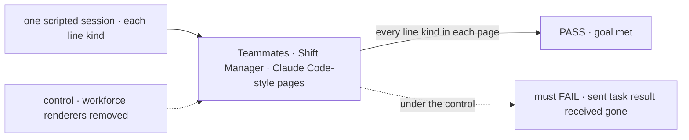
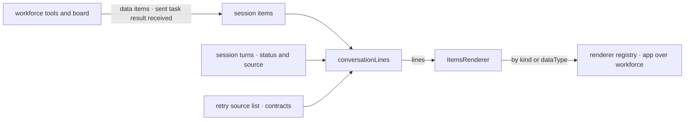

# FIX-2848 · One conversation model: React owns turn-aware conversation lines, workforce registers its line types, and Teammates and Shift Manager delete their copies

**Spec** · [Decisions](DECISIONS.md)

## Six people, before and after

| Someone who… | Today | After |
|---|---|---|
| **sees a turn fail in Teammates** | A failed line with Retry, worked out by Teammates' own `toEntries` from a copy of the engine's retry list | The same line, worked out by React. The retry list exists once |
| **sees a worker's turn fail or get stopped in Shift Manager** | The registry's plain red error text. No Retry, and no line where a stopped turn ended | The same failed line (Retry where the engine retries the turn) and stopped line Teammates draws |
| **watches a worker message another, file a task and get its result** | Each app reads the `sendMessage` and `createTask` calls and the board's ending line its own way: Shift Manager's *Asked Ada*, Teammates' sent line | Workforce writes each one as a `data` item and draws it with its own renderer. An app replaces the look by registering its own |
| **builds a new conversation screen**, such as the message board plugin ([FIX-2839](https://linear.app/fixpoint-labs/issue/FIX-2839)) | Writes a fourth copy of the decoding | Calls React's model and spreads workforce's renderers |
| **opens a conversation stored before this ships** | Sent, task and result lines show | Those three show as ordinary steps and messages. No compatibility read ([D1](DECISIONS.md#d1)) |
| **adds a source the engine retries** | Edits the engine, two lab copies and two sync tests | Edits one list |

Claude Code-style's `entriesOf` is a third copy the issue doesn't name; it moves too ([D2](DECISIONS.md#d2)).

## The goal, and how we'll know it's met

**Every app that shows a conversation draws it from React's one model and workforce's
renderers, and none of them reads conversation items itself.**

| Is it the right goal? | |
|---|---|
| **The real need** | "Nothing in either is unique to the app." One model the framework owns, so the next screen is not a fourth copy (the issue, decided by Jake on 2026-11-19) |
| **Smaller, and rejected** | "Move `toEntries` into React and keep the workforce lines app-side." The tool-call and notice decoding is the larger half, and Shift Manager would keep its copy |
| **Bigger, and not this issue's** | One model for every item view. The devtool shows raw items on purpose; kitchen-sink's turn notices are under *Leaves* |
| **Not done if** | Any app keeps a retry list, a sync test, or a function that turns items into its own entries · Shift Manager still has no stopped line · workforce lines show with workforce's renderers removed · a page goal in `goals/teammates-lab/`, `goals/shift-manager/` or `goals/claude-code-style-lab/` fails |



The check reads what each page draws. The control proves workforce's lines come through the
registry, not app code.

| How we verify | |
|---|---|
| **Goal check** | `goals/workforce-apps/one-conversation-model/` (new) · scripted model · real browser, run by the implementer at completion · verdict on the implementation PR |
| **Signal** | Each page draws all ten line kinds: user, assistant (streaming, then cut off), failed with Retry, stopped, steps, approval with its answer, sent, received, task, result |
| **Input** | One session holding each kind once. Moving the stopped turn before the failed one must pass too |
| **Anti-game** | Don't assert on `conversationLines`' return or a component test. Both pass while an app still decodes items |
| **Control that must fail** | `GOAL_CONTROL=no-workforce-renderers` must FAIL on sent, task, result and received. Today's `main` must FAIL on Shift Manager's stopped line |

## What changes


Three decoders become one model and one set of renderers. Red goes; green is what each app calls.

**A conversation screen, as an app writes it:**

```diff
- const entries = toEntries(items, workers, ended, retryable, stopped)
- return entries.map((entry) => <Entry key={entry.id} entry={entry} />)
+ const lines = conversationLines(items, turns) // turns: { id, status, source }[]
+ return (
+   <FlowProvider renderers={{ ...appRenderers, data: { ...workforceRenderers, ...appRenderers.data } }}>
+     <ItemsRenderer lines={lines} />
+   </FlowProvider>
+ )
```

**Docs:** update `client/react.md` (a *Conversation lines* section: the kinds, turns, Retry)
and `api/react.md`; update `workforce/ui.md` (workforce's renderers) and
`workforce/messaging-workers.md` (a send is a `data` item); the React and workforce READMEs.
No new page.

## How a line reaches the screen



The model alone knows turns; the registry alone knows how a line looks.

## What stays as it is

- The engine's retry route and its rule.
- Each app's look: it registers its own components for the lines.
- Teammates' divider (`windowMarkOf`) and its *is answering* read (`answeringOf`), FIX-2772's.
- The devtool's raw item view.

## What's already here, and the debt

| Already here | What this does with it |
|---|---|
| Ways to turn a conversation's items into lines (searched `toEntries`, `entriesOf`, `callRuns`, `buildItemRenderStream`, `suspension_resume`, `kind: "stopped"` across `packages/`, `labs/`, `apps/`) | **Four today, one after.** Closest: `react` · `buildItemRenderStream`, which becomes the model; the three app copies go. The registry's `request-group` already builds on it |
| `react` · `ItemsRenderer`, `toolGroupRenderer`, the approval receipt | **Extends.** Draws lines; the approval keeps its `resolution` |
| Engine `PUBLIC_REENTRY_SOURCES` | **Moves** to contracts, re-exported by core; the engine imports it |
| Workforce `workforce:received` | **Builds on.** Sent, task and result follow it ([D1](DECISIONS.md#d1)) |
| [FIX-2738](https://github.com/fixpoint-labs/flow-state-dev/pull/5284): one `data` kind, drawn only through a registered renderer | **Kept and applied** to workforce's lines |
| [FIX-2772 → Decided, not asked](../FIX-2772/DECISIONS.md#decided-not-asked): running, stopped and retryable read the turns view | **Kept.** The model takes those turns as input |

| Adds | Existing piece considered | Why it doesn't fit / how composed |
|---|---|---|
| Turns as an input to the model, and the stopped and failed lines | `react` · `buildItemRenderStream` | Composed: the same filter and grouping, plus a turn list it can't read off items |
| `workforce:sent`, `workforce:task`, `workforce:result` data types | `workforce:received`; orchestration's `task-change` | Same pattern as received. `task-change` is a board record; joining it in the browser is the decoding this removes |
| `workforceRenderers` on `workforce/react` | Shift Manager's `ReceivedMessage` and message-call line; Teammates' entry components | Moved into the package, not written new |

| The debt | |
|---|---|
| **Removes** | Teammates' `toEntries`, `items.ts`, `steps.ts` · Shift Manager's `callRuns`, `UNDRAWN` and message-call decoding · Claude Code-style's `entriesOf` and `withStopped` · two retry-list copies and two sync tests |
| **Adds** | One rule: a tool call that wrote a line is not a step. Permanent by design: without it each sent message also shows as a step |
| **Leaves** | The browser can't see a host's extra retry sources, so Retry is not offered on those turns · kitchen-sink's harness turn notices read turn status their own way |

**Net: down.** Three decoders and two list copies go; one rule is added.

## Sign off

**[The goal](#the-goal-and-how-well-know-its-met), at that size:** all three apps, measured on
the page. If wrong: a model in React that the apps call while still decoding beside it.

**[The debt](#whats-already-here-and-the-debt), net down:** three decoders go, one rule is added.
If wrong: a fourth decoder in the message board plugin.

1. **[D1](DECISIONS.md#d1) · Sent, task and result are `data` items the server writes, not lines
   a workforce reader decodes in the browser.** If wrong: conversations stored before this lose
   those three lines for good.
2. **[D2](DECISIONS.md#d2) · Claude Code-style moves to the model too.** If wrong: a larger PR
   for a lab nobody asked about.

**Open: none.** D1 is the one to weigh. Implementation starts after
[#5473](https://github.com/fixpoint-labs/flow-state-dev/pull/5473) merges: it moves the Teammates
code this deletes.

Improvement · `contracts` `core` `engine` `react` `workforce` `orchestration` `shift-manager`, two labs · large · no epic
