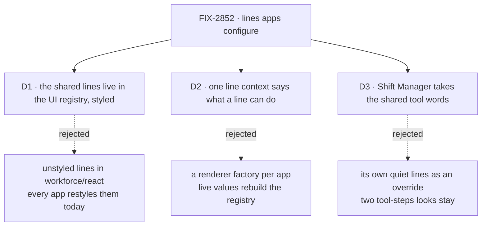

# FIX-2852 · Decisions

[Spec](SPEC.md) · **Decisions**

Jake set the goal on FIX-2848's review: granular components with the structure done, apps that
configure them, and app source that shrinks with registry copies left out of the count. These
are the three calls that shape how.

## The tree

Solid edges are what you're signing. Dashed edges lost, and the label says why.

## D1 · The shared lines live in the UI registry, styled, instead of unstyled in `workforce/react`

| | |
|---|---|
| **Instead of** | Granular, unstyled line components in `workforce/react` (and the failed and stopped lines in `react`), themed by `data-line` attributes and `--fsd-panel-*` properties, as `workforceRenderers` and the workforce panels are today |
| **Because** | Apps don't adopt unstyled lines: Teammates replaces all four of `workforceRenderers`, Shift Manager replaces the two it styles most (sent, received), and no app uses the workforce panels. Every app's look is Tailwind and the registry's tokens, which the registry carries and a package can't. The registry already holds workforce-aware pieces (`task-actions`, `task-signals`), and a byte-identical copy costs an app nothing on the count Jake asked for (tenet 2: the framework absorbs what every app was writing) |
| **Locks in** | Two registry items, `conversation-lines` (no workforce import) and `workforce-lines` (depends on it), installed with `fsdev ui add`. `workforceRenderers` leaves `@flow-state-dev/workforce/react` before it releases; `react`'s plain *Stopped* fallback stays |

![D1, where the shared lines live. Chosen: the UI registry, styled. Instead of: unstyled components in workforce/react. It comes down to the first criterion: whether apps adopt them as they are; Shift Manager and Teammates restyle the unstyled ones today. The price is the second criterion: a fix reaches an app when it refreshes its copy. A tie: the lines behave the same. Locks in two registry items and workforceRenderers leaving workforce/react. Flips if a host without the registry needs workforce lines by default](figures/d1-lines-in-the-registry.svg)

It comes down to adoption: the unstyled lines get restyled in Shift Manager and Teammates, and those restyles are the copies this issue removes.

**What would change my mind:** a host we support that draws a workforce conversation with no
Tailwind and no registry. None in this repo does.

## D2 · One line context says what a line can do on its screen, instead of a renderer factory per app

| | |
|---|---|
| **Instead of** | A factory each app calls, `workforceLines({ nameOf, avatarOf, openTask })`, returning its registry fragment |
| **Because** | Half of what a line needs is live and per screen: Retry for this session, the work still running, whether this screen answers an approval (a popup doesn't). In a factory those values rebuild the registry on each change, which FIX-2848's review asked us to keep stable. One context replaces the three apps have today (Teammates' `LineContext`, Shift Manager's `TurnLineContext`, Kitchen Sink's retry context) |
| **Locks in** | One context in `conversation-lines`: `who`, `nameOf`, `avatarOf`, `openTask`, `openMessage`, `retry`, `stillRunning`, `onViewRunning`, `canAnswer`, `readFile`. Each field optional; a line outside a provider draws with no action, as Teammates' popups want |

It comes down to live, per-screen values: in a factory, Retry for this session rebuilds the registry.

## D3 · Shift Manager's tool lines take the shared words, instead of keeping its own as an override

| | |
|---|---|
| **Instead of** | Shift Manager keeping its quiet lines (*Used discover*, *Used 3 tools, one failed*) registered over the shared steps line |
| **Because** | Four tool-steps copies are the largest duplicate. Teammates and Claude Code-style already draw from the registry's `tool-grouping` words, and Kitchen Sink from its `ToolGroup`. Shift Manager's one rule the others lack, a failed call that a later call of the same tool redid reads *Tried …*, moves into `tool-grouping` for all of them |
| **Locks in** | Shift Manager's tool lines read *Read src/a.ts*, *Read 2 files and searched the code*. Its page goals' tool wording updates. The steps line has one look and a `compact` variant (Teammates, then Claude Code-style) |

It comes down to how many tool-steps looks stay: an override keeps two.

**What would change my mind:** Shift Manager's wording is a deliberate product voice. Then it
stays as one override of the steps line, about 120 lines, and the count still drops.

## Decided, not asked

- **The model is untouched.** No new option on `conversationLines` or `ItemsRenderer`; FIX-2848's
  "no renderer, no line" holds (the guard against a per-app option bag, from its review).
- **The failed line offers Retry when `line.retryable` and the context has `retry`**, the rule
  both apps use today. **Which stopped line says the work still running** is decided once, in the
  shared piece, not per app.
- **A task's brief folds through a wrapper over any message renderer**, so Teammates keeps its
  bubbles and Shift Manager the registry's `Message`.
- **The approval card reads the line's answer** (`line.resolution`) and `canAnswer`, so
  Teammates' own card goes.
- **Shift Manager's task run draws its lines** through the same renderers, not flattened to
  items; its pending-ask override stays, and it passes no `retry`.
- **What stays each app's own**: Teammates' live task card and message bubbles; Shift Manager's
  coordinator route, board summary, labels and times; Claude Code-style until FIX-2848's slice 3.
- **The count is [`count.mjs`](poc/line-count/count.mjs)**: identical copies count 0, a changed
  copy counts its changes, and a line file nobody listed fails the run.

## Considered and dropped

| Alternative | Why not |
|---|---|
| Unstyled lines in `workforce/react` | D1 |
| A renderer factory per app | D2 |
| Keep Shift Manager's tool words | D3 |
| Keep `workforceRenderers` beside the registry's lines | Two default looks for one line, and the unstyled one has no app |
| Move Kitchen Sink's failed turn now | It decides Retry without turns; [FIX-2853](https://linear.app/fixpoint-labs/issue/FIX-2853) |

## Settled

**The factual base is counted, with a control.** `count.mjs --root <#5495 head ce22f39a8>`:
Shift Manager 1,214 (8 line files, 36 identical copies), Teammates 783 (4 line files, one changed
copy at 14 lines, 20 identical), Kitchen Sink 101, Claude Code-style 777. `--control`: PASS on a
changed copy (+3), an identical copy (+0), a listed file grown by 4 (+4), and a renamed, unlisted
line renderer (the run fails). On `main` (`982246623`), before FIX-2848's second slice, the three
apps count 2,139.

## Analysis

2026-11-20 · watermark 2026-11-20 (issue filed) · **Right approach.** Run by the author, so a
reviewer should treat it as unchecked.

1. **Reuse** — both items wrap registry pieces (`request-recovery`, `ToolGroup`, `approval`) or move
   them (`workforceRenderers`); nothing new beside an existing piece.
2. **Prior art** — shadcn's model the registry already follows: copy, then configure.
3. **Other shapes** — D1's package route; D2's factory.
4. **New factors** — Kitchen Sink's third failed-turn wrapper (left, FIX-2853).
5. **Necessity** — three apps, about 800 duplicated lines, a fourth app in slice 3.
6. **Ergonomics** — two `fsdev ui add`s, one spread, one provider.
7. **Concerns** — a copy that drifts. The count catches it in each app.

## How it got here

- **Draft** — the apps' copies of failed, stopped, workforce, brief and tool-steps lines,
  measured; shared as two styled registry items and one line context, built on FIX-2848's model
  and the registry's `request-recovery`, `ToolGroup` and `approval`.

## Notes from review

None yet.

**Open: none.**
