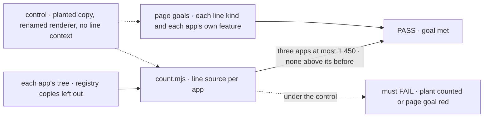
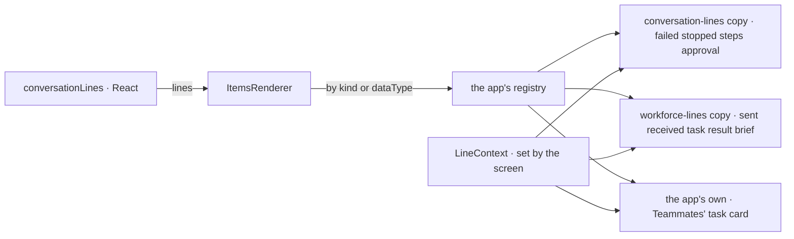

# FIX-2852 · Conversation line components apps configure instead of copy

**Spec** · [Decisions](DECISIONS.md)

## Seven people, before and after

| Someone who… | Today | After |
|---|---|---|
| **builds a workforce app's conversation screen** | Writes its own failed, stopped, sent, received, result, brief and steps lines and a context to feed them, or takes workforce's unstyled defaults | Installs two registry items and configures them: names, avatars, what a click opens, Retry ([D1](DECISIONS.md#d1), [D2](DECISIONS.md#d2)) |
| **sees a worker's turn fail or get stopped** in Shift Manager or Teammates | The same line, from two near-identical wrappers around `request-recovery` | The same line, from one shared failed line and one stopped line |
| **reads a worker's tool calls in Shift Manager** | Shift Manager's own words: *Used discover*, *Used 3 tools, one failed* | The words every other app uses: *Read src/a.ts*, *Read 2 files and searched the code*. *Tried discover* moves into the shared words ([D3](DECISIONS.md#d3)) |
| **clicks a teammate's sent or result line in Teammates** | Opens the exchange or the task, beside the teammate's avatar | Unchanged. Teammates sets `openMessage`, `openTask` and `avatarOf`; its live task card stays its own |
| **opens a task's run in Shift Manager** | Lines flattened back to items: no stopped line, calls drawn one by one | The run's lines draw as the conversation's do, stopped line included. Still no Retry there |
| **watches a worker message another in Kitchen Sink** | Workforce's unstyled lines | The registry's lines, the same look as the other apps. Its failed turn stays its own ([FIX-2853](https://linear.app/fixpoint-labs/issue/FIX-2853)) |
| **fixes how a line behaves** | In three or four apps | In the registry once; each app refreshes its copy |

## The goal, and how we'll know it's met

**Shift Manager, Teammates and Kitchen Sink draw every line kind the issue names from shared
registry components they only configure, and the line source they write themselves goes down,
from 2,098 lines to at most 1,450.**

| Is it the right goal? | |
|---|---|
| **The real need** | "More granular components that can be customized, but the complex structure is done for the user", and app source that shrinks, not counting lines that "are nothing more than copies of the component library" (Jake, on FIX-2848) |
| **Smaller, and rejected** | Share only the failed and stopped lines. The sent, received and result lines and the four tool-steps copies are most of the duplicated source |
| **Bigger, and not this issue's** | Claude Code-style, which FIX-2848's third slice moves straight onto these components. Changing how `fsdev ui add` copies the registry |
| **Not done if** | An app still defines its own failed, stopped, sent, received, result, brief or steps line, or its own line context, except Kitchen Sink's failed turn ([FIX-2853](https://linear.app/fixpoint-labs/issue/FIX-2853)) · the count is down because a feature went: Teammates' avatars, click-through or live task card, Shift Manager's Messages link, coordinator route or board summary · a registry copy is edited in an app and not counted · a line kind draws in an app without its renderer |



| How we verify | |
|---|---|
| **Goal check, leg 1** | [`poc/line-count/count.mjs`](poc/line-count/count.mjs) `--root <implementation checkout>`. Today (#5495 head `ce22f39a8`): Shift Manager **1,214**, Teammates **783**, Kitchen Sink **101**, three apps **2,098**; Claude Code-style 777 |
| **Goal check, leg 2** | `goals/teammates-lab/` and `goals/shift-manager/` pass, Shift Manager's tool wording updated ([D3](DECISIONS.md#d3)); `goals/workforce-apps/configured-lines/` (new) asserts each app's own feature on the page |
| **Signal** | Leg 1: three apps at most 1,450, none above its before. Leg 2: each page draws failed with Retry, stopped, sent, received, task, result, brief and steps, plus Teammates' avatar, click-through and live task card, and Shift Manager's Messages link |
| **Anti-game** | Not a line count alone: deleting a feature lowers it too, which leg 2 catches. Every file that draws a line is counted or declared out with a reason; an unlisted one fails the run |
| **Control that must fail** | `count.mjs --control` plants a changed copy, an identical copy and a renamed line renderer; each must be caught, and it passes today. `GOAL_CONTROL=no-line-context` must FAIL on Retry, the avatars and the click-through |

## What changes


Each app keeps only what is its own; everything else is one registry copy it configures.

**Teammates' registry and conversation, as the lab writes them:**

```diff
  export const teammatesRenderers: RendererRegistry = {
-   message: MessageLine, error: FailedLine, suspension: ApprovalLine, stopped: StoppedLine,
+   ...conversationLineRenderers,            // failed, stopped, approval: registry copy
+   message: withBrief(MessageLine),         // the lab's bubbles; a task's brief folds
    status: false, source: false, block_trace: false,
-   data: { ...workforceRenderers, [SENT_MESSAGE_DATA_TYPE]: SentLine, [RECEIVED_MESSAGE_DATA_TYPE]: ReceivedLine,
-           [FILED_TASK_DATA_TYPE]: TaskLine, [TASK_RESULT_DATA_TYPE]: ResultLine },
+   data: { ...workforceLineRenderers, [FILED_TASK_DATA_TYPE]: TaskLine }, // the live task card stays the lab's
  };

- <LineContext.Provider value={screen}>      // the lab's own LineScreen
+ <LineContext.Provider value={{ who: workerName, nameOf, avatarOf: (id) => <Avatar look={lookOf(id)} size="sm" />,
+                               openTask, openMessage, retry, stillRunning, canAnswer: true }}>
-   <ItemsRenderer lines={[line]} toolGroupRenderer={StepsLine} />   // over the lab's ToolRun
+   <ItemsRenderer lines={[line]} toolGroupRenderer={CompactSteps} /> // registry copy
```

**Docs:** `apps/docs/docs/ui/flow-aware-components.md` gains a *Conversation lines* section (the
two items, the line context, the compact steps line) after *RequestRecovery*;
`apps/docs/docs/workforce/ui.md` → *Messages between workers* points at `workforce-lines` in
place of `workforceRenderers`. `packages/workforce/README.md` drops `workforceRenderers`. A
`patch` changeset for `workforce`, or FIX-2848's pending one amended if it has not released. The
registry (`@flow-state-dev/ui`) is private: no changeset.

## How a line reaches the screen



The model decides what each line is; the registry copy decides how it looks; the screen's line
context says what a line can do there.

## What stays as it is

- React's model, `ItemsRenderer` and the registry's slots. No new option on the model.
- FIX-2848's rule: no renderer, no line.
- Each app's frame: Shift Manager's labels, times and composer; Teammates' bubbles and divider.
- Claude Code-style, until FIX-2848's third slice.

## What's already here, and the debt

| Already here | What this does with it |
|---|---|
| Ways to give a line its screen's actions: Teammates' `LineContext`, Shift Manager's `TurnLineContext`, Kitchen Sink's `FailedTurnRetryContext`. Mechanism entries `react` and `workforce-panels`; searched `createContext`, `retry`, `stillRunning`, `openTask` across `labs/`, `packages/`, `apps/` | **Three today, one after**, plus Kitchen Sink's until [FIX-2853](https://linear.app/fixpoint-labs/issue/FIX-2853) |
| Ways to draw a run of tool calls: the registry's `ToolGroup` and `tool-grouping`, Shift Manager's `ToolLine`, Teammates' `ToolRun`, Claude Code-style's `tool-steps` | **Four today; two after, one in slice 3**. All draw from `tool-grouping` |
| Registry `request-recovery`, `approval`, `chat-assistant` | **Extended**: the failed and stopped lines wrap `request-recovery`; `approval` reads the line's answer and `canAnswer` |
| FIX-2848 · [D1](../FIX-2848/DECISIONS.md#d1), *Decided, not asked* | **Kept**: the line kinds and data types. **Amended in part**: `workforceRenderers` leaves `workforce/react` for the registry before it releases ([D1](DECISIONS.md#d1)) |
| `workforce-panels` (`Roster`, `BoardColumns`), unstyled in `workforce/react` | **Kept.** No app uses them; their place is not this issue's |

| Adds | Existing piece considered | Why it doesn't fit / how composed |
|---|---|---|
| `conversation-lines`: the line context, failed, stopped, steps (with `compact`) | `request-recovery`, `ToolGroup`, the three app contexts | Composed: wraps both registry pieces; one context replaces three |
| `workforce-lines`: sent, received, task, result, the brief fold | `workforceRenderers`; the apps' copies | Moved and merged: one styled look per line |

| The debt | |
|---|---|
| **Removes** | Shift Manager's `ToolLine` quiet lines, `TurnLines`, `TaskBrief`, `ReceivedMessage`, `SentMessage` and `TaskSession`'s flattening · Teammates' `FailedLine`, `StoppedLine`, `ApprovalLine`, `SentLine`, `ReceivedLine`, `ResultLine`, `LineContext` and `ToolRun` · `workforce/react`'s `lines.ts` |
| **Adds** | Two registry items, about 400 lines, and their copies in each app, uncounted as the issue asks. Permanent by design |
| **Leaves** | Kitchen Sink's failed turn, which decides Retry without turns ([FIX-2853](https://linear.app/fixpoint-labs/issue/FIX-2853)) |

Measured with [`count.mjs`](poc/line-count/count.mjs): app line source **2,098 → at most 1,450**
across the three apps (about 1,300 expected); registry and `workforce/react` line source about
+280 (`count.mjs --base <main checkout>` prints that delta over the shared files this issue touches; 1,008 lines today). **Net: down**, by about 500 lines with the shared homes counted.

## Sign off

**[The goal](#the-goal-and-how-well-know-its-met):** three apps, 2,098 → at most 1,450 app
lines, each app's own feature still on the page. If wrong: apps that configure the shared lines
and still keep a copy beside them.

**Debt: net down.** Removes the apps' own failed, stopped, approval, sent, received, result, brief
and tool-steps lines and three contexts; adds two registry items. If wrong: a registry item no
app adopts as it is.

1. **[D1](DECISIONS.md#d1) · The shared lines live in the UI registry, styled**, not unstyled in
   `workforce/react`. If wrong: hosts without the registry get no workforce lines by default.
2. **[D2](DECISIONS.md#d2) · One line context carries what a line can do on its screen**, not a
   renderer factory per app. If wrong: a line outside a provider draws with no actions, silently.
3. **[D3](DECISIONS.md#d3) · Shift Manager takes the shared tool words.** If wrong: its people
   relearn a few phrases, and *Used discover* is back as one override.

Starts on FIX-2848's second slice ([#5495](https://github.com/fixpoint-labs/flow-state-dev/pull/5495));
lands before its third. **Open: none.**

Improvement · `ui` registry, `workforce`, `shift-manager`, Teammates, Kitchen Sink · medium · no epic
