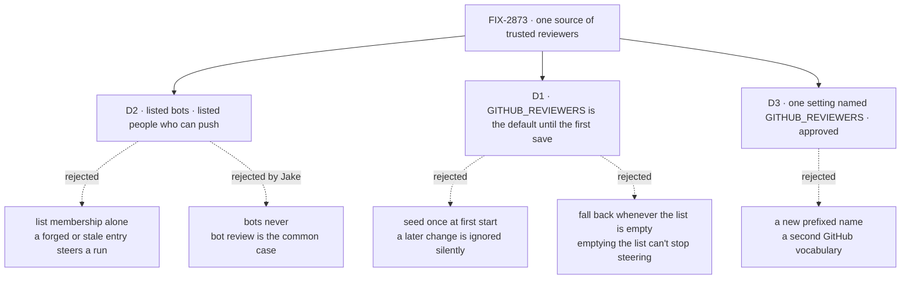

# FIX-2873 · Decisions

[Spec](SPEC.md) · **Decisions**

What was considered, what was chosen, why, and what each choice locks in. Jake approved D3 and
the bot half of D2. The write-check half of D2, D1, and one open question are his to answer.

## The tree

Solid edges are what you're signing. Dashed edges lost, and the label says why.

## D2 · A listed bot is heard. A listed person is heard only when they can also push to the repository

**Jake's words:** "Bots can trigger code changes (this is the most common case). Whatever
accounts are in our list are allowed." **The bot half is his call and is settled.** Read
literally, "whatever accounts" also drops FIX-2789's per-comment write check. **I recommend
keeping that check for people**, and this card argues it. Bots skip it: GitHub can't answer a
write check for an app, and only an app installed on the repository can comment there.

| | |
|---|---|
| **Instead of** | List membership alone, with no write check, which is the literal reading. Or "bots never", which Jake rejected |
| **Because** | The list is only as safe as its write path. Cursor's security review showed a run can rewrite it: Teammates makes every HTTP caller the operator, and Shift Manager's owner bearer is a constant in its source ([POC](poc/save-action/save-action.poc.ts)). The public save action goes, but a run on these hosts can still forge the tool's turn and its Approve over HTTP: an accepted residual, fixed by [FIX-2882](https://linear.app/fixpoint-labs/issue/FIX-2882). Until then, the write check means a forged or stale person entry adds only someone who can already push. A forged bot entry is bounded too: a GitHub App can comment only on a repository it is installed on, which takes an org owner or repo admin (settled below). The exception is `github-actions[bot]`, which posts whatever a workflow posts, so it should never be listed. Without the write check, a forged person entry hands steering to anyone |
| **Locks in** | A listed person who loses write access stops being heard. Teammates gains one GitHub call per comment from a listed person. A listed bot is as trustworthy as the app's installation on the repository |

It comes down to a forged or stale entry: without the check, it steers a run that pushes.

**What would change my mind:** both hosts proving who a caller is, so only the operator, in
person, can change the list. Then membership alone is a safe gate.

## D1 · `GITHUB_REVIEWERS` is the list's default until the list is first saved. After that, only the saved list counts, an emptied list included

| | |
|---|---|
| **Instead of** | Seeding the store once from the setting at first start, or falling back to the setting whenever the saved list is empty |
| **Because** | An operator who empties the list means "nobody". A fallback on emptiness would bring the setting's accounts back, so the list could never stop all steering. "Never saved" is whether a stored row exists, which the engine already decides for a resource's definition content. It is never whether the list has entries: `githubLoginsListed(null)` and an emptied list both read `[]` |
| **Locks in** | The setting is a default, never an override. After the first save, changing `GITHUB_REVIEWERS` does nothing, with no warning. Anything that deletes the row (a store wipe, a reset) brings the setting back, even after the operator emptied the list |

It comes down to emptying the list: a fallback on emptiness re-trusts the setting's accounts.

**What would change my mind:** operators who manage trust only through their environment. Then
the setting should win, and the tool should go.

## D3 · The one setting is `GITHUB_REVIEWERS`, read by workforce beside `GITHUB_TOKEN` · approved

**Approved by Jake on #5561:** "I'm fine with GITHUB_REVIEWERS".

| | |
|---|---|
| **Instead of** | A new name, such as `FSD_GITHUB_REVIEWERS` |
| **Because** | An operator sets up GitHub once: `GITHUB_TOKEN` and `GITHUB_REVIEWERS`, both read by workforce, so no app spells its own |
| **Locks in** | A public setting every app reads. An operator who kept it from before FIX-2789 gets those accounts back as the default on a store that never saved a list |

It comes down to one GitHub setup: the token and the reviewers, under one prefix.

## Decided, not asked

- **The only write path is the coordinator tool. No HTTP route writes the list, in either app.**
  A security fix, not a fork. The raw `setGitHubReviewers` action goes from what workforce
  exports and from Shift Manager. An in-process caller, such as a test, may keep it as an
  internal action, which the engine never routes from HTTP. Teammates' Lead gets the tool. This
  is settled, below.
- **Bot admission is per subscription, never service-wide.** The service's `trustedBots` is not
  fed from the list, because the sender screen applies it to every GitHub subscription, at
  routing and at delivery. The run's follow carries a row setting, beside `outsiders`, that hands
  a bot on to that row's list screen. Only host code sets it, and only on a row that lists a
  custom screen. A listed bot never wakes an ordinary subscription.
- **Forgeable coordinator writes are an accepted residual** here. A run calling its host app over
  HTTP as the operator is [FIX-2882](https://linear.app/fixpoint-labs/issue/FIX-2882)'s.
- **Users and bots stay apart** in the list: `name[bot]` matches only a bot sender, and a plain
  login only a user. A user who registers a listed bot's name is refused (#5540's fix).
- **The list moves into workforce** with the tool and screen, about 250 to 350 lines. Move the
  tool's check, judge and approve steps as they are. Shift Manager's `operatorGitHub` and
  `operatorGitHubToken` fold into workforce's, keeping `interestModel` and the custom screens.
- **The convergence point for "who may steer a run" is the list screen**, listed first by
  `reviewers.follow`. Both hosts follow through it. A provider-level screen was rejected,
  because it would also screen the operator's own GitHub routines.
- **The document keeps the ref `github-reviewers`** and its frontmatter, so a saved list still
  reads. The default and a save share one document builder.
- **`GITHUB_REVIEWERS` is read when `githubTrustedReviewers()` is called** at host start, not
  at import, so a `.env` loaded first still applies.
- **"Never saved" is the engine's stored-row test**, never an emptiness test. A control pins it.
- **`TEAMMATES_GITHUB_REVIEWERS` goes with no alias** (the architect's fence). Whether to warn
  is open, below.
- **Teammates always follows a run's pull request**, so an account added later is heard. With no
  `GITHUB_TOKEN`, the run shows a note that the pull request isn't followed.
- **FIX-2686's spec names one source**: workforce's `github-reviewers` document, read per event.
  A listed bot is heard, and a listed person also needs write access. A comment on FIX-2686 says so.
- **`reviewedPullRequestFollow` and `githubReviewers` are removed, not deprecated.** Neither has
  shipped.

## Considered and dropped

| Alternative | Why not |
|---|---|
| Rename the setting and stop | One name, two rules. The issue's smaller goal |
| Keep the folder file as a second default | Two defaults is two sources |
| The default read in the screen (`null` gives the setting's accounts) | The saved list the operator sees reads empty while the setting's accounts pass |
| Seed the store once at start | A start-time write per app, and a seeded row looks like the operator's choice. Lost in D1 |
| Keep a public save action behind a bearer | Shift Manager's bearer is a constant in source; Teammates has none |
| A keyed `providers` slot, or a GitHub kit | [FIX-2874](https://linear.app/fixpoint-labs/issue/FIX-2874), after the release |

## Open · Warn at start when `TEAMMATES_GITHUB_REVIEWERS` is still set?

**Plain terms.** The old Teammates setting stops working. If the operator forgets to rename the
line, runs quietly stop hearing review. A one-line warning at start would name the new setting.

**The trade-off.** A warning catches a missed rename. It is also code for a name that no longer
exists, which nobody owns removing, and the architect fenced compatibility out.

**My recommendation: no warning.** One operator runs Teammates, and the implementation PR tells
them to rename one line.

**What would change my mind:** anyone besides Jake running Teammates.

**If I'm wrong:** a missed rename silences PR review in Teammates until someone notices, with no
error to point at it.

## Settled

- **No HTTP route may write the list** — **CONFIRMED** by
  [`poc/save-action`](poc/save-action/save-action.poc.ts) on `main` `bb1c09790`. Over Shift
  Manager's real HTTP door, the member's bearer left the list unchanged, and the owner's bearer
  rewrote it to `mallory`. The engine never routes an internal action from HTTP
  (`engine/src/execution/resolve-action-core.ts`).
- **Three sources today** — **CONFIRMED** by [`poc/sources/check.sh`](poc/sources/check.sh) on
  `main`: `PASS (today)`, `1 1 2 2 1 1 0`. The planted control fails. `--after` fails with
  `want 0 0 1 0 0 0 0`. Counter 7 (`list_fed_trusted_bots`) is a guard that reads 0 today; a
  planted `trustedBots: reviewers.bots` turns it red.
- **A stored row wins over the definition content, even an emptied list. A `contentTemplate`
  would win over a stored row** — read in `engine/src/context/resource-registry.ts`. Cursor's
  review confirmed the first half.
- **The sender screen passes collaborators and refuses bots outside `trustedBots`, and
  `trustedBots` is service-wide** — read in `workforce/src/subscriptions/screens.ts` and
  `workforce/src/service-flows/service-flow.ts` (the chain at routing, and the screens again for
  each subscription at delivery). Codex's round-2 finding; it holds.
- **A GitHub App can comment only on a repository it is installed on** — **CONFIRMED** from
  GitHub's docs. Creating an issue or pull-request comment needs the Issues or Pull requests
  **write** repository permission
  ([permissions for GitHub Apps](https://docs.github.com/en/rest/authentication/permissions-required-for-github-apps)).
  An installation token reaches only the repositories its installation was granted
  ([authenticating as an installation](https://docs.github.com/en/enterprise-cloud@latest/apps/creating-github-apps/authenticating-with-a-github-app/authenticating-as-a-github-app-installation)).
  Public visibility opens reads only. Installing takes an org owner or a repo admin. Exception:
  `github-actions[bot]` relays whatever a workflow posts.

## Analysis

2026-11-22 · watermark 2026-11-20 (#5540) · **Right approach.** Run in this session, not by an
independent agent: this worker had no sub-agent tool.

1. **Reuse** — every Adds row moves or extends an existing piece. See
   [Builds on / Adds](SPEC.md#whats-already-here-and-the-debt).
2. **Prior art** — a default under a user-edited value is the common shape. Confirms D1.
3. **Other shapes** — the setting as the only source loses edit without restart.
4. **New factors** — Jake's reversal of D2, and Cursor's write-path finding. Both folded.
5. **Necessity** — two trust paths disagree on a security boundary.
6. **Ergonomics** — one setting, beside the token.
7. **Concerns** — caller identity in both hosts: an accepted residual, [FIX-2882](https://linear.app/fixpoint-labs/issue/FIX-2882).

## How it got here

- **Draft** — framed as three sources deciding trust differently. One stored list in workforce,
  defaulted from `GITHUB_REVIEWERS` through the resource's definition content.
- **Review round 1** — D2 flipped: Jake ruled that listed bots are heard. Cursor's security
  review showed a run could rewrite the list over HTTP, so the public save action went, the
  tool became the only write, and the write check stays for people as a backstop. D3 approved.
  The list screen stays first, so FIX-2880's evaluator has a place after it.
- **Review round 2** — Codex: bot admission moved from the service-wide `trustedBots` to the run's
  follow, because the service-wide gate would let a listed bot wake any subscription. The goal
  narrowed to "no direct HTTP write", with forged coordinator writes an accepted residual
  ([FIX-2882](https://linear.app/fixpoint-labs/issue/FIX-2882)), and D2 now states the bot bound.

## Notes from review

- "Move it as is — no reshaping of the coordinator tool's judge/approve sequencer while moving it." — second-look comment ([#5561](https://github.com/fixpoint-labs/flow-state-dev/pull/5561#issuecomment-7086496831))
- "Preserve today's `interestModel: JUDGE_MODEL` + custom screens wiring." — cursor ([thread](https://github.com/fixpoint-labs/flow-state-dev/pull/5561#discussion_r4660238384))
- "Name each counter in the file header and in the echo line." — cursor ([thread](https://github.com/fixpoint-labs/flow-state-dev/pull/5561#discussion_r4660238387)). Done in `check.sh`.

These are inputs, not instructions.
