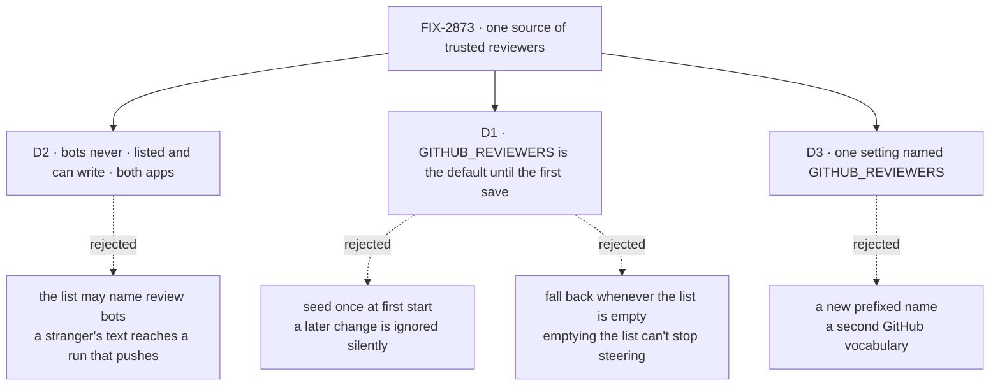

# FIX-2873 · Decisions

[Spec](SPEC.md) · **Decisions**

What was considered, what was chosen, why, and what each choice locks in. Three decisions are
the sign-off surface. D2 is the one to weigh.

## The tree

Solid edges are what you're signing. Dashed edges lost, and the label says why.

## D2 · One screen in both apps: listed, can write to the repository, never a bot. Teammates' runs stop hearing review bots and listed outsiders

| | |
|---|---|
| **Instead of** | Letting the stored list name review bots (`greptile-apps[bot]`), heard without a write check, as Teammates does today |
| **Because** | A run acts on what it hears, with Bash and a push. A bot's review quotes the pull request and its comments, so a listed bot carries a stranger's words into that run. Nothing fences a delivery-woken turn yet ([FIX-2686](https://linear.app/fixpoint-labs/issue/FIX-2686)). Jake asked to keep FIX-2789's write check and "bots are never trusted" |
| **Locks in** | Teammates' runs answer only people with write access. Codex, Cursor, Greptile and Gitar review, which #5540 said is most review here, reaches a run only when a person relays it. Re-admitting bots is a new decision, best taken after FIX-2686 lands |

It comes down to a stranger's text: a listed bot quotes it into a run that can push.

**What would change my mind:** FIX-2686's fence shipping first, so a delivery-woken turn can't
push on a bot's say-so. Then listing bots by `name[bot]` in the same stored list is a small,
separate change.

## D1 · `GITHUB_REVIEWERS` is the list's default until the list is first saved. After that, only the saved list counts, an emptied list included

| | |
|---|---|
| **Instead of** | Seeding the store once from the setting at first start, or falling back to the setting whenever the saved list is empty |
| **Because** | An operator who empties the list means "nobody". A fallback on emptiness would bring the setting's logins back, so the list could never stop all steering. "Never saved" is whether a stored row exists, which the engine already decides for a resource's definition content. It is never whether the list has logins: `githubLoginsListed(null)` and an emptied list both read `[]` |
| **Locks in** | The setting is a default, never an override. After the first save, changing `GITHUB_REVIEWERS` does nothing, with no warning, and the operator edits the list instead. Before it, a changed setting applies on the next start. The saved list is what the operator sees, so the setting's logins show there too until a save |

It comes down to emptying the list: a fallback on emptiness re-trusts the setting's logins.

**What would change my mind:** operators who manage trust only through their environment, and
never through the list. Then the setting should win, and the save action should go.

## D3 · The one setting is `GITHUB_REVIEWERS`, read by workforce beside `GITHUB_TOKEN`

| | |
|---|---|
| **Instead of** | A new name, such as `FSD_GITHUB_REVIEWERS` |
| **Because** | An operator sets up GitHub once: `GITHUB_TOKEN` and `GITHUB_REVIEWERS`, both read by workforce's operator helpers, so no app spells its own. The name FIX-2789 retired meant "whose comments are trusted", and it means that again, now as a default |
| **Locks in** | A public setting name every app reads. An operator who kept `GITHUB_REVIEWERS` from before FIX-2789 gets those logins back as the default on a store that never saved a list. They are still checked for write access |

It comes down to one GitHub setup: the token and the reviewers, under one prefix.

## Decided, not asked

- **The list, its save action, the coordinator tool and the screen move into workforce** beside
  `trusted-reviewers.ts`, about 250 to 350 lines. Shift Manager's `operatorGitHub` and
  `operatorGitHubToken` fold into workforce's; `operatorGitHub` takes `reviewers` and the
  interest model. The architect fenced both.
- **The convergence point for "who may steer a run" is the trusted-reviewer screen** on the
  operator's GitHub provider. Every follow lists it: Shift Manager's coder flow and Teammates'
  harness kit. No other screen admits a sender to a run's pull request.
- **The document keeps the ref `github-reviewers`** and its frontmatter, so a list already saved
  still reads.
- **"Never saved" is the engine's stored-row test**, never `githubLoginsListed(...).length`. The
  goal check's control pins it.
- **A `[bot]` login in `GITHUB_REVIEWERS` refuses start, naming it.** It is a mistake to report.
- **`TEAMMATES_GITHUB_REVIEWERS` goes with no alias and no refusal**, per the architect's fence.
  The implementation PR tells the operator to rename the line.
- **Teammates always follows a run's pull request**, so a reviewer added later is heard. It gets
  the save action; giving Lead the tool is the app's call.
- **FIX-2686's spec names one source**: workforce's `github-reviewers` document, read per event
  with the live write check, defaulted by `GITHUB_REVIEWERS`. A comment on FIX-2686 says so.
- **`reviewedPullRequestFollow` and `githubReviewers` are removed, not deprecated.** Neither has
  shipped.

## Considered and dropped

| Alternative | Why not |
|---|---|
| Rename `TEAMMATES_GITHUB_REVIEWERS` to a shared name and stop | One name, two paths that still disagree on bots and write access. The issue's smaller goal |
| Keep the folder file as the default, the setting overriding it | Two defaults is two sources. The folder file goes |
| The default read in the screen (`null` gives the setting's logins) | The same trust, but the saved list the operator sees reads empty while the setting's logins pass |
| Write the setting's logins into the store at start (seed once) | A start-time write per app, and a seeded row looks like the operator's choice. Lost in D1 |
| A keyed `providers` or `topics` slot, or a GitHub kit | [FIX-2874](https://linear.app/fixpoint-labs/issue/FIX-2874), parked until after the release |

## Settled

- **Three sources and two helper copies today** — **CONFIRMED** by
  [`poc/sources/check.sh`](poc/sources/check.sh) on `main` `bb1c09790`: every matching file
  classified, `PASS (today)`. The planted control fails. `--after` fails on `main` with `counts 1
  1 2 2, want 0 0 1 0`, the red state the implementation turns green.
- **A stored row wins over the definition content, even an emptied list** — read in
  `engine/src/context/resource-registry.ts`, not run. The goal check's control runs it.
- **A refused follow fails no run** — read in `core/src/helpers/pull-request-recorder.ts`: it
  becomes a status note.

## Analysis

2026-11-22 · watermark 2026-11-20 (#5540) · **Right approach, one finding folded.** Run in this
session, not by an independent agent: this worker had no sub-agent tool.

1. **Reuse** — every Adds row moves or extends an existing piece. See
   [Builds on / Adds](SPEC.md#whats-already-here-and-the-debt).
2. **Prior art** — a default under a user-edited value is the common shape. Confirms D1.
3. **Other shapes** — the setting as the only source. It loses edit without restart.
4. **New factors** — #5540 chose the `allow` screen for bot review. **Folded**: D2 says it
   reverses that.
5. **Necessity** — two trust paths disagree on a security boundary.
6. **Ergonomics** — one setting, beside the token.
7. **Concerns** — D2 removes most of Teammates' heard review. Recorded as D2.

## How it got here

- **Draft** — framed as three sources deciding trust differently. One stored list in workforce,
  defaulted from `GITHUB_REVIEWERS` through the resource's definition content. Built on
  FIX-2789's screen and the existing follow.
