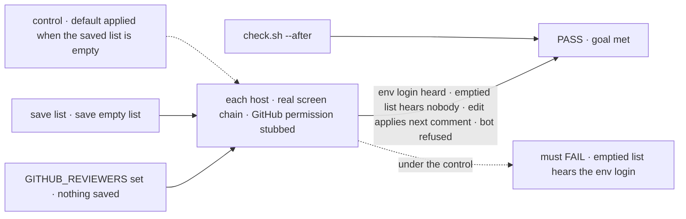
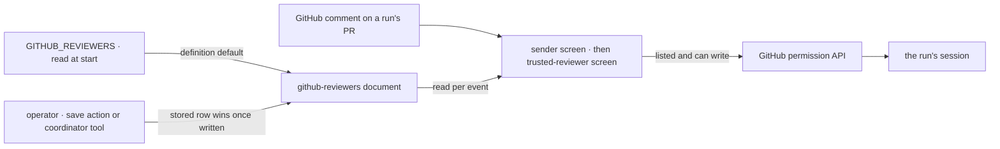

# FIX-2873 · Trusted GitHub reviewers come from one place, with one setting as its default

**Spec** · [Decisions](DECISIONS.md)

## Six people, before and after

| Someone who… | Today | After |
|---|---|---|
| **runs Shift Manager and never saved the reviewer list** | `jhoffner` is trusted, from a file in the devteam folder | The logins `GITHUB_REVIEWERS` names are trusted. Unset, nobody is, until the list is saved. A list already saved stays as saved |
| **runs Teammates** | `TEAMMATES_GITHUB_REVIEWERS` decides, and a change needs a restart | The same stored list Shift Manager uses, defaulted from `GITHUB_REVIEWERS` ([D3](DECISIONS.md#d3)). An edit applies to the next comment, with no restart |
| **is a review bot (Codex, Cursor, Greptile) commenting on a Teammates run's pull request** | Heard by the run when listed | Never heard, in either app ([D2](DECISIONS.md#d2)). A person relays what matters |
| **is listed but can't write to the repository** | Teammates hears them. Shift Manager refuses them | Refused in both. GitHub is asked on each comment |
| **empties the list to stop all steering** | Shift Manager: nobody trusted | Nobody trusted in both apps, whatever `GITHUB_REVIEWERS` says ([D1](DECISIONS.md#d1)) |
| **opens a pull request from a Teammates run with no `GITHUB_TOKEN`** | Nothing is followed, and nothing says so | The run shows a note: the pull request isn't followed, naming `GITHUB_TOKEN` |

Three things decide trust today: Shift Manager's folder file, its stored list, and Teammates'
env var. They disagree on bots, on people outside the project, and on write access.
[`poc/sources/check.sh`](poc/sources/check.sh) lists every file involved.

## The goal, and how we'll know it's met

**In Shift Manager and Teammates alike, a coding run acts only on comments from a login on one
stored list that can write to the repository. The list is defaulted from `GITHUB_REVIEWERS`
until it is first saved, an edit applies to the next comment, and no bot is ever heard.**

| Is it the right goal? | |
|---|---|
| **The real need** | "One should act as the default for the other" (Jake, on [FIX-2873](https://linear.app/fixpoint-labs/issue/FIX-2873)), keeping FIX-2789's live write check and "bots are never trusted" |
| **Smaller, and rejected** | Rename `TEAMMATES_GITHUB_REVIEWERS` to a shared name and leave the two paths alone. That gives one name, but two paths that still disagree on bots and write access |
| **Bigger, and not this issue's** | GitHub as its own kit, or a keyed providers slot: [FIX-2874](https://linear.app/fixpoint-labs/issue/FIX-2874), parked until after the release. What a delivery-woken turn may call: [FIX-2686](https://linear.app/fixpoint-labs/issue/FIX-2686) |
| **Not done if** | Either app still reads its own setting or its own allow list · an emptied list falls back to `GITHUB_REVIEWERS` · only one app's path is driven · the check routes through a stubbed screen instead of the real chain |



The check reads what each host's real routing lets through to the run, in both apps. The
control swaps "nothing saved" for "nothing listed", and must fail.

| How we verify | |
|---|---|
| **Goal check** | Model-free: trust has no model in it. Two host tests route GitHub events through the real screen chain, run by the implementer at completion: Shift Manager's `devteam-coder-follows-pull-request`, and a Teammates twin. Plus [`check.sh --after`](poc/sources/check.sh). Verdict in the implementation PR |
| **Signal** | Each host: `GITHUB_REVIEWERS=alice`, nothing saved: alice (a writer) heard, bob refused. Save `[]`: alice refused. Save `[bob]`: bob's next comment heard, no restart. Unset, nothing saved: nobody. A bot: refused. `check.sh --after` PASS |
| **Input** | Fixture logins, stubbed permission endpoint. Other logins, or a reader-only one, give the same results |
| **Anti-game** | Don't assert on `githubLoginsListed`, or on a screen called directly. Both pass while a host wires its own list |
| **Control that must fail** | `GOAL_CONTROL=empty-falls-back` (the default applies whenever the list has no logins) must FAIL on *after saving `[]`, alice is refused*. `check.sh --after` must FAIL on today's `main`. It does: `counts 1 1 2 2, want 0 0 1 0` |

## What changes


One stored list in workforce. Both apps install it, and the setting is only its default.

**Teammates, as the lab writes it** (names are the implementer's, except the ones the
decisions lock):

```diff
- githubReviewers: githubReviewers(process.env.TEAMMATES_GITHUB_REVIEWERS),
+ // nothing: workforce reads GITHUB_REVIEWERS as the list's default
```

```diff
+ const reviewers = githubTrustedReviewers({ operator: options.userId });
- const github = operatorGitHub({ operator: options.userId, token: options.githubToken });
+ const github = operatorGitHub({ operator: options.userId, token: options.githubToken, reviewers });
- github: { provider: github, poll: true, trustedBots: options.githubReviewers?.bots ?? [] },
+ github: { provider: github, poll: true },
- onPullRequestRecorded: reviewedPullRequestFollow(github, options.githubReviewers),
+ onPullRequestRecorded: (installation) => followPullRequest({ providers: [github], installation, screens: [reviewers.screen] }),
- flows: [appContextFlow(…)],
+ flows: [appContextFlow(…), reviewers.flow],
```

**Shift Manager** makes the same calls; its Shift Coordinator's catalog takes `reviewers.tool`.

**The operator's setting:**

```diff
- TEAMMATES_GITHUB_REVIEWERS=jhoffner,greptile-apps[bot],cursor[bot]
+ GITHUB_REVIEWERS=jhoffner
```

**Docs:** update `packages/workforce/README.md` (trusted reviewers: the stored list,
`GITHUB_REVIEWERS` as its default, `operatorGitHub`'s `reviewers`), at release from workforce's
and Shift Manager's changeset lines. Rewrite the pending
`.changeset/harness-kit-follows-pull-requests.md` so it names neither removed function.
`labs/teammates/README.md`'s settings row changes in the implementation PR. No `apps/docs` page.

## How one comment is decided



The default is the document's own definition content, so the engine's existing rule decides
"never saved": a stored row, even an emptied list, always wins ([D1](DECISIONS.md#d1)).

## What stays as it is

- FIX-2789's screen order: bots refused, then the list, then the live write check.
- The save action's and the tool's gates: operator only, their own typed words, the judge,
  Approve in Inbox.
- `onPullRequestRecorded`, `followPullRequest`, and the `allow` screen with its `bots`.
- What a delivery-woken turn may call ([FIX-2686](https://linear.app/fixpoint-labs/issue/FIX-2686)).

## What's already here, and the debt

| Already here | What this does with it |
|---|---|
| Who decides what a run hears: `subscriptions`' code screens | **Folds two into one.** `githubTrustedReviewersScreen` (Shift Manager) and the `allow` screen via `reviewedPullRequestFollow` (Teammates) do one job two ways. `check.sh` searched `packages/` and `labs/`: no third. This is the fold, not a third way |
| A resource's definition content (a stored string wins) | **Builds on.** It is the default; no new fallback code |
| [FIX-2789](https://github.com/fixpoint-labs/flow-state-dev/pull/5453) (no retained spec): stored list, write check, bots never | **Kept**, moved into workforce. Its `jhoffner` seed is **superseded** by `GITHUB_REVIEWERS` |
| [FIX-2869](https://github.com/fixpoint-labs/flow-state-dev/pull/5540) (a bug fix, no spec): Teammates follows its runs' pull requests | **Follow kept.** Its allow-list follow, setting and `trustedBots` wiring are **superseded**. Its call to hear review bots is **reversed** by [D2](DECISIONS.md#d2) |
| FIX-2535 D2 `followPullRequest`; workforce's `operatorGitHub` | **Builds on** the first. **Extends** the second with `reviewers`; Shift Manager's copies go |
| [FIX-2686](https://linear.app/fixpoint-labs/issue/FIX-2686), no spec yet | Its spec names this document as the one source |

| Adds | Existing piece considered | Why it doesn't fit, or how it is composed |
|---|---|---|
| The trusted-reviewers set in workforce (document, save flow, coordinator tool, screen reference) | `subscriptions` · `githubTrustedReviewersScreen`; Shift Manager's private copies | Composed: moved from Shift Manager, with the screen it already used. Not new |
| `operatorGitHub({ reviewers })` | `operatorGitHub` (workforce) | Extends: Shift Manager's private copy was this helper plus this option |
| `GITHUB_REVIEWERS` as the default | `resource` · definition content | Composed: the setting fills the definition content |

| The debt | |
|---|---|
| **Removes** | Shift Manager's copy of the list's flow, tool and screen wiring, and of both operator helpers · the devteam folder's `github-reviewers.md` and its `jhoffner` · `TEAMMATES_GITHUB_REVIEWERS` · `reviewedPullRequestFollow`, `githubReviewers` and their test (unreleased) · Teammates' `trustedBots` wiring · a second way to decide who a run hears |
| **Adds** | One setting read by workforce, as a default. Permanent by design |
| **Leaves** | `followPullRequest({ outsiders })` and the `allow` screen's `bots` lose their reviewer-follow caller but serve subscriptions and routines · FIX-2869 reads Backlog in Linear though #5540 merged · GitHub as its own kit ([FIX-2874](https://linear.app/fixpoint-labs/issue/FIX-2874)) |

**Net: down.** Two ways to decide trust become one, about 300 lines and two copies of a helper
go, and one setting is added.

## Sign off

**[The goal](#the-goal-and-how-well-know-its-met), at that size:** one list, both apps, the
setting only a default, checked through each host's real routing. If wrong: one app keeps a
private path, and trust drifts again.

**[The debt](#whats-already-here-and-the-debt), net down:** a second trust path, a folder seed,
a per-app setting and two helper copies go. One shared setting is added. If wrong: the shared
setting gets read as an override.

1. **[D2](DECISIONS.md#d2) · Teammates' runs stop hearing review bots, and listed people who
   can't write.** If wrong: Teammates loses most of the review it hears today, until a person
   relays it.
2. **[D1](DECISIONS.md#d1) · `GITHUB_REVIEWERS` is the default until the list is first saved.
   Then only the saved list counts, an empty one included.** If wrong: an operator changes the
   setting after a save, and nothing changes.
3. **[D3](DECISIONS.md#d3) · The one setting is `GITHUB_REVIEWERS`, beside `GITHUB_TOKEN`.**
   If wrong: a name FIX-2789 retired comes back with a narrower meaning.

**Open: none.** D2 is the one to weigh. It reverses a call #5540 made two days ago. Reasoning
and what lost: [DECISIONS.md](DECISIONS.md).

Improvement · `workforce` + `shift-manager` + `labs/teammates` · medium (three packages, about
300 lines moved, two unreleased exports removed, one option added) · no epic
