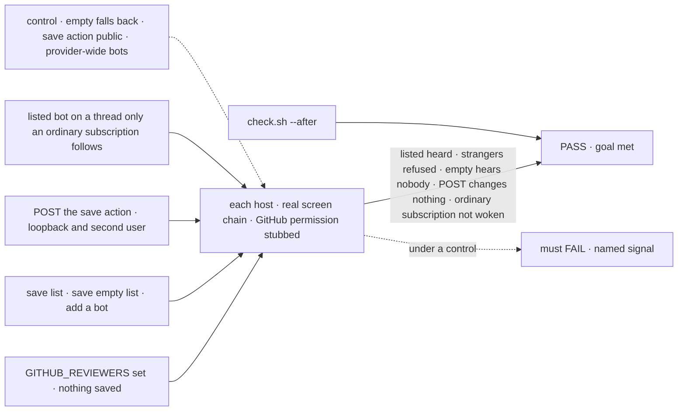
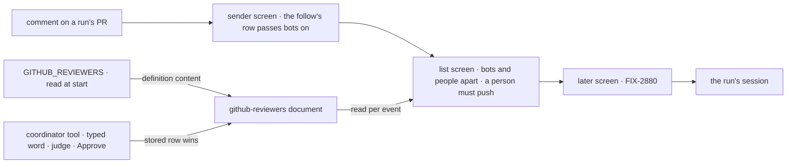

# FIX-2873 · Trusted GitHub reviewers come from one place, with one setting as its default

**Spec** · [Decisions](DECISIONS.md)

## Six people, before and after

| Someone who… | Today | After |
|---|---|---|
| **runs Shift Manager and never saved the reviewer list** | `jhoffner` is trusted, from a file in the devteam folder | The accounts `GITHUB_REVIEWERS` names are trusted. Unset, nobody is, until the list is saved. A list already saved stays as saved |
| **runs Teammates** | `TEAMMATES_GITHUB_REVIEWERS` decides, and a change needs a restart | The same stored list Shift Manager uses, defaulted from `GITHUB_REVIEWERS` ([D3](DECISIONS.md#d3)). Lead changes it on the operator's word and Approve; it applies to the next comment |
| **is a review bot (Codex, Cursor, Greptile)** | Teammates hears it when listed. Shift Manager never does | Heard in both apps when listed as `name[bot]`. An unlisted bot, or a user who registers a listed bot's name, is refused ([D2](DECISIONS.md#d2)) |
| **is a listed person who can't write to the repository** | Teammates hears them. Shift Manager refuses them | Refused in both: a listed person must also be able to push ([D2](DECISIONS.md#d2), recommended) |
| **is a coding run that tries to rewrite the list** | Shift Manager: one HTTP request with the owner's bearer, a constant in its source, rewrites it ([POC](poc/save-action/save-action.poc.ts)) | No direct request rewrites it, in either app. Only the coordinator tool writes. A run that forges the tool's turn and Approve over HTTP is [FIX-2882](https://linear.app/fixpoint-labs/issue/FIX-2882)'s to stop |
| **empties the list to stop all steering** | Shift Manager: nobody trusted | Nobody trusted in both apps, whatever `GITHUB_REVIEWERS` says ([D1](DECISIONS.md#d1)) |

Three things decide trust today: Shift Manager's folder file, its stored list, and Teammates'
env var. They disagree on bots, on people outside the project, and on write access.
[`poc/sources/check.sh`](poc/sources/check.sh) lists every file involved.

## The goal, and how we'll know it's met

**In Shift Manager and Teammates alike, a coding run acts only on comments from an account on
one stored list: a listed bot, or a listed person who can push. The list is defaulted from
`GITHUB_REVIEWERS` until it is first saved, and an edit applies to the next comment. No HTTP
route writes it directly: the coordinator tool is the only writer.**

| Is it the right goal? | |
|---|---|
| **The real need** | "One should act as the default for the other" (Jake, on [FIX-2873](https://linear.app/fixpoint-labs/issue/FIX-2873)). Then, on #5561: "Bots can trigger code changes (this is the most common case). Whatever accounts are in our list are allowed. I'm fine with GITHUB_REVIEWERS" |
| **Smaller, and rejected** | Rename `TEAMMATES_GITHUB_REVIEWERS` and leave the two paths alone: one name, two rules |
| **Bigger, and not this issue's** | A check for prompt injection in a review: [FIX-2880](https://linear.app/fixpoint-labs/issue/FIX-2880), an evaluator step after the list screen in this unified chain. GitHub as its own kit: [FIX-2874](https://linear.app/fixpoint-labs/issue/FIX-2874). What a delivery-woken turn may call: [FIX-2686](https://linear.app/fixpoint-labs/issue/FIX-2686). A run that calls its host app over HTTP as the operator, and so can forge the coordinator tool's turn and Approve: [FIX-2882](https://linear.app/fixpoint-labs/issue/FIX-2882), an accepted residual here |
| **Not done if** | Either app still reads its own setting or list · an emptied list falls back to `GITHUB_REVIEWERS` · a listed bot added at runtime is refused by the sender screen · a listed bot wakes a subscription that has no list screen · an HTTP route writes the list directly · only one app's path is driven |



The check reads what each host's real routing lets through, and whether a request changed the
list. Each control breaks exactly one of those, and must fail.

| How we verify | |
|---|---|
| **Goal check** | Model-free, by the implementer at completion, verdict in the implementation PR. **Teammates' path:** `packages/workforce/test/subscriptions-reviewed-follow.test.ts`, reworked to drive `reviewers.follow(github)` through the real chain beside an ordinary subscription, which is exactly Teammates' wiring. **Shift Manager:** `devteam-coder-follows-pull-request.test.ts`. **Write paths:** a new `labs/teammates/test/github-reviewers-write.test.ts`, and `devteam-github-reviewers-edit.test.ts`. Plus [`check.sh --after`](poc/sources/check.sh) |
| **Signal** | Both paths: `GITHUB_REVIEWERS=alice,greptile-apps[bot]`, nothing saved: alice (a writer) and the bot heard, bob refused, user `greptile-apps` refused. Save `[]`: alice and the bot refused. Save `[bob, cursor[bot]]`: both heard on the next comment, no restart. Listed reader-only carol refused. A listed bot commenting on a thread that only an ordinary subscription follows (no list screen) wakes nothing. Write paths: a loopback POST to `/:flowKind/actions/setGitHubReviewers` on Teammates, and the same POST with the member's and the owner's bearer on Shift Manager, leave the list unchanged. `check.sh --after` PASS |
| **Input** | Fixture accounts, stubbed permission endpoint. Other accounts give the same results |
| **Anti-game** | Not `githubLoginsListed`, a screen called directly, or `runAction` with another `userId`. Each passes while a host wires its own list, or while every HTTP caller is the operator |
| **Control that must fail** | `GOAL_CONTROL=empty-falls-back` FAILs on *save `[]`: alice refused*. `GOAL_CONTROL=public-save-action` (the save action registered for HTTP) FAILs on *list unchanged* on Teammates. `GOAL_CONTROL=provider-wide-bots` (the list's bots fed to the provider's `trustedBots`) FAILs on *ordinary subscription not woken*. On `main`, the owner-bearer POST rewrote the list to `mallory` ([POC](poc/save-action/save-action.poc.ts), run 2026-11-22). `check.sh --after` FAILs on `main` |

## What changes


One stored list in workforce. Both apps install it, and only the operator's approved edit writes it.

**Teammates, as the lab writes it** (names are the implementer's, except the ones the
decisions lock):

```diff
- githubReviewers: githubReviewers(process.env.TEAMMATES_GITHUB_REVIEWERS),
+ // nothing: workforce reads GITHUB_REVIEWERS as the list's default
```

```diff
+ const reviewers = githubTrustedReviewers({ operator: options.userId });   // reads GITHUB_REVIEWERS here, at start
- const github = operatorGitHub({ operator: options.userId, token: options.githubToken });
+ const github = operatorGitHub({ operator: options.userId, token: options.githubToken, reviewers });
- github: { provider: github, poll: true, trustedBots: options.githubReviewers?.bots ?? [] },
+ github: { provider: github, poll: true },                                  // no trustedBots: the follow admits listed bots itself
- onPullRequestRecorded: reviewedPullRequestFollow(github, options.githubReviewers),
+ onPullRequestRecorded: reviewers.follow(github),
  catalog: { ...projectSourceTools(workspace), search: search(), fetch: fetch(),
+   setGitHubReviewers: reviewers.tool },                                     // and Lead's tools: line names it
```

**Shift Manager** makes the same calls. Its Shift Coordinator keeps the tool; its public save
action goes.

**The operator's setting:**

```diff
- TEAMMATES_GITHUB_REVIEWERS=jhoffner,greptile-apps[bot],cursor[bot]
+ GITHUB_REVIEWERS=jhoffner,greptile-apps[bot],cursor[bot]
```

**Docs:** update `packages/workforce/README.md` (trusted reviewers: the stored list,
`GITHUB_REVIEWERS` as its default, `operatorGitHub`'s `reviewers`), at release from workforce's
and Shift Manager's changeset lines. Rewrite the pending
`.changeset/harness-kit-follows-pull-requests.md` so it names neither removed function.
`labs/teammates/README.md`'s settings row changes in the implementation PR. No `apps/docs` page.

## How one comment is decided



**The wiring the implementer holds to** ([D1](DECISIONS.md#d1)):

- The document is declared with `content` built from `GITHUB_REVIEWERS`, by the same builder the
  tool saves with. Not `contentTemplate`: on a resource, a template renders on every read and
  would hide a save.
- `readContent()` returns the stored row whenever one exists (`readResourceContent`), an emptied
  list included. Only with no row does the definition content apply.
- The list screen reads the document and nothing else. No fallback to `GITHUB_REVIEWERS` in
  `reviewers(ctx)`.
- **Bot admission is per subscription.** The sender screen runs first, at routing and again at
  delivery, and admits a bot only if the service's `trustedBots` names it. `trustedBots` is
  service-wide, so it is never fed from the list: that would admit a listed bot on every GitHub
  subscription, ordinary ones included. Instead the follow `reviewers.follow` builds carries a
  row setting, beside `outsiders`, that lets the sender screen hand a bot on to that row's list
  screen. Only host code sets it, never a model's `subscribe` call, and a row that lists no
  custom screen can't carry it. The follow also takes outsiders, so the list screen decides.
- The list screen is its own custom screen, first in the ordered list `reviewers.follow` builds.
  [FIX-2880](https://linear.app/fixpoint-labs/issue/FIX-2880)'s evaluator goes after it and
  sees only senders the list passed.
- Teammates gains one GitHub permission call per comment from a listed person; bots and
  strangers make none. Shift Manager already pays it. Don't optimize it away.

## What stays as it is

- The tool's gates: operator only, their own typed words, the judge, Approve in Inbox.
- `followPullRequest`, `onPullRequestRecorded`, and the `allow` screen with its `bots`.
- What a delivery-woken turn may call ([FIX-2686](https://linear.app/fixpoint-labs/issue/FIX-2686)).

## What's already here, and the debt

| Already here | What this does with it |
|---|---|
| Who decides what a run hears: `subscriptions`' code screens | **Folds two into one.** `githubTrustedReviewersScreen` (Shift Manager) and the `allow` screen via `reviewedPullRequestFollow` (Teammates) do one job two ways. `check.sh` searched `packages/` and `labs/`: no third |
| A resource's definition content (a stored string wins) | **Builds on.** It is the default; no new fallback code |
| [FIX-2789](https://github.com/fixpoint-labs/flow-state-dev/pull/5453) (no retained spec): stored list, write check, bots never, a public save action | **List and write check kept** for people, moved into workforce. **Superseded:** "bots never" ([D2](DECISIONS.md#d2)), the `jhoffner` seed, and the public save action |
| [FIX-2869](https://github.com/fixpoint-labs/flow-state-dev/pull/5540) (a bug fix, no spec): Teammates' follow, listed bots, users and bots kept apart | **Kept**: the follow, listed bots, the users-and-bots split. **Superseded:** its setting, its allow list, and hearing listed people who can't push |
| FIX-2535 D2 `followPullRequest`; workforce's `operatorGitHub`; `githubServiceFlow`'s `trustedBots` | **Builds on** the first. **Extends** the second with `reviewers`, keeping Shift Manager's interest model and custom screens. **Leaves alone** the third, which stays service-wide and is never fed from the list |
| [FIX-2686](https://linear.app/fixpoint-labs/issue/FIX-2686), no spec yet | Its spec names this document as the one source |

| Adds | Existing piece considered | Why it doesn't fit, or how it is composed |
|---|---|---|
| The trusted-reviewers set in workforce (document, tool, list screen, `follow`) | `subscriptions` · `githubTrustedReviewersScreen`, `followPullRequest`; Shift Manager's copies | Composed: moved from Shift Manager. `follow` is `followPullRequest` with outsiders and the list screen, replacing `reviewedPullRequestFollow` |
| `operatorGitHub({ reviewers })` | `operatorGitHub` (workforce) | Extends: Shift Manager's private copy was this helper plus this option |
| A row setting that hands a bot on to the row's own list screen | `subscriptions` · the row's `outsiders`; `githubServiceFlow`'s `trustedBots` | Extends the row's admission settings, beside `outsiders`. `trustedBots` doesn't fit: the sender screen applies it to every subscription at routing and delivery, so a listed bot would wake unrelated sessions |
| `GITHUB_REVIEWERS` as the default | `resource` · definition content | Composed: the setting fills the definition content |

| The debt | |
|---|---|
| **Removes** | Shift Manager's copy of the list's flow, tool and screen wiring, its public save action, and its two operator helpers · the folder's `github-reviewers.md` and its `jhoffner` · `TEAMMATES_GITHUB_REVIEWERS` · `reviewedPullRequestFollow`, `githubReviewers` and their test (unreleased) · Teammates' fixed `trustedBots` · a second way to decide who a run hears |
| **Adds** | One setting read by workforce, as a default. Permanent by design |
| **Leaves** | **Forgeable coordinator writes, an accepted residual** ([FIX-2882](https://linear.app/fixpoint-labs/issue/FIX-2882)): Teammates makes every HTTP caller the operator, and Shift Manager's owner bearer is a constant in its source, so a run that drives the app over HTTP can forge a tool turn and its Approve. Until FIX-2882 lands, a forged person entry is bounded by write access, and a forged bot entry by the apps installed on the repository ([D2](DECISIONS.md#d2)) · `allow` (a fixed list in a subscription) beside the live list screen · FIX-2869 reads Backlog though #5540 merged |

**Net: down.** Two ways to decide trust become one; about 300 lines, a public write path and
two helper copies go. One setting is added.

## Sign off

**[The goal](#the-goal-and-how-well-know-its-met), at that size:** one list, both apps, bots
heard when listed, and no direct HTTP write. Forged coordinator writes stay an accepted residual
until [FIX-2882](https://linear.app/fixpoint-labs/issue/FIX-2882). If wrong: one app keeps a
private path, and trust drifts again.

**[The debt](#whats-already-here-and-the-debt), net down:** a second trust path, a public write,
a folder seed, a per-app setting and two helper copies go. If wrong: the setting gets read as an
override.

1. **[D2](DECISIONS.md#d2) · Listed bots are heard. A listed person must also be able to push.**
   Bots: your call. The write check for people: my recommendation, for you to confirm. Until
   FIX-2882, a forged entry admits only a person who can push, or an app a repo admin installed
   (`github-actions[bot]` excepted, so don't list it). If wrong: a listed person who can't push
   goes unheard until given access.
2. **[D1](DECISIONS.md#d1) · `GITHUB_REVIEWERS` is the default until the list is first saved.
   Then only the saved list counts, an empty one included.** Awaiting you. If wrong: an operator
   changes the setting after a save, and nothing changes.
3. **[D3](DECISIONS.md#d3) · The setting is `GITHUB_REVIEWERS`.** Approved by Jake on #5561.

**Open: one.** [Warn at start when `TEAMMATES_GITHUB_REVIEWERS` is still set?](DECISIONS.md#open)
I recommend no. The write path is settled as a security fix, not a fork
([decided, not asked](DECISIONS.md#decided-not-asked)).

Improvement · `workforce` + `shift-manager` + `labs/teammates` · medium (three packages, about
300 lines moved, a public write path and two unreleased exports removed, two options extended)
· no epic
