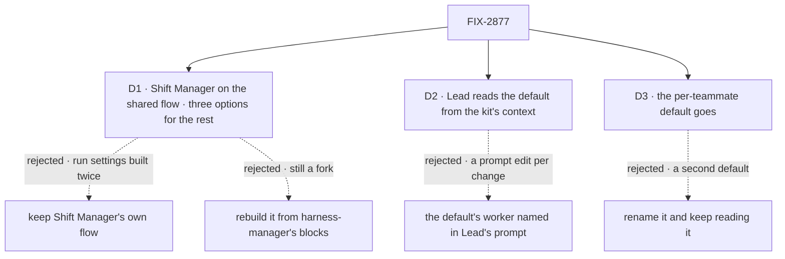

# FIX-2877 · Decisions

[Spec](SPEC.md) · **Decisions**

What was considered, what was chosen, and what each choice locks in. Three decisions are the
sign-off surface. The epic's rules ER-1, ER-3 and ER-4 are this issue's to build
([FIX-2876 → Who owns what](../../epics/FIX-2876/DECISIONS.md#who-owns-what)); none is decided again here.

## The tree

Solid edges are what you're signing. Dashed edges lost, and the label says why.

## D1 · Shift Manager moves onto the shared flow; the flow gains three options for the rest

| | |
|---|---|
| **Instead of** | Keeping `coder.mts` ([FIX-2627 → What stays as it is](../FIX-2627/SPEC.md#what-stays-as-it-is)), or rebuilding it from harness-manager's blocks ([FIX-2627 D1](../FIX-2627/DECISIONS.md#d1)'s escape hatch) |
| **Because** | Run settings (FIX-2878) and PR policy (FIX-2583) land in the shared flow. A fork gets them by a second build or never ([epic ER-1](../../epics/FIX-2876/DECISIONS.md#who-owns-what)). Of the fork's 25 pieces, 14 the kit already has and 4 need nothing; 7 need an option ([option map](poc/option-map/README.md)). Tenet 2: refine the shared flow, don't keep a copy beside it |
| **Locks in** | Three public harness-kit options, permanent: **phases** (a task naming feature work runs the app's feature phase in its own workspace; any other task runs the app's answer phase, else today's one phase), **`approveTools`**, and the app's own worker settings, documents and actions on `coder`, which the flow carries and never reads. Shift Manager's runs are `coder` flow runs: block names and run records name the shared flow, so a check that reads `harness-manager-answer` or `devteam-coder-judge` moves with it. One run budget per app |

**What would change my mind:** a Shift Manager need no option carries without the flow reading
app knowledge. Then FIX-2627 D1's escape hatch, and a comment on the epic, as its *decided* line asks.

It comes down to run settings: on the shared flow they arrive once; a fork needs them built twice.

## D2 · Lead learns the default coder from the harness kit's context, not its prompt

| | |
|---|---|
| **Instead of** | Lead's prompt naming the default's worker (`teammates.cursor`) and the client keeping a copy, as today. Also weighed: a fourth coding worker with no `harness:`, which would run on the default |
| **Because** | The readiness rows already steer Lead from that capability (`goals/teammates-lab/routes-only-to-ready-harnesses`), so one more line there is the place every app's coordinator already reads. A prompt that names a worker needs an edit each time the default moves ([epic ER-3](../../epics/FIX-2876/DECISIONS.md#who-owns-what)). A fourth worker adds a roster row FIX-2879 would remove ([epic D2](../../epics/FIX-2876/DECISIONS.md#d2)) |
| **Locks in** | Every worker holding the harness kit's capability is told the app's default coder, in every app on the kit. Until FIX-2879, Lead maps that default to the coding worker whose roster `harness` matches: a model's choice, held by the goal check. The composer names a harness only when you picked one |

**What would change my mind:** Lead missing the mapping in the goal check. Then the fourth
worker, pulling FIX-2879's collapse forward.

It comes down to one knob: with the context line, the env var alone moves Lead; with the prompt, it can't.

## D3 · The per-teammate "default coding harness" goes, not renamed

| | |
|---|---|
| **Instead of** | Renaming it for what it is (a starting pick for *Code with*) and keeping the composer reading it |
| **Because** | The server never reads it; agent-flow settings only ride to the roster row. A renamed copy is still a second default ([epic ER-3, ER-4](../../epics/FIX-2876/DECISIONS.md#who-owns-what)), and FIX-2879's *Code with*, a pick per conversation that survives a reload, does its job |
| **Locks in** | The hire and edit dialogs lose the field, and no agent-flow worker carries `harness`. A stored worker that set it reads without it. Until FIX-2879, a pick lasts while the conversation is open, and a new one starts at the app's default |

**What would change my mind:** people who rely on a per-teammate default. FIX-2879 then keeps it
as the conversation's pick, not as a teammate setting.

It comes down to one default: a renamed setting is still the second one.

## Decided, not asked

- **The convergence point is the harness kit's `defaultHarness`.** Every reader passes through it:
  the coder flow's order (`worker.config.harness ?? defaultHarness`), the coding board's
  `codingBoardView`, the capability's new line, and each app's context flow (Teammates'
  `appContextFlow` reads the same host value it hands the kit). `DEVFORCE_LAB_HARNESS` and
  `TEAMMATES_HARNESS` only feed it; no other module reads them.
- **One harness list in Shift Manager.** The scripted run, Claude Code, Codex and Cursor go in the
  kit's `harnesses` slot as harness values, wrapped with the lab's MCP tools and its starting-files
  note. The coder's `harness:` enum, the readiness view and the Shift Coordinator's roster line read it. The scripted run reports ready.
- **A fixed repository is a workspace host on that repository**, as Teammates' is. The kit takes
  no second workspace shape.
- **The feature split reads the task.** A task whose input names feature work (`harnessFeature`
  today; FIX-2878 moves it into the declared input) runs the feature phase. One that names it
  malformed is refused there, never run as an answer, as today.
- **Shift Manager's judge is the kit's.** It is `goalJudge` on the same model and floor (0.7); only its block name goes.
- **Stop-on-steer is the harness block's.** A check that needs it declares `stopsOnAbort` on its
  harness block, which the manager already reads. Per-harness run budgets go: one `runTimeoutMs`.
- **Old rows (BP-030).** A stored agent-flow worker with `settings.harness` is read without it, never refused.
- **Coordination.** [#5585](https://github.com/fixpoint-labs/flow-state-dev/pull/5585) (FIX-2873,
  trusted reviewers) touches both hosts and Lead's `WORKER.md`; FIX-2583 touches `coder-flow.ts`. The second to merge rebases.

## Considered and dropped

| Option | Why it lost |
|---|---|
| A `judge` option that takes an app's judge | Shift Manager's judge is the kit's own. Nothing to carry |
| A per-harness run budget and stop-on-steer on the kit | One budget serves both apps; stop-on-steer is already a harness block's declaration |
| Templating Lead's prompt from `TEAMMATES_HARNESS` | The template is a second reader of the env var, in app code |
| A harness-less fourth Teammates worker | Changes the roster, which is FIX-2879's ([D2](#d2)) |

## Settled

- **Every piece of Shift Manager's flow has a place** (2026-11-23, `main` `26e76736b`).
  [`poc/option-map/check.mjs`](poc/option-map/README.md) classifies all 25 pieces (options,
  per-harness fields, settings, actions): 14 the kit has, 7 for the three options, 4 dropped. It
  finds Teammates' four knobs and Shift Manager's two lists where the issue says. PASS; its
  planted-key control FAILs. The premise held: the shared flow can take the split as config.

## Analysis

2026-11-23 · watermark `26e76736b` (the epic merge) · **right approach, one fold.** Run inline:
this worker has no sub-agent tool, so the analyst and validators were not independent; say so at review.

- *Reuse:* every Adds row extends an existing piece. The judge, drafted as an option, is the kit's
  own: **folded**, it goes.
- *Prior art:* LangGraph's `configurable` and Mastra's `RuntimeContext` read one default from
  config, never a prompt copy. That is D2.
- *Other shapes:* keep the fork, the escape hatch, a fourth worker. All lost ([considered](#considered-and-dropped)).
- *New since:* #5585 (FIX-2873) open on both hosts, **recorded** under coordination.
- *Necessity:* the issue is the epic's prerequisite; nothing smaller meets ER-1.
- *Concern:* D2 leans on Lead mapping a harness to a worker. **Open to the goal check**, with D2's flip.

## How it got here

- **Draft** — framed as the epic's one-flow, one-default prerequisite; Shift Manager moves onto
  the kit's `coder` with three options, Lead reads the default from the kit's capability, the
  per-teammate setting goes. Builds on FIX-2627's shared flow and FIX-2391's readiness context.
