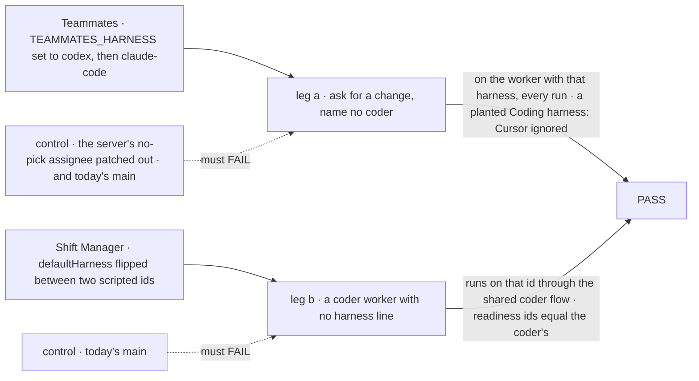
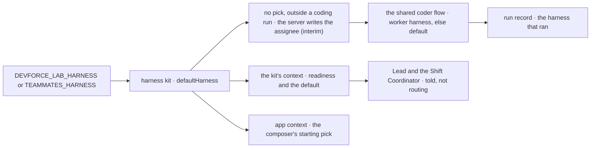

# FIX-2877 · Coder coherence: Shift Manager on the shared coder flow, one default-coder knob, one meaning for `harness`

**Spec** · [Decisions](DECISIONS.md)

| Someone who… | Today | After |
|---|---|---|
| **sets Teammates' default coder** (`TEAMMATES_HARNESS=codex`) | Lead still files unnamed coding work from a person's message on `teammates.cursor`. The composer adds a `Coding harness: Codex` line to every message to work around it | The task lands on the Codex worker, set by the server whatever Lead wrote. The composer sends the message as typed |
| **asks Lead for a change and picks no coder** | Lead follows its prompt's fallback, `teammates.cursor` | The server puts it on the app's one default |
| **runs a coding task whose worker files more work from inside the run** | The worker's model picks the assignee | Unchanged: the model's assignee stands. FIX-2878's run settings win on an unlocked worker, and its lock refuses a mismatch |
| **names a coder in words, or something Lead reads does** ("have Cursor do it", a README's `Coding harness: Cursor`) | Lead files it on that coder, any one on the roster, whatever its sandbox | The task still goes to the default. Until FIX-2879, a coder is picked only by a person assigning the task on the board |
| **edits a teammate in Teammates** | Sees a "Default coding harness" field. The server never reads it; only the composer's starting pick does | Sees no such field. Until FIX-2879, the *Code with* picker has no effect: every filing goes to the app's default |
| **starts Shift Manager with `DEVFORCE_LAB_HARNESS=codex`** | The coder runs on Codex. The readiness view lists only Claude Code, and a Codex run with no sign-in fails inside the run | The same coder. Readiness lists every harness the coder runs, and a task on one that is not ready is refused at once, saying why |
| **hires a Shift Manager coder with `harness: cursor`** | Runs on Cursor, through Shift Manager's own coding flow | Runs on Cursor, through the shared `coder` flow, for a task a person assigns it. A coordinator's own filing with no pick goes to the default; a worker's filing inside its run can still go to a role-specific coder worker. Same checks, same judge |
| **builds an app on the harness kit** | Copies the coding flow to change how a task is phased or checked, as Shift Manager did | Sets an option: a separate phase for feature work, tool approval, and the app's own worker settings |

## The goal, and how we'll know it's met

**Each app picks its coder through one coding flow and one default: change that one value and
the coder that runs changes, with nothing else edited.**

| Is it the right goal? | |
|---|---|
| **The real need** | [FIX-2627](https://linear.app/fixpoint-labs/issue/FIX-2627) promised one coding flow for the labs, and Shift Manager kept its own. Teammates' four knobs agree only by convention. Epic [FIX-2876](../../epics/FIX-2876/SPEC.md) needs one flow and one default before run settings ([FIX-2878](https://linear.app/fixpoint-labs/issue/FIX-2878)) and *Code with* ([FIX-2879](https://linear.app/fixpoint-labs/issue/FIX-2879)) build on them ([ER-1, ER-3, ER-4](../../epics/FIX-2876/DECISIONS.md#who-owns-what)) |
| **Smaller, and rejected** | "`coder.mts` is deleted and the constants are gone." That can pass while Shift Manager runs a renamed copy, or while Lead still reaches the default only because its prompt names the same worker |
| **Bigger, and not this issue's** | A harness or model per task (FIX-2878). The pick as structured state, and one coder worker in Teammates (FIX-2879). A *Code with* picker in Shift Manager (not in the epic) |
| **Not done if** | The kit's `coder` is still switched off in Shift Manager · a coding task filed with no pick outside any coding run lands where the model's assignee, or a `Coding harness:` line, says · the composer still compares against a constant · the readiness view and the coder accept different harness ids · Shift Manager's coder goals were not run on the shared flow · an agent-flow teammate can still save a `harness` setting |



Each leg reads what ran, from the stored task and the run record, never Lead's reply. Under each
control its leg must fail.

| How we verify | |
|---|---|
| **Goal check** | Leg a: `goals/teammates-lab/one-default-picks-the-coder/`, real model, Lead on the lab's default. Leg b: `goals/shift-manager/its-coder-is-the-shared-flow/`, no model. Run by the implementer at completion; verdicts in the implementation PR. Shift Manager's existing coder goals (`goals/devforce-lab/*`, `goals/shift-manager/*` that open a Lab) run too, on the shared flow |
| **Signal** | **a:** for each value, in every run (3 of 3), the stored task's assignee is the coding worker whose `harness:` is that value, the run record names that harness, and the stored message has no `Coding harness:` text. With the default on `codex`, an ask whose message and README (which Lead reads) both say `Coding harness: Cursor` still lands on the Codex worker, 3 of 3; a person assigning the task to the Cursor worker on the board runs it on Cursor. A filing made inside a coding run is not rewritten: no signal reads one as moved to the default. A *Code with* pick landing on its coder is FIX-2879's check, not this one. A teammate hired with a `harness` setting has none on its roster row. **b:** for each id, the run record names that harness, the run is a `coder` flow run, and a hire naming an id outside the readiness rows is refused with exactly the readiness ids |
| **Input** | A held-out ask, "add a line to the README", in two wordings, plus the planted-text ask; scripted harnesses (`GOAL_HARNESS=stub`), so no vendor sign-in is needed. Leg b: two scripted harness values under different ids |
| **Anti-game** | No worker file or prompt names the default. Read the stored task, the message and the run record, never Lead's reply or the picker. The server's no-pick assignee ([D2](DECISIONS.md#d2)) is the mechanism under test, not a way round it; what it must not do is read the default from anything a model wrote |
| **Control that must fail** | Leg a: `GOAL_CONTROL=model-assignee` (the server's no-pick write patched out, so Lead's assignee stands) must FAIL *on the default, every run*; today's `main` must FAIL it for `codex`, and FAIL the planted-text ask. Leg b: today's `main` must FAIL *a `coder` flow run* and *readiness ids equal the coder's* |

## What changes


Each app ends with one box on the left edge, the kit's `defaultHarness`, and every reader points
at it. Shift Manager's own flow folds into the shared one ([D1](DECISIONS.md#d1)).

**Shift Manager's host:**

```diff
- harnesses({ workspace, logReadiness: true }).without(workforce.slots.workerFlows, "coder"),
+ harnesses({ workspace, defaultHarness: process.env.DEVFORCE_LAB_HARNESS ?? "stub",
+   review: options.reviewChanges === true, branchPrefix: "shift-manager/", approveTools, onPullRequestRecorded,
+   phases: { feature: { phase: implementPhase, workspace }, answer: { phase: answerPhase, workspace: answerHost } },
+   /* the lab's document setting, its documents and its inspect read: D1 */ }),
- fill: { [harnesses.slots.harnesses]: [...options.harnessValues] }   // readiness only
+ fill: { [harnesses.slots.harnesses]: [stub, claudeCode, codex, cursor] }  // the coder and readiness
```

**Lead's `WORKER.md`:**

```diff
- When the user names one ("have Codex do it", or a `Coding harness: <name>` line), assign it to that one.
- When they name none, assign it to `teammates.cursor` and go ahead: never ask which.
+ Assign it to a coding worker and go ahead: never ask which. The server sets the coder:
+ the app's default.
```

With no pick, on a filing made outside any coding run (a person's turn, or a linked non-coding
session), the server writes a coding task's assignee from the kit's `defaultHarness` and ignores
the model's ([D2](DECISIONS.md#d2)). A filing made inside or below a coding run keeps the model's
assignee. The rule is **interim**: FIX-2878 retires it once its filler, on the no-pick path,
writes `defaultHarness`, that harness's default model and the plan setting it implies, with the marker, whatever worker the model names; from then the model's assignee is honoured and
FIX-2878's lock checks it. The harness kit's context names the default beside the
readiness rows, so Lead can say which coder took it. `LEAD_FALLBACK_HARNESS` and the `Coding
harness:` line go, and the composer sends nothing in their place. The per-teammate field goes
([D3](DECISIONS.md#d3)).

**Accepted interim cost.** Between this issue and FIX-2879, Teammates' *Code with* picker has no
effect: the text line is gone and the structured pick is not there yet, so every Lead filing is the
no-pick path and lands on the default. It ends when FIX-2879 ships its pick; both are in this epic.

**Readers of what goes** (grep on `main` `26e76736b`; each moves in the same PR):

- `packages/shift-manager/teams/devteam/host.mts` imports `CODER_FLOW`, `coderHarnessNames` and
  `HARNESS_SETTING` from `coder.mts`. Its roster line (`settings.harness`, one of …) reads the
  kit's harness ids, and both `showSettings: [HARNESS_SETTING]` sites show the kit's `harness:`
  setting, which keeps FIX-2486. Its `withoutJudge` option passes the kit's `judge: false`.
- `fsdev.config.mts` and `fsd.fsdev.config.mts` in `teams/devteam/` set
  `harnesses: workerHarnesses()`; they fill the kit's `harnesses` slot instead. The devteam
  `README.md` line on `workerHarnesses` is rewritten.
- `goals/devforce-lab/it-answers-a-conversations-task` imports `JUDGE_MODEL` from `judge.mts`: it
  takes `GOAL_JUDGE_MODEL` from `@flow-state-dev/harness-manager`, and its `no-judge` control
  (`withoutJudge: true`) reaches the kit's `judge: false`.
- Eight goal files import `CODER_FLOW` from `coder.mts` (`workforce-apps/keyboard-first`, and
  six `shift-manager/` goals' `run.mts` or `lab/fsdev.config.mts`): they import the kit's, the same
  `"coder"`. `one-person-runs-a-labs-projects-and-people/controls/patches.mts` patches a `host.mts`
  line by its text and is re-pointed if that line moves.

**Docs:** the harness kit has no user page yet. Changesets for `@flow-state-dev/harness-manager`
(the three options, the default in context, and the server's no-pick assignee) and `@flow-state-dev/shift-manager` (readiness
lists every coder). `/release-docs` updates `shift-manager/from-a-checkout.md`, where
`DEVFORCE_LAB_HARNESS` is described. The epic's harness-kit sentence stays FIX-2878's.

## How a task reaches its coder



One value enters at the kit. The server's assignee, the flow, the coordinators' context and the
client read it; none keeps a copy, and no model chooses from it.

## What stays as it is

- Teammates' three coding workers. FIX-2879 collapses them
  ([epic D2](../../epics/FIX-2876/DECISIONS.md#d2)).
- A person's own assignment from the board wins. That is the only pick until FIX-2879.
- A filing made inside or below a coding run keeps the model's assignee, as today.
- Shift Manager's tasks, phases, checks, judge, pull-request follow and EM. It gets no picker. A
  coordinator's own no-pick filing gets the default; its EM files on `eng.coder`, which has no
  `harness:` line, so its routing stays as it is. A worker's filing inside its run keeps the
  model's assignee, so it can still route to a role-specific coder worker.
- The task input's `harnessFeature` key, which FIX-2878 moves into the declared input.

## What's already here, and the debt

| Already here | What this does with it |
|---|---|
| The kit's `coder` flow (`coderWorkerFlow`) | **Extends** with three options; becomes Shift Manager's coder |
| Shift Manager's `defineCoderWorkerFlow` (438 lines) | **Removes.** Of its 25 pieces, 14 the kit already has, 4 go, and 7 land in the three options: three phase keys in `phases`, `approveTools` in its own, and `resources`, the `document` setting and the inspect action in the app's worker extension ([poc/option-map](poc/option-map/README.md)) |
| Other ways to pick a coder: `DEVFORCE_LAB_HARNESS`, `harnessValues`, `TEAMMATES_HARNESS`, the host's `?? "cursor"`, Lead's fallback, `LEAD_FALLBACK_HARNESS`, the agent-flow setting | **Fold into** `defaultHarness`; the env vars feed it. Searched `harness` across `labs/` and `packages/shift-manager` by hand; the checker confirms each of these sites, and the readers of what goes are listed [above](#what-changes) by grep |
| `harnessReadinessCapability` and `READINESS_GUIDANCE`, already steering Lead (`goals/teammates-lab/routes-only-to-ready-harnesses`) | **Extends** with the default coder |
| [FIX-2627 → What stays as it is](../FIX-2627/SPEC.md#what-stays-as-it-is): Shift Manager's flow "stays its own" | **Superseded**, as [epic ER-1](../../epics/FIX-2876/DECISIONS.md#who-owns-what) says. [D1](../FIX-2627/DECISIONS.md#d1)'s escape hatch stays for apps outside this repo |
| FIX-2486: a Shift Manager coder names a harness | **Kept**, on the kit's `harness:` setting |
| FIX-2878's run settings, filler and lock | **Builds before it.** FIX-2877 merges first: FIX-2878 imports and renames `harnessFeature`. **Hands off** the no-pick assignee: FIX-2878 retires it once its filler, on the no-pick path, writes `defaultHarness`, that harness's default model and the plan setting it implies, with the marker, whatever worker the model names |
| FIX-2879's *Code with* pick | **Hands off**: FIX-2879 brings the structured pick (respond `fields`, the `codeWith` session field, the composer sending it), and that is where it enters D2 as a pick. This issue adds no field and no composer send |

| Adds | Existing piece considered | Why it doesn't fit / how composed |
|---|---|---|
| `phases`: a feature phase with its workspace, and the answer phase | `codingPhase` and `commandCheck` | **Extends**: the kit's checks wrap whichever phase runs; the default is today's one phase |
| `approveTools` | `harnessManager({ approveTools })` | **Extends**: forwarded, like `review` |
| The app's worker settings, documents and actions on `coder` | The agent flow's `settings` option | **Extends** in the same shape; the flow never reads them. `resources` is the fork's file-declared documents (`resourcesFromDocs`), installed at flow level beside the installation's |
| The server's no-pick assignee, **interim** | `checkAssignee`, `harnessOf` | **Extends** the kit's filing of a coding task made outside any coding run: `checkAssignee` accepts any roster id, so the default is written before it. Retired by FIX-2878 |
| The default coder in the kit's context | `harnessReadinessCapability` | **Extends** the same capability |

| The debt | |
|---|---|
| **Removes** | `coder.mts`, `coderHarnessNames`, `HARNESS_SETTING`, `workerHarnesses` and Shift Manager's second list · `LEAD_FALLBACK_HARNESS` and the `Coding harness:` line · Lead's `teammates.cursor` fallback and its rule to follow a coder named in words · the agent-flow `harness` setting and its form field · Shift Manager's judge wrapper (`judge.mts`). Their readers are [listed](#what-changes) |
| **Adds** | Three harness-kit options and one context line, public and permanent by design. The server's no-pick assignee, interim: FIX-2878 retires it |
| **Leaves** | Teammates' three per-harness workers (FIX-2879). Until then the server maps the default to the worker whose `harness:` matches |

**Net: down.** A 438-line fork, a second list and three knobs go; the kit gains three options, a line and one interim filing rule.

## Sign off

**[The goal](#the-goal-and-how-well-know-its-met), at that size:** one flow and one default per
app, proved by moving the default and reading what ran. If wrong: the epic builds run settings
on a second flow, or a default that only one of four readers obeys.

**[The debt](#whats-already-here-and-the-debt), net down:** a fork and three knobs go; three
kit options and a line come. If wrong: options only Shift Manager uses.

1. **[D1](DECISIONS.md#d1) · Shift Manager moves onto the shared flow: what the flow already does
   is dropped, and the flow gains three options for the rest.** If wrong: three public options
   carrying one app's habits.
2. **[D2](DECISIONS.md#d2) · With no coder picked, outside any coding run, the server puts a coding
   task on the default coder, whatever Lead wrote; text naming a coder is not a pick. Interim:
   FIX-2878 retires it; a filing inside a coding run keeps the model's assignee.** If wrong: someone who names a
   coder in words gets the default. Until FIX-2879, so does someone who uses *Code with*: the
   picker has no effect in that gap, an accepted cost that ends when FIX-2879 ships.
3. **[D3](DECISIONS.md#d3) · The per-teammate "default coding harness" goes, not renamed.** If
   wrong: people who set it lose a starting pick until FIX-2879 keeps one per conversation.

**Open: none.** D1 is the one to weigh.

Improvement · `harness-manager`, `shift-manager`, Teammates lab · medium: two packages, one lab, one flow removed · epic FIX-2876
