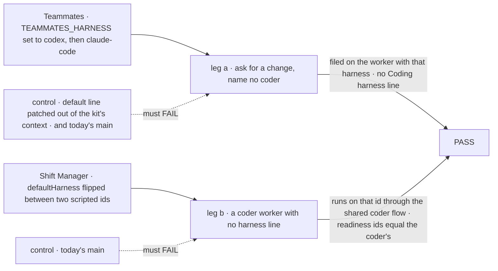
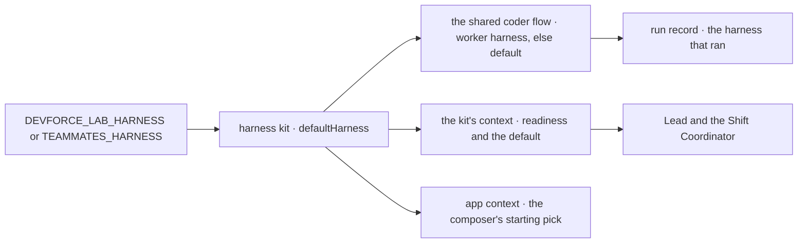

# FIX-2877 · Coder coherence: Shift Manager on the shared coder flow, one default-coder knob, one meaning for `harness`

**Spec** · [Decisions](DECISIONS.md)

| Someone who… | Today | After |
|---|---|---|
| **sets Teammates' default coder** (`TEAMMATES_HARNESS=codex`) | Lead still files unnamed coding work on `teammates.cursor`. The composer adds a `Coding harness: Codex` line to every message to work around it | Lead files it on the Codex worker. The composer sends the message as typed |
| **asks Lead for a change and names no coder** | Lead follows its prompt's fallback, `teammates.cursor` | Lead follows the app's one default, read from its context |
| **edits a teammate in Teammates** | Sees a "Default coding harness" field. The server never reads it; only the composer's starting pick does | Sees no such field. *Code with* starts at the app's default |
| **starts Shift Manager with `DEVFORCE_LAB_HARNESS=codex`** | The coder runs on Codex. The readiness view lists only Claude Code, and a Codex run with no sign-in fails inside the run | The same coder. Readiness lists every harness the coder runs, and a task on one that is not ready is refused at once, saying why |
| **hires a Shift Manager coder with `harness: cursor`** | Runs on Cursor, through Shift Manager's own coding flow | Runs on Cursor, through the shared `coder` flow. Same tasks, same checks, same judge |
| **builds an app on the harness kit** | Copies the coding flow to change how a task is phased or checked, as Shift Manager did | Sets an option: a separate phase for feature work, tool approval, and the app's own worker settings |

## The goal, and how we'll know it's met

**Each app picks its coder through one coding flow and one default: change that one value and
the coder that runs changes, with nothing else edited.**

| Is it the right goal? | |
|---|---|
| **The real need** | [FIX-2627](https://linear.app/fixpoint-labs/issue/FIX-2627) promised one coding flow for the labs, and Shift Manager kept its own. Teammates' four knobs agree only by convention. Epic [FIX-2876](../../epics/FIX-2876/SPEC.md) needs one flow and one default before run settings ([FIX-2878](https://linear.app/fixpoint-labs/issue/FIX-2878)) and *Code with* ([FIX-2879](https://linear.app/fixpoint-labs/issue/FIX-2879)) build on them ([ER-1, ER-3, ER-4](../../epics/FIX-2876/DECISIONS.md#who-owns-what)) |
| **Smaller, and rejected** | "`coder.mts` is deleted and the constants are gone." That can pass while Shift Manager runs a renamed copy, or while Lead still reaches the default only because its prompt names the same worker |
| **Bigger, and not this issue's** | A harness or model per task (FIX-2878). The pick as structured state, and one coder worker in Teammates (FIX-2879). A *Code with* picker in Shift Manager (not in the epic) |
| **Not done if** | The kit's `coder` is still switched off in Shift Manager · Lead's routing passes because its prompt still names the default's worker · the composer still compares against a constant · the readiness view and the coder accept different harness ids · Shift Manager's coder goals were not run on the shared flow · an agent-flow teammate can still save a `harness` setting |



Each leg reads what ran, from the stored task and the run record, never Lead's reply. Under each
control its leg must fail.

| How we verify | |
|---|---|
| **Goal check** | Leg a: `goals/teammates-lab/one-default-picks-the-coder/`, real model, Lead on the lab's default. Leg b: `goals/shift-manager/its-coder-is-the-shared-flow/`, no model. Run by the implementer at completion; verdicts in the implementation PR. Shift Manager's existing coder goals (`goals/devforce-lab/*`, `goals/shift-manager/*` that open a Lab) run too, on the shared flow |
| **Signal** | **a:** for each value, Lead's `createTask` names the coding worker whose `harness:` is that value, in at least 2 of 3 runs, and the stored message has no `Coding harness:` text. A teammate hired with a `harness` setting has none on its roster row. **b:** for each id, the run record names that harness, the run is a `coder` flow run, and a hire naming an id outside the readiness rows is refused with exactly the readiness ids |
| **Input** | A held-out ask, "add a line to the README", in two wordings; scripted harnesses (`GOAL_HARNESS=stub`), so no vendor sign-in is needed. Leg b: two scripted harness values under different ids |
| **Anti-game** | No worker file or prompt names the default. Read the stored task, the message and the run record, never Lead's reply or the picker |
| **Control that must fail** | Leg a: `GOAL_CONTROL=no-default-context` (the default line patched out of the harness kit's capability) must FAIL *filed on the worker with that harness* in at least 2 of 3 runs; today's `main` must FAIL it for `codex`. Leg b: today's `main` must FAIL *a `coder` flow run* and *readiness ids equal the coder's* |

## What changes


Each app ends with one box on the left edge, the kit's `defaultHarness`, and every reader points
at it. Shift Manager's own flow folds into the shared one ([D1](DECISIONS.md#d1)).

**Shift Manager's host:**

```diff
- harnesses({ workspace, logReadiness: true }).without(workforce.slots.workerFlows, "coder"),
+ harnesses({ workspace, defaultHarness: process.env.DEVFORCE_LAB_HARNESS ?? "stub",
+   review: options.reviewChanges === true, branchPrefix: "shift-manager/", approveTools, onPullRequestRecorded,
+   phases: { feature: { phase: implementPhase, workspace }, answer: { phase: answerPhase, workspace: answerHost } },
+   /* the lab's document setting, its documents and its inspect read: D1 */ }),
- fill: { [harnesses.slots.harnesses]: [...options.harnessValues] }   // readiness only
+ fill: { [harnesses.slots.harnesses]: [stub, claudeCode, codex, cursor] }  // the coder and readiness
```

**Lead's `WORKER.md`:**

```diff
- When they name none, assign it to `teammates.cursor` and go ahead: never ask which.
+ When they name none, assign it to the coding worker on the default coder and go ahead: never ask which.
```

The harness kit's context names the default beside the readiness rows ([D2](DECISIONS.md#d2)).
`LEAD_FALLBACK_HARNESS` goes; the composer adds its line only for a coder you picked. The
per-teammate field goes ([D3](DECISIONS.md#d3)).

**Docs:** the harness kit has no user page yet. Changesets for `@flow-state-dev/harness-manager`
(the three options and the default in context) and `@flow-state-dev/shift-manager` (readiness
lists every coder). `/release-docs` updates `shift-manager/from-a-checkout.md`, where
`DEVFORCE_LAB_HARNESS` is described. The epic's harness-kit sentence stays FIX-2878's.

## How a task reaches its coder



One value enters at the kit. The flow, the coordinators' context and the client read it; none
keeps a copy.

## What stays as it is

- Teammates' three coding workers and Lead's rule to use a coder the user names. FIX-2879
  collapses the workers ([epic D2](../../epics/FIX-2876/DECISIONS.md#d2)).
- The `Coding harness:` line for a coder you pick. FIX-2879 replaces it.
- Shift Manager's tasks, phases, checks, judge, pull-request follow and EM. It gets no picker.
- The task input's `harnessFeature` key, which FIX-2878 moves into the declared input.

## What's already here, and the debt

| Already here | What this does with it |
|---|---|
| The kit's `coder` flow (`coderWorkerFlow`) | **Extends** with three options; becomes Shift Manager's coder |
| Shift Manager's `defineCoderWorkerFlow` (438 lines) | **Removes.** Of its 25 pieces, 14 the kit already has, 7 land in the three options, and 4 go ([poc/option-map](poc/option-map/README.md)) |
| Other ways to pick a coder: `DEVFORCE_LAB_HARNESS`, `harnessValues`, `TEAMMATES_HARNESS`, the host's `?? "cursor"`, Lead's fallback, `LEAD_FALLBACK_HARNESS`, the agent-flow setting | **Fold into** `defaultHarness`; the env vars feed it. Searched `harness` across `labs/` and `packages/shift-manager`; the checker re-derives each site |
| `harnessReadinessCapability` and `READINESS_GUIDANCE`, already steering Lead (`goals/teammates-lab/routes-only-to-ready-harnesses`) | **Extends** with the default coder |
| [FIX-2627 → What stays as it is](../FIX-2627/SPEC.md#what-stays-as-it-is): Shift Manager's flow "stays its own" | **Superseded**, as [epic ER-1](../../epics/FIX-2876/DECISIONS.md#who-owns-what) says. [D1](../FIX-2627/DECISIONS.md#d1)'s escape hatch stays for apps outside this repo |
| FIX-2486: a Shift Manager coder names a harness | **Kept**, on the kit's `harness:` setting |

| Adds | Existing piece considered | Why it doesn't fit / how composed |
|---|---|---|
| `phases`: a feature phase with its workspace, and the answer phase | `codingPhase` and `commandCheck` | **Extends**: the kit's checks wrap whichever phase runs; the default is today's one phase |
| `approveTools` | `harnessManager({ approveTools })` | **Extends**: forwarded, like `review` |
| The app's worker settings, documents and actions on `coder` | The agent flow's `settings` option | **Extends** in the same shape; the flow never reads them |
| The default coder in the kit's context | `harnessReadinessCapability` | **Extends** the same capability |

| The debt | |
|---|---|
| **Removes** | `coder.mts`, `coderHarnessNames`, `HARNESS_SETTING`, `workerHarnesses` and Shift Manager's second list · `LEAD_FALLBACK_HARNESS` · Lead's `teammates.cursor` fallback · the agent-flow `harness` setting and its form field · Shift Manager's judge wrapper |
| **Adds** | Three harness-kit options and one context line. Public and permanent by design |
| **Leaves** | Teammates' three per-harness workers and the `Coding harness:` line (FIX-2879). Lead maps the default to a worker by model choice until then |

**Net: down.** A 438-line fork, a second list and three knobs go; the kit gains three options and a line.

## Sign off

**[The goal](#the-goal-and-how-well-know-its-met), at that size:** one flow and one default per
app, proved by moving the default and reading what ran. If wrong: the epic builds run settings
on a second flow, or a default that only one of four readers obeys.

**[The debt](#whats-already-here-and-the-debt), net down:** a fork and three knobs go; three
kit options and a line come. If wrong: options only Shift Manager uses.

1. **[D1](DECISIONS.md#d1) · Shift Manager moves onto the shared flow: what the flow already does
   is dropped, and the flow gains three options for the rest.** If wrong: three public options
   carrying one app's habits.
2. **[D2](DECISIONS.md#d2) · Lead learns the default coder from the harness kit's context, not its
   prompt.** If wrong: Lead picks the wrong worker when no coder is named, until FIX-2879.
3. **[D3](DECISIONS.md#d3) · The per-teammate "default coding harness" goes, not renamed.** If
   wrong: people who set it lose a starting pick until FIX-2879 keeps one per conversation.

**Open: none.** D1 is the one to weigh.

Improvement · `harness-manager`, `shift-manager`, Teammates lab · medium: two packages, one lab, one flow removed · epic FIX-2876
