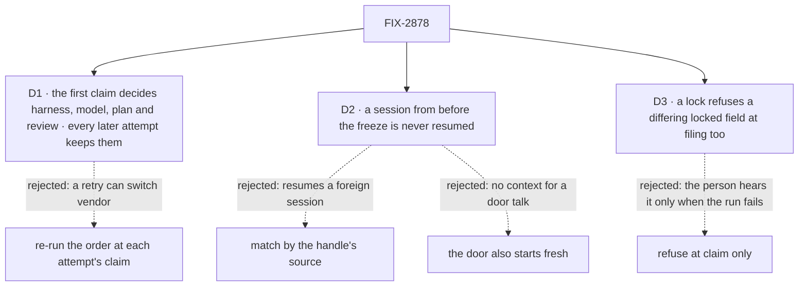

# FIX-2878 · Decisions

[Spec](SPEC.md) · **Decisions**

The epic decided most of this issue: the order, the freeze, server-owned harness, model and
plan, the lock, the model catalog rule and the plan-run postcheck
([FIX-2876 rules](../../epics/FIX-2876/DECISIONS.md#who-owns-what), as amended on
[#5605](https://github.com/fixpoint-labs/flow-state-dev/pull/5605), not yet approved; this spec
tracks #5605, including its next amendment, and is re-checked when it merges). Three calls were left to this spec. Everything else is under *Decided, not asked*.

## The tree

Solid edges are what you sign. Dashed edges lost, and the label says why.

## D1 · A task keeps the coder its first claim chose, through every attempt after it

| | |
|---|---|
| **Instead of** | Running the order again at each attempt's claim: a retry, a re-claim after a held question, a claim after a crash |
| **Because** | The person (or the run that filed the task) asked for a coder once. The claim freezes one value, the frozen settings: the three run settings (the harness, the effective model, which is the harness's `defaultModel` when the task names none, and the plan setting) plus the worker's review mode. Only the three run settings are carried to a task the run files; review is never inherited, it stays the assignee's. Review and PR policy is moving into the coder flow's options under [FIX-2583](https://linear.app/fixpoint-labs/issue/FIX-2583), which changes where the frozen review mode is read from, not that it is frozen. A retry that re-reads the worker's file or the app's default can land on another vendor, lose its session, or switch between a reviewed and an unreviewed run, and the task card changes under the person. The epic says "once per run, at the first claim"; this reads *run* as the task's life |
| **Locks in** | A change to a worker's `harness:` or `review`, the kit's `defaultHarness` or a harness's default model reaches only tasks not yet claimed. Moving a claimed task means cancelling and refiling it. A harness removed from the app fails its claimed tasks by name at their next attempt |

**What would change my mind:** tasks that sit claimed for days while an app's default is fixed
for a reason the person would want applied, such as a harness that was down. Then a retry
re-runs the order, and a fresh session is the cost.

It comes down to a retry: re-running the order lets a retry switch vendor without anyone asking.

## D2 · A session from before the freeze is never resumed

| | |
|---|---|
| **Instead of** | Matching by the handle's `source`; starting a fresh session on the door too; or a per-session harness and plan field beside `sessionId` |
| **Because** | `source` cannot tell harnesses apart: `claude-code` and `claude-code-plan` both report `claude-code/sdk`, and every scripted harness reports `harness-manager/stub` (epic ER-8). Under D1 the frozen settings are written at the first claim, before any session exists, and never change, so every session made after this change belongs to them; ER-8's match on harness id and plan holds by construction, and resume compares nothing extra. Only a row from before this change, with a `sessionId` and no frozen settings, can hold a foreign session. Its first claim writes the frozen settings and clears `sessionId`, so it starts fresh once. A door talk on a row with no frozen settings is refused by name, because a fresh session there would answer with no memory of the work the person asks about |
| **Locks in** | At upgrade, every task in flight starts one fresh session, and a door talk on a task finished before the upgrade is refused with a line saying to file a new task. After that, a session is only ever continued under the settings that made it |

**What would change my mind:** a large number of long-running tasks in flight at upgrade. Then
a pre-change session is resumed when the task's frozen harness reports the record's `source`,
for one release only, with an issue filed to remove it.

It comes down to one source for two harnesses: matching by source resumes a plan session as an edit run.

## D3 · A locked worker refuses a task that differs on a locked field at filing, as well as at claim

| | |
|---|---|
| **Instead of** | Refusing only at claim, which the epic requires and allows to be the only check (ER-11) |
| **Because** | At filing the refusal reaches the filer while the person is still in the conversation, and nothing is filed. At claim it arrives as a failed task, later and elsewhere. The filler already runs on every coding filing and knows the assignee, so the check is one read of that worker's file. The claim check stays for tasks filed before the lock was set |
| **Accepted** | **A filing that inherits its parent run's settings and meets a lock with other fixed values is refused.** It is never widened and never silently swapped to the worker's values (ER-10: an inherited pick is kept, never widened). So a worker locked to the plan harness takes filings only from runs already on it. The refusal returned to the filer names the conflict and says to file to an unlocked worker or tell the person, so the filing model can recover |
| **Locks in** | The public name `lock:` on a worker's file: fixed values for any server-owned run setting (`harness`, `plan`, `model`), compared with deep equality, so a Cursor model with other params differs. The refusal reads the same in both places, naming the field, the worker's value and the one asked for |

**What would change my mind:** FIX-2894's filler not being handed the assignee. Then the lock
is checked at claim only, as the epic allows, and this card goes.

It comes down to who hears it: claim-only turns a refusal into a failed task later.

## Decided, not asked

- **One resolver, one reader.** The first claim writes the frozen settings and returns them
  whole. The steer turn, a delivered message, the door, the manager's next attempt, the
  `coder-harness` action and the coding board row all read them; none re-reads
  `worker.config.review` or `harness:`. The only writer of `harness`, `model` and `plan` on a
  task is the harness kit's filler.
- **Only what the filler wrote counts** (security; epic ER-9 and ER-10 at issue level, BP-030).
  Today `createTask` copies a filer's whole `input`, and a stored `input.harness` is inert. Read
  as a run setting, a held task with `input.harness: "claude-code"` on a `claude-code-plan`
  worker would run the edit harness, with no postcheck. So the filler writes a server-owned
  marker with the values it fills. Without it, `harness`, `model` and `plan` are absent: worker,
  then kit, nothing of them frozen. `updateTask` strips an unmarked value, as a leftover
  `harnessFeature` is refused. The marker's name is the implementer's.
- **The run row.** Four fields for the frozen settings, `.nullable().default(null)`, kept across
  attempts and written only by the first claim. `source` goes: never written, tolerated on old
  rows when read (BP-030). The `run-record.ts` comments that leave the harness check "to the
  issue that introduces the choice" and hand the id down "only when the source matches" go too.
- **A row written before this change** reads as today until its first claim (BP-030); see
  [D2](#d2) for its session.
- **Plan, until FIX-2599.** A harness with the read-only mark is a plan run whatever `plan`
  says; `plan: true` on one without it fails the claim by name. `plan` never loosens the id.
- **The model is checked once, at the first claim:** `models()` must answer `status: "models"`
  and list the whole selection, Cursor's params included. Otherwise the run uses the harness
  default, and the refusal is written on the run row and shown on the coding board row.
- **The model feed** is `HarnessFeeds.model`, the name `HarnessSessionFeeds` already uses, an id
  or an id with params, always the frozen model.
- **The filler, until FIX-2879,** writes, with the marker, the filing run's three run settings
  when the filing session is a coding run (never its review mode), and nothing otherwise. A
  worker's `harness:` line governs a task that carries none. Outside a coding run, FIX-2877's
  server-written assignee on a no-pick filing stays as it is.
- **`harnessFeature` goes with no alias.** A stored task that still carries it is refused at
  claim by name (BP-030).
- **Fixed boards stay.** Their rows keep `harnessTaskInputSchema` at the top of `input` and don't
  run the coder flow; folding them into `feature` would change rows this epic doesn't own.
- **Read-only is a mark on the `Harness` value,** set by Claude Code's plan harness, never an id
  string. FIX-2599 maps its plan setting onto the same check.
- **The postcheck sees only its own run,** deterministically: it snapshots the run's own
  worktree status and the refs at the start, and after the run fails it if that worktree is
  dirty or a ref the run's worktree created or moved appears. It never reads the common git dir,
  so a concurrent task's branch, a `fetch` or a `gc` never fails it.
- **Merge order: FIX-2894 and FIX-2877 first.** Shift Manager's `coder.mts` imports
  `harnessFeatureOf`, which this issue removes without editing that file, and FIX-2877's
  `phases.feature` reads the `harnessFeature` key this issue renames to `feature`; the rename
  updates that read. Written in Linear as blocks.
- **Glossary.** *Run settings* (a coding task's `harness`, `model` and `plan`) and the lock are
  added; *Harness* is amended to say a task's run settings name one.

## Considered and dropped

| Option | Why it lost |
|---|---|
| A worker-file `model:` layer, or the filer writing `harness` and `model` (the issue's text) | Epic ER-2 and ER-10: a model belongs to a harness, and a prompt-injected filing would choose its own coder (BP-031) |
| Honouring a stored `harness` or `model` no filler wrote | A task filed before this change would pick its own coder at first claim ([security review](https://github.com/fixpoint-labs/flow-state-dev/pull/5604#discussion_r4667660416)) |
| Freezing a null model and reading the option at each attempt | A retry or an inherited child runs whatever the option says later |
| Leaving `review` live | A retry could switch between a reviewed and an unreviewed run: the drift D1 removes, one field over |
| Retiring FIX-2877's server-written no-pick assignee, with the filler writing the default run settings | Text the model reads could still steer the task onto a worker with another review mode or other worker config, and the lock catches only locked workers ([architect review](https://github.com/fixpoint-labs/flow-state-dev/pull/5606#issuecomment-7105832775)) |
| A lock that wins over an inherited pick | It would widen or swap a pick nobody made (ER-10) |
| An isolated read-only repository per plan run | The epic chose scoping: one checkout model, no new store |
| Matching a resume by `source`; a per-session harness field | [D2](#d2) |
| Checking plan mode by the id `claude-code-plan` | Puts one vendor's id string in harness-manager |

## Notes from review

From the [second look](https://github.com/fixpoint-labs/flow-state-dev/pull/5604#issuecomment-7104788120), for the implementer:

> **Postcheck is detection, not prevention.** A plan-mode run that writes has already written. Fine given FIX-2599 owns enforcement, but "common git dir" change detection needs a cheap, deterministic definition (e.g. snapshot of `refs` + `config`), or it becomes a flaky signal. The goal check's `no-postcheck` control only proves the check runs, not that it avoids false positives on benign git activity (fetch, gc).

Taken: the definition is under *Decided, not asked*, and the Postcheck signal has a false-positive case.

> **"Today's main fails all six"** but only five controls are named; **Order** has none.

Taken: Order is checked by the straight run, and the count is corrected in the SPEC.

From the coordinator, for the implementer (ergonomics, not direction):

> A lock that names fields and reads their values from the worker's own lines, e.g. `lock: [harness, plan]`, avoids repeating `harness: claude-code-plan` under `lock:`. A worker's `harness:` applies only to a task that carries no run settings; the lock is what binds it. The value form in the SPEC's diff stays valid; which form ships is yours.

## Open

**Open: none.**

## Analysis

2026-11-23 · watermark 2026-11-23 (the epic merged at `26e76736b`). **Inline, by the author,**
so not independent; the coordinator can run `analysis` before the gate.

**Verdict: right approach.** *Reuse:* every Adds row extends an existing piece. *Prior art:* the
epic's pass (OpenAI Agents SDK `RunConfig.model`, LangGraph `configurable`) holds. *Other
shapes:* the epic's `adhd` pass covered them. *New factors:* the #5605 amendment, folded.
*Concern, recorded:* until FIX-2879 nothing writes a named model, so the goal check proves the
model path only through the harness default; the named-model leg is the closure's. *Counted
facts:* four `byHarness` routes and the `harness` action, by `grep` on `coder-flow.ts` at
`26e76736b`.

## How it got here

- **Draft** — the run side of the epic's goal: one resolver at the first claim, a frozen pair
  every route reads, server-written run settings, a lock, a model feed and a plan postcheck.
- **Round 1** — folded the security review (unmarked stored values are absent), and aligned to
  #5605: `plan` server-owned, the effective model frozen, a lock on any server-owned field by
  deep equality, `plan: true` on a non-plan harness fails, a postcheck scoped to its own run.
- **Round 2** — folded the second look: `review` frozen with the rest; an inherited filing that
  meets a different lock is refused; D2 takes the smaller shape (clear a pre-change session at
  first claim, no per-session field); `source` leaves the run row; the postcheck's detection
  defined; Order's check and the control count corrected.
- **Cross-spec fold** — the frozen value named as the three run settings plus the review mode,
  review never inherited (FIX-2583 note); FIX-2877's no-pick assignee left as it is; FIX-2877's
  `phases.feature` rename noted; lock ergonomics noted for the implementer.
