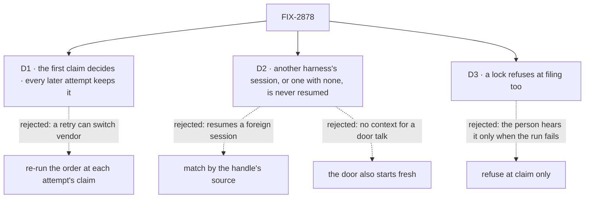

# FIX-2878 · Decisions

[Spec](SPEC.md) · **Decisions**

The epic already decided most of this issue: the order, the freeze, server-owned harness and
model, the lock, the model catalog rule and the plan-run postcheck
([FIX-2876 rules](../../epics/FIX-2876/DECISIONS.md#who-owns-what)). Three calls were left to
this spec. They are below; everything else is under *Decided, not asked*.

## The tree

Solid edges are what you sign. Dashed edges lost, and the label says why.

## D1 · A task keeps the coder its first claim chose, through every attempt after it

| | |
|---|---|
| **Instead of** | Running the order again at each attempt's claim: a retry, a re-claim after a held question, a claim after a crash |
| **Because** | The person (or the run that filed the task) asked for a coder once. A retry that re-reads a worker's file or the app's default can land on another vendor, which then can't resume the session, and the task card changes coder under the person. The epic says "once per run, at the first claim"; this reads *run* as the task's life, so ER-8's mismatch becomes a backstop, not a path |
| **Locks in** | Changing a worker's `harness:` or the kit's `defaultHarness` moves only tasks not yet claimed. Moving a claimed task to another coder means cancelling it and filing a new one. A harness removed from the app fails its claimed tasks by name at their next attempt; it never moves them |

**What would change my mind:** tasks that sit claimed for days while an app's default is fixed
for a reason the person would want applied, such as a harness that was down. Then a retry
re-runs the order, and D2's fresh session is the cost.

It comes down to a retry: re-running the order lets a retry switch vendor without anyone asking.

## D2 · A session recorded under another harness, or under none, is never resumed

| | |
|---|---|
| **Instead of** | Matching by the handle's `source`, the field the run row already has; or starting a fresh session on the door too |
| **Because** | `source` cannot tell harnesses apart: `claude-code` and `claude-code-plan` both report `claude-code/sdk`, and every scripted harness reports `harness-manager/stub` (epic ER-8). So the harness id is written in the same write as the session id, the moment the harness names it, never after, or an interrupted run leaves a session with no harness. A manager attempt that finds another harness, or none, starts fresh: the same self-heal a dead session already gets. A door talk refuses by name instead, because a fresh session there would answer with no memory of the work the person is asking about |
| **Locks in** | At upgrade, every task in flight resumes from scratch once, and a door talk on a task finished before the upgrade is refused with a line saying to file a new task. After that, a session is only ever continued by the harness that made it |

**What would change my mind:** a large number of long-running tasks in flight at upgrade. Then
a record with no harness is resumed when the task's frozen harness reports the record's
`source`, for one release only, with an issue filed to remove it.

It comes down to one source for two harnesses: matching by source resumes a plan session as an edit run.

## D3 · A locked worker refuses a different harness at filing, as well as at claim

| | |
|---|---|
| **Instead of** | Refusing only at claim, which the epic requires and allows to be the only check (ER-11) |
| **Because** | At filing the refusal reaches the filer while the person is still in the conversation, and nothing is filed. At claim it arrives as a failed task, later and elsewhere. The harness kit's filler already runs on every filing to the coder flow and knows the assignee, so the check is one read of that worker's file. The claim check stays: it covers tasks filed before the lock was set and any task that reaches a locked worker another way |
| **Locks in** | The public name `harnessLocked: true` on a worker's file. A coding filing reads the assignee's worker file once. The refusal reads the same in both places, naming the worker's harness and the one asked for |

**What would change my mind:** FIX-2894's filler not being handed the assignee. Then the lock
is checked at claim only, as the epic allows, and this card goes.

It comes down to who hears it: claim-only turns a refusal into a failed task later.

## Decided, not asked

- **The convergence point for a task's coder.** One resolver at the first claim writes the
  frozen pair. Every other reader goes through the pair: the steer turn, a delivered message,
  the door, the manager's next attempt, the `coder-harness` action and the coding board row.
  The only writer of `harness` and `model` on a task is the harness kit's filler: FIX-2894
  drops a filer's values on `createTask` and keeps the stored ones on `updateTask`.
- **Where the pair lives.** Two fields on the run row, kept across attempts (not in the
  attempt-scoped clear), written only by the first claim. The session's harness id is a third
  field, attempt-scoped like `sessionId` and written in the same `onSession` write.
- **A row written before this change** has no pair. Every route reads it as today, by the
  worker's harness and the harness default model (BP-030). Its session is not resumed ([D2](#d2)).
- **The model is checked once, at the first claim** (implementer note, round 2 of the epic):
  `models()` must answer `status: "models"` and list the whole selection, Cursor's params
  included. Otherwise the run uses the harness default, and the refusal is written on the run
  row and shown on the coding board row.
- **The model feed** is `HarnessFeeds.model`, the name `HarnessSessionFeeds` already uses, typed
  as a harness's own value: an id, or an id with params. Each harness value hands it to its
  agent's `model` resolver and falls back to its own `model` option.
- **The filler, until FIX-2879.** It writes the filing run's frozen pair when the filing session
  is a coding run, and nothing otherwise. FIX-2879 adds the turn's `codeWith`.
- **`harnessFeature` goes with no alias.** A stored task that still carries it is refused at
  claim by name (BP-030: reject removed keys loudly). The issue's acceptance said so too.
- **Fixed boards stay.** Their rows carry `harnessTaskInputSchema` at the top of `input` and
  don't run the coder flow. The issue text folded them into `feature`; that would change rows
  this epic doesn't own.
- **Read-only is a mark on the `Harness` value,** set by Claude Code's plan harness. The
  postcheck reads the mark, never an id string. FIX-2599 maps its plan setting onto the same
  check.
- **Merge order: FIX-2877 first.** Shift Manager's `coder.mts` imports `harnessFeatureOf`, and
  this issue removes it but never edits that file (epic seam). Written in Linear as a block.
- **Glossary.** The implementation PR adds *Run settings* (a coding task's `harness` and `model`)
  and the lock, and amends *Harness* to say a task's run settings name one too.

## Considered and dropped

| Option | Why it lost |
|---|---|
| A worker-file `model:` layer (the issue's text) | Epic ER-2: no worker or kit model. A model belongs to a harness, and a worker's harness can be overridden by the task |
| The filer writes `harness` and `model` (the issue's text) | Epic ER-10 reverses it: a prompt-injected filing would choose its own coder (BP-031) |
| Re-running the order at each attempt | [D1](#d1) |
| Matching a resume by `source` | [D2](#d2) |
| Checking plan mode by the id `claude-code-plan` | Puts one vendor's id string in harness-manager; the mark on the value is one field and vendor-neutral |

## Open

**Open: none.**

## Analysis

2026-11-23 · watermark 2026-11-23 (the epic merged at `26e76736b`). **Inline, by the author:**
this dispatch could not start a separate analyst, so this pass is not independent. The
coordinator can run `analysis` on the PR before the gate.

**Verdict: right approach.** *Reuse:* every Adds row extends an existing piece; `codingTaskInput`
is a declaration on FIX-2894's mechanism, not a second one. *Prior art:* the epic's pass
(OpenAI Agents SDK `RunConfig.model`, LangGraph `configurable`) holds; nothing new. *Other
shapes:* the epic's `adhd` pass already ran on this design. *New factors:* none since the epic
merged. *Necessity:* this is the issue the rest of the set needs. *Concern, recorded:* until
FIX-2879 nothing writes a named model, so this issue's goal check proves the model path's
refusals and freeze only through the harness default; the named-model leg is the closure's.
*Counted facts:* the only one is the route list (four `byHarness` routes and the `harness`
action, by `grep` on `coder-flow.ts` at `26e76736b`); no checker needed.

## How it got here

- **Draft** — framed as the run side of the epic's goal: one resolver at the first claim, a
  frozen pair every route reads, server-written run settings, a lock, a model feed and a plan
  postcheck, built on FIX-2894's declared input and the run row.
