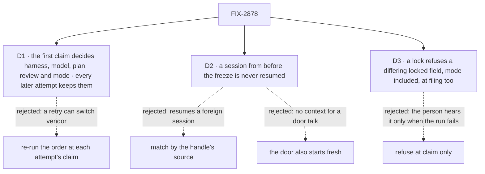

# FIX-2878 · Decisions

[Spec](SPEC.md) · **Decisions**

> **Amendment, 2026-11-23: modes replace the feature marker** (the owner's modes design; see the
> [SPEC's note](SPEC.md)). D1's frozen value gains the task's mode, D3's lock can pin it, and
> *Decided, not asked* gains the mode rules and replaces "`harnessFeature` is refused" with a
> legacy read as implement. D2 is unchanged.

The epic decided most of this issue: the order, the freeze, server-owned harness, model and
plan, the lock, the model catalog rule and the plan-run postcheck
([FIX-2876 rules](../../epics/FIX-2876/DECISIONS.md#who-owns-what), as amended on
[#5605](https://github.com/fixpoint-labs/flow-state-dev/pull/5605), not yet approved, including
its next amendment on the no-pick filing; this spec tracks #5605 and is re-checked when it merges). Three calls were left to this spec. Everything else is under *Decided, not asked*.

## The tree

Solid edges are what you sign. Dashed edges lost, and the label says why.

## D1 · A task keeps the coder and the mode its first claim chose, through every attempt after it

| | |
|---|---|
| **Instead of** | Running the order again at each attempt's claim: a retry, a re-claim after a held question, a claim after a crash |
| **Because** | The person (or the run that filed the task) asked for a coder once. The claim freezes one value, the frozen settings: the three run settings (the harness, the effective model, which is the harness's `defaultModel` when the task names none, and the plan setting) plus the worker's review mode and the task's mode (the one it names, or the app's default mode when it names none). Only the three run settings are carried to a task the run files; review is never inherited, it stays the assignee's, and the mode is never inherited, it is the filer's. Review and PR policy is moving into the coder flow's options under [FIX-2583](https://linear.app/fixpoint-labs/issue/FIX-2583), which changes where the frozen review mode is read from, not that it is frozen. A retry that re-reads the worker's file or the app's default can land on another vendor, lose its session, or switch between a reviewed and an unreviewed run, or between an answer and an implement run, and the task card changes under the person. The epic says "once per run, at the first claim"; this reads *run* as the task's life |
| **Locks in** | A change to a worker's `harness:` or `review`, the kit's `defaultHarness`, a harness's default model or the app's default mode reaches only tasks not yet claimed. Moving a claimed task means cancelling and refiling it. A harness removed from the app fails its claimed tasks by name at their next attempt |

**What would change my mind:** tasks that sit claimed for days while an app's default is fixed
for a reason the person would want applied, such as a harness that was down. Then a retry
re-runs the order, and a fresh session is the cost.

It comes down to a retry: re-running the order lets a retry switch vendor without anyone asking.

## D2 · A session from before the freeze is never resumed

| | |
|---|---|
| **Instead of** | Matching by the handle's `source`; starting a fresh session on the door too; or a per-session harness and plan field beside `sessionId` |
| **Because** | `source` cannot tell harnesses apart: `claude-code` and `claude-code-plan` both report `claude-code/sdk`, and every scripted harness reports `harness-manager/stub` (epic ER-8). Under D1 the frozen settings are written at the first claim, before any session exists, and never change, so every session made after this change belongs to them; ER-8's match on harness id and plan holds by construction, and resume compares nothing extra. Only a row from before this change, with a `sessionId` and no frozen settings, can hold a foreign session. Its first claim writes the frozen settings and clears `sessionId`, so it starts fresh once. A door talk on a row with no frozen settings is refused by name, because a fresh session there would answer with no memory of the work the person asks about |
| **Locks in** | At upgrade, every task in flight starts one fresh session, and a door talk on a task finished before the upgrade is refused with a line saying to file a new task. After that, a session is only ever continued under the settings that made it |

**What would change my mind:** a large number of long-running tasks in flight at upgrade. Then
a pre-change session is resumed when the task's frozen harness reports the record's `source`,
for one release only, with an issue filed to remove it.

It comes down to one source for two harnesses: matching by source resumes a plan session as an edit run.

## D3 · A locked worker refuses a task that differs on a locked field at filing, as well as at claim

| | |
|---|---|
| **Instead of** | Refusing only at claim, which the epic requires and allows to be the only check (ER-11) |
| **Because** | At filing the refusal reaches the filer while the person is still in the conversation, and nothing is filed. At claim it arrives as a failed task, later and elsewhere. The filler already runs on every coding filing and knows the assignee, so the check is one read of that worker's file. The claim check stays for tasks filed before the lock was set |
| **Accepted** | **A filing that inherits its parent run's settings and meets a lock with other fixed values is refused.** It is never widened and never silently swapped to the worker's values (ER-10: an inherited pick is kept, never widened). So a worker locked to the plan harness takes only filings already on it: from a run on it, or a no-pick filing when the plan harness is the kit default. The refusal returned to the filer names the conflict and says to file to an unlocked worker or tell the person, so the filing model can recover |
| **Locks in** | The public name `lock:` on a worker's file: fixed values for any server-owned run setting (`harness`, `plan`, `model`) and for `mode`, compared with deep equality, so a Cursor model with other params differs. A mode is the filer's to pick, and a lock is how a worker bounds that pick: `lock: { mode: answer }` refuses an implement filing by name (epic ER-11's refusal, applied to the mode). The refusal reads the same in both places, naming the field, the worker's value and the one asked for |

**What would change my mind:** FIX-2894's filler not being handed the assignee. Then the lock
is checked at claim only, as the epic allows, and this card goes.

It comes down to who hears it: claim-only turns a refusal into a failed task later.

## Decided, not asked

- **One resolver, one reader.** The first claim writes the frozen settings and returns them
  whole. The steer turn, a delivered message, the door, the manager's next attempt, the
  `coder-harness` action and the coding board row all read them; none re-reads
  `worker.config.review` or `harness:`. The only writer of `harness`, `model` and `plan` on a
  task is the harness kit's filler.
- **Only what the filler wrote counts** (security; epic ER-9 and ER-10 at issue level, BP-030).
  Today `createTask` copies a filer's whole `input`, and a stored `input.harness` is inert. Read
  as a run setting, a held task with `input.harness: "claude-code"` on a `claude-code-plan`
  worker would run the edit harness, with no postcheck. So the filler writes a server-owned
  marker with the values it fills. Without it, `harness`, `model` and `plan` are absent: worker,
  then kit, nothing of them frozen. `updateTask` strips an unmarked value. The marker's name is the implementer's.
- **The run row.** Five fields for the frozen settings (the mode is the fifth), `.nullable().default(null)`, kept across
  attempts and written only by the first claim. `source` goes: never written, tolerated on old
  rows when read (BP-030). The `run-record.ts` comments that leave the harness check "to the
  issue that introduces the choice" and hand the id down "only when the source matches" go too.
- **A row written before this change** reads as today until its first claim (BP-030); see
  [D2](#d2) for its session.
- **Plan, until FIX-2599.** A harness with the read-only mark is a plan run whatever `plan`
  says; `plan: true` on one without it fails the claim by name. `plan` never loosens the id.
- **The model is checked once, at the first claim:** `models()` must answer `status: "models"`
  and list the whole selection, Cursor's params included. Otherwise the run uses the harness
  default, and the refusal is written on the run row and shown on the coding board row.
- **The model feed** is `HarnessFeeds.model`, the name `HarnessSessionFeeds` already uses, an id
  or an id with params, always the frozen model.
- **The filler, until FIX-2879,** writes, with the marker, the filing run's three run settings
  when the filing session is a coding run (never its review mode), and otherwise the server's
  default run settings: the kit's `defaultHarness`, that harness's default model, and the plan
  setting that harness implies. So every coding filing through the kit carries run settings, and
  a worker's `harness:` line governs only a task that carries none (stored before this change, or
  filed outside the kit).
- **FIX-2877's interim no-pick assignee is retired** (coordinator decision, tracking #5605's next
  amendment). FIX-2877 rewrote a no-pick coding filing's assignee to the default coder's worker,
  because the worker then chose the harness, and text the model read could steer it to an
  unsandboxed one. Here the filler writes the default run settings whatever worker the model
  names, so the model's assignee picks a role, never a coder. It is honoured again, inside and
  outside coding runs, and the lock ([D3](#d3)) checks it at filing and at claim. A role-specific
  coder worker gets its tasks; one locked to other values refuses them by name.
- **The residual, accepted.** On a no-pick filing the model's assignee also selects that worker's
  review mode, which the first claim freezes from the worker. Text the model reads can therefore
  steer a task onto a worker that reviews differently. Accepted because review mode is process,
  not permission: harness, model and plan stay server-written, so no text picks the coder or its
  sandbox ([architect review](https://github.com/fixpoint-labs/flow-state-dev/pull/5606#issuecomment-7105860295)).
- **The mode is the filer's, bounded twice** (owner's modes design). `codingTaskInput.mode?:
  string`, absent meaning the app's default mode. It is filer-written, not server-owned: Lead
  legitimately picks answer or implement, as it picks the feature marker today. It is bounded by
  the app's registered modes, checked at filing (an unknown mode is refused by name, naming the
  registered ones), and by a worker's lock, checked at filing and at claim.
- **A mode's required input is checked at filing.** `implement` needs `issue`; a filing without
  it is refused by name, never run in another mode. The check reads what the registered mode
  declares it needs, so a later mode's requirements are its own.
- **The mode is frozen at the first claim**, with the rest of the frozen settings ([D1](#d1)),
  and every route (claim, steer, message, door, next attempt, the coding board row) reads the
  frozen mode. A mode removed from the app fails its claimed tasks by name at their next attempt.
- **The mode is not inherited.** A child filing from a coding run names its own mode or gets the
  app's default, never its parent's: a mode says what kind of work, like a role, and an implement
  run's follow-up is often a question. Only the three run settings are inherited.
- **`doneWhen` and `workspace` are not task fields** (BP-031). A filer choosing them would widen
  what a run may do: a done check that always passes, a workspace outside the mode's. A filer's
  are dropped at filing, like a filer's `harness`, and the run uses its mode's. Per-task wording
  is allowed: the task's own text is appended to the mode's instructions.
- **`harnessFeature` is read once more, then never written** (BP-030 dual-read). Its published
  names go with no alias. A stored row with `harnessFeature: { issue }` reads as `mode:
  "implement"` with that issue at its first claim, which freezes `implement`. A malformed marker
  is refused at claim by name, never run as an answer, as today. Nothing writes the key.
- **Fixed boards stay.** Their rows keep `harnessTaskInputSchema` at the top of `input` and don't
  run the coder flow; folding them into `codingTaskInput` would change rows this epic doesn't own.
- **Read-only is a mark on the `Harness` value,** set by Claude Code's plan harness, never an id
  string. FIX-2599 maps its plan setting onto the same check.
- **The postcheck sees only its own run,** deterministically: it snapshots the run's own
  worktree status and the refs at the start, and after the run fails it if that worktree is
  dirty or a ref the run's worktree created or moved appears. It never reads the common git dir,
  so a concurrent task's branch, a `fetch` or a `gc` never fails it.
- **Merge order: FIX-2894 and FIX-2877 first.** Shift Manager's `coder.mts` imports
  `harnessFeatureOf`, which this issue removes without editing that file, and FIX-2877's
  `phases.feature` reads the `harnessFeature` key this issue replaces with `mode: "implement"`
  and `issue`; that read moves to the frozen mode. Written in Linear as blocks.
- **Glossary.** *Run settings* (a coding task's `harness`, `model` and `plan`), *Mode* and the
  lock are added; *Harness* is amended to say a task's run settings name one. *Mode*, never
  *phase*: "phase" stays free for a future board idea (plan, implement, review as stages of a
  task). The entries land in the implementation PR, with the code that coins them.

## Considered and dropped

| Option | Why it lost |
|---|---|
| A worker-file `model:` layer, or the filer writing `harness` and `model` (the issue's text) | Epic ER-2 and ER-10: a model belongs to a harness, and a prompt-injected filing would choose its own coder (BP-031) |
| Honouring a stored `harness` or `model` no filler wrote | A task filed before this change would pick its own coder at first claim ([security review](https://github.com/fixpoint-labs/flow-state-dev/pull/5604#discussion_r4667660416)) |
| Freezing a null model and reading the option at each attempt | A retry or an inherited child runs whatever the option says later |
| Leaving `review` live | A retry could switch between a reviewed and an unreviewed run: the drift D1 removes, one field over |
| Keeping FIX-2877's server-written no-pick assignee | It sends every no-pick filing to the default coder's worker, so a role-specific coder never gets one. With the filler writing the default run settings, the worker no longer chooses the coder, so the rewrite guards nothing |
| A lock that wins over an inherited pick | It would widen or swap a pick nobody made (ER-10) |
| An isolated read-only repository per plan run | The epic chose scoping: one checkout model, no new store |
| Matching a resume by `source`; a per-session harness field | [D2](#d2) |
| A server-owned mode, like the run settings | Lead legitimately picks answer or implement. The registered set and a lock bound the pick instead (owner's modes design) |
| A child filing inheriting its parent's mode | A mode is the kind of work, like a role; an implement run's follow-up is often a question, and inheriting would run it as implement with no issue |
| A filer's `doneWhen` or `workspace` on the task | It would widen what a run may do (BP-031) |
| Refusing a stored `harnessFeature` row at claim (this spec as merged on #5604) | Those rows are real feature work in flight; reading them as implement keeps them running and costs one legacy read (BP-030) |
| Checking plan mode by the id `claude-code-plan` | Puts one vendor's id string in harness-manager |

## Notes from review

From the [second look](https://github.com/fixpoint-labs/flow-state-dev/pull/5604#issuecomment-7104788120), for the implementer:

> **Postcheck is detection, not prevention.** A plan-mode run that writes has already written. Fine given FIX-2599 owns enforcement, but "common git dir" change detection needs a cheap, deterministic definition (e.g. snapshot of `refs` + `config`), or it becomes a flaky signal. The goal check's `no-postcheck` control only proves the check runs, not that it avoids false positives on benign git activity (fetch, gc).

Taken: the definition is under *Decided, not asked*, and the Postcheck signal has a false-positive case.

> **"Today's main fails all six"** but only five controls are named; **Order** has none.

Taken: Order is checked by the straight run, and the count is corrected in the SPEC.

From the coordinator, for the implementer (ergonomics, not direction):

> A lock that names fields and reads their values from the worker's own lines, e.g. `lock: [harness, plan]`, avoids repeating `harness: claude-code-plan` under `lock:`. A worker's `harness:` applies only to a task that carries no run settings; the lock is what binds it. The value form in the SPEC's diff stays valid; which form ships is yours.

## Open

**Open: none.**

## Analysis

2026-11-23 · watermark 2026-11-23 (the epic merged at `26e76736b`). **Inline, by the author,**
so not independent; the coordinator can run `analysis` before the gate.

**Verdict: right approach.** *Reuse:* every Adds row extends an existing piece. *Prior art:* the
epic's pass (OpenAI Agents SDK `RunConfig.model`, LangGraph `configurable`) holds. *Other
shapes:* the epic's `adhd` pass covered them. *New factors:* the #5605 amendment, folded.
*Concern, recorded:* until FIX-2879 nothing writes a named model, so the goal check proves the
model path only through the harness default; the named-model leg is the closure's. *Counted
facts:* four `byHarness` routes and the `harness` action, by `grep` on `coder-flow.ts` at
`26e76736b`.

## How it got here

- **Draft** — the run side of the epic's goal: one resolver at the first claim, a frozen pair
  every route reads, server-written run settings, a lock, a model feed and a plan postcheck.
- **Round 1** — folded the security review (unmarked stored values are absent), and aligned to
  #5605: `plan` server-owned, the effective model frozen, a lock on any server-owned field by
  deep equality, `plan: true` on a non-plan harness fails, a postcheck scoped to its own run.
- **Round 2** — folded the second look: `review` frozen with the rest; an inherited filing that
  meets a different lock is refused; D2 takes the smaller shape (clear a pre-change session at
  first claim, no per-session field); `source` leaves the run row; the postcheck's detection
  defined; Order's check and the control count corrected.
- **Cross-spec fold** — FIX-2877's interim no-pick assignee retired: the filler writes the default
  run settings and the model's assignee is checked by the lock (the No-pick signal); the frozen
  value named as the three run settings plus the review mode, review never inherited (FIX-2583
  note); FIX-2877's `phases.feature` rename noted; lock ergonomics noted for the implementer.
- **Merged** on [#5604](https://github.com/fixpoint-labs/flow-state-dev/pull/5604) at `fc3eb81`.
- **Amendment: modes** (2026-11-23, the owner's modes design) — `mode` plus `issue` replaces the
  `feature` field: checked at filing against the registered modes and the mode's required input,
  frozen at the first claim, read by every route, not inherited, lockable; `doneWhen` and
  `workspace` dropped from a task; an old `harnessFeature` row runs as implement. Three goal
  signals (Mode, Mode lock, Legacy feature) and an Examples section added.
