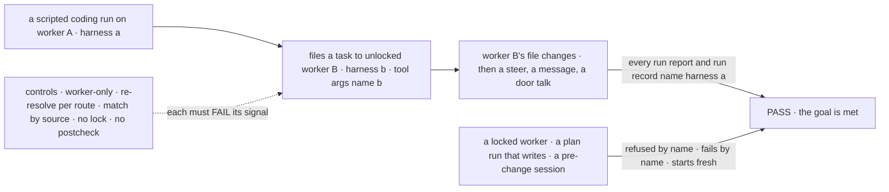
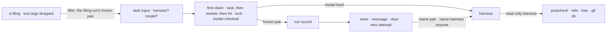

# FIX-2878 · A coding task carries its run settings (harness, model): task first, then worker, then kit default

**Spec** · [Decisions](DECISIONS.md)

## Five people, before and after

| Someone who… | Today | After |
|---|---|---|
| **files a coding task from inside a coding run** (a worker splitting its work) | The child runs on whatever its assignee's `harness:` says, often another vendor | The child runs on the filing run's harness and model, whatever the filer's tool call or the assignee's file says |
| **steers, messages or talks to a task after its worker's file changed** | Each route re-reads the worker, so a steer can reach a different vendor than the run it steers | Every route uses the harness and model the task's first claim recorded |
| **hands a task to a worker that must not change coder** (a plan-only reviewer) | No way to say so; a pick naming another harness is silently ignored or obeyed | The worker's file says `harnessLocked: true`; a different harness is refused by name, at filing and at claim |
| **runs a plan-mode coder** | A plan run that writes a file, a branch or git config still ends as a quiet success | It fails, naming what it changed |
| **files a task whose model the harness doesn't list, or whose list failed** | No model reaches a coding run at all; it is fixed when the harness value is built | The run uses the harness's own default and says, on the run, which model it refused and why |

Nothing a person types changes yet: the conversation's *Code with* pick arrives with
[FIX-2879](https://linear.app/fixpoint-labs/issue/FIX-2879). This issue builds the order that
pick lands in, the freeze, the lock and the model feed, so that it has somewhere to go.

## The goal, and how we'll know it's met

**A coding run uses exactly the harness and model its task carries, decided once at its first
claim and kept for its whole life, and anything it would not run is refused by name instead of
swapped.**

| Is it the right goal? | |
|---|---|
| **The real need** | The epic's: *"whoever asks for a code change names the coder and model once, and the run uses exactly that"* ([FIX-2876](../../epics/FIX-2876/SPEC.md#the-goal-and-how-well-know-its-met)). This issue owns the run side of that sentence: ER-2, ER-6, ER-8, ER-10, ER-11 and ER-12 ([rules](../../epics/FIX-2876/DECISIONS.md#who-owns-what)) |
| **Smaller, and rejected** | "The coder flow reads `harness` from the task." Hittable while a steer re-reads the worker, a filer writes its own coder, and a resumed session belongs to another vendor: the three ways the pick is lost after filing |
| **Bigger, and not this issue's** | A person's pick reaching the task (*Code with*, FIX-2879) and the whole four-leg run on one commit (closure [FIX-2883](https://linear.app/fixpoint-labs/issue/FIX-2883)). Until FIX-2879 nothing writes a named model, so a model a person picked is proved there, on legs a and d |
| **Not done if** | The goal check never ran under its controls · any route but the first claim resolves a harness · a filer's `input`, tool args or `metadata` survive into `harness` or `model` · a locked worker runs a different harness · a refused model runs, or falls to the default silently · a session recorded under one harness is resumed by another · a plan run that wrote passes · `harnessFeature` is still read |



The check reads the run record and the run's own report, never the task's stored input or the
filing tool's reply. Under each control its named signal must fail.

| How we verify | |
|---|---|
| **Goal check** | `goals/harness-manager/a-task-runs-on-its-own-coder/` · scripted harnesses, no model · run by the implementer at completion · verdict in the implementation PR |
| **Signal** | **Inherit:** the child task's run record and run report name harness `a`, though its assignee says `b` and the filing call named `b`. **Freeze:** after worker B's file changes to `c`, a steer, a delivered message and a door talk each report `a`. **Order:** a task with nothing on it, to a worker with no `harness:`, runs on the kit's `defaultHarness`. **Lock:** a filing that would put harness `a` on a worker locked to `b` is refused at filing, and a stored task that reaches it is refused at claim, both naming both harnesses. **Postcheck:** a read-only scripted run that writes a file, adds a ref, or changes the common git dir fails, naming which. **Resume:** a run record with a session but no harness (written before this change) starts a fresh session |
| **Input** | Two scripted harnesses under different ids that report one `source` (`harness-manager/stub`), plus one read-only. A different pair of ids, or a different order of routes, must pass too |
| **Anti-game** | Read the run record and the report the scripted harness writes. Never the task's stored `input`, the `coder-harness` action's answer, or a stubbed board |
| **Control that must fail** | `GOAL_CONTROL=worker-only` fails **Inherit**; `re-resolve` (every route runs the order) fails **Freeze**; `match-by-source` fails **Resume**; `no-lock` fails **Lock**; `no-postcheck` fails **Postcheck**. Today's `main` fails all six. The PR shows each FAIL before the PASS |

## What changes


Left is today: every route asks the worker. Right is after: one claim decides, the run record
remembers, and every other route reads what it remembered.

**A worker that must not change coder:**

```diff
  <!-- workers/planner/WORKER.md -->
  ---
  flow: coder
  harness: claude-code-plan
+ harnessLocked: true
  ---
```

**A task's input, as the coder flow declares it** (through FIX-2894's declaration):

```diff
- input: { harnessFeature: { issue: "FIX-2165" }, project: { … } }
+ input: { feature: { issue: "FIX-2165" }, project: { … }, harness?: "codex", model?: "gpt-6-luna" }
+ //  harness and model are server-owned: whatever the filer sends there is dropped,
+ //  and the harness kit's filler writes them
```

**A harness value that runs read-only** (Claude Code's plan harness) says so on the value, and
the coder flow post-checks its runs.

**Docs:** the harness kit's docs get the epic's one sentence on where a coding task's harness
and model come from, with the order and the lock. The harness-manager reference replaces its
`harnessFeature` paragraph with `codingTaskInput`. The glossary adds *Run settings* and amends
*Harness*. All through this PR's changeset; the pages follow at release.

## How a task's coder travels



The order runs once. Everything after it reads the run record, which is why a later change to a
worker's file, or a later pick, can't reach a run in flight.

## What stays as it is

- **Harness sessions** (Kitchen Sink's harness mode) keep `HarnessSessionFeeds.model`. A session is not a task.
- **Fixed boards** keep `harnessTaskInputSchema` at the top of a conductor row's `input`. They don't run the coder flow, so they don't take `codingTaskInput`.
- **Shift Manager's** coding flow is FIX-2877's to delete; this issue never edits `coder.mts`.
- **Plan mode as a run setting**, and read-only enforcement inside each vendor, are FIX-2599's. This issue only checks after the run.

## What's already here, and the debt

| Already here | What this does with it |
|---|---|
| **Whatever picks a coding run's harness** (`coding-harness`): `harnessOf` in `coder-flow.ts`, read by four `byHarness` routes and the `harness` action | **Replaced** by one resolver at the first claim and one reader of the frozen pair. This would otherwise be the fifth reader of the worker's line |
| **Whatever feeds a run its model**: `HarnessSessionFeeds.model` (sessions only); each agent's `model` resolver; the harness value's own `model` option | **Extended**: the same feed name on `HarnessFeeds`. Searched `model` across `harness-manager/src`; the task path feeds none |
| `run-record.ts`: `sessionId` and `source`, whose comment leaves the harness check "to the issue that introduces the choice" | **Extended** with the frozen pair and the session's harness id. `source` stays, recorded only ([D2](DECISIONS.md#d2)) |
| `harnessFeature`, `HARNESS_FEATURE_KEY`, `namesHarnessFeature`, `harnessFeatureOf` (FIX-2282) | **Removed.** `codingTaskInput.feature` replaces them; an old-key task is refused at claim, by name |
| `runChangedFiles` in `coder-flow.ts` | **Extended** with new refs and the common git dir, for read-only runs |
| Epic [ER-2, ER-8, ER-10, ER-11, ER-12](../../epics/FIX-2876/DECISIONS.md#who-owns-what) | **Built.** ER-8's "fresh or refuse" is [D2](DECISIONS.md#d2); ER-11's optional filing check is [D3](DECISIONS.md#d3); ER-2's "first claim" is [D1](DECISIONS.md#d1) |
| FIX-2152 ER-9 / FIX-2157 D5: a worker's `harness:` names its harness | **Kept**, as the middle of the order. The lock extends it |

| Adds | Existing piece considered | Why it doesn't fit / how composed |
|---|---|---|
| `codingTaskInput` and the harness kit's filler | `task` · FIX-2894's declared input · `harnessFeature` · `input.project` | **Composed**: a declaration on FIX-2894's mechanism, absorbing the two keys |
| `harnessLocked` on a worker's file | The worker's `harness:` line, `workerConfigSchema` | **Extends** the coder flow's config schema by one field |
| The frozen pair and the session's harness id on the run row | `run-record.ts`'s nullable row | **Extends**: three fields, `.nullable().default(null)` (BP-030) |
| `model` on `HarnessFeeds` | `HarnessSessionFeeds.model` | **Extends**: the same name and resolver, widened to a harness's own model value |
| A read-only mark on a `Harness` value | The plan harness's id, `claude-code-plan` | **Extends** `Harness`; a check keyed on one vendor's id string would put Claude Code in harness-manager |

| The debt | |
|---|---|
| **Removes** | `harnessOf` and the four routes' re-reads · the `harnessFeature` namespace and its three helpers · the unchecked resume in `session-door.ts` |
| **Adds** | `codingTaskInput`, the lock, the model feed, the read-only mark: published, permanent by design. Three run-row fields, internal |
| **Leaves** | Fixed boards' top-level payload. `source` on the run row, now unread |

**Net: flat.** One resolver replaces five readers and a namespace goes; four small published
extensions arrive, each of something that exists.

## Sign off

**[The goal](#the-goal-and-how-well-know-its-met), at that size:** one decision per task, kept
for its whole life, refusals by name. If wrong: a picker that works until a worker's run files
the next task.

**[The debt](#whats-already-here-and-the-debt), net flat:** five readers and a namespace go; a
lock, a feed, a read-only mark and a declared input arrive. If wrong: a lock and a mark nobody
sets.

1. **[D1](DECISIONS.md#d1) · A task keeps the coder its first claim chose, through every
   attempt after it.** If wrong: an app that fixes its default can't move a stuck task without
   refiling it.
2. **[D2](DECISIONS.md#d2) · A session recorded under another harness, or under none, is never
   resumed: the next attempt starts fresh, and a door talk is refused by name.** If wrong: each
   task in flight at upgrade loses its session context once.
3. **[D3](DECISIONS.md#d3) · A locked worker refuses a different harness at filing, as well as
   at claim.** If wrong: one more read per coding filing, to stop something the claim stops
   anyway.

**Open: none.** Number 2 is the one to weigh.

Feature · `harness-manager`, `claude-code`, `codex`, `cursor` · medium · epic
[FIX-2876](../../epics/FIX-2876/SPEC.md) · blocked by FIX-2894 and FIX-2877
