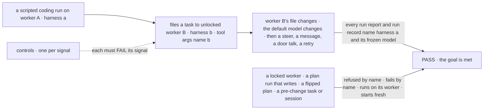

# FIX-2878 · A coding task carries its run settings (harness, model, plan): task first, then worker, then kit default

**Spec** · [Decisions](DECISIONS.md)

## Nine people, before and after

| Someone who… | Today | After |
|---|---|---|
| **files a coding task from inside a coding run** (a worker splitting its work) | The child runs on whatever its assignee's `harness:` says, often another vendor | The child goes to the worker it was filed to, and runs on the filing run's harness, model and plan setting, whatever the filer's tool call or that worker's `harness:` line says. Review is not carried. If the worker is locked to other values, the filing is refused and the filer is told to pick an unlocked worker or ask the person |
| **files a coding task with no coder picked, outside any coding run** (Lead asking for a change) | After FIX-2877, the server overwrites the model's choice of worker with the default coder's worker, so a role-specific coder never gets the task | The task goes to the worker the model chose and runs on the server's default settings: the kit's harness, its default model, its plan setting. A worker locked to other values refuses the filing by name |
| **steers, messages or retries a task after its worker's file changed** | Each route re-reads the worker, so a steer can reach a different vendor, or a retry skip review | Every route uses what the task's first claim froze: the three run settings and the worker's review mode |
| **hands a task to a worker that must not change coder** (a plan-only reviewer) | No way to say so; a pick naming another harness is silently ignored or obeyed | The worker's file declares a `lock:`; a task that differs on a locked field is refused by name, at filing and at claim |
| **runs a plan-mode coder** | A plan run that writes a file or a branch still ends as a quiet success | It fails, naming the file in its own worktree or the ref it made. Another task's branch never fails it, and a filer can't switch plan mode off |
| **files a task whose model the harness doesn't list, or whose list failed** | No model reaches a coding run at all | The run uses the harness default and says which model it refused and why. A retry keeps that model even if the app's default changes |
| **has a task stored before this change with `harness` or `model` in its input** | Inert: the manager reads neither | Still inert: only values the server's filler wrote count |
| **files a task in a mode the app doesn't have, or `implement` with no issue** | There are no modes: a task is feature work if it carries the feature marker, an answer if not | Refused at filing, naming the mode and the modes the app has, or the input the mode needs. Nothing runs in another mode. A task that names no mode gets the app's default mode written in at filing, so a later change to the default doesn't move it |
| **has a task stored before this change with `harnessFeature`** | Shift Manager runs it as feature work on that issue | Still feature work: it reads as `mode: "implement"` with that issue. Nothing writes `harnessFeature` again, and a malformed one is refused, never run as an answer |

Nothing a person types changes yet: the *Code with* pick arrives with
[FIX-2879](https://linear.app/fixpoint-labs/issue/FIX-2879). This issue builds the order that
pick lands in, the freeze, the lock and the model feed.

> **Amendment, 2026-11-23: modes replace the feature marker.** This spec was approved and merged
> on [#5604](https://github.com/fixpoint-labs/flow-state-dev/pull/5604). The owner has since
> settled how a task picks its kind of work: a task names a **mode** (`mode?: string`) that the
> app registered, and `mode: "implement"` with `issue` replaces the `feature` field (the old
> `harnessFeature`) this spec renamed. What changed: the typed input, the frozen settings (they
> gain the mode), the lock (it can pin a mode), the legacy rule (an old `harnessFeature` row now
> runs as implement instead of being refused), three new goal signals, and the
> [Examples](#examples). D2 is unchanged. Needs renewed owner approval before implementation.

**Tracks the epic as amended.** [#5605](https://github.com/fixpoint-labs/flow-state-dev/pull/5605)
merged (at `a6302bc`): it makes `plan` server-owned, freezes the effective model, widens the lock,
scopes the postcheck and retires FIX-2877's interim server-written assignee for the no-pick
filing above. The epic's own modes amendment, [#5612](https://github.com/fixpoint-labs/flow-state-dev/pull/5612) (in progress), changes Q-A's
`codingTaskInput` from `feature?` to `mode?` and `issue?`; this spec is re-checked against it
when it merges. The modes themselves are registered by FIX-2877 on [#5606](https://github.com/fixpoint-labs/flow-state-dev/pull/5606).

## The goal, and how we'll know it's met

**A coding run uses exactly the harness, model, plan setting and mode its task carries, decided once at
its first claim (the harness's default model included, and the mode the app's default gave it at filing) and kept for its
whole life, and anything it would not run is refused by name instead of swapped.**

| Is it the right goal? | |
|---|---|
| **The real need** | The epic's: *"whoever asks for a code change names the coder and model once, and the run uses exactly that"* ([FIX-2876](../../epics/FIX-2876/SPEC.md#the-goal-and-how-well-know-its-met)). This issue owns the run side: ER-2, ER-6, ER-8, ER-10, ER-11 and ER-12 ([rules](../../epics/FIX-2876/DECISIONS.md#who-owns-what), as #5605 amends them) |
| **Smaller, and rejected** | "The coder flow reads `harness` from the task." Hittable while a steer re-reads the worker, a filer writes its own coder, and a resumed session belongs to another vendor |
| **Bigger, and not this issue's** | A person's pick reaching the task (FIX-2879), moving plan mode off the `claude-code-plan` id (FIX-2599), and the four-leg run on one commit (closure [FIX-2883](https://linear.app/fixpoint-labs/issue/FIX-2883)), where a named model is proved |
| **Not done if** | The goal check never ran under its controls · any route but the first claim resolves harness, model, plan, review or mode · a filer's `input`, tool args or `metadata` survive into `harness`, `model` or `plan` · an unmarked stored value is honoured, frozen or kept · a retry runs another model · `plan: true` runs on a harness with no plan mode · a locked worker runs a different value on a locked field, or an inherited filing is swapped to fit a lock · a refused model runs, or falls to the default silently · a pre-change session is resumed · a plan run that wrote passes, or one fails for another task's ref · an unknown mode, or a mode missing its required input, is filed or run · a child filing inherits its parent's mode · a filer's `doneWhen` or `workspace` reaches a run · `harnessFeature` is written, or a stored one runs as anything but implement on its issue · `source` is still written · a no-pick filing's worker is still rewritten by the server |



The check reads the run record and the run's own report, never the task's stored input or the
filing tool's reply.

| How we verify | |
|---|---|
| **Goal check** | `goals/harness-manager/a-task-runs-on-its-own-coder/` · scripted harnesses, no model · run by the implementer at completion · verdict in the implementation PR |
| **Signal** | **Inherit:** the child's run record and report name worker B, the assignee the filer chose, with harness `a` and its frozen model and plan, though B's `harness:` says `b` and the filing named `b`. **Freeze:** after worker B's file changes to `c`, a steer, a message and a door talk each report `a`. **Default:** a retry after `a`'s default model changed runs the frozen model. **Review:** a retry after the worker's `review` flipped runs the frozen review. **Order:** a task with nothing on it, to a worker with no `harness:`, runs on the kit's `defaultHarness`. **Legacy:** a task in today's shape, unmarked, with `input.harness` naming `b`, claimed by a worker on `a`, runs on `a`. **Plan:** a filer who clears or flips `plan`, at filing or on `updateTask`, still runs in plan mode; `plan: true` on an unmarked harness fails the claim by name; the read-only harness with `plan: false` runs as a plan run. **Lock:** a filing that would put `a` on a worker locked to `b` is refused at filing, naming both and telling the filer what to do, and a stored task that reaches it is refused at claim; a lock on a model with params refuses the same id with other params. **Postcheck:** a read-only run that writes a file in its worktree, or creates or moves a ref, fails, naming which; one during which another task creates a branch, or a `fetch` and `gc` run, passes. **Resume:** a row with a session and no frozen settings starts a fresh session, and a door talk on it is refused by name. **No-pick:** a filing with no pick, from outside any coding run, to a role-specific coder worker whose `harness:` is not the default lands on that worker and runs the kit's default harness, its default model and plan setting; the same filing to a worker locked to other values is refused at filing. **Mode:** a filing naming a mode the app doesn't register is refused at filing, naming it and the registered modes; `mode: "implement"` with no `issue` is refused at filing, naming `issue`; a task with no mode, claimed while the app's default is `answer`, retried after the default changes to `implement`, runs as `answer` on both attempts; a task filed with no mode while the default is `answer`, the default changed to `implement` before its first claim, keeps its stored `answer` and runs; a task stored in `implement` whose mode's `requires` gains a field it lacks before its first claim is refused at claim, naming the field; and a child it files with no mode runs in the app's default, not its parent's mode. **Mode lock:** a filing naming `implement` to a worker locked to `answer` is refused at filing, naming both, and a stored task that reaches it is refused at claim; a stored row with `harnessFeature: { issue }` that reaches a worker locked to `answer` is refused at claim by name, because the legacy read makes it `implement` before the lock compares. **Legacy feature:** a stored row in today's shape with `harnessFeature: { issue }` runs as implement on that issue, and its run record freezes `mode: "implement"` with that issue; a row with a malformed `harnessFeature` is refused at claim |
| **Input** | Two scripted harnesses under different ids that report one `source` (`harness-manager/stub`), plus one read-only; one whose default model changes between attempts; a worker whose `review` flips; a second task that creates a branch during a plan run; a row in today's shape. An app that registers `implement` (needs `issue`) and `answer`, whose default mode changes between attempts; a worker locked to `answer`; a row carrying `harnessFeature`, and one with a malformed one. Another pair of ids, or route order, must pass too |
| **Anti-game** | Read the run record and the report the scripted harness writes. Never the task's stored `input`, the `coder-harness` action's answer, or a stubbed board |
| **Control that must fail** | `GOAL_CONTROL=worker-only` fails **Inherit**; `re-resolve` fails **Freeze**; `null-default` fails **Default**; `live-review` fails **Review**; `trust-stored` fails **Legacy**; `filer-plan` fails **Plan**; `no-lock` and `lock-by-reference` fail **Lock**; `no-postcheck` and `unscoped-postcheck` fail **Postcheck**; `match-by-source` fails **Resume**; `server-assignee` (FIX-2877's no-pick worker rewrite kept) and `no-lock` fail **No-pick**; `unchecked-mode` (no validation at filing), `live-mode` (each attempt reads the app's current default), `claim-default` (the default read at claim, not written at filing), `no-claim-requires` (no re-check at claim) and `inherit-mode` fail **Mode**; `no-mode-lock` fails **Mode lock**; `drop-feature` (an old `harnessFeature` row read as no mode) fails **Legacy feature**; `lock-before-legacy` (the lock compared before the legacy read) fails **Mode lock**. **Order** has no control: the straight run checks it. Today's `main` fails twelve of the fourteen signals; Order and Legacy describe what it already does. Legacy feature fails on `main` because no run record there carries a frozen mode. The PR shows each FAIL before the PASS |

## What changes


**A worker that must not change coder** (a worker's `harness:` applies only to a task that
carries no run settings; the lock is what makes it binding):

```diff
  <!-- workers/planner/WORKER.md -->
  ---
  flow: coder
  harness: claude-code-plan
+ lock:
+   harness: claude-code-plan
+   plan: true
  ---
```

A lock names fixed values for any server-owned run setting, `model` included, compared with deep
equality: a Cursor model is an id with params, and other params are a different model. It can
also pin `mode`, which the filer writes ([an example](#a-worker-locked-to-a-mode)).

**A task's input, as the coder flow declares it** (through FIX-2894's declaration):

```diff
- input: { harnessFeature: { issue: "FIX-2165" }, project: { … } }
+ input: { mode?: "implement", issue?: "FIX-2165", project: { … }, harness?: "codex", model?: "gpt-6-luna", plan?: false }
+ //  harness, model and plan are server-owned: whatever the filer sends there is dropped,
+ //  and the harness kit's filler writes them, with a server-owned marker that says it did.
+ //  A stored task without the marker has none of the three: worker, then kit.
+ //  mode is the filer's: checked at filing against the app's registered modes and the
+ //  mode's required input, never inherited by a child filing. No mode: the server writes the
+ //  app's defaultMode in at filing, before the required-input check.
+ //  doneWhen and workspace are not task fields: a filer's are dropped.
```

The modes themselves are registered by the app on the harness kit, as
[FIX-2877](https://github.com/fixpoint-labs/flow-state-dev/pull/5606) specifies: `modes` (each a `ModeSpec` with its
instructions, done check, workspace and `requires`, the task input it needs) and `defaultMode`, which is `default` when absent. Shift
Manager registers `implement` and `answer` and sets `defaultMode: "answer"`. A task filed with no
`mode` gets the app's `defaultMode` written in at filing. This issue reads the registered set: it validates a filing against it
and against the mode's `requires`, refusing a missing field by name, re-checks the stored mode and its
`requires` at the first claim,
freezes the task's mode at the first claim, and makes every route read the frozen mode.

**A harness value says two more things:** its `defaultModel`, so the first claim freezes the
model that actually runs; and, on Claude Code's plan harness, a read-only mark, which until
FIX-2599 is the plan boundary. The coder flow post-checks plan runs, scoped to the run's own
worktree and the refs it created or moved.

**Docs:** the harness kit's docs get the epic's one sentence on where a coding task's harness,
model and plan come from, with the order and the lock. The harness-manager reference replaces its
`harnessFeature` paragraph with `codingTaskInput`, `mode` and `issue` included. The glossary adds
*Run settings* and *Mode* (never *phase*, which stays free for a future board idea) and amends
*Harness*, in the implementation PR. All through this PR's changeset; the pages follow at release.

## How a task's coder travels

```mermaid
flowchart LR
  T["a filing · tool args dropped · the model's assignee kept · mode checked against the registered set"] -->|"filler: the filing run's three run settings, or the server default with no pick · marker · lock"| I["task input · harness? model? plan? mode? issue?"]
  I --> C["first claim · marked task, then worker, then kit · plan reconciled · lock · model checked · review · mode, or the app default"]
  C -->|"frozen settings · effective model"| R["run record"]
  C -->|"model feed"| H["harness"]
  R --> S["steer · message · door · next attempt"]
  S -->|"same settings · a pre-change session cleared"| H
  H -->|"plan run"| Q["postcheck · own worktree · refs it made"]
```



The order runs once. Everything after it reads the run record, so a later change to a worker's
file, a harness's default model, or a later pick, can't reach a run in flight.

## What stays as it is

- **Harness sessions** (Kitchen Sink's harness mode) keep `HarnessSessionFeeds.model`. A session is not a task.
- **Fixed boards** keep `harnessTaskInputSchema` at the top of a conductor row's `input`. They don't run the coder flow.
- **Shift Manager's** coding flow is FIX-2877's to delete; this issue never edits `coder.mts`.
- **Moving plan mode off the `claude-code-plan` id**, and read-only enforcement inside each vendor, are FIX-2599's.

## What's already here, and the debt

| Already here | What this does with it |
|---|---|
| **Whatever picks a coding run's harness** (`coding-harness`): `harnessOf` in `coder-flow.ts`, which re-reads the worker's harness and `review` for four `byHarness` routes and the `harness` action | **Replaced** by one resolver at the first claim, returning the frozen settings whole, and one reader of them |
| **Whatever feeds a run its model**: `HarnessSessionFeeds.model` (sessions only); each agent's `model` resolver; the harness value's own `model` option | **Extended**: the same feed name on `HarnessFeeds`, and `defaultModel` on `Harness` |
| `run-record.ts`: `sessionId` and `source`, whose comments leave the harness check "to the issue that introduces the choice" | **Extended** with the frozen settings. `source` is no longer written, and those comments go ([D2](DECISIONS.md#d2)) |
| `harnessFeature`, `HARNESS_FEATURE_KEY`, `namesHarnessFeature`, `harnessFeatureOf` (FIX-2282) | **Removed** as published names. `codingTaskInput.mode: "implement"` with `issue` replaces them. One internal read stays: an old row's `harnessFeature: { issue }` reads as implement on that issue (BP-030), a malformed one is refused at claim, and nothing writes the key. FIX-2877's `phases.feature` reads `harnessFeature`; that read moves to the frozen mode |
| Shift Manager's split of feature work from answers: the feature marker, present or absent | **Replaced** by the task's mode, checked at filing against the app's registered modes and frozen at the first claim |
| `runChangedFiles` in `coder-flow.ts` | **Extended** with the refs the run created or moved, scoped to its own worktree |
| Epic ER-2, ER-8, ER-10, ER-11, ER-12, as #5605 amends them | **Built.** ER-8's "fresh or refuse" is [D2](DECISIONS.md#d2); ER-11's optional filing check is [D3](DECISIONS.md#d3); ER-2's "first claim" is [D1](DECISIONS.md#d1) |
| FIX-2152 ER-9 / FIX-2157 D5: a worker's `harness:` names its harness | **Kept**, as the middle of the order, for a task that carries no run settings. The lock extends it |
| FIX-2877's interim no-pick assignee: the server rewrites a no-pick coding filing's worker to the default coder's | **Removed.** The filler writes the default run settings instead, the model's assignee is honoured, and the lock checks it at filing and claim |

| Adds | Existing piece considered | Why it doesn't fit / how composed |
|---|---|---|
| `codingTaskInput`, its marker and the harness kit's filler | FIX-2894's declared input · `harnessFeature` · `input.project` | **Composed**: a declaration on FIX-2894's mechanism, absorbing the two keys |
| `mode` and `issue` on `codingTaskInput`, checked at filing | `harnessFeature: { issue }` · the app's registered modes | **Replaces** the feature marker with a name from the registered set; the check reads that set, it adds no registry |
| `lock:` on a worker's file | The worker's `harness:` line, `workerConfigSchema` | **Extends** the coder flow's config schema by one field, which can pin `mode` too |
| The frozen settings (the three run settings, the worker's review mode and the task's mode) on the run row | `run-record.ts`'s nullable row | **Extends**: five fields, `.nullable().default(null)` (BP-030); `source` leaves |
| `model` on `HarnessFeeds` | `HarnessSessionFeeds.model` | **Extends**: the same name, widened to a harness's own model value |
| `defaultModel` and a read-only mark on a `Harness` value | `cursorHarness({ model })`'s option; the id `claude-code-plan` | **Extends** `Harness`; a check keyed on one vendor's id would put Claude Code in harness-manager |

| The debt | |
|---|---|
| **Removes** | `harnessOf` and the routes' re-reads · FIX-2877's interim no-pick assignee write · the `harnessFeature` namespace and its three helpers, its write and every read but the legacy one · the unchecked resume in `session-door.ts` · `source` on the run row and its deferred-check comments |
| **Adds** | `codingTaskInput` with `plan`, `mode`, `issue` and its marker, the lock, the model feed, `defaultModel`, the read-only mark: published, permanent by design. Five run-row fields, internal |
| **Leaves** | Fixed boards' top-level payload · the legacy read of `harnessFeature`, until no stored row carries it |

**Net: flat.** One resolver replaces five readers, and a namespace, a write-only field and an
interim assignee rewrite go;
five small published extensions arrive, each of something that exists. The mode replaces the
feature marker one for one, with one legacy read left behind.

## Examples

These use Shift Manager's two modes: `implement` (needs `issue`) and `answer`, its
`defaultMode`.
Refusal wording is the implementer's; what each one names is not.

### Filing a task

A task that names no mode gets the app's `defaultMode`, here `answer`, written in by the server at filing.

```json
{ "title": "Why does the nightly export skip archived rows?", "assignee": "coder" }
```

A task can name the default mode outright; it runs the same way.

```json
{ "title": "Why does the nightly export skip archived rows?", "assignee": "coder",
  "input": { "mode": "answer" } }
```

An implement task names its issue, and works on that issue's branch.

```json
{ "title": "Skip archived rows in the export", "assignee": "coder",
  "input": { "mode": "implement", "issue": "FIX-2165" } }
```

A mode the app doesn't register is refused at filing, by name, and nothing is filed.

```json
{ "title": "Review the export change", "assignee": "coder",
  "input": { "mode": "review" } }
```

The filer is told:

```text
Refused: this app has no mode "review". Its modes are "implement" and "answer".
File in one of those, or ask the person.
```

`implement` without an issue is refused at filing; it never falls back to an answer.

```json
{ "title": "Skip archived rows in the export", "assignee": "coder",
  "input": { "mode": "implement" } }
```

The filer is told:

```text
Refused: mode "implement" needs "issue", and this filing has none.
Name the issue, or file it in mode "answer".
```

<a name="a-worker-locked-to-a-mode"></a>
### A worker locked to a mode

A worker can pin the mode it runs, beside any run setting it pins.

```diff
  <!-- workers/explainer/WORKER.md -->
  ---
  flow: coder
+ lock:
+   mode: answer
  ---
```

A filing that asks it to implement is refused at filing, and a stored task that reaches it is
refused the same way at claim.

```json
{ "title": "Skip archived rows in the export", "assignee": "explainer",
  "input": { "mode": "implement", "issue": "FIX-2165" } }
```

The filer is told:

```text
Refused: worker "explainer" is locked to mode "answer", and this filing asks for "implement".
File it to a worker that isn't locked, or ask the person.
```

### A task stored before this change

An old row that carries the feature marker is read as implement on its issue. Nothing writes
`harnessFeature` again.

```json
{ "input": { "harnessFeature": { "issue": "FIX-2165" }, "project": { "repo": "acme/app" } } }
```

Its first claim reads it as this task input, and freezes `implement`:

```json
{ "mode": "implement", "issue": "FIX-2165", "project": { "repo": "acme/app" } }
```

A malformed marker, such as `{ "harnessFeature": { "phase": "build" } }` with no issue, is
refused at claim, never run as an answer.

### What a filer cannot set

A filer that sends a done check or a workspace on the task has them dropped at filing, like a
filer's `harness`: the run uses its mode's.

```json
{ "title": "Skip archived rows in the export", "assignee": "coder",
  "input": { "mode": "implement", "issue": "FIX-2165",
             "doneWhen": "always", "workspace": { "host": "/" } } }
```

What is stored on the task:

```json
{ "mode": "implement", "issue": "FIX-2165" }
```

### A child filing names no mode

A run in `implement` that files a follow-up with no mode gets the app's `defaultMode`, `answer`, not
its own mode. The mode is not inherited; only the three run settings are.

```json
{ "title": "Check whether other exports skip archived rows", "assignee": "coder" }
```

Its first claim freezes:

```json
{ "mode": "answer", "harness": "<the parent run's>", "model": "<the parent run's>", "plan": "<the parent run's>" }
```

## Sign off

**[The goal](#the-goal-and-how-well-know-its-met), at that size:** one decision per task, kept
for its whole life, refusals by name. If wrong: a picker that works until a worker's run files
the next task.

**[The debt](#whats-already-here-and-the-debt), net flat.** If wrong: a lock and a mark nobody sets.

1. **[D1](DECISIONS.md#d1) · A task keeps the three run settings (harness, effective model,
   plan), the review mode and its mode as its first claim chose them, through every attempt after it.** If wrong: an app that fixes its default can't move a
   stuck task without refiling it.
2. **[D2](DECISIONS.md#d2) · A session from before the freeze is never resumed: its first claim
   clears it, and a door talk on such a row is refused by name.** If wrong: each task in flight at
   upgrade loses its session context once.
3. **[D3](DECISIONS.md#d3) · A locked worker refuses a task that differs on a locked field
   (`mode` included), at filing as well as at claim, an inherited filing included.** If wrong: a locked plan worker takes
   only filings already on its harness, from a run on it or a no-pick filing when it is the default.

**Decided for you, not asked** ([list](DECISIONS.md#decided-not-asked)): a `harness`, `model` or
`plan` stored without the filler's marker counts as absent, so a task filed today can't pick its
own coder at its first claim after the upgrade. And a no-pick filing outside a coding run goes to
the worker the model chose, on the server's default settings: FIX-2877's interim rewrite of that
worker is retired. If wrong: a model's choice of worker reaches a worker no lock protects.
The mode is the filer's, checked against the registered set, never inherited, and an old
`harnessFeature` row runs as implement (the owner's modes design, registered by FIX-2877 on [#5606](https://github.com/fixpoint-labs/flow-state-dev/pull/5606)). If wrong: a filer picks the
wrong kind of work, inside the set the app allows.

**Open: none.** Number 2 is the one to weigh. The epic's modes amendment is re-checked when it merges.

Feature · `harness-manager`, `claude-code`, `codex`, `cursor` · medium · epic
[FIX-2876](../../epics/FIX-2876/SPEC.md) · blocked by FIX-2894 and FIX-2877 ([#5606](https://github.com/fixpoint-labs/flow-state-dev/pull/5606): it registers the modes this validates against, and its `phases.feature` reads the `harnessFeature` this replaces)
