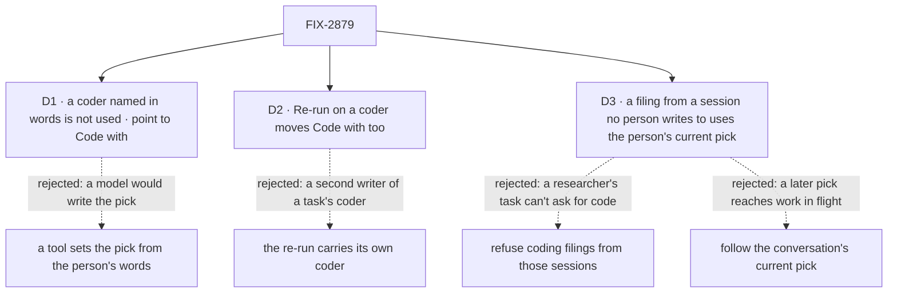

# FIX-2879 · Decisions

[Spec](SPEC.md) · **Decisions**

The epic already decided the carrier: workforce's `sessionFields` as a keyed slot with a
`written: "turn"` mode, the harness kit's `codeWith`, the respond action's optional `fields`, the
filler that copies the pick into the task, one coder worker in Teammates
([Q-C, ER-5, ER-10, D2](../../epics/FIX-2876/DECISIONS.md#who-owns-what)). Three calls a person
will notice were left to this spec. They are below; the rest is under *Decided, not asked*.

## The tree

Solid edges are what you sign. Dashed edges lost, and the label says why.

## D1 · A coder named only in words is not used; the teammate points the person to *Code with*

| | |
|---|---|
| **Instead of** | A tool the teammate calls to set the conversation's pick when the person types "have Codex do it" |
| **Because** | The only pick the server trusts is the one the person's own turn sent ([ER-10](../../epics/FIX-2876/DECISIONS.md#who-owns-what), BP-031). A tool the model calls is written by the model: a fetched page, a file or a tool's output that says "use Claude Code" would move a plan-mode conversation onto an edit-capable coder, which is the attack the epic's security review closed. The picker is one click, and it is visible |
| **Locks in** | Lead's prompt rule "assign it to the agent the user names" goes. The harness kit's instruction says that a coding task runs on the conversation's pick, and that a person who names another coder in words is told to pick it in *Code with*. No tool writes `codeWith` |

**What would change my mind:** people mostly switching coder by typing, and ignoring the picker.
Then the teammate offers a one-click *Switch to Codex* the person presses, which writes the pick
through the person's own request, still never through the model.

It comes down to who writes the pick: a tool means the model does, and so can anything it reads.

## D2 · *Re-run on* another coder also moves the conversation's *Code with* to it

| | |
|---|---|
| **Instead of** | The re-run carries its own coder, and the conversation's pick stays as it was |
| **Because** | A task's coder has one writer: the harness kit's filler, from the pick the server holds ([ER-10](../../epics/FIX-2876/DECISIONS.md#who-owns-what)). With one coder worker, *Re-run on Claude Code* can no longer name a worker. So the press writes the pick, through the same person-only action that writes it at open (`setSessionFields`), then refiles. A re-run that carried its own coder would need the board to trust a coder in the refile's body: a second writer, from caller input |
| **Locks in** | `setSessionFields` writes a turn field again whenever the person's request says so; an open field stays write-once. After a re-run, *Code with* shows the coder it ran on, and the next request uses it. The write waits for a turn in flight to end, so it never changes that turn's filings |

**What would change my mind:** people re-running on another coder to compare, and expecting the
conversation to stay on the first. Then the refile takes a coder from the person's own request,
checked as a turn field is, as a second source the filler reads.

It comes down to one writer: a re-run with its own coder is a second way to set one.

## D3 · A filing from a session no person writes to uses the person's current pick

| | |
|---|---|
| **Instead of** | The pick that session was opened with (its carried copy), or refusing every coding filing from such a session |
| **Because** | The carried copy is a second, stale source. The person can move *Code with* after the session opened, and a session opened before any pick holds none. An empty stamp skips ER-11's lock, so the worker's or the kit's coder runs, and that can be wider than what the person picked ([security review](https://github.com/fixpoint-labs/flow-state-dev/pull/5607#discussion_r4667849222)). The root conversation's current `codeWith` is what the person chose. The server reads it through the session link, which no filer writes (BP-031). Reading the current pick only stamps new tasks: [ER-2](../../epics/FIX-2876/DECISIONS.md#who-owns-what) freezes a run's pick at first claim, so work in flight never moves. That was the cost that first kept the opened-with pick, and it does not hold. Refusing would leave a researcher who finds a bug unable to ask for the fix |
| **Locks in** | The server resolves a filing's pick in this order. **(1) Inside a coding run** (a coding task's session, or any turn that runs inside a coding run): that run's frozen triple (harness, model, plan), as [ER-10](../../epics/FIX-2876/DECISIONS.md#who-owns-what) says, and never a default. **(2) Below a coding run** (a non-coding task a coding run started, directly or through other non-coding tasks): the run's resolved triple, which the server carries into the task session at hand-over. It wins over any `codeWith`, and the filing never falls back to worker or kit, so delegating cannot widen a plan-only parent ([thread](https://github.com/fixpoint-labs/flow-state-dev/pull/5607#discussion_r4667755346)). **(3) Any other session that is not the person's own conversation** (a delegate's, a task's, a workstream lead's, a routine's): the root conversation's *current* `codeWith`, read when the task is filed, by walking the session links. The carried copy is never read. **(4) The person's own conversation:** its `codeWith`. **(5) No pick on that conversation:** the server-written default (FIX-2877 D2). It is exactly what the person's own turn would get with no pick, so it is never wider than their choice. **(6) No root conversation resolves:** the filing is refused by name. The carried triple is server-written and no filer can set it (BP-031). **A turn field is not carried at hand-over.** Nothing displays it there: *Code with* shows only on the person's conversation, and a linked session's instruction names the pick this order resolves. **This amends two epic rows.** [ER-5](../../epics/FIX-2876/DECISIONS.md#who-owns-what)'s "a task session's carried copy is never read for run settings" now holds everywhere, because no copy of `codeWith` is carried. It gains one clause: the run triple of step 2 is a frozen pick, not a copy of `codeWith`. [ER-10](../../epics/FIX-2876/DECISIONS.md#who-owns-what)'s rule for filings no person started gains steps 2, 3, 5 and 6. A filing outside any coding run reads the root conversation's current pick. With none, it gets the person's own no-pick default, and with no root it is refused. ER-10 is FIX-2878's row, so **the coordinator's follow-up PR on the epic covers both rows, coordinated with FIX-2878's spec**, opened when this is signed |

Which pick the filler writes, by where the filing comes from
([thread](https://github.com/fixpoint-labs/flow-state-dev/pull/5607#discussion_r4667742949)):

| Filing from | The filler writes | With no pick |
|---|---|---|
| A coding task's session, or any other turn running inside a coding run | That run's frozen triple (ER-10) | Never a default |
| A non-coding task session a coding run started, directly or through other non-coding tasks | The run's triple, carried by the server at hand-over; wins over any `codeWith` | Never worker or kit |
| Another session no person writes to, with no coding run above it (a delegate's, a task's, a workstream lead's, a routine's) | The root conversation's current `codeWith`, read when the task is filed, through the session links | The server-written default, as the person's own turn gets |
| The person's own conversation, a routine's wake there included | Its `codeWith` | The server-written default |
| A session whose root conversation can't be resolved | Nothing: the filing is refused by name | — |

**What would change my mind:** people who delegate work and then move *Code with* to compare
coders, and who expect the delegated work's later filings to stay on the old pick. Then the pick
would be stamped at hand-over, as a server-written triple like step 2, not as a carried copy.

It comes down to a researcher's task: refusing it strands the fix, and the opened-with pick can
be stale or empty, and so wider than the person's.

## Decided, not asked

- **The convergence point for the pick.** One writer: the rule `setSessionFieldsAction` already
  applies (the session's own user, on their own conversation, a declared field, a value its
  schema parses, one versioned write), widened so a turn field can be written again. Two entry
  points use it: the respond action's `fields` and `setSessionFields` itself. One reader for
  run settings: the harness kit's filler. Nothing else writes `codeWith`, and no prompt reads it
  for routing.
- **When a turn's fields are written.** When the turn starts, under the conversation's reply
  line, not when the request arrives. A pick sent behind a running turn never reaches that turn's
  filings; the same holds for `setSessionFields` ([D2](#d2)).
- **Where a turn field can be written.** Only on the person's own conversation, as open fields
  today. On a task's, a delegate's, a workstream lead's or a project coordinator's session a
  `fields` entry is refused, naming why, and the message is not stored. Those sessions hold no
  turn field; a filing there reads the root conversation's ([D3](#d3)).
- **A refused field refuses the whole request.** A field not declared, one marked `written:
  "open"`, or a value that doesn't parse: nothing is stored, the message included. The issue's
  acceptance said so.
- **The client's `send` takes `fields`** and sends them only to a door that takes them, read
  the way `doorTakesTask` is. To any other door it rejects before sending, naming the door, so a
  pick is never silently dropped. Teammates shows *Code with* only where the door takes it.
- **No clear.** A pick stays until the person picks again. Picking the app's default harness is
  a pick, so a later change to the default doesn't move that conversation. A clear is one
  nullable value, added when someone asks for it.
- **The model.** Teammates' *Code with* lists the picked harness's models from a new view on the
  harnesses flow, beside readiness, over `Harness.models`. A harness whose list failed offers only
  its default. **At the write**, `harness` is accepted only if it is a filled harness id, and
  `model` only if that harness's `models()` listed it; anything else refuses the whole request,
  as an open-only field does ([thread](https://github.com/fixpoint-labs/flow-state-dev/pull/5607#discussion_r4667849231)).
  The model is checked again at claim (FIX-2878's rule); the picker is never trusted.
  FIX-2598 reads the same view.
- **The one instruction** comes from the harness kit's capability, beside `READINESS_GUIDANCE`
  and FIX-2877's default-coder line, and names the pick [D3](#d3)'s order resolves for this
  session, read for each turn. It is built from the server's label for the harness id, never from
  the stored string. It says: a coding task runs on that coder; don't ask which, and don't pick
  another; a coder named in words is picked in *Code with* ([D1](#d1)); a pick marked ✗ files
  nothing, and the person is told what to run or to pick a ready one.
- **One coder worker in Teammates**, `teammates.coder`, unlocked and with no `harness:` line, so
  the kit's `defaultHarness` applies. Tasks in flight on a removed worker at upgrade fail by name.
  Teammates is a lab, so there is no migration; the PR says to finish or cancel coding tasks
  first.
- **No session predates the field** in a way that breaks: one without `codeWith` reads as no pick
  (BP-030).
- **Two PRs, in order.** The package half: the slot and its mode, `fields` on respond and `send`,
  `setSessionFields` rewriting turn fields, `codeWith`, the filler's source, the instruction, the
  model list view, and the Claude Code-style lab's move to `fill`, since the config key goes in
  the same change. FIX-2598 waits only for it ([epic D3](../../epics/FIX-2876/DECISIONS.md#d3)).
  Then the Teammates half: the composer, the model pick, one coder, Lead's prompt, *Re-run on*,
  and the goals.
- **Goals that change with the worker collapse.** `routes-only-to-ready-harnesses` (picks Codex
  instead of typing it), `stops-and-re-runs-a-task-from-its-popup` (*Re-run on* by harness) and
  FIX-2877's `one-default-picks-the-coder` (one worker) are rewritten in the Teammates half.
- **Glossary.** The implementation PR adds *Session field*: a value on a worker session the
  server writes, once at open or again by each of the person's turns. No entry exists today.

## Considered and dropped

| Option | Why it lost |
|---|---|
| A new session-schema slot for turn state (the issue's first framing) | Owner's call, [epic Q-C](../../epics/FIX-2876/DECISIONS.md#decided-in-review): a fourth way to extend session state |
| The pick on the request only, not the session | A turn no person started has no request to read, and a reload would lose it (the owner's "both") |
| A per-teammate default coder | Removed by FIX-2877; the epic's *Decided, not asked* |
| The pick the session opened with (its carried copy) | D3's first draft. A stale or empty copy can stamp a coder wider than the person's current pick, and the cost that kept it (moving work in flight) doesn't hold: ER-2 freezes at first claim ([D3](#d3)) |
| Removing the Claude Code-style lab's `Coder:` line here | FIX-2598's, with its workers ([epic D3](../../epics/FIX-2876/DECISIONS.md#d3)) |

## Open

**Open: none.**

## Analysis

2026-11-23 · watermark 2026-11-23 (the epic merged at `26e76736b`; FIX-2877 and FIX-2878 specs
open as #5606 and #5604). **Inline, by the author:** this dispatch could not start a separate
analyst, so the pass is not independent. The coordinator can run `analysis` on the PR before the
gate.

**Verdict: right approach, with two folds.** *Reuse:* every Adds row extends a piece that
exists; FIX-2598's issue asks for the model list in a package ("the lab keeps no model list the
harness packages could give"). *Prior art:* the epic's pass holds (LangGraph's `configurable`,
Mastra's `RuntimeContext`: request, then default, never message text). *Other shapes:* the epic's
`adhd` pass ran on this design. *New factors, folded:* a coding filing from a non-coding task
session, which the epic didn't name ([D3](#d3)); and *Re-run on*, which names a worker and has no
target after the collapse ([D2](#d2)). *Concern, recorded:* D3's price is left to FIX-1990.
*Counted facts:* the six ways a choice rides a turn, by `grep` across `packages/` and `labs/` at
`26e76736b`; no checker needed.

## How it got here

- **Draft** — framed as the person's half of the epic's goal: `codeWith` as a `written: "turn"`
  session field the respond action writes, the filler's second source, one instruction, a model
  list for the picker, and one coder in Teammates; built on `setSessionFieldsAction`, the
  hand-over carry and FIX-2878's filler.
- **Review round (Gitar, Cursor)** — D3 now names its divergence from epic ER-10 as well as
  ER-5: inside a coding run the frozen pick, never the kit default; outside one the carried
  `codeWith`, then worker, then kit. The epic follow-up covers both rows, with FIX-2878's spec.
  D3 gained a resolution table, and an ancestry step (security review): a non-coding task a
  coding run started carries the run's triple, so delegation cannot widen a plan-only parent.
- **Security review (Cursor)** — D3 flipped from the pick the session opened with to the root
  conversation's current pick, then the server default, else a refusal. `codeWith` is no longer
  carried. The write checks the harness and model against the filled catalog, and the
  instruction is built from the server's label.

## Notes from review

- "Worth locking that in the package half explicitly: **no second write module** (epic `sketch.md` floated `writeTurnFields` beside respond). One shared parse/refuse/atomic-write helper keeps the convergence point from becoming two trust models." — cursor ([thread](https://github.com/fixpoint-labs/flow-state-dev/pull/5607#discussion_r4667742936))
- "Consider naming **`doorTakesFields`** (or generalizing the inventory flag) in the Adds table so implementation mirrors `door-task-stamp.test.ts` instead of ad hoc respond wiring." — cursor ([thread](https://github.com/fixpoint-labs/flow-state-dev/pull/5607#discussion_r4667742942))
- "If Teammates and FIX-2598 only need “models for one harness id,” implementation can still **reuse readiness’s fetch/cache/dedup** semantics and avoid fan-out over all harnesses on picker open." — cursor ([thread](https://github.com/fixpoint-labs/flow-state-dev/pull/5607#discussion_r4667742958))
- "**Refused fields**: validate/write before persisting the user line (engine echo ordering vs **Refused** signal)." — cursor ([review](https://github.com/fixpoint-labs/flow-state-dev/pull/5607#pullrequestreview-6024137304))
- "**Client**: omit `fields` when `codeWith` unchanged (already implied by **Reload** goal)." — cursor ([review](https://github.com/fixpoint-labs/flow-state-dev/pull/5607#pullrequestreview-6024137304))

These are inputs, not instructions. Adopt, adapt, or discard; you owe no justification for
discarding one.
