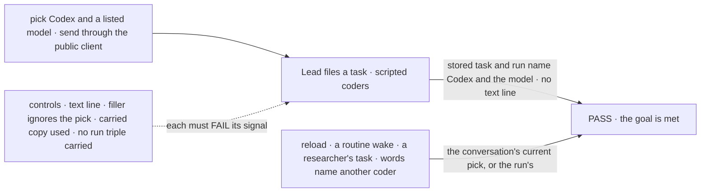
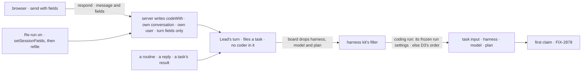

# FIX-2879 · "Code with": the client picks the coder as structured request/session state, and every teammate passes it into the task

**Spec** · [Decisions](DECISIONS.md)

## Six people, before and after

| Someone who… | Today | After |
|---|---|---|
| **picks Codex and a model in Teammates, then asks for a code change** | The composer adds a `Coding harness: Codex` line to the message. Lead reads it and picks one of three coding workers. No model can be picked | The pick goes beside the message as a field, not as text. The task's run settings name Codex and that model, and so does the run. The stored message is what was typed |
| **reloads the page, or opens the conversation on another machine** | *Code with* is back on the app's default | *Code with* shows the conversation's pick, read from the session |
| **types "have Codex do it" with Claude Code picked** | Lead files the task on the Codex worker | Nothing runs on Codex. Lead says that the coder is chosen in *Code with*; a task it files runs on Claude Code ([D1](DECISIONS.md#d1)) |
| **presses *Re-run on Claude Code* on a failed task** | A new task on the Claude Code worker | A new task on the one coder, on Claude Code. The conversation's *Code with* is now Claude Code too ([D2](DECISIONS.md#d2)) |
| **is away while a worker's reply, a routine or a task's result wakes Lead, which files a coding task** | Lead guesses from the last line that named a coder | The task runs on the conversation's last pick; with none, on the app's default. A researcher's task that files a coding task uses the conversation's current pick ([D3](DECISIONS.md#d3)) |
| **builds an app that keeps a value on each session** | Sets `sessionFields` on the workforce kit; the value is written once, when the session opens | Fills `workforce.slots.sessionFields`, and says per field whether it is written once at open or again by each turn. Another kit can fill it too |

Nothing changes in the Claude Code-style lab's picker: its `Coder:` line and its coder workers
are [FIX-2598](https://linear.app/fixpoint-labs/issue/FIX-2598)'s, on the carrier this issue
builds ([epic D3](../../epics/FIX-2876/DECISIONS.md#d3)).

## The goal, and how we'll know it's met

**A person's *Code with* pick, harness and model, reaches every coding task filed from their
conversation as state the server writes, stays with the conversation across a reload and across
turns no person started, and no message text carries it.**

| Is it the right goal? | |
|---|---|
| **The real need** | The epic's: *"whoever asks for a code change names the coder and model once, and the run uses exactly that"* ([FIX-2876](../../epics/FIX-2876/SPEC.md#the-goal-and-how-well-know-its-met)). This issue owns the person's half: [ER-5](../../epics/FIX-2876/DECISIONS.md#who-owns-what), and the Teammates side of [D2](../../epics/FIX-2876/DECISIONS.md#d2). [D3](DECISIONS.md#d3) amends the wording of ER-5 and of ER-10 for filings outside a coding run. Without it a person's pick never reaches a task, because a filer cannot set one ([ER-10](../../epics/FIX-2876/DECISIONS.md#who-owns-what)) |
| **Smaller, and rejected** | "The composer sends the harness as a field." It can pass while the pick is lost on reload, while a routine's filing runs on the default, while a model can't be picked, or while Lead still routes by worker |
| **Bigger, and not this issue's** | The freeze, the lock and the model check, which are FIX-2878's · the lab's picker (FIX-2598) · a picker in Shift Manager (none, by the epic) · the whole four-leg run on one commit (closure [FIX-2883](https://linear.app/fixpoint-labs/issue/FIX-2883)) |
| **Not done if** | The goal check never ran under its controls · a `Coding harness:` line, or a prompt rule that reads one, survives in Teammates · the pick is read from message text anywhere · a reload loses it · a turn no person started files on anything but the conversation's pick or, with none, the default · a field a turn may not write, or one that doesn't parse, is stored · a model's tool call changes the pick · Teammates keeps more than one coding worker · the `sessionFields` config key still works |



The check reads the stored task, the run record and the scripted harness's own report, never
Lead's reply or the picker. Under each control its named signal must fail.

| How we verify | |
|---|---|
| **Goal check** | `goals/teammates-lab/code-with-reaches-the-task/` · Teammates over HTTP through the public client, scripted coders, a real model for Lead · run by the implementer at completion · verdict in the implementation PR |
| **Signal** | **Pick:** a send with `codeWith` Codex and a model read from the harnesses flow's model list files one task whose stored input, run record and scripted report all name Codex and that model; the stored message has no `Coding harness:` text, in at least 2 runs of 3. **Reload:** a fresh client reads `codeWith` off the session, and a second send with no fields files a task on the same run settings. **Words:** with Claude Code picked, "have Codex do it" runs nothing on Codex, in 3 runs of 3; any task it files runs on Claude Code. **No person:** a routine fired in the conversation files a task on its pick. **Filed task:** a researcher's task is filed under a Cursor pick, the person moves *Code with* to Codex, and the researcher's next coding filing runs on Codex: it reads the root conversation's current pick. *Code with* changes between two filings, and the second task follows. **Delegated:** a coding run locked to plan mode files a researcher task that files coding work; the new run is a plan run on the parent's harness, in 3 runs of 3. **Refused:** a send whose `fields` name an open-only field, or a value that doesn't parse, is refused and stores neither the field nor the message. So is a harness that isn't filled, or a model its harness didn't list. A second principal posting `fields` on this session stores nothing and gets the same response as an unknown session id |
| **Input** | Two scripted harnesses under the ids `codex` and `claude-code`, each listing two models and reporting the model it ran and whether it ran in plan mode ([ER-6](../../epics/FIX-2876/DECISIONS.md#who-owns-what)). The change request is drawn from two wordings; no worker file or prompt names a harness |
| **Anti-game** | Read the stored task, the run record and the scripted report. Never Lead's reply, the picker, or a stubbed board |
| **Control that must fail** | `GOAL_CONTROL=text-line` (the composer's line back, no `fields`) fails **Pick** and **Reload**; `no-fill` (the filler ignores `codeWith`) fails **Pick** and **No person**; `use-carried` (the filler reads the session's carried copy) fails **Filed task**, so the carried copy fails closed. `drop-ancestry` (the hand-over carries no run triple) fails **Delegated**. Today's `main` fails all but **Refused**. The PR shows each FAIL before the PASS |

## What changes


Left is today: the pick is words, and a model reads them. Right is after: the pick is a field
the server writes, and the server copies it into the task.

**An app's session field** (the Claude Code-style lab's one field moves to the slot):

```diff
  workforce({
    agent: { model },
-   sessionFields: { repository: z.string().min(1) },
  }),
  fill: {
+   [workforce.slots.sessionFields]: { repository: { schema: z.string().min(1), written: "open" } },
  },
```

**The harness kit's field**, contributed beside its capability:

```diff
+ [workforce.slots.sessionFields]: { codeWith: { schema: codeWithSchema, written: "turn" } },
+ // codeWith: { harness: "codex", model?: "gpt-6-luna", plan?: false }   plan is inert until FIX-2599
```

**Teammates' send:**

```diff
- await workforce.send(sessionId, withHarness(text, picked, defaultHarness), { attachments });
+ await workforce.send(sessionId, text, { attachments, fields: { codeWith: { harness: "codex", model: "gpt-6-luna" } } });
```

**Teammates' coding workers:**

```diff
- workers/claude-code/WORKER.md   harness: claude-code
- workers/codex/WORKER.md         harness: codex
- workers/cursor/WORKER.md        harness: cursor
+ workers/coder/WORKER.md         flow: coder, no harness line: the kit's defaultHarness
```

**Docs:** the harness-manager page's *Choosing the harness* gets the epic's *Code with* clause
(a person's pick reaches the task through `codeWith`), and *Which harnesses can run here* gets
the model list. The workforce overview's *Serving it to your users* and the workforce README get
session fields: the slot, `written`, the respond action's `fields` and `send(…, { fields })`.
The glossary adds *Session field*. All through this PR's changeset; the pages follow at release.

## How a pick reaches the task



The server writes the pick once per turn, before the turn runs. Every filing then reads it from
the session, whoever started the turn, which is why nothing a model writes can change it.

## What stays as it is

- **The coder flow's door** takes no `fields`: a talk to a running task stays on its frozen coder ([ER-8](../../epics/FIX-2876/DECISIONS.md#who-owns-what)).
- **The order, the freeze, the lock and the model check** are FIX-2878's. This issue only writes what the filler reads.
- **Open fields** (`written: "open"`) are written once, at open, exactly as `sessionFields` are today.
- **The Claude Code-style lab** keeps its `Coder:` line and per-harness workers until FIX-2598, which writes the same `codeWith`. It only moves its `repository` field to the slot here.
- **Shift Manager** gets no picker; its tasks run on the worker's or the kit's default (epic).
- **Harness sessions** (Kitchen Sink's harness mode) keep their own model pick.
- **Plan mode** stays behind `claude-code-plan`. `codeWith` takes `plan?`, checked at the write like `harness` and `model`, but nothing reads it until [FIX-2599](https://linear.app/fixpoint-labs/issue/FIX-2599).

## What's already here, and the debt

| Already here | What this does with it |
|---|---|
| **Ways a person's choice rides a turn to the server:** `sessionFields` (written once, at open) · `taskId` on the respond action (a label) · `createSession`'s `state` (refused for server-owned keys) · agent-flow `settings` (per worker, never read) · capability `sessionStateSchema` (declares, writes nothing) · message text (`Coding harness:`, `Coder:`) | **Extends the first.** Searched `sessionFields`, `respond`, `settings`, `stateSchema` and `Coding harness` across `packages/` and `labs/`. As a new piece this would be the seventh way; as a `written: "turn"` mode it is none |
| `setSessionFieldsAction`: admits only the session's own user on their own conversation, parses each field, writes in one versioned write | **Extended**: a turn field may be written again; an open field stays write-once. The respond action writes through the same rule |
| `carriedSessionFields` at each hand-over (three sites in `board.ts`) | **Extended.** A `written: "turn"` field is not carried: a linked session reads the root conversation's current `codeWith` through its links, and nothing displays a carried copy. At a hand-over inside or below a coding run, the server carries that run's resolved triple, which no filer can set. The filler reads them in [D3](DECISIONS.md#d3)'s order |
| `Harness.models` (FIX-2458), read today only by FIX-2878's claim check | **Extended** with a view on the harnesses flow, beside readiness, for a picker |
| `READINESS_GUIDANCE` and FIX-2877's default-coder line in the harness kit's capability | **Extended** with the one instruction, which names the conversation's pick |
| Teammates' `withHarness`, `LEAD_FALLBACK_HARNESS`, Lead's routing rules, three coding workers, *Re-run on* by worker | **Removed**, or moved onto the one coder |
| Epic [ER-5](../../epics/FIX-2876/DECISIONS.md#who-owns-what), [D2](../../epics/FIX-2876/DECISIONS.md#d2), [D3](../../epics/FIX-2876/DECISIONS.md#d3), [Q-C](../../epics/FIX-2876/DECISIONS.md#decided-in-review); [FIX-2616 D1](../../epics/FIX-2616/DECISIONS.md#d1) | **Built.** ER-5's "never the carried copy" holds everywhere, since `codeWith` is no longer carried. ER-10 gains [D3](DECISIONS.md#d3)'s steps for filings outside a coding run: the root conversation's current pick, then the person's no-pick default, else a refusal. Both rows' text is amended, folded into the epic amendment on #5605; ER-10 is FIX-2878's, so the wording is coordinated with its spec. FIX-2616 D1 (the pick is the person's) is kept |

| Adds | Existing piece considered | Why it doesn't fit / how composed |
|---|---|---|
| `workforce.slots.sessionFields`, keyed, each entry `{ schema, written: "open" \| "turn" }` | The kit's `sessionFields` config key | **Replaces** it, with no alias (BP-034): a slot lets the harness kit fill a field, and a key given twice is refused, naming both |
| `fields?` on the agent and coordinator flows' respond action | `doorTask`, which adds `taskId` the same way | **Extends** the action's input; it writes through `setSessionFieldsAction`'s rule |
| `fields?` on the client's `send` | `send`'s `taskId`, sent only to a door that takes one | **Extends**: sent only to a door that takes fields, refused elsewhere |
| `codeWith` (`{ harness, model?, plan? }`) and its exported name and schema | FIX-2878's run-settings shape (`harness`, `model`, `plan`) | **Composed** on the slot; the shape is FIX-2878's. `plan` is inert until FIX-2599 |
| The filler reading the pick | FIX-2878's filler | **Extends** it by four sources: the session's own `codeWith`, the walk to the root conversation's `codeWith`, the run triple carried at hand-over, and a refusal when no root resolves ([D3](DECISIONS.md#d3)) |
| The harnesses flow's model list | The readiness view on the same flow · Kitchen Sink's per-mode model lists | **Extends** the flow with one view over `Harness.models`; Kitchen Sink's are for sessions |

| The debt | |
|---|---|
| **Removes** | The `sessionFields` config key and its nested-key refusal · Teammates' `Coding harness:` line, `withHarness`, `LEAD_FALLBACK_HARNESS` and the prompt rules that read the line · two of Teammates' three coding workers · *Re-run on* by worker |
| **Adds** | The slot, `written`, `fields` on respond and on `send`, `codeWith`, the model list view: published, permanent by design |
| **Leaves** | The lab's `Coder:` line and its eight workers, which FIX-2598 removes together |

**Net: down.** A text protocol, a config key, two workers and three prompt rules go; one slot
with a mode replaces the key, and the rest extend pieces that exist.

## Sign off

**[The goal](#the-goal-and-how-well-know-its-met), at that size:** the pick reaches every
coding task from the conversation, whoever started the turn, and survives a reload. If wrong: a
picker that works until a routine files the next task.

**[The debt](#whats-already-here-and-the-debt), net down:** a text protocol, a config key and
two workers go; a slot mode, a `fields` option and a model list arrive. If wrong: a turn-written
field nobody but the harness kit uses.

1. **[D1](DECISIONS.md#d1) · A coder named only in words is not used; the teammate points the
   person to *Code with*.** If wrong: people who switch coder by typing find it doesn't work.
2. **[D2](DECISIONS.md#d2) · *Re-run on* another coder also moves the conversation's *Code
   with* to it.** If wrong: someone comparing coders finds the conversation's coder changed.
3. **[D3](DECISIONS.md#d3) · A filing from a session no person writes to uses the person's
   current pick.** If wrong: someone who moves *Code with* finds a delegate's next task followed.

**Open: none.** D3 is the one to weigh: it amends the wording of epic ER-5 and ER-10 (inside or below a coding run, that run's triple; otherwise the root conversation's current `codeWith`, then the person's no-pick default, else refused), folded into the epic amendment on #5605.

Feature · `workforce`, `harness-manager`, Teammates lab, Claude Code-style lab · medium-large · epic
[FIX-2876](../../epics/FIX-2876/SPEC.md) · blocked by FIX-2877 and FIX-2878 · two PRs: the
package half, which FIX-2598 waits for, then the Teammates half
