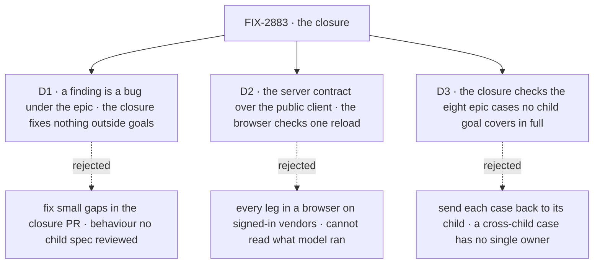

# FIX-2883 · Decisions

[Spec](SPEC.md) · **Decisions**

What was considered, what was chosen, why, and what each choice locks in. Three decisions are
the sign-off surface. Everything else here is context for them.

## The tree

Solid edges are what you're signing. Dashed edges lost, and the label says why.

## D1 · A gap the closure finds becomes a bug under the epic; the closure PR fixes nothing outside `goals/`

| | |
|---|---|
| **Instead of** | Fixing a small gap inside the closure PR, where it was found |
| **Because** | A fix changes behaviour, and behaviour in this epic is reviewed against a child spec. A fix in a QA PR has no spec behind it, and its reviewer reads goal code. The epic's own rule is that the closure finds what falls between the children. Filing the gap as a bug under the epic gives it an owner, a spec to answer to, and a regression row: the closure row that failed |
| **Locks in** | The epic wraps only after each finding's fix merges and the closure runs green again on that commit. Each finding costs at least one PR and one re-run, even a one-line fix. Goal files are the one exception: a superseded child goal is updated by the child that superseded it, and a stale one is a finding against that child |

It comes down to who reviews the fix: a QA PR has no spec behind the behaviour it changes.

**What would change my mind:** a first closure run whose findings are all in goal files, not in
behaviour. Then the closure PR fixes them, and D1 holds only for behaviour.

## D2 · The closure proves the server contract over the public client with scripted coders; the browser checks only the composer after a reload

| | |
|---|---|
| **Instead of** | Every leg in a real browser on signed-in vendors, as the epic's *Goal check* row reads ("Teammates in the browser") |
| **Because** | What the goal promises lives on the server: the stored task, the run record, and the model a harness was handed. A signed-in vendor cannot report which model it was handed, so a browser leg would grade the picker, which the epic's anti-game forbids. Steer, message, door, retry and claim are routes a browser does not drive. The owner's review note on this issue asks for this: integration-first, the browser only for the reload of turn state ([epic ER-6](../../epics/FIX-2876/DECISIONS.md#who-owns-what)) |
| **Locks in** | "The person sees it" rests on one browser check: the composer shows the conversation's pick after a reload. A bug in another click path, such as a *Re-run on* button that sends no `fields`, is caught only if a public-client row covers the same request. The epic's *Goal check* wording is narrowed, which the epic records at wrap |

![D2, where the closure proves the pick. Chosen: over the public client with scripted coders, plus one browser reload. Instead of: every leg in a real browser on signed-in vendors. It comes down to what a pass reads: the stored task, the run record and the model the harness was handed, against the picker and the vendor's own screen. The price: a bug only a click path shows can ship. Locks in: the person's view rests on one browser check. Flips if: a finding shows the composer and the public client send different fields](figures/d2-public-client.svg)

It comes down to what a pass reads: a browser leg on a real vendor can only read the picker.

**What would change my mind:** a finding where the composer sends a request the public client
does not, such as a button that drops `fields`. Then each button that sends a pick gets its own
browser row.

## D3 · Where the epic promises something no child's goal covers in full, the closure checks it, citing the text that promises it

| | |
|---|---|
| **Instead of** | Sending each such case back to its child, to add a goal signal before it builds |
| **Because** | Eight cases are like this. Six cross a child boundary: a pick written by FIX-2879 and refused at FIX-2878's claim (d3), a filing walked to the root by FIX-2879 and filled by FIX-2878 (d8), a mode default from FIX-2877 that a FIX-2878 steer must not read (b6), and b7, d1 and d6. A child's goal proves its half of those against a stub of the other. FIX-2878's spec already hands the named-model proof to this closure. Two sit inside one child, a2's browser reload (FIX-2879) and b9 (FIX-2878), but the epic names both as its own signal and control. So the closure checks them and tells those children their goals miss them. The checker names all eight and fails if one loses its citation |
| **Locks in** | Five cases are proved nowhere but the closure: b7, b9, d3, d6 and d8. A regression in one is seen only when the closure is re-run, so the closure stays in the goal library as the epic's regression check. A new case wholly inside one child, that the epic does not name, goes back to that child |

It comes down to a case across two children: one child alone proves it only against a stub.

**What would change my mind:** a child adds the signal for its own case before it merges, as
FIX-2879 could for a2 and FIX-2878 for b9. Then that row rolls the child's signal up instead.

## Decided, not asked

- **When it runs.** On the first `main` commit that holds all four children, by the implementer.
  A dry run on a partial set is allowed for building, never for a verdict.
- **Thresholds are the children's.** A row that rolls up a model-backed child signal keeps its
  threshold (FIX-2879 *Pick* 2 of 3, *Words* 3 of 3; FIX-2877 *a* 3 of 3). Model-free rows pass
  1 of 1, and a flaky one is a finding, not a retry.
- **Today's `main` as a control.** `GOAL_COMMIT=0a9ac03b4` for legs a and c, which reach the apps
  over HTTP. Legs b and d import a lock and modes that do not exist there, so their red state is
  the code the checker reads on that commit. That is a recorded fact, not a run.
- **Controls are load-time patches** (`goals/lib/module-patch`), never written to the checkout,
  so no control is behaviour the closure adds.
- **One host for legs b and d.** A harness-kit host under the closure's directory, with modes,
  locked workers and the odd scripted harnesses. Whether it extends `goals/harness-manager/host.mts`
  is the implementer's call.
- **Lead runs on the lab's default model** for the rows that need a person's words (a1, a2, a4,
  a5). Every other row is scripted.
- **FIX-2894's rows are provisional.** d6 cites epic ER-9 until FIX-2894's spec merges. Then the
  build ties it to that spec's signal names, and a promise the spec drops is a finding.
- **b9 may be unrepresentable.** Until FIX-2599, a plan session runs on `claude-code-plan`, a
  different id from `claude-code`. If the run record as built cannot hold the mismatch b9 seeds,
  the verdict log says so and names the type that rules it out. That is b9's evidence, and
  `match-by-id` is recorded as unconstructible, not as passed.
- **A finding is filed through `issue-manager`** as a child of FIX-2876 that blocks FIX-2883. It
  names the row, the control and the commit, and gets the bug route.
- **The invariant and its convergence point.** "Every child signal is rolled up, and every cited
  name exists" converges in [`poc/coverage/coverage.json`](poc/coverage/coverage.json). Every
  writer of a row goes through it, and [`check.mjs`](poc/coverage/check.mjs) asserts totality
  over every child's *Signal* row, so a signal a child adds later and no row covers fails the check.

## Considered and dropped

| Alternative | Why not |
|---|---|
| Re-run the children's goals and call that the closure | Each proves its half against a stub of the others. It misses the eight cross-child cases and the two goals the final commit changes |
| One `run.mts` per epic leg, each with its own host | Legs b and d need the same modes, locks and odd harnesses. Two hosts drift apart |
| Fold leg b's and d's rows into FIX-2878's goal | That goal belongs to FIX-2878's PR and its commit. The rows that need FIX-2879's `codeWith` would come before FIX-2879 merges |
| A cut run on a partial set, as FIX-2541 had | That epic used it to decide what to build. Here the set is decided, so only the final commit's verdict counts |

## Settled

- **The matrix is total and its citations exist.** CONFIRMED by
  [`poc/coverage/check.mjs`](poc/coverage/check.mjs) on `0a9ac03b4`: 28 rows roll up every signal
  of the epic (4), FIX-2877 (3), FIX-2878 (16) and FIX-2879 (7). Eight rows rest on a promise no
  child goal covers in full, five with no child signal at all. There are ten closure controls and
  two superseded child signals, and all ten red-on-main lines are present. `--control` plants a
  missing signal, a dropped row, a reused control name and an absent line, and it FAILS on all
  four. Run with `node specs/issues/FIX-2883/poc/coverage/check.mjs` from the repo root.
- **Two child goals disagree with a later child about the final state.** CONFIRMED by reading
  them. FIX-2877's goal *c* keeps "its branch, checkout and saved session", but
  [FIX-2878 D2](../FIX-2878/DECISIONS.md#d2) starts a session from before the freeze fresh once.
  FIX-2877's goal *a* expects the default's worker as the assignee, which FIX-2878 retires. The
  later, signed decision wins (CLAUDE.md §6). The checker holds both as `superseded`.

## Analysis

2026-11-23 · watermark 2026-11-23 (FIX-2879's spec merged) · **Right approach.** Run by the
author in the same pass, not by a fresh agent. This worker had no sub-agent tool, so the pass
is weaker than the skill asks. The reviewer at the gate should read it with that in mind.

1. **Reuse.** The goal directory composes `goals/lib`'s verdict, patch and driver modules and
   the children's goals. The controls extend the children's and reuse no name. See
   [Builds on / Adds](SPEC.md#whats-already-here-and-the-debt).
2. **Prior art.** `closure-smarter-agents` (FIX-2541): legs as modules, a re-run of the children,
   a control that must fail first. The shape is followed. Its cut run is dropped (*Considered
   and dropped*).
3. **Other shapes.** Children's goals only, and a browser-first run. Both are recorded above.
4. **New factors.** The modes amendment (#5612), FIX-2878's modes re-check (#5611) and FIX-2879's
   merge (#5607) are all folded in. FIX-2894 has no spec yet, so its rows are provisional.
5. **Necessity.** Earns its place. Two inter-child disagreements and eight uncovered cases
   showed up at spec time, before any child built.
6. **Ergonomics.** One command per leg, and one checker that a later spec change re-runs.
7. **Concerns.** D2 narrows an epic wording, and the epic records it at wrap. Recorded.

## How it got here

- **Draft.** Framed as the epic's QA plan, written before the children build. The approach is
  four legs over the public client and a goal host, each row citing the child signal or promise
  it rolls up, with a checker that proves the matrix total. It builds on the epic's legs and
  `closure-smarter-agents`' shape.

**Open: none.**
