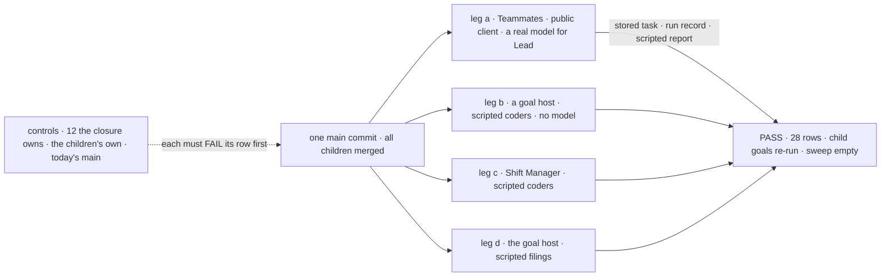
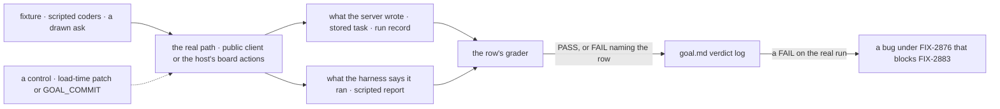

# FIX-2883 · Closure: a coding task runs on the coder that was picked, through one flow

**Spec** · [Decisions](DECISIONS.md)

| Someone who… | Today | After |
|---|---|---|
| **signs off epic FIX-2876 at wrap** | Would read four goal verdicts, each run on its own child's commit, each against stubs of the other children | Reads one verdict per leg on one `main` commit, each leg's controls seen failing first, with every child's own goal re-run beside it |
| **picks Codex and a model in Teammates, then asks for a change** | The pick rides in the message as `Coding harness: Codex`; the run's model is whatever the harness was built with | Is the person leg a stands in for: the closure proves the run used Codex and that model, after a reload too, and that no text carried it |
| **lets a worker, a delegate or a routine file the next coding task** | That task runs on whatever its assignee's file says | Is leg b's person: the closure proves a run keeps the coder it started with, and a new coder is a new task with a fresh session |
| **runs Shift Manager on its default coder** | Its tasks run through Shift Manager's own copy of the coding flow | Is leg c's person: the closure proves they run through the shared flow, in its two modes, on the one default |
| **owns a child issue of the epic** | Finds a gap between two children after the epic wraps, if anyone does | Gets a bug filed under the epic that names the leg, the control and the commit. The epic does not wrap until it is fixed ([D1](DECISIONS.md#d1)) |

The closure builds no feature. It is the epic's goal check, written down before the children
build, and run once they have all merged.

## The goal, and how we'll know it's met

**On one `main` commit after every child merges, a run of the closure check shows that whoever
asks for a code change names the coder and model once, and the run uses exactly that, through
one coding flow and one resolution order, with each of its controls failing first.**

| Is it the right goal? | |
|---|---|
| **The real need** | The epic's goal, in its words: *"Whoever asks for a code change names the coder and model once, and the run uses exactly that, through one coding flow and one resolution order"*, proved on legs a to d with a control per leg ([FIX-2876](../../epics/FIX-2876/SPEC.md#the-goal-and-how-well-know-its-met)). The issue adds: re-run every child's goal, walk each team the legs miss, and sweep each seam and *not done if* state |
| **Smaller, and rejected** | "Every child's goal check passes." Each child proves its half against a stub of the others. Two child goals already disagree with a later child about the final state ([below](#two-child-goals-the-final-commit-changes)), and eight epic promises have no child goal that covers them in full |
| **Bigger, and not this issue's** | Fixing what the closure finds (each fix is a bug under the epic, [D1](DECISIONS.md#d1)) · the lab's picker and plan mode as a setting ([FIX-2598](https://linear.app/fixpoint-labs/issue/FIX-2598), [FIX-2599](https://linear.app/fixpoint-labs/issue/FIX-2599)) · signed-in vendors ([D2](DECISIONS.md#d2)) |
| **Not done if** | A leg ran on a commit other than the one the children merged to · a control was never seen to FAIL its named row · a row passed on today's `main` · a leg read the picker, Lead's reply, the filing tool's answer or a stubbed board · a child goal was not re-run, or was re-run on its own commit · a superseded child assertion still asserts the interim state · a sweep printed a hit · a finding was fixed inside the closure PR · a finding is open |



Every row reads the stored task, the run record and the scripted harness's report of what it
ran and with which model. Each control must fail its named row before any PASS counts.

| How we verify | |
|---|---|
| **Goal check** | `goals/coder-selection/runs-on-the-coder-that-was-picked/` · `GOAL_LEG=a\|b\|c\|d`, all four by default · leg a: the Teammates lab over HTTP through the public client, a real model for Lead (the lab's default), and one browser check, the composer after a reload ([D2](DECISIONS.md#d2)) · legs b and d: a goal host under the same directory, no model · leg c: Shift Manager through `goals/lib/shift-manager` · run by the implementer on the commit after the last child merges · verdicts in its `goal.md` and the closure PR |
| **Signal** | The 28 rows of the [coverage matrix](#the-coverage-matrix), each its own named assertion. Together they cover all 80 clauses of the epic's and the children's goal signals, each row naming the clauses it covers, or the child or epic text that promises it ([D3](DECISIONS.md#d3)). Thresholds are the child's: a row that rolls up a model-backed signal keeps that signal's (FIX-2879's *Pick* 2 of 3, *Words* 3 of 3); model-free rows pass 1 of 1. Then every child goal [re-run](#what-else-runs-on-the-same-commit), and the [sweep](#what-else-runs-on-the-same-commit) printing nothing |
| **Input** | Scripted harnesses under the ids `codex`, `claude-code`, `claude-code-plan` and `cursor` for Teammates, and `alpha` and `beta` for the host, all reporting one `source`, each listing two models and reporting the one it was handed ([epic ER-6](../../epics/FIX-2876/DECISIONS.md#who-owns-what)). Also one whose catalog fails, one whose default model changes between attempts, a plan harness that writes, and a second task that makes a branch. The model a row picks is read from the harness's own list at run time, never its default. Asks are drawn from two wordings. Another pair of ids must pass too |
| **Anti-game** | Never the picker, Lead's reply, the filing tool's answer, the task's stored input as the proof of what ran, or a stubbed board. A refusal is graded on what was stored and what ran, not on its wording |
| **Control that must fail** | Per row, in the matrix: the children's own controls, by their names, and twelve the closure owns: `kit-fallback`, `door-takes-pick`, `match-by-id`, `own-coder-flow`, `lock-on-meant-worker`, `lock-harness-only`, `skip-failed-catalog`, `ignore-plan`, `no-root-default`, `empty-no-pick`, `accept-any-fields`, `open-input`. Each is a load-time module patch (`goals/lib/module-patch`), never written to the checkout. **Every row has a red state.** 26 rows name a control that must turn them red. Two more (a3, c2) are red on today's `main` through `GOAL_COMMIT=0a9ac03b4`, which must also FAIL legs a and c, since they drive the apps over HTTP. Legs b and d cannot load on today's `main`, because the lock and the modes do not exist yet, so each of their rows needs a named control, and the checker requires one. What the code on that commit does is [context](#red-on-main), never evidence of a red state |

## What changes

![The closure, as a picture. On the left, what the children promise, as goal-signal clauses: FIX-2894 through epic rule ER-9 until its spec merges, FIX-2877's nine, FIX-2878's thirty-four and FIX-2879's thirteen. In the middle, four legs on one main commit: a with six rows, b with nine, c with three, d with ten. Eight rows also rest on a promise no child goal names in full. On the right, each control fails first, then the legs pass, the child goals are re-run and the sweep prints nothing. A finding is a bug under the epic](figures/what-changes.svg)

Every clause of every child signal goes into at least one leg. The closure's own rows are the eight cases the
epic promises and no child's goal covers in full, most of them between two children.

**What the closure adds, all under `goals/`** (no package, app or lab file changes, [D1](DECISIONS.md#d1)):

```diff
+ goals/coder-selection/runs-on-the-coder-that-was-picked/
+   goal.md          # the 28 rows, their controls, the verdict log
+   run.mts          # GOAL_LEG=a|b|c|d, GOAL_CONTROL=<name>, GOAL_COMMIT=<sha>
+   legs/            # a.mts (Teammates), b.mts and d.mts (the host), c.mts (Shift Manager)
+   lab/             # Teammates with scripted coders filled under the vendor ids
+   host/            # a harness-kit host: modes, locked workers, the odd scripted harnesses
+   controls/        # the twelve closure-owned patches
+   rerun.mts        # every child goal, on the same commit, with its verdict
+   sweep.mts        # the not-done-if sweep
```

**Docs:** no documentation impact. The closure is a goal check under `goals/`, which is not user
documentation. The sweep checks that each child's changeset carries its part of the epic's docs
line, since the pages follow at release.

## The coverage matrix

[`poc/coverage/coverage.json`](poc/coverage/coverage.json) is the matrix.
[`check.mjs`](poc/coverage/check.mjs) re-derives it from the specs on disk.

- **Clauses.** The checker splits each spec's *Signal* row into signals, and each signal into its
  clauses (the scenarios it names), at each `;` and each sentence end. That gives 80 clauses:
  the epic 24, FIX-2877 9, FIX-2878 34, FIX-2879 13. Each clause is pinned by its opening words,
  so a reworded child spec fails the check until the matrix follows it.
- **Totality.** Every clause is covered by a row that names it, so a scenario no row exercises
  fails the check.
- **Citations.** Every cited promise and child control exists. The twelve closure controls reuse
  no child's name.
- **Red states.** Every row has one: a named control, or `GOAL_COMMIT` for an a or c row.
- **Its own control.** `--control` plants an uncovered clause, an unknown clause, a b or d row
  with no control, a reused control name and a reworded clause. The check must FAIL on all five.

| Leg | Rows | Rolls up | The closure's own ([D3](DECISIONS.md#d3)) |
|---|---|---|---|
| **a** · a person's pick reaches the run | a1–a6 | epic *a* · FIX-2879 *Pick, Reload, Words, No person, Refused* · FIX-2877 *a* · FIX-2878 *Order* | a2's browser reload |
| **b** · a run keeps its coder | b1–b9 | epic *b* · FIX-2878 *Inherit, Freeze, Default, Review, Mode, Resume* · FIX-2879 *Delegated, Filed task* · FIX-2877 *a, c* | b6's steer, b7 a new coder, b9 a plan session |
| **c** · Shift Manager on the shared flow | c1–c3 | epic *c* · FIX-2877 *b* · FIX-2878 *Legacy feature* | — |
| **d** · only the server picks, and refusals have names | d1–d10 | epic *d* · FIX-2878 *Plan, Lock, Postcheck, Mode, Mode lock, Legacy feature, Legacy write, Mode update, No-pick, Legacy* · FIX-2894 via ER-9 | d1's turn pick, d3 a failed catalog, d6 a filer's `doneWhen`, d8 no root |

FIX-2894 has no spec yet, so d6 cites [epic ER-9](../../epics/FIX-2876/DECISIONS.md#who-owns-what).
The build ties d6 to FIX-2894's clauses when that spec merges, and a promise its spec drops
is a finding.

## Examples

Every row as it runs: what is set up, what is sent, and what must be read back. Names past the
ones a child spec fixes are illustrative; the implementer settles them against the code.
Teammates rows use session `s1`. Host rows use workers `A` (`harness: alpha`), `B`
(`harness: beta`) and `C` (no `harness:` line), with `defaultHarness: alpha` unless a row says otherwise.

### Leg a · a person's pick reaches the run

```text
a1 · pick Codex and a model it lists, then ask for a change           FIX-2879 Pick · epic a
send   workforce.send(s1, "Add a line to the README saying who maintains it",
         { fields: { codeWith: { harness: "codex", model: "<codex's second listed model>" } } })
read   the stored message        what was typed, and no "Coding harness:" anywhere
       the stored task           harness codex, that model, plan false, with the server's marker
       the run record            frozen harness codex, that model
       the scripted report       ran codex, was handed that model
pass   2 of 3 runs
red    on main the message ends "Coding harness: Codex" and the report says "stub-model"
fails  text-line · no-fill · worker-only
```

```text
a2 · reload, then ask again with no pick                              FIX-2879 Reload · epic a
after  a1
read   a fresh client reads s1's codeWith      { harness: "codex", model: "<a1's model>" }
send   "Also add a link to CONTRIBUTING.md", with no fields
read   the second task's run record and report: codex, a1's model
browser reload the Teammates page on s1        Code with shows Codex and a1's model, not the default
red    on main the picker returns to the app default, and the second task runs on Lead's fallback
fails  text-line
```

```text
a3 · nobody picks: the app's one value decides                       FIX-2877 a · FIX-2878 Order
start  Teammates with TEAMMATES_HARNESS=codex, a new conversation, no codeWith ever sent
send   "Add a line to the README"
read   run record: codex, codex's own default model, plan false
start  again with TEAMMATES_HARNESS=claude-code, nothing else edited, the same ask
read   run record: claude-code, its own default model
hire   a teammate with a harness setting: its roster row has none
note   FIX-2877 a's own goal expects the default's worker as the assignee, and a board pick of the
       Cursor worker. On this commit the assignee is the model's, on the one coder worker; the
       goal is updated by the PRs that change it (see "Two child goals")
red    GOAL_COMMIT=0a9ac03b4: with codex set, Lead still files on teammates.cursor
```

```text
a4 · words name another coder                                         FIX-2879 Words · FIX-2877 a
set    codeWith { harness: "claude-code" }; the checkout's README ends "Coding harness: Cursor"
send   "Have Codex do it: add a line to the README"
read   no run record names codex or cursor; any task filed runs on claude-code
pass   3 of 3 runs
red    on main Lead files the task on teammates.codex
fails  text-line
```

```text
a5 · a routine wakes Lead, and Lead files coding work                 FIX-2879 No person
set    s1's codeWith { harness: "cursor", model: "<cursor's second listed model>" }
fire   a routine on s1: "Fix the failing lint in src/"
read   the task the routine's turn filed runs on cursor and that model
fails  no-fill (it runs on the default)
```

```text
a6 · a pick the server will not store                                 FIX-2879 Refused
send   fields { codeWith: { harness: "devin" } }                  refused; neither message nor field stored
send   fields { codeWith: { harness: 42 } }  (does not parse)     refused; neither message nor field stored
send   fields { codeWith: { harness: "codex", model: "gpt-0" } }  refused; codex does not list gpt-0
send   fields { repository: "acme/app" }    (an open-only field)  refused; nothing stored
send   any fields on s1, as a second user                         the same answer as an unknown session id
fails  accept-any-fields (the write rule patched to store any field: each send above is stored)
```

### Leg b · a run keeps its coder

```text
b1 · a worker's run files the next task                              FIX-2878 Inherit · epic b
claim  task P on worker A: frozen alpha, alpha-m2, plan false
file   from P's run: { title: "Update the docs", assignee: "B", input: { harness: "beta" } }
read   the child's run record: worker B, harness alpha, model alpha-m2, plan false
       (not beta from the tool args, not B's harness line, not the kit default)
read   the child's assignee is B, as the run filed it: a filing inside a coding run is not rewritten
fails  worker-only · use-carried · kit-fallback

b1' · the same, two steps down                                         FIX-2879 Delegated
claim  a task on claude-code-plan; its run files a researcher task; the researcher files coding work
read   that coding run is a plan run on claude-code-plan, 3 of 3
fails  drop-ancestry
```

```text
b2 · a delegate files after the person moved Code with               FIX-2879 Filed task · epic b
set    s1's codeWith cursor; Lead files a researcher task R
send   a turn on s1 with fields { codeWith: { harness: "codex" } }
file   from R's session: a coding task
read   it runs on codex, the root conversation's current pick, not R's carried copy (cursor)
send   a turn on s1 with codeWith claude-code; R files a second coding task
read   the second task runs on claude-code: it follows the change between two filings
fails  use-carried
```

```text
b3 · a later pick and an edited worker file reach no claimed task    FIX-2878 Freeze · epic b
claim  task T on worker A: frozen alpha, alpha-m2, plan false, review off, mode default
then   s1's codeWith becomes beta; worker A's file says harness: beta
steer  T: "Also update the changelog"          report: alpha, alpha-m2
send   T a message                              report: alpha, alpha-m2
talk   to T through the door                    report: alpha, alpha-m2
resume T after its attempt is killed            report: alpha, alpha-m2, the same session id
fails  re-resolve · worker-only (each route reports beta)
```

```text
b4 · the harness's default model changes between attempts             FIX-2878 Default
claim  T with no model on alpha: the first claim freezes alpha's default, alpha-m1
then   the app restarts with alpha({ model: "alpha-m2" }); T's attempt fails; T retries
read   the retry's report: alpha-m1
fails  null-default (alpha-m2)
```

```text
b5 · review is frozen, and never inherited                            FIX-2878 Review
claim  T on worker A with review on; then A's file turns review off; T retries
read   the retry runs review
file   from T's run, a child to worker C, whose review is off: the child runs with no review
fails  live-review
```

```text
b6 · the app's default mode changes under claimed tasks              FIX-2878 Mode · epic promise
host   modes implement (requires issue) and answer; defaultMode answer
claim  X, filed with no mode (stored as answer); Y, filed { mode: "implement", issue: "ENG-142" }
then   the app restarts with defaultMode implement
read   X's retry runs answer; a steer of Y runs implement on its first attempt's branch
fails  live-mode
```

```text
b7 · a new coder is a new task, on a fresh session                   epic b · ER-8 · closure's own
claim  T on alpha; its session is sA. alpha and beta both report source harness-manager/stub
send   a turn on s1 with codeWith beta: "Now do the same for the API docs"; or press Re-run on beta
read   a new task T2 on beta, with a new session id; T's record unchanged; s1's codeWith is beta
talk   to T through the door, with fields { codeWith: { harness: "beta" } }
read   the door takes no fields; T stays on alpha and sA
fails  match-by-source (T2 resumes sA) · door-takes-pick (the door honours the pick)
```

```text
b8 · a run in flight at upgrade                                       FIX-2878 Resume · FIX-2877 c
seed   in today's row shape: a run at acme/FIX-12/code on the kit's default mode, with a branch,
       a checkout, sessionId s-old, source harness-manager/stub, and no frozen settings
claim  its next attempt, on the closure commit
read   the record is found at acme/FIX-12/code and nothing is written at acme/FIX-12/default
       the same branch and checkout; the frozen settings written; a new session, not s-old
talk   to a finished row of the same shape through the door: refused by name
file   a new run on FIX-12: it writes acme/FIX-12/default
fails  no-legacy-key (a fresh branch) · match-by-source (s-old resumed)
```

```text
b9 · a plan session is never continued as an edit run                 epic b · ER-8 · closure's own
seed   a row frozen on claude-code-plan with plan true and session sP, then a task on claude-code
read   no attempt and no door talk on the claude-code task resumes sP
fails  match-by-id
```

### Leg c · Shift Manager on the shared flow

```text
c1 · Shift Manager's coder is the shared flow, on its one default     FIX-2877 b · epic c
start  Shift Manager with DEVFORCE_LAB_HARNESS=alpha; the coordinator files "Add a line to the README"
read   run record: alpha, and the run is a coder-flow run; coder.mts is gone
start  again with DEVFORCE_LAB_HARNESS=beta: run record beta
hire   a coder with harness: cursor; a person assigns it a task: run record cursor, the same flow
red    GOAL_COMMIT=0a9ac03b4 fails "a coder-flow run"
fails  own-coder-flow
```

```text
c2 · one list of harnesses                                             FIX-2877 b
read   the readiness view's harness ids equal the coder's
hire   a coder with harness: devin: refused, naming exactly the readiness ids
read   no Shift Manager page draws a Code with control
red    GOAL_COMMIT=0a9ac03b4: the readiness ids and the coder's differ
```

```text
c3 · Shift Manager's two modes                                         FIX-2878 Mode · Legacy feature
file   { title: "Why does the export skip archived rows?" }      mode answer; the answers host; nothing kept
file   { mode: "implement", issue: "ENG-142" }                   a commit the base lacks, on the issue's branch
seed   { harnessFeature: { issue: "ENG-142" } } (today's shape)  runs implement on ENG-142; frozen mode implement
fails  drop-feature (the seeded row runs as answer)
```

### Leg d · only the server picks, and refusals have names

```text
d1 · a filer cannot choose its coder or switch plan off               FIX-2878 Plan · epic promise
set    s1's codeWith { harness: "claude-code-plan" }
file   Lead's tool args say { harness: "claude-code", plan: false }    a plan run on claude-code-plan
set    no codeWith; defaultHarness claude-code-plan; tool args name claude-code    a plan run
update updateTask sets plan false, then clears it                     the stored plan stays; a plan run
fails  filer-plan
```

```text
d2 · a locked worker cannot be talked out of its lock                 FIX-2878 Lock · epic d
worker planner: harness claude-code-plan, lock { harness: claude-code-plan, plan: true }
file   with codeWith claude-code, the model assigns planner     refused at filing, naming both values
seed   the same task, stored with the marker, reaching planner  refused at claim
worker fast: lock { model: { id: "composer-2", params: { fast: true } } }
file   the same id with params { fast: false }                  refused; other params are another model
fails  no-lock · lock-by-reference · lock-on-meant-worker · lock-harness-only
```

```text
d3 · a model that cannot be checked is refused, not run             epic d · ER-2 · closure's own
set    harness gamma lists gamma-m1 and gamma-m2; s1 picks gamma-m2 while the list answers
then   gamma's list fails before the task's first claim
read   the claim refuses gamma-m2 by name; the run uses gamma's default; the run record names both
set    cursor lists { id: "composer-2", params: { fast: true } }; the pick sends { fast: false }
read   refused by name; cursor's default runs
fails  skip-failed-catalog (gamma-m2 runs)
```

```text
d4 · the plan setting and the harness must agree                      FIX-2878 Plan
seed   a task whose server-written settings say claude-code with plan true    the claim fails by name
seed   claude-code-plan with plan false               runs, and is frozen, as a plan run
fails  ignore-plan (claude-code runs as an edit run)
```

```text
d5 · a plan run that wrote fails                                       FIX-2878 Postcheck
run    a plan run that writes notes.md in its worktree      fails, naming notes.md
run    a plan run that creates the branch tmp/x             fails, naming refs/heads/tmp/x
run    a plan run while another task creates other/y        passes
run    a plan run during which a git fetch and a git gc run     passes
fails  no-postcheck · unscoped-postcheck
```

```text
d6 · a task's input is what the flow declares                         epic d · ER-9 (FIX-2894)
file   { mode: "implement", issue: 142 }                      refused at filing, naming issue
file   { mode: "answer", doneWhen: "always", workspace: { host: "/" } }   stored without both keys
read   listDelegates shows the coder's input fields; a flow that declares none takes an open record
fails  open-input (the declared check patched off: the filing is taken as an open record)
```

```text
d7 · modes: only the registered ones, with what they need              FIX-2878 Mode · Mode lock · Legacy …
file   { mode: "review" }                       refused: no mode "review"; names implement and answer
file   { mode: "constructor" }, { mode: "toString" }    refused the same way: own keys only
file   { mode: "implement" }, no issue          refused: implement needs issue
file   no mode, with defaultMode implement, no issue    refused: requires reads the resolved mode
file   implement to explainer (lock { mode: answer })   mode_locked at filing; a seeded copy, at claim
file   no mode to explainer: defaultMode implement      mode_locked;   defaultMode answer: accepted
seed   { harnessFeature: { issue: "ENG-142" } } on Shift Manager            runs implement
seed   { harnessFeature: { issue: "ENG-142", phase: "code" } } on a kit app runs default
seed   { harnessFeature: { issue: "ENG-142", phase: "review" } }            refused at claim; no checkout
seed   a marker with no issue, or beside an explicit mode                   refused at claim
seed   { harnessFeature: { issue: "ENG-142" } } reaching explainer          refused at claim
file   createTask or updateTask sending harnessFeature     legacy_marker; nothing filed or changed
update before the first claim: mode review, implement with no issue, against a lock    refused as at filing
update after the first claim: any mode change          the frozen mode runs
file   no mode while defaultMode is answer; the default becomes implement before the first claim
                                                 it keeps its stored answer, and runs
seed   implement with an issue; before its first claim, implement's requires gains a field it lacks
                                                 refused at claim, naming the field
file   from an implement run, a child with no mode   runs in the app's default, not implement
fails  every FIX-2878 control row d7 lists in the matrix
```

```text
d8 · no person behind a filing                                         epic d · ER-10 · closure's own
seed   a routine session whose links reach no person's conversation; it files coding work
read   refused by name; nothing filed
fails  no-root-default (it runs on the default)
```

```text
d9 · a filing with no pick, outside any coding run                    FIX-2878 No-pick · epic d
set    a new conversation, no codeWith; the filing names worker B (beta, unlocked)
read   it lands on B and runs alpha, alpha's default model, plan false
file   the same filing to worker L, lock { harness: beta }    refused at filing
fails  server-assignee (rewritten to A) · empty-no-pick (it runs on beta)
```

```text
d10 · run settings stored before the change are inert                 FIX-2878 Legacy
seed   { input: { harness: "beta", model: "beta-m2" } }, no marker, claimed by worker A
read   runs alpha on alpha's default; beta-m2 is never handed to a harness
fails  trust-stored
```

## What else runs on the same commit

**Every child goal, re-run** (`rerun.mts`): `teammates-lab/one-default-picks-the-coder`,
`shift-manager/its-coder-is-the-shared-flow` and `harness-manager/a-run-keeps-its-key-across-the-rename`
(FIX-2877); `harness-manager/a-task-runs-on-its-own-coder` (FIX-2878);
`teammates-lab/code-with-reaches-the-task` (FIX-2879); FIX-2894's, once its spec names it; and
the goals that already route coding work: `teammates-lab/routes-only-to-ready-harnesses`, the
`devforce-lab` and `shift-manager` goals that open a Lab, and the coder ask of
`closure-smarter-agents`.

<a name="two-child-goals-the-final-commit-changes"></a>
**Two child goals the final commit changes.** A later child changes what they expect, by design.
**The implementation PR of the child whose code turns a goal red updates that goal**, because a
PR never leaves a goal it broke red. So FIX-2878's implementation PR updates FIX-2877's goals
*a* (the server-written assignee) and *c* (the saved session). FIX-2879's updates goal *a*'s
per-harness workers, which it collapses. The closure only re-runs the goals. A goal still stale
on the closure commit is a closure finding: a bug under the epic, by [D1](DECISIONS.md#d1).

| Child goal | Its own commit asserts | On the closure commit |
|---|---|---|
| FIX-2877 *a* | The task's assignee is the worker whose `harness:` is the default, and a person's board pick of the Cursor worker runs on Cursor | The run record names the default. The assignee is the model's, on Teammates' one coder worker. Updated by FIX-2878's implementation PR (it retires the interim assignee; `model-assignee` becomes its `server-assignee`) and by FIX-2879's (it collapses the workers) |
| FIX-2877 *c* | The resumed run keeps its branch, checkout **and saved session** | It keeps its key, branch and checkout. Its session from before the freeze starts fresh once ([FIX-2878 D2](../FIX-2878/DECISIONS.md#d2)). Updated by FIX-2878's implementation PR |

**The sweep** (`sweep.mts`), on that commit, each item printing nothing: a `Coding harness:` line
or a rule reading one in Teammates · `coder.mts` or `.without(workforce.slots.workerFlows, "coder")`
anywhere · `PhaseSpec`, `PhaseDoneVerdict`, `codingPhase`, `harnessFeatureOf`,
`namesHarnessFeature`, `needsProject` or the `sessionFields` config key exported · a second
default-coder value in either app · `source` written on a run record · more than one coding
worker in Teammates · a seam in the epic's [coordination table](../../epics/FIX-2876/DECISIONS.md#coordination-seams)
whose one line of evidence is missing · a glossary entry the epic names (*Run settings*, *Mode*,
*Session field*, *Harness* amended) absent · a child changeset without its part of the docs line.

<a name="red-on-main"></a>
**Today's `main`, as context (not evidence).** On `0a9ac03b4` the composer appends
`Coding harness:` through `withHarness`; the scripted harness reports `stub-model` whatever it
was handed; `harnessOf` re-reads the worker for the steer, message, door and claim routes; the
session door resumes the recorded session unchecked; Shift Manager switches the kit's `coder` off
and runs `coder.mts`; `harnessFeature` is the live marker. This says why the rows should fail
there. It proves nothing: a row's red state is its control, or `GOAL_COMMIT` for legs a and c.

## How a run is checked



A row never grades what the filer asked for. It grades what the server stored and what the
harness ran.

## What stays as it is

- **Every package, app and lab.** The closure PR adds goal files only ([D1](DECISIONS.md#d1)).
- **The children's goals and their controls.** The closure re-runs them; it does not replace them.
- **The epic's legs, signals and controls.** The closure builds them as written, with the browser
  narrowed to one reload ([D2](DECISIONS.md#d2)).
- **Kitchen Sink.** No leg drives it; harness sessions keep their own model pick, by the epic.

## What's already here, and the debt

| Already here | What this does with it |
|---|---|
| **Whatever already checks this goal end to end:** none. Searched `goals/` for `codeWith`, `runs-on-the-coder`, `coder-selection` and the children's goal paths; the children's goals exist only in their specs. The closest: `goals/closure-smarter-agents/` (FIX-2541), whose coder ask grades a report, not the coder that ran | **Builds on** its shape: one directory, legs as modules, a re-run of child goals. This is not a second check of the same thing |
| The epic's goal check, signals and controls ([FIX-2876](../../epics/FIX-2876/SPEC.md#the-goal-and-how-well-know-its-met)) | **Builds** them. **Amends in part** the *Goal check* row's "Teammates in the browser": the browser is one reload ([D2](DECISIONS.md#d2)) |
| The owner's review notes on this issue (epic review rounds 1 and 2): integration-first, one matrix of route by assertion, steer, message and door on a task whose settings differ from its worker's | **Kept**: legs a, b and d over the public client, the matrix above, b3 |
| FIX-2877 goals *a*, *b*, *c* · FIX-2878's sixteen signals · FIX-2879's seven · ER-9 for FIX-2894 | **Rolled up**, clause by clause, 80 clauses in all. Two FIX-2877 goals are **superseded** on the closure commit, and the implementation PRs of FIX-2878 and FIX-2879 update them ([above](#two-child-goals-the-final-commit-changes)) |
| `goals/lib`: `runGoal`, `tell.over`, `module-patch`, `shift-manager`, `client-actions`, `playwright` | **Builds on**: the verdict format, the controls and the drivers |
| `goals/harness-manager/host.mts` and `goals/teammates-lab/lab.mts` | **Builds on** where they fit; the implementer decides whether the new host extends the first |

| Adds | Existing piece considered | Why it doesn't fit / how composed |
|---|---|---|
| The closure goal directory, its host and its lab | The children's goals · `closure-smarter-agents` | **Composed**: each child goal proves one child; this one runs them together on one commit, from the same `goals/lib` pieces |
| Twelve closure-owned controls | The children's controls | **Extends**: the twelve cover only what no child's control reaches; the checker refuses a reused name |

| The debt | |
|---|---|
| **Removes** | Nothing in code. Two stale child goals are updated by the implementation PRs that turn them red |
| **Adds** | One goal directory with its host, lab and twelve controls. It is permanent by design: it is the regression check for the epic |
| **Leaves** | The lab's `Coder:` line and per-harness workers (FIX-2598). Plan mode as a setting (FIX-2599): b9 and d4 change shape when it lands |

**Net: flat.** No code moves. One goal directory joins the library, and it is the only place the
cross-child cases are proved.

## Sign off

**[The goal](#the-goal-and-how-well-know-its-met), at that size:** the epic's four legs on one
commit, 28 rows, every child goal re-run, a sweep, each control seen failing. If wrong: the epic
wraps on children that each pass alone and fail together.

**[The debt](#whats-already-here-and-the-debt), net flat:** one goal directory, no code. If wrong:
a check nobody re-runs after the wrap.

1. **[D1](DECISIONS.md#d1) · A gap the closure finds becomes a bug under the epic. The closure PR
   fixes nothing outside `goals/`.** If wrong: the wrap waits a PR per finding, even for a
   one-line fix.
2. **[D2](DECISIONS.md#d2) · The closure proves the server contract over the public client with
   scripted coders. The browser checks only the composer after a reload.** If wrong: a bug that
   only a click path shows ships.
3. **[D3](DECISIONS.md#d3) · Where the epic promises something no child's goal covers in full,
   the closure checks it, citing the text that promises it: eight cases.** If wrong: a child
   merges with a gap that only the closure finds, late.

**Open: none.** D2 is the one to weigh: it narrows the epic's "Teammates in the browser".

Improvement · goals only: `goals/coder-selection/` · medium: four legs, 28 rows over 80 clauses, twelve controls · closure of epic [FIX-2876](../../epics/FIX-2876/SPEC.md) · blocked by FIX-2877, FIX-2878, FIX-2879 and FIX-2894
