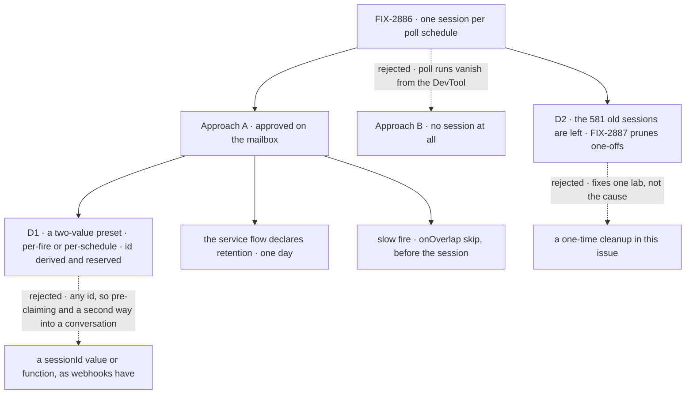

# FIX-2886 · Decisions

[Spec](SPEC.md) · **Decisions**

Two decisions are the sign-off. The approach is already chosen: Jake approved Approach A on the
foundations mailbox (a schedule gets a stable session derived from its id, so a poll's fires share
one). What is left is the shape of the option a schedule author sees, and what happens to the
sessions the old behaviour already left.

## The tree

Solid edges are what you're signing. Dashed edges lost, and the label says why.

## D1 · A schedule picks `session: "per-schedule"`, a derived and reserved id, not a `sessionId` it writes

| | |
|---|---|
| **Instead of** | A `sessionId` on the schedule, a value or a function of the fire's context, the way a webhook binding has `sessionId(event)`, with the poll passing a function of its schedule id |
| **Because** | A poll's session id is computable by anyone who knows the user and the thread. If an author writes the id, another signed-in user can create a session at it first, and the engine then refuses every fire (`UserBindingMismatchError`), so the poll stops. FIX-1739 found this hole for channels. A preset lets the framework own the id and reserve its prefix at three of the points that already guard write sessions (the inbound host, the create route, the action route) and at dispatch birth inside a run (see *Decided, not asked*), once for every schedule. A free id would also be a second way to send into an existing conversation, which FIX-1233 tried as its own design and canceled. Tenet 2: the smallest option that does the job |
| **Locks in** | `session?: "per-fire" \| "per-schedule"` on a schedule (`ScheduleConfig`) and on `createResourceCollectionScheduleResolver`; default `"per-fire"`. A reserved session-id prefix for schedule sessions (the implementer names it, beside `fsd-write.`): only a scheduled dispatch may create a session at it or run in it; reads stay open to the owner. Both names go through `docs/contributing/glossary.mjs` in the implementation PR, which adds no retired word |

![D1, how a schedule says where its fires run. Chosen: a two-value preset, per-fire or per-schedule, with the id derived by the framework and its prefix reserved. Instead of: a sessionId value or function, like a webhook binding. It comes down to who can hold the session first: with a reserved derived id nobody else can create it; with a written id another user can create it first and stop the poll. Price: a schedule can't fire into a session of the author's choosing. Tie: the poll's case works either way. Locks in the option and a reserved prefix. Flips if a schedule must fire into a session the author names](figures/d1-preset-not-id.svg)

It comes down to who can hold the session first: a written id can be taken, and the poll stops.

**What would change my mind:** a schedule that must fire into a session the author names, such as
a user's own conversation. Today the task schedules do that from inside their handler
(`dispatchThroughSeam`, in `scheduled-work.ts`), so none needs it on the schedule.

## D2 · The 581 existing empty sessions are left; FIX-2887 prunes one-off sessions for every source

| | |
|---|---|
| **Instead of** | A one-time cleanup in this issue: delete the service flows' empty `ephemeral_` sessions, by a migration at start or a script |
| **Because** | The empty sessions are one case of a general gap: every run with no session leaves a one-off session that nothing removes, and webhook deliveries keep making them after this ships. A one-time sweep fixes one lab and adds code that deletes sessions by a guess at how they were made (the prefix is display-only, per `one-off-session.ts`). One rule for every one-off session, old and new, belongs in [FIX-2887](https://linear.app/fixpoint-labs/issue/FIX-2887). The rows are inert: no reader breaks on them |
| **Locks in** | Existing deployments keep their old poll sessions until FIX-2887 ships. The Teammates lab can delete its SQLite file to start clean today |

It comes down to the cause: webhooks keep making one-off sessions, so a one-time sweep fixes one lab.

**What would change my mind:** FIX-2887 being put off for good. Then a scoped cleanup of empty
service-flow sessions earns its place here.

## Decided, not asked

- **A slow fire (FIX-837).** The schedule's own overlap check runs before the session is touched:
  with `onOverlap: "skip"`, which the poll already sets and which is the default, the next fire is
  answered `skipped` while the last still runs. The poll loses nothing, because its mark
  (`polledThrough`, the ETags, what it still owes) lives in its schedule resource, and the next
  fire it lets through catches up. A schedule with `onOverlap: "allow"` and a per-schedule session
  runs its overlapping fires in one session under the flow's concurrency policy, as two tabs on one
  conversation do; an author who needs order there declares `concurrency` keyed on the session. No
  new check.
- **The id names the org and user the fire runs as, the flow instance, and the schedule id**,
  spelled like the engine's other derived ids (`owner-run:`, `service-route:`: a prefix, then the
  parts URL-encoded and joined by `:`), so two flows with the same static schedule id, or two
  principals firing one static schedule, never share a session (the session binds its flow and its
  user, and refuses a mismatch). The prefix word is the implementer's. Tenants are already kept
  apart by the session storage key.
- **The reserved prefix, and its convergence point.** Every dispatch passes the inbound host's
  `refuseReservedAddress` (webhooks included, before they create a session); a schedule id is
  admitted there only from the scheduled source (`source` is set by the transport, never the
  caller, BP-031). The session create route and the action route check it in their handlers, as
  they check write-session ids. Those are three of the write prefix's six points: the other three
  (`reserved-addresses.ts` on every HTTP route, the listing, change notices) hide a write session,
  and a schedule's session must stay listable and readable to its owner, which the DevTool needs.
  So it is its own check beside `isWriteSessionId`, not a widening of it. A fourth point is
  dispatch from inside a run: a dispatcher's `{ id, state }` target births its session in
  `create-request-host.ts` before the operation reaches the host, and the host's refusal then leaves
  that row behind, under the dispatching user. So the request host refuses a schedule id in the
  dispatch spec before any birth, for every `{ id }` and `{ id, state }` target. The write prefix
  has the same gap at that point; closing it there too is the implementer's call, since it is the
  same line. An engine test at the request host covers it, with `no-reserve` failing it. The
  scheduled endpoint is the only writer of the id.
- **No public re-entry in a schedule's session.** Retry, continue and resume (`recovery-routes.ts`,
  `resume-routes.ts`) re-run a request in its recorded session by calling `runAction` directly,
  so they pass none of the checks above or the schedule's overlap check; `scheduled` is on the
  public re-entry allow-list (`public-reentry.ts`), and retry takes caller input. Today that runs in
  a throwaway session. In a schedule's own session it would let the owner run chosen input beside a
  live fire. So a request whose session carries the schedule prefix is refused on those routes,
  answered as a request that can't be re-entered, and listed `retryable: false`. A per-fire
  schedule keeps re-entry as today. A failed poll fire needs no retry: the next fire catches up
  from the poll's mark. Delete stays open; the next fire recreates the session. `fsdev run`
  (a trusted local operator) is not guarded, as for write sessions.
- **Not stored on a schedule row.** The resolver option applies to every row it resolves, and the
  collection schema gains no field, so a schedule written through a client can't pick a session.
- **The service flow's retention is `maxAge: "24h"`.** About 288 fires a day: enough to look back
  over a day of polling in the DevTool, and bounded. Retention evicts completed and interrupted
  fires only, after a completed one, so a poll that keeps failing still grows its session; that is
  retention's rule everywhere, not new here. The flow's one-off webhook runs are never touched after
  their one request. Its `service-route:` session, where every routing runs and which nothing caps
  today, is capped too; the implementer confirms nothing reads that session's request history
  (the routing keeps its state in resources) before relying on it. One line to change.
- **The comment in the dispatch endpoint that says scheduled envelopes have no session** goes
  with this change.
- **The poll opts in; nothing else changes.** Routine and task schedules on the roster flow keep
  one-off fires.

## Considered and dropped

- **Make `per-schedule` the default for every schedule.** Fewer rows everywhere, but it changes
  where every existing schedule's fires run, and a static schedule's session would grow with no
  retention unless its flow declares one. Opt-in costs one line.
- **A framework default retention for per-schedule sessions.** A second retention setting beside
  the flow's one. The flow's setting already applies.
- **Derive the id with a server secret instead of reserving a prefix.** No guessable id, but a new
  secret to configure and rotate. The prefix reuses a guard that exists.

## Open

None.

## Settled

None. No POC: each premise is a reading of current code. A run given a session id that does not
exist creates it (`createExecutionContext.ts`); its request stub is claimed with that id
(`runAction.ts`); a session refuses a run as another user (`UserBindingMismatchError`); the host and
routes already refuse a reserved prefix (`write-session-id.ts`, `createInboundTransportHost.ts`,
`session-routes.ts`); retention runs only when the run has a session id (`runAction.ts`).

## Analysis

2026-11-22 · watermark `3bdcd281` · **build as scoped, three folds.**
- Reuse: the preset is new (the webhook-style free id is rightly rejected); the reserved prefix extends the host guard; retention is reused. Missed: the engine's own derived ids, `owner-run:` and `service-route:`.
- Prior art: Temporal and Trigger.dev run each fire separately and group runs by schedule id; in FSD the session is the grouping unit, so `per-schedule` is the analogue.
- Other shapes: reuse the derived-id family rather than a third format. Folded.
- New factors: Issue 1 is FIX-2888, in development and independent; FIX-2887 in Backlog; FIX-2630 does not move this.
- Necessity: right size. Ergonomics: `session` on a schedule (where fires run) beside `session` on a flow (session config) is a small surprise. Major concerns: none.
- **Folded:** the derived-id precedent, and the id spelled like it (FIX-2889 filed for the two unreserved ones) · the retention line, which missed the flow's `service-route:` session · the reserved-prefix line, which said two checks where the write prefix has six and this one joins three.
- **Recorded:** retention never evicts failed fires; `fsdev run` creates sessions unguarded; the stale "no session" comment in the dispatch endpoint.
- Goal validation (blind) also ran. **Folded:** a slow-fire signal (o) with its control, the existing sessions named in the goal, harder (m) (row, owner, request listing) and (n) (action and read), retention tested through the real dispatch path.

## Notes from review

From the Cursor review on #5579 (2026-11-23), for the implementer:
- `session` on a schedule (where fires run) vs `session: { retention }` on the flow is easy to mis-wire. Consider a distinct name, or give both distinct `glossary.mjs` entries and a docs callout.
- Put the id derivation in one helper (e.g. in `core` beside `formatScheduleId`), sharing the colon-joined format with `owner-runs.ts`, so engine, workforce and goals don't each spell it.
- Consider one reserved-id check (`id`, `source`) or a small registry, so FIX-2889 adds its two prefixes there instead of copying three call sites.
- A poll session holds about 288 fires a day; check that the DevTool's request listing for one session pages or limits, so the Trace tab stays fast.
- Retention runs only after a completed fire; a poll that keeps failing still grows its session. A test or goal note may cover it.

From the second-look comment on #5579 (2026-11-23), for the implementer:
- The admitted-source check reads the existing `SCHEDULED_SOURCE` constant (`execution/transport-sources.ts`), with no new flag.
- Handle the bare and the tenant-namespaced id (`tenant:<prefix>…`) at all four points, as `isWriteSessionId` does, and test the namespaced form in (n).
- In `refuseReservedAddress`, put the schedule check after the `isServerResourceSend` early return, with its own source test, so a resource send can't reach a schedule session.
- Make the `service-route:` retention confirmation a grep-backed line in the implementation PR.
- Build the schedule id beside `owner-run:` / `service-route:` in `owner-runs.ts` with one small shared id builder; don't widen past that (the reserved-prefix family is FIX-2889).
- A poll that fails every fire grows its session (retention evicts completed fires only). Consider a named goal signal, or a follow-up for retention on failed requests.

## How it got here

- **Draft** — the mailbox's Approach A (a stable session per schedule, approved by Jake) as a
  two-value schedule option with a framework-derived, reserved id, used by the workforce poll with
  a day of retention; builds on the write-session prefix guard, `onOverlap` and session retention.
- **Review round 1** — Greptile and Codex found two paths that skip the three entry checks: public
  re-entry (now refused in a schedule's session) and a dispatcher's session birth inside a run (now
  checked before the birth). Both fold into *Decided, not asked*; the direction is unchanged.
