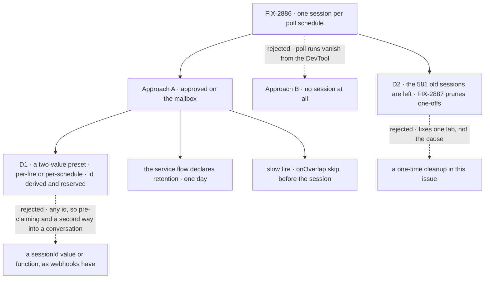

# FIX-2886 · Decisions

[Spec](SPEC.md) · **Decisions**

Two decisions are the sign-off. The approach is already chosen: Jake approved Approach A on the
foundations mailbox (a schedule gets a stable session derived from its id, so a poll's fires share
one). What is left is the shape of the option a schedule author sees, and what happens to the
sessions the old behaviour already left.

## The tree

Solid edges are what you're signing. Dashed edges lost, and the label says why.

## D1 · A schedule picks `session: "per-schedule"`, a derived and reserved id, not a `sessionId` it writes

| | |
|---|---|
| **Instead of** | A `sessionId` on the schedule, a value or a function of the fire's context, the way a webhook binding has `sessionId(event)`, with the poll passing a function of its schedule id |
| **Because** | A poll's session id is computable by anyone who knows the user and the thread. If an author writes the id, another signed-in user can create a session at it first, and the engine then refuses every fire (`UserBindingMismatchError`), so the poll stops. FIX-1739 found this hole for channels. A preset lets the framework own the id and reserve its prefix at the two points that already guard write sessions, once for every schedule. A free id would also be a second way to send into an existing conversation, which FIX-1233 tried as its own design and canceled. Tenet 2: the smallest option that does the job |
| **Locks in** | `session?: "per-fire" \| "per-schedule"` on a schedule (`ScheduleConfig`) and on `createResourceCollectionScheduleResolver`; default `"per-fire"`. A reserved session-id prefix for schedule sessions (the implementer names it, beside `fsd-write.`): only a scheduled dispatch may create a session at it or run in it; reads stay open to the owner. Both names go through `docs/contributing/glossary.mjs` in the implementation PR, which adds no retired word |

![D1, how a schedule says where its fires run. Chosen: a two-value preset, per-fire or per-schedule, with the id derived by the framework and its prefix reserved. Instead of: a sessionId value or function, like a webhook binding. It comes down to who can hold the session first: with a reserved derived id nobody else can create it; with a written id another user can create it first and stop the poll. Price: a schedule can't fire into a session of the author's choosing. Tie: the poll's case works either way. Locks in the option and a reserved prefix. Flips if a schedule must fire into a session the author names](figures/d1-preset-not-id.svg)

It comes down to who can hold the session first: a written id can be taken, and the poll stops.

**What would change my mind:** a schedule that must fire into a session the author names, such as
a user's own conversation. Today the task schedules do that from inside their handler
(`dispatchThroughSeam`, in `scheduled-work.ts`), so none needs it on the schedule.

## D2 · The 581 existing empty sessions are left; FIX-2887 prunes one-off sessions for every source

| | |
|---|---|
| **Instead of** | A one-time cleanup in this issue: delete the service flows' empty `ephemeral_` sessions, by a migration at start or a script |
| **Because** | The empty sessions are one case of a general gap: every run with no session leaves a one-off session that nothing removes, and webhook deliveries keep making them after this ships. A one-time sweep fixes one lab and adds code that deletes sessions by a guess at how they were made (the prefix is display-only, per `one-off-session.ts`). One rule for every one-off session, old and new, belongs in [FIX-2887](https://linear.app/fixpoint-labs/issue/FIX-2887). The rows are inert: no reader breaks on them |
| **Locks in** | Existing deployments keep their old poll sessions until FIX-2887 ships. The Teammates lab can delete its SQLite file to start clean today |

It comes down to the cause: webhooks keep making one-off sessions, so a one-time sweep fixes one lab.

**What would change my mind:** FIX-2887 being put off for good. Then a scoped cleanup of empty
service-flow sessions earns its place here.

## Decided, not asked

- **A slow fire (FIX-837).** The schedule's own overlap check runs before the session is touched:
  with `onOverlap: "skip"`, which the poll already sets and which is the default, the next fire is
  answered `skipped` while the last still runs. The poll loses nothing, because its mark
  (`polledThrough`, the ETags, what it still owes) lives in its schedule resource, and the next
  fire it lets through catches up. A schedule with `onOverlap: "allow"` and a per-schedule session
  runs its overlapping fires in one session under the flow's concurrency policy, as two tabs on one
  conversation do; an author who needs order there declares `concurrency` keyed on the session. No
  new check.
- **The id names the flow instance, the user and org the fire runs as, and the schedule id**, so
  two flows with the same static schedule id, or two principals firing one static schedule, never
  share a session (the session binds its flow and its user, and refuses a mismatch). The encoding is
  the implementer's, as long as it is one-to-one and one URL path segment. Tenants are already kept
  apart by the session storage key.
- **The reserved prefix, and its convergence point.** Every dispatch passes the inbound host's
  `refuseReservedAddress`; a per-schedule id is admitted there only from the scheduled source
  (`source` is set by the transport, never the caller, BP-031). The session create route and the
  action route check it in their handlers, as they check write-session ids. The scheduled endpoint
  is the only writer of the id. The listing, state and request reads stay open to the session's
  owner, which the DevTool needs; delete stays open too, and the next fire recreates the session.
- **Not stored on a schedule row.** The resolver option applies to every row it resolves, and the
  collection schema gains no field, so a schedule written through a client can't pick a session.
- **The service flow's retention is `maxAge: "24h"`.** About 288 fires a day: enough to look back
  over a day of polling in the DevTool, and bounded. The flow's other sessions are one-off webhook
  runs, which retention never touches after their one request. One line to change.
- **The poll opts in; nothing else changes.** Routine and task schedules on the roster flow keep
  one-off fires.

## Considered and dropped

- **Make `per-schedule` the default for every schedule.** Fewer rows everywhere, but it changes
  where every existing schedule's fires run, and a static schedule's session would grow with no
  retention unless its flow declares one. Opt-in costs one line.
- **A framework default retention for per-schedule sessions.** A second retention setting beside
  the flow's one. The flow's setting already applies.
- **Derive the id with a server secret instead of reserving a prefix.** No guessable id, but a new
  secret to configure and rotate. The prefix reuses a guard that exists.

## Open

None.

## Settled

None. No POC: each premise is a reading of current code. A run given a session id that does not
exist creates it (`createExecutionContext.ts`); its request stub is claimed with that id
(`runAction.ts`); a session refuses a run as another user (`UserBindingMismatchError`); the host and
routes already refuse a reserved prefix (`write-session-id.ts`, `createInboundTransportHost.ts`,
`session-routes.ts`); retention runs only when the run has a session id (`runAction.ts`).

## Analysis

Pending: written by the analysis pass before the PR opens.

## Notes from review

None yet.

## How it got here

- **Draft** — the mailbox's Approach A (a stable session per schedule, approved by Jake) as a
  two-value schedule option with a framework-derived, reserved id, used by the workforce poll with
  a day of retention; builds on the write-session prefix guard, `onOverlap` and session retention.
