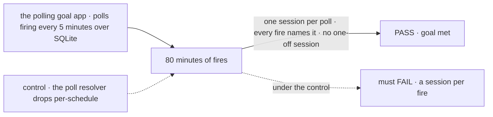
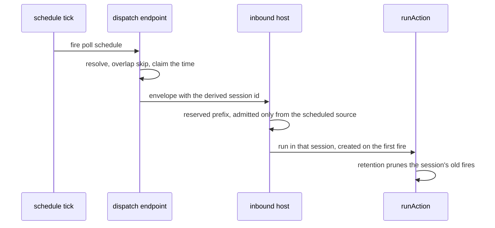

# FIX-2886 · All fires of one poll schedule run in one session

**Spec** · [Decisions](DECISIONS.md)

## Five people, before and after

| Someone who… | Today | After |
|---|---|---|
| **opens a service flow's poll in the DevTool** | Finds "One-off runs (580)": one empty session per fire, each one's Trace tab saying "No requests yet" | Finds one session per poll, with every fire in its request history |
| **runs a deployment that polls GitHub every 5 minutes** | Gets about 288 new session rows a day per poll, and nothing removes them | Gets one session per poll, whose history the service flow's retention caps at a day ([Decided, not asked](DECISIONS.md#decided-not-asked)) |
| **has a poll fire that is still running when the next one is due** | The next fire is skipped (`onOverlap: "skip"`), and it would have run in a session of its own anyway | The next fire is still skipped, before it reaches the session. The poll's mark lives in its schedule resource, so the fire after that catches up, as today |
| **is another signed-in user, and creates a session at someone's poll session id** | No such id exists to take | Is refused: the id carries a prefix only the scheduled dispatch may create or send to, so nobody can stop someone else's poll by holding its session first ([D1](DECISIONS.md#d1)) |
| **writes a schedule of their own** | Every fire is a one-off run, with no way to keep them together | Adds `session: "per-schedule"` and gets the poll's behaviour. Leaving it out keeps one-off runs, as today |

Webhook deliveries are unchanged: each still runs once, as a one-off run. The 581 empty sessions
already in the Teammates lab stay where they are; [D2](DECISIONS.md#d2) says why and who removes them.

## The goal, and how we'll know it's met

**Every fire of one poll schedule runs in one session that only the schedule can open, each fire's
request record names that session, and the session's history is capped by retention.**

| Is it the right goal? | |
|---|---|
| **The real need** | From the mailbox request: "give a schedule a stable session, so a poll doesn't mint one per fire … so all fires for one poll share one session and retention can cap its request history." And: "poll history stays visible in the devtool" |
| **Smaller, and rejected** | "Poll fires run with no session at all" (Approach B). Poll runs would vanish from the DevTool, and it needs a no-session mode for actions that only views have today. Jake chose A |
| **Bigger, and not this issue's** | Removing one-off sessions that already exist, or that webhooks keep making ([FIX-2887](https://linear.app/fixpoint-labs/issue/FIX-2887)). A sessionless run losing its minted id on the request record (the mailbox's Issue 1, fixed in its own thread). Giving routine and task schedules the same option |
| **Not done if** | A poll fire still creates an `ephemeral_` session · two fires of one poll name different sessions · a fire's request record has no session id · another user can create, or send an action to, a poll's session · the service flow declares no retention, so the poll's session grows without end · a schedule that does not opt in changes behaviour |



The check counts sessions and request records in the store, after real fires through the
engine's tick and the dispatch endpoint.

| How we verify | |
|---|---|
| **Goal check** | `goals/webhook-routing/polls-each-event-once-without-a-webhook/`, amended · model `n/a` · run by the implementer at completion · verdict on the implementation PR |
| **Signal** | Every existing leg still passes. New **(m)**: for each poll schedule, every accepted fire's request record names one session, that session's id is the poll's derived id, and the store holds no `ephemeral_` session for the service flow (leg 3's pushed deliveries excepted: their count equals the pushed deliveries). New **(n)**: on leg 1, before the first fire, `bob` creates a session at `alice`'s poll session id through the HTTP create route; it is refused, no session at that id belongs to bob, and alice's poll fires and delivers as the oracle says |
| **Input** | The goal's existing fixture, legs and clock |
| **Anti-game** | Read sessions and requests from the store, not from a counter in the code under test. Floor each list with `tell.over`, so a run that read no sessions reads CAN'T TELL |
| **Control that must fail** | `GOAL_CONTROL=session-per-fire`: the service flow's poll resolver omits `session`. Must FAIL (m). `GOAL_CONTROL=no-reserve`: the engine skips the reserved-prefix check. Must FAIL (n), on the create. Today's `main` fails (m) |
| **Retention** | Not in the goal, which runs 80 simulated minutes against a one-day cap. A workforce test drives a service flow's poll session past a day and reads that the older fires' requests are gone, with the same check failing when the flow declares no retention |

## What changes


A schedule can say where its fires run, and the subscription poll says one session per schedule.

```diff
  // A static schedule
  defineFlow({
    schedules: {
      static: {
        "nightly-digest": {
          cron: "0 2 * * *",
          block: digest,
+         session: "per-schedule",
        },
      },
    },
  });

  // A dynamic schedule, from a schedule collection
  schedules: {
    resolve: createResourceCollectionScheduleResolver({
      collection: polls,
      blocks: { [SUBSCRIPTION_POLL_HANDLER]: pollFire },
+     session: "per-schedule",
    }),
    index,
  },

  // The workforce service flow, which the app does not write
+ session: { retention: { maxAge: "24h" } },
```

`session` takes `"per-fire"` (the default, today's one-off run) or `"per-schedule"`. It is not
stored on a schedule row: the resolver sets it for every row it resolves, so a stored schedule
can't choose another user's session.

**Docs:** at release, `docs/server/scheduled.md` gains a section "Where a fire runs", after
"Overlap policy" (the two options, the reserved id, how overlap and retention apply);
`docs/server/schedule-index.md` names the resolver's `session` option; the `@flow-state-dev/scheduled`
README adds the option to the resolver's table. Contributor docs in the implementation PR:
`docs/architecture/scheduled-actions.md` (where a fire runs, and the reserved prefix beside the
write-session one). No new page.



## What stays as it is

- A schedule with no `session`, static or dynamic: one one-off session per fire, byte for byte.
- Webhook deliveries in service flows: one-off runs. Webhook bindings keep their own `sessionId`.
- Overlap policy, the once-per-scheduled-time claim, the tick, the schedule index and every
  dispatch response code.
- The flow's concurrency policy (FIX-837). Its default (`allow`) is unchanged.

## What's already here, and the debt

| Already here | What this does with it |
|---|---|
| **The job: pick the session a run from outside lands in.** Mechanisms `inbound-transport`, `webhook`, `schedule`, `dispatch`. Four ways do it today: the HTTP action body's `sessionId`; a webhook binding's `sessionId(event)` (`core/src/types/webhooks.ts`); the dispatcher's key-derived child session; and, for every run with none, the minted one-off session (`createExecutionContext.ts`, `ONE_OFF_SESSION_PREFIX`). The closest is the webhook binding's `sessionId`. Searched `sessionId` across `packages/scheduled/src` (none), `packages/engine/src/transports/`, and `core/src/types/{schedules,webhooks,flow}.ts` | **Adds** a fifth: a schedule option. It is a preset, not an id the author writes, for the reason [D1](DECISIONS.md#d1) gives |
| **The job: keep a client off an id the server owns.** `WRITE_SESSION_PREFIX` (`engine/src/resources/write-session-id.ts`): refused at the inbound host for every transport (`refuseReservedAddress`) and in the session create route | **Extended**: a second reserved prefix, checked at the same two points. Unlike a write session, a schedule's session stays readable to its owner |
| The `onOverlap` check in the dispatch endpoint (`transports/scheduled/routes.ts`) | **Kept**, and it is the answer to a slow fire: the next fire is skipped before it reaches the session |
| Session retention (`flow.session.retention`, `execution/retention.ts`, FIX-216) | **Used**: the service flow declares it. Retention runs per session, so it can cap one poll's history and never could cap one-offs |
| [FIX-1233](https://linear.app/fixpoint-labs/issue/FIX-1233) (canceled, no retained spec): a schedule that names a session and fires into it as a relay message | **Not revived.** That design sent into an existing conversation; this one keeps a schedule's own fires together. D1 keeps the two apart |
| [FIX-1739](https://linear.app/fixpoint-labs/issue/FIX-1739) (canceled when channels were removed): a caller pre-claiming a known session id and stopping a channel from opening | **The same hole, closed here before it opens**: a poll's id is computable, so it is reserved |
| The mailbox's Issue 1: a sessionless run's request record loses the minted id | **Independent.** A per-schedule fire names its session before the request stub is claimed, so its record carries it with or without that fix |

| Adds | Existing piece considered | Why it doesn't fit / how composed |
|---|---|---|
| `session: "per-fire" \| "per-schedule"` on a schedule and on `createResourceCollectionScheduleResolver` | A webhook binding's `sessionId` function, copied onto schedules | A free id can name any session, so every author must defend it against pre-claiming, and it becomes a second way to send into a conversation ([D1](DECISIONS.md#d1)) |
| A reserved session-id prefix for schedule sessions | The write-session prefix and its two checks | **Composed**: the same two check points, one more prefix |
| `session.retention` on the workforce service flow | None: the flow declares no session config today | Uses the existing retention option |

| The debt | |
|---|---|
| **Removes** | One session row per poll fire, going forward |
| **Adds** | A fifth way to pick a run's session, as a two-value preset. Permanent by design: it is the schedule's half of a job every transport has. One more reserved prefix, permanent by design, kept by the same checks as the first |
| **Leaves** | One-off sessions are never pruned, the 581 included ([FIX-2887](https://linear.app/fixpoint-labs/issue/FIX-2887)). Routine and task schedules on the roster flow still fire one-off; each is one line to change when someone wants it. The DevTool shows a poll's session by its id; naming it is FIX-2875's kind of work, not filed |

**Net: flat.** A preset and a reserved prefix are added; a session per fire stops, which is a
storage win, not a code removal.

## Sign off

**[The goal](#the-goal-and-how-well-know-its-met), at that size:** one reserved session per poll,
each fire's record naming it, history capped by retention. If wrong: polls still leave a session
per fire, or a poll's session can be taken by someone else.

**[The debt](#whats-already-here-and-the-debt), net flat:** a two-value schedule option and a
reserved prefix are added; nothing is removed from the code. If wrong: a fifth way to pick a
session that the next transport copies with a twist.

1. **[D1](DECISIONS.md#d1) · A schedule picks `session: "per-schedule"`, a framework-derived,
   reserved id, not a `sessionId` it writes.** The one to weigh: the mailbox request said
   "a sessionId hook". If wrong: the first schedule that must fire into a session of the author's
   choosing needs a new option.
2. **[D2](DECISIONS.md#d2) · The 581 existing empty sessions are left; FIX-2887 prunes one-off
   sessions for every source.** If wrong: the lab's DevTool keeps the old rows until FIX-2887
   ships, unless the lab deletes its database.

Feature · `core`, `engine`, `scheduled`, `workforce`, one goal · S (one option, one reserved
prefix, one flow setting) · independent of the mailbox's Issue 1 · [Linear](https://linear.app/fixpoint-labs/issue/FIX-2886)
