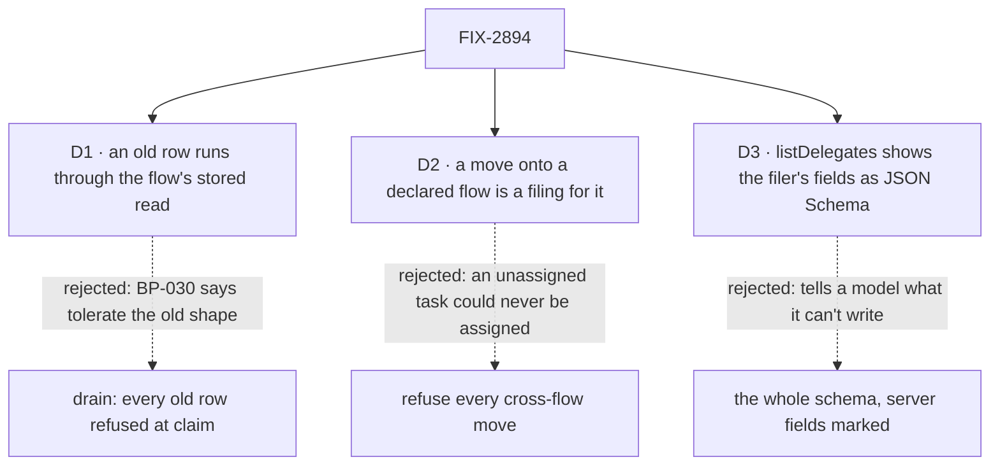

# FIX-2894 · Decisions

[Spec](SPEC.md) · **Decisions**

What was considered, what was chosen, and what each choice locks in. Three decisions are the
sign-off surface. The epic already settled the rest: the declaration lives on the flow's `work`
entry, server-owned fields are dropped and filled before the parse, `updateTask` keeps their
stored values, the board knows no field name, and `needsProject` goes with no alias
([ER-9](../../epics/FIX-2876/DECISIONS.md#who-owns-what)).

## The tree

Solid edges are what you're signing. Dashed edges lost, and the label says why.

## D1 · A task stored before its flow's shape changed still runs, through the flow's `stored` read; only a row that neither fits nor maps fails its next claim by name

| | |
|---|---|
| **Instead of** | The issue's "no backwards compatibility": every row in an old shape is refused at its next claim, and in-flight tasks are drained first |
| **Because** | BP-030 says tolerate the old shape, and the epic's implementer note asked for a named exception or a dual-read. A dual-read costs one optional function, and only on a flow that changes its shape. FIX-2878 needs it anyway, for stored `harnessFeature` rows. A drain needs a quiet board at upgrade, which a hosted app never has |
| **Locks in** | `stored` is a public option. It runs only on stored rows: at claim, and in any reader of stored input through the declaration's `read`. A write never goes through it, so an old shape can't be filed again. A flow with no `stored` that changes its schema fails its old rows at their next claim, naming the field |

It comes down to the upgrade: a drain needs a quiet board, and a hosted app never has one.

## D2 · Moving a task onto a declared flow is a filing for that flow, filler included; an edit within a flow keeps the stored server-owned values

| | |
|---|---|
| **Instead of** | Refusing any move to another flow ("cancel it and file it again"), or checking a move as an edit, with no filler |
| **Because** | A task filed with no assignee, in a conversation with several delegates, waits unchecked until it is assigned. Refusing moves would strand it. Checking a move as an edit would keep values no filler on the new flow wrote, so a filer could write a server-owned field on an open flow and then move the task onto a declared one. A filing for the new flow is what cancel-and-refile would give, without the refile |
| **Locks in** | Who asked, and a coding task's run settings, are written by the server of the conversation that assigns or moves the task, at that moment. A reassign between workers on one flow changes no server-owned value, so FIX-2878's lock is what refuses a worker that can't take them |

It comes down to the unassigned task: refusing moves leaves it with no way onto any flow.

## D3 · `listDelegates` shows each delegate's input as JSON Schema, without its server-owned fields

| | |
|---|---|
| **Instead of** | The whole schema with server-owned fields marked read-only, or a short text summary |
| **Because** | A model files from what it reads. A field it may not write is one it will try to write, and the value is dropped without a word. JSON Schema is what a model's tool parameters already use, and the issue asks for it |
| **Locks in** | `input` on a delegate row is public: `{ schema, project }` or `null`. The schema is the filer's view, so it can differ from the type code imports (`z.infer` of the declared schema). A schema a JSON Schema can't express (a `refine`) shows only its shape |

It comes down to what a model does with a field it reads: it writes it.

## Decided, not asked

- **The convergence point is one filing check**, replacing `assertProjectFor` in the guarded
  board. Every writer of a task's input passes it: `createTask`, `createTasks` (refused whole),
  the routed filing (`fileRouted`, which skips `assertProjectFor` today), a `session: "new"`
  step (checked against the worker's own flow), `patchSettings` (`updateTask`'s input and
  assignee) and `setAssignee`. An inline step never reaches a `work` entry and stays open.
- **The order:** `refuse` on what was sent · drop every `serverOwned` name · `fill` (a filing or
  a move) or keep the stored values (an edit) · parse · `check` · parse its return again · the
  project requirement · store the parsed value. The project the board writes into `input`
  (`ownProjectIn`) is written before the parse.
- **The lookup:** the installation reads the declaration off each flow's `work` entry, as
  `takesConversationTasks` reads the entry's mark today, and the board takes one internal option,
  `taskInputOf(flowKind)`, in place of `needsProject(flowKind)`. No app sets it. It is read per
  call, so a roster change counts.
- **`serverOwned` names may lie outside the schema.** Such a name is only dropped. That is how
  FIX-2878 drops `doneWhen` and `workspace`, so the sketch's separate `dropped` list folds in.
- **`fill` returns only server-owned fields;** anything else it returns is ignored. `check` may
  change any field (FIX-2878 writes the default mode) and returns the input to store.
- **The hooks are handed** the request's context, the assignee, and the assignee's worker (id
  and config, read per call). FIX-2878's lock needs the config; its D3 flips without it.
- **The claim parses only the schema,** after `stored`, and hands the worker block the parsed
  input. A failure fails the attempt by name with `Nothing ran.`, and the block never runs.
  `check` and the project requirement run only at filing; FIX-2878's claim checks are its own.
- **Refusals** are `TaskWriteRefusedError`s. The board's own code is `input_refused`, naming the
  assignee, its flow, the first issue's path and what was expected. Every filing refusal ends
  `Nothing was filed.`, on `updateTask` too. Exact wording is the implementer's; what each names
  is not.
- **A schema that transforms is refused when the flow is built** (a `.transform`, a `.preprocess`
  or a `.pipe` anywhere in it). `.default` and `.refine` are allowed: parsing a parsed value again
  gives the same value.
- **No assignee and one task-taking delegate:** checked against it, as the issue asks. Several:
  unchecked until assigned ([D2](#d2)).
- **Shift Manager's `coder.mts`** moves its `needsProject` into its work entry's declaration if
  this lands before FIX-2877 deletes the file. Whichever merges second rebases.
- **`createTask`'s description** tells the model to read a delegate's `input` with `listDelegates`.

## Considered and dropped

| Alternative | Why not |
|---|---|
| Refuse a filer's server-owned field, as session state does | A model can't act on "you may not set `harness`"; it retries with another value. Dropping and filling never honours it ([ER-10](../../epics/FIX-2876/DECISIONS.md#who-owns-what)) |
| A host option on `createTask` per concern | The epic rejected it: the board would grow one option per flow's need |
| Type the task primitive's `input` in orchestration | Every board would need a roster of schemas. Workforce is where an assignee resolves to a flow |
| Run `check` again at claim | FIX-2878's claim runs its own order on the frozen settings; a second pass would run the lock twice with different inputs |
| One `taskInput({ schema, … })` object | The epic's sketch and FIX-2878 use `taskInput(schema, options)`. An open flow that needs only a project writes `taskInput(z.record(z.string(), z.unknown()), { project: "required" })` |

## Analysis

2026-11-23 · watermark 2026-11-22 (issue filed) · **Right approach.** Run by the author inline,
not by a fresh sub-agent: this dispatch has no agent tool. Weigh it as a self-check.

1. **Reuse** — every Adds row extends a piece that exists: `assertProjectFor`, the entry's
   sequencer, the delegate row, session state's `serverOwned`. See [Builds on / Adds](SPEC.md#whats-already-here-and-the-debt).
2. **Prior art** — schema-at-the-edge with server-set fields is how typed RPC layers work (a
   validated input, the server's context merged in, never the client's). Nothing to fold.
3. **Other shapes** — a static per-assignee type (impossible while rosters are runtime files),
   and per-reader parsing (today). Both in the tables.
4. **New factors** — FIX-2878 and FIX-2879 merged on 2026-11-23. Their hooks (`refuse`, `stored`,
   the hooks handed the worker) are folded in; nothing else.
5. **Necessity** — earns its place: FIX-2878's security rule has no seam without it.
6. **Ergonomics** — one option on an entry a flow author already writes; a filer reads the shape
   where it already reads the delegate.
7. **Concerns** — D2 runs the filler on a write that isn't `createTask`. Recorded as the one to weigh.

## Settled

- **No counted facts.** The spec rests on no enumerated count, so no checker was built. The
  writer list above is from the guarded board's methods on `main` at `0a9ac03b4`.

## How it got here

- **Draft** — framed as the board half of ER-9: one declaration on the `work` entry, one
  filing check on every writer, a claim parse. Built on `assertProjectFor`'s seat and session
  state's `serverOwned`; answered the epic's BP-030 note with a dual-read (D1).

**Open: none.**
