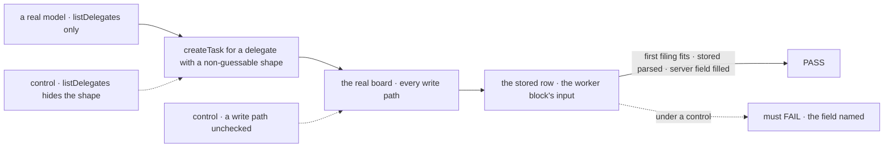
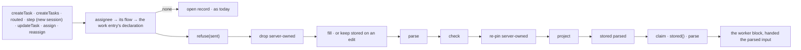

# FIX-2894 · Typed task input: a flow's `work` entry declares what its tasks take; filing and claim check it

**Spec** · [Decisions](DECISIONS.md)

## Seven people, before and after

| Someone who… | Today | After |
|---|---|---|
| **files a task for a delegate** (a model's `createTask`, or code) | Anything goes in `input`. A wrong key or type is found late, by the worker, or never | The input is checked against what the delegate's flow declares, at filing. A misfit is refused, naming the field and what was expected, and nothing is filed |
| **asks what a delegate takes** (a model reading `listDelegates`) | Sees only `takes: "tasks"`, so it guesses the input | Sees the delegate's input as a JSON Schema: the fields it may write, with the server's own fields left out |
| **sends a field only the server may write** (a prompt-injected filer) | The value is stored and may be read | The value is dropped. The flow's filler writes the field. `updateTask` keeps the stored value |
| **builds a worker flow** | Every reader parses `input` on its own, late. "Needs a project" is a separate hire option, `needsProject` | One declaration on the flow's `work` entry: the schema, the server-owned fields and their filler, an optional check, and the project requirement. The worker block is handed the parsed input |
| **has a task in flight when a flow changes its declared input** | n/a | The flow reads the old shape it declares (`stored`) and the task runs. A row that neither fits nor maps fails its next claim by name, and never runs on partial input |
| **files for a delegate whose flow declares nothing** (an agent worker) | An open record | The same open record, byte for byte |
| **moves a task onto another flow** (assigns an unassigned task, or reassigns it to a worker on another flow) | The input moves unchecked | The move is checked as a filing for the new flow, filler included ([D2](DECISIONS.md#d2)) |

This is the board half of the coder-selection epic
([FIX-2876](../../epics/FIX-2876/SPEC.md), rule [ER-9](../../epics/FIX-2876/DECISIONS.md#who-owns-what)).
The coding task's own fields, its filler, its mode checks and its lock are
[FIX-2878](../FIX-2878/SPEC.md)'s. They plug into the hooks this issue adds, and the board
knows none of their names.

## The goal, and how we'll know it's met

**A filer learns what a delegate takes, and a task that doesn't fit is refused at filing with
the field named, so no worker runs on input it can't read and no filer writes a field the
server owns.**

| Is it the right goal? | |
|---|---|
| **The real need** | The epic's run settings must reach a coding task "as fields of the coder flow's declared task input", checked, and never written by a filer ([ER-9, ER-10](../../epics/FIX-2876/DECISIONS.md#who-owns-what)). The issue: "Nobody checks it when the task is filed, when it is claimed, or when its worker's `work` entry runs it" |
| **Smaller, and rejected** | "`createTask` parses `input` against a schema." Met while `updateTask`, a batch, a routed filing or a reassign still write unchecked input, and while a filer can still write a server-owned field |
| **Bigger, and not this issue's** | The coder flow's schema, filler, mode checks and lock: [FIX-2878](../FIX-2878/SPEC.md). Typing `taskBoard({ workers })` under strict TypeScript: FIX-2732 |
| **Not done if** | A model can file a valid task only because the test told it the shape · one write path (batch, routed, step, `updateTask`, reassign) skips the check · the claim trusts the stored row · a declared flow's worker block still parses `input` itself |



The check reads the stored row and what the worker block was handed, never the tool's reply.

| How we verify | |
|---|---|
| **Goal check** | `goals/workforce/a-task-fits-its-flow/` · a real model for the **Discover** leg, scripted for the rest · run by the implementer at completion · verdict in the implementation PR |
| **Signal** | **Discover:** in 5 runs, a model that has only `listDelegates` files a task for a flow declaring `{ ticket: /^ENG-\d+$/, kind: "fix" \| "probe" }`, and the first filing is accepted in at least 4. **Refuse:** a misfit on `createTask`, `createTasks`, a routed filing, a `session: "new"` step and `updateTask` is refused with `input_refused`, naming the path, and no row is written. **Own:** a filer's server-owned value is replaced by the filler's on filing, and kept from the stored row (read through `stored`) on `updateTask`; a `check` that returns a different `requestedBy` is refused with `input_refused` and nothing is written. **Move:** assigning an unassigned row, and reassigning to a worker on another declared flow, run the filler and the parse. **Claim:** a stored row that no longer fits fails its attempt, naming the field, and the block never runs; a row the flow's `stored` maps runs on the mapped input. **Open:** a flow with no declaration stores and hands over any object unchanged. **Project:** a declaration with `project: "required"` refuses as `no_project` does today |
| **Input** | A scripted `triage` flow (below), an agent flow with no declaration, a conversation with one and with two delegates. A different shape or field name must pass too |
| **Anti-game** | Read the stored row and the input the worker block received. Never the tool's reply, and never a stubbed board |
| **Control that must fail** | `GOAL_CONTROL=hide-shape` fails **Discover** (at most 1 of 5); `filing-only` (only `createTask` checks) fails **Refuse**; `trust-filer` and `check-rewrites-owned` (the scripted `check` overwrites `requestedBy`, and the board stores it) fail **Own**; `move-unchecked` fails **Move**; `trust-stored` fails **Claim**. Today's `main` fails every signal but **Open** and **Project**. The PR shows each FAIL before the PASS |

## What changes


Every write that puts input on a task passes one filing check, and the claim parses again.

**A flow declares what its tasks take:**

```diff
  task: {
    actions: {
      work: workerTaskEntry({
        name: "triage-work",
        turn: triageTurn,
+       input: taskInput(triageInput, {
+         serverOwned: ["requestedBy"],
+         fill: ({ ctx }) => ({ requestedBy: ctx.user!.identity.userId }),
+         project: "required",
+       }),
      }),
    },
  },
```

**And the hire option goes, with no alias (BP-034):**

```diff
  workerFlows: {
-   coder: { flow: coderFlow, roles: ["contributor"], needsProject: workspaceHost !== undefined },
+   coder: { flow: coderFlow, roles: ["contributor"] }, // the coder's work entry declares `project`
  }
```

**Docs:** update `delegating-work.md` with a *What a delegate takes* section (the declaration,
the refusal, `listDelegates`'s `input`, and the rule that a `check`-only rule goes in the
field's description), update `projects.md` where it names `needsProject`, and
update the workforce README's `workerTaskEntry`, `workerFlow` and `listDelegates` rows. The
glossary gains *Task input* in the implementation PR. All through the changeset; the pages
follow at release.

## The filing check



The board looks up the assignee's flow and its declaration per call. It calls the hooks; it never
reads a field a flow declares.

## Examples

These use one example flow. `requestedBy` is server-owned: a task records who asked, and a filer
must not be able to say it was someone else (BP-031).

```ts
const triageInput = z
  .object({
    ticket: z.string().regex(/^ENG-\d+$/),
    severity: z
      .enum(["low", "high"])
      .default("low")
      // `check` enforces this rule, so the field's description carries it to listDelegates.
      .describe('"high" only for a worker that is on call; any other worker refuses it'),
    requestedBy: z.string().min(1), // server-owned: the filler writes it
  })
  .strict();
```

### Filings that pass

A filing with only the filer's fields. The default is applied and the filler writes `requestedBy`:

```jsonc
// Jane's conversation, delegate ops.triager on flow "triage"
{ "assignee": "ops.triager", "goal": "Why is checkout slow?", "input": { "ticket": "ENG-142" } }
//   → stored: { "ticket": "ENG-142", "severity": "low", "requestedBy": "u_jane" }
```

A filer that sends a server-owned field has it dropped, then filled:

```jsonc
{ "assignee": "ops.triager", "goal": "Why is checkout slow?",
  "input": { "ticket": "ENG-142", "severity": "high", "requestedBy": "u_admin" } }
//   → stored: { "ticket": "ENG-142", "severity": "high", "requestedBy": "u_jane" }
```

With no assignee, a filing is checked against the conversation's only task-taking delegate:

```jsonc
{ "goal": "Why is checkout slow?", "input": { "ticket": "ENG-142" } }
//   → assignee ops.triager; stored as in the first example
```

With several delegates and no assignee, the row waits unassigned and unchecked, as today. It is
checked when it is assigned (below).

### Filings refused

A wrong type. The refusal names the delegate, its flow, the path and what was expected:

```jsonc
{ "assignee": "ops.triager", "goal": "…", "input": { "ticket": 142 } }
```

```text
input_refused: this task's input doesn't fit what "ops.triager" takes (flow "triage"):
at "ticket", expected string, received number. Read what it takes with listDelegates.
Nothing was filed.
```

An unknown key, under a strict schema:

```jsonc
{ "assignee": "ops.triager", "goal": "…", "input": { "ticket": "ENG-142", "urgent": true } }
```

```text
input_refused: this task's input doesn't fit what "ops.triager" takes (flow "triage"):
unrecognized key "urgent". Read what it takes with listDelegates. Nothing was filed.
```

A missing field, and a value off the enum, each name their path the same way (`at "ticket",
required`; `at "severity", expected "low" | "high", received "urgent"`). A batch is refused
whole: one row that doesn't fit files none of them.

A project-requiring flow, with no project anywhere. The text is today's `no_project`, unchanged:

```text
no_project: "devteam.coder" works in a project's files, and this conversation has no project
for it to work in. Nothing was filed. Set the project of the conversation that files it: …
```

### The flow's own refusal and check

A flow can refuse by what the filer sent, before anything is dropped (`refuse`), and check the
parsed input, returning what to store (`check`). Both run on filing and on `updateTask`.

**A rule for flow authors:** a rule that only `check` or `refuse` enforces goes in the affected
field's `.describe()` text too, so a model reads it in `listDelegates` before it is refused. The
on-call rule below is the one in `severity`'s description above.

```ts
input: taskInput(triageInput, {
  serverOwned: ["requestedBy"],
  fill: ({ ctx }) => ({ requestedBy: ctx.user!.identity.userId }),
  // An old key, refused by name rather than dropped or translated.
  refuse: (sent) => {
    if ("ticketId" in sent) {
      throw new TaskWriteRefusedError("old_key", "ticketId is no longer accepted; send ticket instead. Nothing was filed.");
    }
  },
  // A rule the schema can't say: only an on-call worker takes a high-severity task.
  check: (input, { assignee, worker }) => {
    if (input.severity === "high" && worker.config.onCall !== true) {
      throw new TaskWriteRefusedError("not_on_call", `"${assignee}" isn't on call, so it takes no high-severity task. Nothing was filed.`);
    }
    return input;
  },
}),
```

```jsonc
{ "assignee": "ops.triager", "goal": "…", "input": { "ticketId": "ENG-142" } }
//   → old_key: ticketId is no longer accepted; send ticket instead. Nothing was filed.
{ "assignee": "ops.intern", "goal": "…", "input": { "ticket": "ENG-142", "severity": "high" } }
//   → not_on_call: "ops.intern" isn't on call, so it takes no high-severity task. Nothing was filed.
```

`check` may change a filer's field, never a server-owned one. After `check`, the board compares
each `serverOwned` name with the value it filled (or kept, on an edit). A difference is a bug in
the flow: the write is refused, and the board never stores a server-owned value `check` returned.

```ts
check: (input) => ({ ...input, requestedBy: "u_admin" }), // a buggy check
```

```text
input_refused: flow "triage"'s check changed "requestedBy", which only its filler writes.
This is a bug in the flow, not in the task. Nothing was filed.
```

FIX-2878's `checkMode` writes the default `mode` into a task that names none. That is allowed:
`mode` is filer-written, not server-owned.

The coder flow fills these hooks with FIX-2878's rules, which this issue does not define:

```ts
input: taskInput(codingTaskInputSchema, {
  serverOwned: CODING_SERVER_OWNED, // FIX-2878's: harness, model, plan, their marker, doneWhen, workspace
  refuse: refuseLegacyMarker, // FIX-2878: a sent harnessFeature → legacy_marker
  stored: readLegacy,         // FIX-2878: a stored harnessFeature → mode and issue
  fill: fillRunSettings,      // FIX-2878 and FIX-2879: the run settings, by ER-10's order
  check: checkMode,           // FIX-2878: default mode, registered set, requires, lock
  project: options.project === true ? "required" : "optional",
}),
```

### `updateTask`

`updateTask` replaces `input` whole. It never calls the filler: a server-owned field keeps its
stored value, whatever the filer sent. On a declared flow the order is: read the stored row
through `stored` and take the server-owned values from that read · `refuse` · drop · keep ·
parse · `check` · re-pin.

```jsonc
// stored: { "ticket": "ENG-142", "severity": "low", "requestedBy": "u_jane" }
{ "id": "t_17", "input": { "ticket": "ENG-150", "requestedBy": "u_admin" } }
//   → stored: { "ticket": "ENG-150", "severity": "low", "requestedBy": "u_jane" }
{ "id": "t_17", "input": { "ticket": "150" } }
//   → input_refused: this task's input doesn't fit what "ops.triager" takes (flow "triage"):
//     at "ticket", invalid. Read what it takes with listDelegates. Nothing was filed.
```

A row stored in an old shape keeps the server-owned values its `stored` read gives:

```jsonc
// stored: { "ticketId": "ENG-9", "reporter": "u_jane" }   // stored maps reporter → requestedBy
{ "id": "t_18", "input": { "ticket": "ENG-9", "severity": "high", "requestedBy": "u_admin" } }
//   → stored: { "ticket": "ENG-9", "severity": "high", "requestedBy": "u_jane" }
```

An unassigned row, or a row on an open flow, has no declaration, so an edit stays unchecked, as
today. Nothing it carries counts: when a move puts it on a declared flow, that move is a filing
([D2](DECISIONS.md#d2)), which drops the server-owned fields and calls the filler.

```jsonc
// t_22, unassigned (two delegates), stored { "ticket": "ENG-3" }
{ "id": "t_22", "input": { "ticket": "ENG-3", "requestedBy": "u_admin" } }
//   → stored as sent: { "ticket": "ENG-3", "requestedBy": "u_admin" }  (no declaration yet)
{ "id": "t_22", "assignee": "ops.triager" }
//   → stored: { "ticket": "ENG-3", "severity": "low", "requestedBy": "u_jane" }  (dropped, then filled)
// t_23 on ops.helper (flow "agent", open)
{ "id": "t_23", "input": { "anything": true, "requestedBy": "u_admin" } }
//   → stored as sent; a later move onto "triage" is checked as a filing and refuses "anything"
```

A reassign to another worker on the same flow is an edit too: the stored values stay. Assigning
an unassigned row, or reassigning to a worker on another flow, is a filing for that flow
([D2](DECISIONS.md#d2)):

```jsonc
// t_20, filed unassigned with { "ticket": "ENG-142" }, then:
{ "id": "t_20", "assignee": "ops.triager" }
//   → stored: { "ticket": "ENG-142", "severity": "low", "requestedBy": "u_jane" } (the filler ran)
// t_21 on helper (flow "agent", open), input { "ticket": "ENG-7", "requestedBy": "u_admin" }, then:
{ "id": "t_21", "assignee": "ops.triager" }
//   → stored: { "ticket": "ENG-7", "severity": "low", "requestedBy": "u_jane" }
```

### The claim checks again

The work entry reads the stored row through the flow's `stored`, parses it, and hands the worker
block the parsed input. A row that no longer fits (the flow added a required field after
filing) fails its attempt and never runs:

```text
input_refused: this task's input no longer fits what flow "triage" takes: at "area",
required. Nothing ran.
```

A row stored in a shape the flow still reads runs on the mapped input (BP-030, [D1](DECISIONS.md#d1)):

```ts
stored: (raw) => ("ticketId" in raw ? { ...omit(raw, "ticketId"), ticket: raw.ticketId } : raw),
// stored: { "ticketId": "ENG-9", "requestedBy": "u_jane" }
//   → the block is handed { "ticket": "ENG-9", "severity": "low", "requestedBy": "u_jane" }
```

The claim checks only the schema. The project requirement and `check` are filing checks, so a
task whose project came from its conversation is not refused at its next claim.

### What `listDelegates` shows

```jsonc
{ "delegates": [
  { "worker": "ops.triager", "description": "Triages incidents", "takes": "tasks",
    "input": { "schema": { "type": "object", "additionalProperties": false, "required": ["ticket"],
                           "properties": { "ticket": { "type": "string", "pattern": "^ENG-\\d+$" },
                                           "severity": { "type": "string", "enum": ["low", "high"], "default": "low",
                                                         "description": "\"high\" only for a worker that is on call; any other worker refuses it" } },
                           "$schema": "http://json-schema.org/draft-07/schema#" },
               "project": "required" } },
  { "worker": "ops.helper", "description": null, "takes": "tasks", "input": null }
] }
```

`requestedBy` is not shown: a filer never writes it ([D3](DECISIONS.md#d3)). `input: null` is a
flow that declares nothing. The schema is JSON Schema draft-07, fully inlined: no `$ref` and no
`definitions`, so a model reads it in one piece. The on-call rule reaches the model through
`severity`'s description, before any refusal.

### A flow with no declaration

```jsonc
{ "assignee": "ops.helper", "goal": "Summarise the incident", "input": { "notes": ["a", "b"], "n": 3 } }
//   → stored: { "notes": ["a", "b"], "n": 3 }, nothing dropped, no filler, no parse at claim
```

### Refused when the flow is built

A task input is parsed at filing, stored as JSON, and parsed again at claim. So the schema must
keep this invariant: **`parse(JSON round trip of parse(x))` equals `parse(x)`.** A schema that
can break it is refused when the flow is built. That is `.transform`, `.preprocess`, `.pipe`,
`.catch`, `z.coerce.*`, `z.date`, `z.bigint`, `z.map` and `z.set`, anywhere in the schema.
`.default`, `.refine` and `.describe` keep it.

```ts
workerTaskEntry({ name: "triage-work", turn, input: taskInput(z.object({ n: z.string().transform(Number) })) });
//   → Error: workerTaskEntry "triage-work": a task input may not use .transform (at "n"). It is
//     stored as JSON and parsed again at claim, so it must parse the same after a JSON round trip.
workerTaskEntry({ name: "triage-work", turn, input: taskInput(z.object({ due: z.date() })) });
//   → Error: workerTaskEntry "triage-work": a task input may not use z.date (at "due"). It is
//     stored as JSON and parsed again at claim, so it must parse the same after a JSON round trip.
//     Use an ISO string: z.string().datetime().
```

## What stays as it is

- **Fixed boards** keep `harnessTaskInputSchema` at the top of a conductor row. They don't run a workforce `work` entry.
- **Layer-1 `taskBoard`** keeps its compile-time `TInput`. This is workforce's runtime check.
- **Session state's `serverOwned`** keeps refusing a seeded field with a 400. A task's server-owned field is dropped and filled instead, because a model filer reads a refusal it can't act on.
- **`runProjectOf`'s `no-project`** stays the run's backstop.
- **Inline steps** (a worker's own plan, run in its turn) stay open: they never reach a `work` entry.

## What's already here, and the debt

| Already here | What this does with it |
|---|---|
| **Whatever checks a task's input** (mechanism `task`): `createTask`'s `z.record` (shape only); `assertProjectFor` (one rule); each reader's own parse (`harnessTaskInputSchema`, `namesProject`, FIX-2282's namespaced marker). Searched `inputSchema`, `input:`, `parse(`, `taskInput` across `packages/`. This is the first declaration a filing is checked against | **Replaces** the per-reader parses for a declared flow: the block is handed parsed input. Fixed boards keep theirs |
| Layer-1 `taskBoard`'s `TInput` (compile time) | **Leaves alone.** A roster is runtime files, so a static per-assignee type isn't possible (FIX-1788) |
| `serverOwned` on session state (`withSessionFields`, engine `session-birth`) | **Builds on** the concept and the name: one term, a task-input counterpart ([ER-9](../../epics/FIX-2876/DECISIONS.md#who-owns-what)) |
| `holdsFiling`, a server hook read on every filing | **Builds on** its shape: a per-filing server hook the board calls, never a field a caller sets |
| `needsProject` (hire, `workerFlow`, the board's option) and `assertProjectFor` (FIX-2333) | **Removed**, no alias. The requirement is `project` on the declaration, checked in the same order |
| `listDelegates`' `takes` | **Extends** each delegate row with `input` |
| Epic [ER-9](../../epics/FIX-2876/DECISIONS.md#who-owns-what) and sketch §1 | **Built.** The sketch's `dropped` folds into `serverOwned` ([Decided, not asked](DECISIONS.md#decided-not-asked)) |
| The issue's "no backwards compatibility" | **Superseded** by [D1](DECISIONS.md#d1): a flow reads its old shape (BP-030) |

| Adds | Existing piece considered | Why it doesn't fit / how composed |
|---|---|---|
| `taskInput(schema, { serverOwned, fill, refuse, check, stored, project })` and `workerTaskEntry({ input })` | `task` · `createTask`'s record schema; `needsProject` | **Composed:** the record schema stays the tool's shape; the declaration is read off the flow, replacing a per-concern hire option |
| One filing check on every write path | `assertProjectFor` | **Extends** it: the same convergence point, more rules, more writers |
| A claim parse in `workerTaskEntry` | The entry's envelope parse | **Extends** the existing sequencer by one step |
| `input` on a `listDelegates` row | `takes` | **Extends** the row |

| The debt | |
|---|---|
| **Removes** | `needsProject` in three places and `assertProjectFor` · each declared flow's own late parse of `input` |
| **Adds** | One public declaration and its six options, permanent by design. A board option that looks up a flow's declaration (internal) |
| **Leaves** | Fixed boards' top-level payload (FIX-2878 keeps it) · Layer-1 typing under strict TypeScript, FIX-2732 |

**Net: flat.** One declaration replaces a hire option and scattered parses; the check gains
writers it should always have had.

## Sign off

**[The goal](#the-goal-and-how-well-know-its-met), at that size:** every write path checked,
the claim checked again, server-owned fields never a filer's. If wrong: a coding task's run
settings are typed in one path and writable in another.

**[The debt](#whats-already-here-and-the-debt), net flat:** a declaration replaces `needsProject`
and the late parses. If wrong: two ways to say what a task takes.

1. **[D1](DECISIONS.md#d1) · A task stored before its flow's shape changed still runs, through
   the flow's `stored` read; only a row that neither fits nor maps fails its next claim by name.**
   If wrong: every flow that changes its input carries a reader of its old shape.
2. **[D2](DECISIONS.md#d2) · Moving a task onto a declared flow is a filing for that flow,
   filler included; an edit within a flow keeps the stored server-owned values.** If wrong: a
   reassign quietly changes who asked or which coder runs.
3. **[D3](DECISIONS.md#d3) · `listDelegates` shows each delegate's input as JSON Schema, without
   its server-owned fields.** If wrong: a model can't see why a server field changed.

**Open: none.** Number 2 is the one to weigh.

Feature · `workforce`, `harness-manager`, `shift-manager` · medium · epic
[FIX-2876](../../epics/FIX-2876/SPEC.md) · blocks FIX-2878
