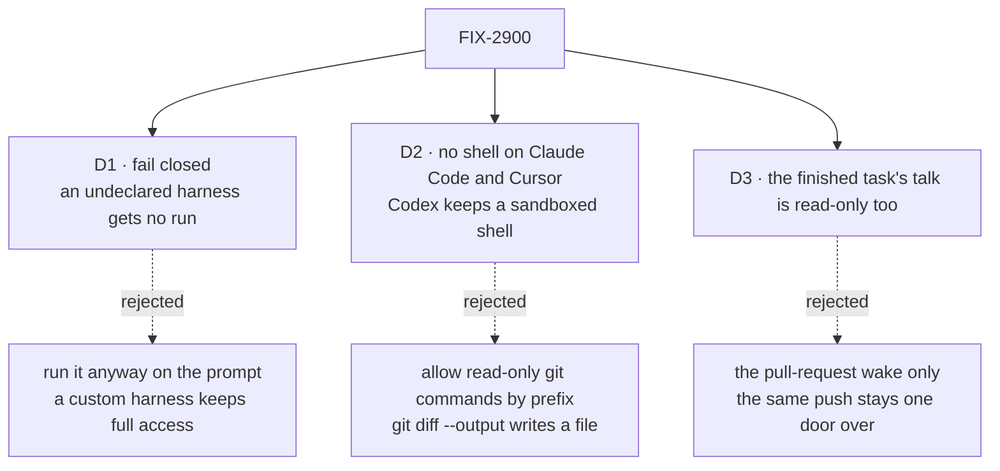

# FIX-2900 · Decisions

[Spec](SPEC.md) · **Decisions**

What was considered, what was chosen, why, and what each choice locks in. Three decisions are the sign-off surface. Everything else here is context for them.

## The tree

Solid edges are what you're signing. Dashed edges lost, and the label says why.

## D1 · Fail closed: a harness that doesn't declare `enforcesReadOnly` gets no run on a read-only turn

| | |
|---|---|
| **Instead of** | Running it anyway, with the prompt as the only guard (today's behaviour for every harness) |
| **Because** | The promise is that a done task's turn can't change anything. A harness we didn't write can ignore a feed it doesn't know, and nothing would tell us. Its own declaration, as `stopsOnAbort` already is, is the only thing a host can check before the run. The wake then settles as it did before FIX-2884, with a note; the talk is refused by name |
| **Locks in** | Every harness author who wants answers on done tasks must enforce read-only and say so. The three shipped harnesses do. A custom harness's users lose answers on done tasks until its author adds it |

![D1, fail closed. Chosen: an undeclared harness gets no run on a read-only turn. Instead of: run it on the prompt alone. It comes down to a harness we didn't write: chosen, the promise holds; instead, it runs with full access and we never know. Price: a question on a done task goes unanswered on that harness. The three shipped harnesses: a tie, they declare it. Locks in: every harness author must enforce read-only and declare it. Flips if: we decide a prompt is guarantee enough for custom harnesses](figures/d1-fail-closed.svg)

It comes down to a harness we didn't write: running it means full access we can't see.

**What would change my mind:** a host that needs custom harnesses to answer on done tasks and accepts the prompt as the guard. Then a host option could opt in, per harness, to running undeclared.

## D2 · No shell on a read-only Claude Code or Cursor turn; Codex keeps its shell inside its read-only sandbox

| | |
|---|---|
| **Instead of** | Allowing read-only `git` commands (`git log`, `git diff`, `git show`, `git status`) by prefix rule on Claude Code |
| **Because** | A prefix can't tell `git diff` from `git diff --output=notes.txt`, which writes a file, and Cursor has no prefix rules at all. Codex is different: its sandbox refuses every write and every network call at the operating-system level, whatever the command ([Settled](#settled)). The resumed session still holds the conversation in which the run made its changes, so it can say what it did |
| **Locks in** | On Claude Code and Cursor, an answer about the work comes from the files and the conversation, not from `git`. The three harnesses do not offer the same tools on that turn; the promise is the same, the reach is not |

![D2, the shell on a read-only turn. Chosen: no shell on Claude Code and Cursor, a sandboxed shell on Codex. Instead of: read-only git commands allowed by prefix. It comes down to a command that looks like a read and writes: chosen, it can't run; instead, git diff --output writes a file under a read-only rule. Price: no git log or git diff on two of three. Cursor support: chosen covers it; instead has no prefix rules on Cursor. Locks in: answers about the work come from files and the conversation. Flips if: Claude Code and Cursor gain an OS-level read-only sandbox like Codex's](figures/d2-no-shell.svg)

It comes down to a command that looks like a read and writes: a prefix rule lets it through.

**What would change my mind:** Claude Code's or Cursor's own sandbox shown to refuse writes and network as Codex's does. Then that harness keeps its shell, inside the sandbox.

## D3 · The talk on a finished task is read-only too

| | |
|---|---|
| **Instead of** | Limiting only the pull-request wake the issue names, and leaving the talk turn (a line in a finished task's session, or a message to its coder) with full tools |
| **Because** | The talk resumes the same coding session in the same checkout, today with full tools and without even the prompt's warning. It can push to the merged branch, and its changes are neither reviewed nor recorded: the task doesn't change. "Anything that needs code changes belongs in a new task" covers it. It is one call site: the talk's feeds answer `read-only` |
| **Locks in** | A finished task's session can't be used to make a quick change. A change on done work is a new task, everywhere |

It comes down to the same push one door over: the wake would be closed and the talk open.

**What would change my mind:** someone who uses the talk to change code after the task is done, on purpose. Then the talk keeps full access and this issue stays at the wake.

## Decided, not asked

- **The switch is a resolver feed, not a field on the run input.** The input is model-facing through a block's tool preset (BP-031); `cwd` and `resume` arrive the same way. Core gets `HarnessAccess` (`"full" | "read-only"`) and nothing about pull requests; "the work is done" stays in harness-manager (tenet 4).
- **Each harness enforces with its vendor's own limit, not the manager through `onToolApproval`.** The approval seam is Claude Code only; Codex and Cursor can't ask per call.
- **Per harness, on a `read-only` turn:** Claude Code: base tool set `Read`, `Grep`, `Glob`, `permissionMode: "dontAsk"`, no `canUseTool`, no relayed MCP tools allowed. Codex: `sandboxMode: "read-only"`, `approvalPolicy: "never"`, over any `thread.sandboxMode` the host set. Cursor: a `tools` allowlist of reading tools (`read`, `grep`, `glob`, `ls`, `semSearch`, `readLints`, `readTodos`) on create and on resume; an allowlist, so a tool Cursor adds later is not offered. The exact lists are the implementer's; the rule is "reading tools only, nothing that writes, runs, delegates or reaches the network". `plan` modes are not the mechanism (dropped, below).
- **Convergence point (tenet 5).** The invariant: a read-only turn never reaches an SDK with a writing tool. Writers that must pass through it: the manager's `access` feed (one answer, from `wakeNews`), the talk's feeds, and in each adapter the one place it builds SDK options (Claude Code's `queryOptions`, in-session and detached; Codex's `threadArgs`, start and resume; Cursor's `mergeCreateOptions`, create and resume). On `read-only`, the adapter's branch wins over anything the host's option bag set.
- **`full`, or no feed, is today byte for byte.** A harness given no `access` builds the options it builds today. Harness sessions (`HarnessSessionFeeds`) get no feed.
- **A harness that declares `enforcesReadOnly` and is handed `read-only` but can't apply it fails the run.** Cursor rejects an unknown tool name at resume; that error stands. Never a silent fall back to full.
- **The settled lead gains a clause** that the run's tools are read-only this turn, so it explains rather than tries. The wording is the implementer's.
- **One read-only vocabulary across FIX-2878 and FIX-2599.** `HarnessAccess`, the `access` feed and `enforcesReadOnly` are the only public read-only words on a harness, and the feed is the only per-vendor enforcement. FIX-2878's planned mark (part 4, not built) is not added as a second word: its amendment restates part 4 in these words. `plan: true` on a harness that doesn't declare `enforcesReadOnly` fails the claim, as "without the mark" did. A plan run is fed `read-only`, so the vendor enforces it, and the scoped postcheck stays as detection. Until FIX-2599 retires the `claude-code-plan` id, that harness is a plan run whatever `plan` says because its value fixes its access at `read-only`, typed `HarnessAccess`, not a new boolean; the property's name is FIX-2878's. FIX-2599's plan run is a `read-only` turn: it may add a plan tool that doesn't write, run a command or reach the network (Claude Code's `ExitPlanMode`), never one that does, and sign-off starts the next turn at `full`. Whichever lands first adds the two words to core as defined here. Instead of two words, "is read-only" and "can be held read-only", that a host must keep apart, and a third vendor path for plan runs. Considered: keep them separate with unconfusable names; dropped, because both describe the same vendor limit and would drift.
- **New public term.** `HarnessAccess` / the `access` feed / `enforcesReadOnly`. The implementation PR adds a glossary entry for harness access; "mode" is avoided because a coding run's Mode is already a term.

## Considered and dropped

| Alternative | Why not |
|---|---|
| Prompt only (today) | The issue exists because a prompt is not a guarantee |
| `permissionMode: "plan"` (Claude Code), `mode: "plan"` (Cursor) | Plan modes change how the agent works (it plans, then asks to leave plan mode), not only what it may touch; whether pre-allowed `Bash` still runs under plan is not documented. `dontAsk` with a reading base set is exact ([Settled](#settled)) |
| `access` on `HarnessRunInput` | Model-facing (BP-031). Rejected for the same reason `cwd` and `resume` are not there |
| A Claude-only fix through `onToolApproval` | Codex and Cursor can't ask per call; it is the smaller goal |
| A harness-manager option only, no core word | A third-party harness would need to learn a manager type to honour it; the feeds and the declarations already live in core |

## Settled

- **Claude Code can be made read-only per run** — **CONFIRMED** by [`poc/read-only-probes/`](poc/read-only-probes/run.mts): Agent SDK 0.3.316 with `tools: ["Read","Grep","Glob"]` and `permissionMode: "dontAsk"` offers exactly `Glob, Grep, Read`; the control, an approximation of the kit's options (the default tool set with `acceptEdits`, not the kit's exact option bag), offers 26 tools, `Write` and `Bash` among them. Options are built per `query()`, so per run on a resume.
- **Codex's read-only sandbox refuses writes and the network, and keeps reads** — **CONFIRMED** by the same POC on Linux, Codex 0.164.0: a file write and a `git commit` are refused, `git log` works, and the same write under `workspace-write` and the same commit under `danger-full-access` succeed, so the refusals are the sandbox's and not a failed launch (`workspace-write` keeps `.git` read-only too); an HTTPS request fails even with the network flag on; `workspace-write` with network and `danger-full-access` reach it. The SDK passes `--sandbox` on every `exec`, resume included (`codex-sdk` `dist/index.js`). macOS Seatbelt is not probed; the goal check runs where the implementer runs it.
- **Cursor's `tools` is per run** — from `@cursor/sdk` 1.0.40's types: "Not persisted on the agent: pass `tools` again on `Agent.resume`". Not run: its runtime needs a signed-in account. The goal check's `cu` leg settles it; if it fails, D1 holds — Cursor doesn't declare and gets no run — and that outcome goes to the product owner as a fork, not an implementer's call (see *Notes from review*).

## Notes from review

For the implementer, recorded as given; they don't change the direction.

- **Cursor bot, on the goal check** (#5725, SPEC.md): "When you author `goal.md`, I'd explicitly mirror `a-tool-call-waits-for-approval`'s `GOAL_LEGS` pattern: default PR runs leg `s` (stub + feed semantics); real harness legs on demand or a scheduled matrix. Direction doesn't need to lock file layout — just don't bake "always six full agent runs" into the default path." Reflected in *How we verify*.
- **Cursor bot, on precedence** (#5725, SPEC.md): "the risk at implementation is **precedence** — on `read-only`, adapter branch must win over host bag with no merge-after; worth one red-state test per package, already sketched in the verification table."
- **Cursor bot, on Cursor's leg** (#5725, DECISIONS.md): "I'd treat a failing `cu` leg as a **product** fork (ship CC+Codex read-only, Cursor gets no done-task runs until allowlist/sandbox is proven), not an implementation guess." If `cu` fails, stop and put that fork to the product owner with a recommendation.

## Analysis

2026-11-25 · watermark: the issue's filing, after PR #5580 merged · **Right approach, scope widened by one call site.** Run in the authoring session, not by a fresh sub-agent: this author had no sub-agent dispatch. A fresh analysis at review is welcome.

1. **Reuse** — the feed is a `HarnessResolver`, the declaration copies `stopsOnAbort`, each adapter sets its vendor's existing options, the no-run path is FIX-2884's settle. Nothing genuinely new beyond the one word. See [Builds on / Adds](SPEC.md#whats-already-here-and-the-debt).
2. **Prior art** — every vendor ships its own read-only lever (Claude Code permission modes and tool sets, Codex sandbox modes, Cursor tool allowlists); none shares one. Mapping one neutral word onto each is the normalization the framework is for (tenet 4).
3. **Other shapes** — prompt only; Claude-only approval seam; plan modes. All in *Considered and dropped*.
4. **New factors** — the talk turn (`harnessTalkTurn`) answers a finished task with full tools and no warning. **Folded** as [D3](#d3).
5. **Necessity** — earns its place: the product owner's decision is today unenforced on every harness.
6. **Ergonomics** — a harness author adds one feed and one declaration; a host writes nothing.
7. **Concerns** — Codex network blocking is proven on Linux only. Recorded; the goal check runs it again.

## How it got here

- **Draft** — framed as "the product owner's answer-only decision is a prompt, not a limit"; a neutral per-run `access` feed each harness maps to its vendor's own read-only control, fail closed for a harness that can't promise it; builds on the harness feeds, the `stopsOnAbort` declaration and FIX-2884's wake. Research found the talk turn on a finished task with the same hazard, folded in as D3.

- **Round 1** — named FIX-2878's planned read-only mark and FIX-2599's per-vendor read-only enforcement, and settled on [one read-only vocabulary](#one-vocabulary): the `access` feed is the enforcement, a plan run is a `read-only` turn, and the mark is restated in these words before it is built. D1 to D3 unchanged. The Codex probe gained positive controls; the Claude control is named an approximation of the kit's options.

**Open: none.**
