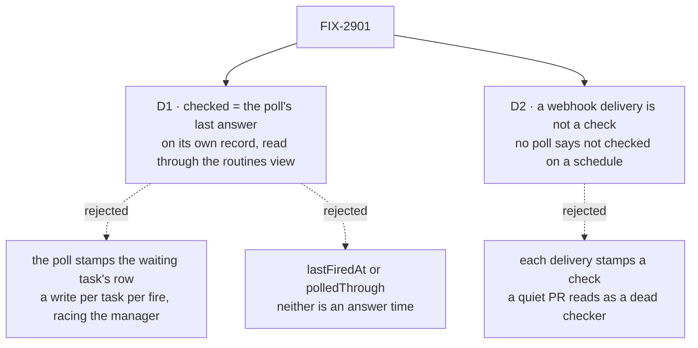

# FIX-2901 · Decisions

[Spec](SPEC.md) · **Decisions**

Two decisions are the sign-off surface. Everything else here is context for them.

## The tree

Solid edges are what you're signing. Dashed edges lost, and the label says why.

## D1 · *Checked* is when the poll last got an answer from GitHub, stamped on the poll's own record and read through the routines view

| | |
|---|---|
| **Instead of** | The poll fire stamping *last checked* onto each waiting task's row |
| **Because** | The task row is orchestration's and its hold is harness-manager's. Stamping it adds a write per waiting task every few minutes, racing the manager's hold and steer writes. The poll record is already written on every answer, so the stamp costs no new write. Watchers keeping their own liveness time is the usual shape (Flux, Argo CD), and harness-manager stays neutral ([FIX-2578 D3](../FIX-2578/DECISIONS.md)) |
| **Locks in** | *Checked* means GitHub answered the poll, changed or not, per user and pull request; a failed fetch doesn't count. Only hosts on workforce get the line |

![D1: where last checked lives. The poll's own record read through the routines view, chosen, beside stamping the waiting task's row. Decides it: who writes the task row. The chosen option adds no write and leaves the row to its owners; stamping the task adds a write per task per fire that races the manager. Price: the host filters the routines list by task, against none. Tie: both update without a reload. Locks in: checked means GitHub answered the poll, shown only through workforce. Flips if: hosts without workforce need the line](figures/d1-where-it-lives.svg)

It comes down to who writes the task row: stamping it from the poll adds a racing write per task.

## D2 · A webhook delivery is not a check; a follow with no poll says *not checked on a schedule*

| | |
|---|---|
| **Instead of** | Counting each webhook delivery as a check, as the issue's note proposes |
| **Because** | A delivery arrives only on a change, so a quiet pull request's last one can be days old and read like a dead checker (Apache Beam's BEAM-5924 is that bug). The view can't tell whether a webhook reaches this host at all. A poll answers every fire |
| **Locks in** | A follow with no poll shows no age, so a webhook that stopped arriving stays invisible until webhook-only follows also poll slowly ([FIX-2536](../FIX-2536/DECISIONS.md) Q-A, open). No host is webhook-only today |

It comes down to a quiet pull request: counting deliveries makes it read as a dead checker.

## Decided, not asked

- **One stamp, one convergence point:** the poll's fetch step, on an unchanged answer and on
  one with events, with the server's clock. A fetch that throws writes nothing. Every other
  writer of the poll record carries it forward untouched: the settle step (the field is on
  the schema, so its parse keeps it) and `ensurePollSchedule`'s speed-up, which re-creates the
  record from `existing.input`.
- **The view joins, the verb doesn't.** The poll fields are added in the routines view's
  projection, from one read of the user's polls per run. `ListedRoutine` and the `listRoutines`
  verb a worker calls stay unchanged: no new fields in a model's tool output, and no per-row
  read on a worker's turn.
- **A task's line reads only its own enabled follow.** One poll serves all the user's follows on
  a pull request, so a paused follow reads *paused*, never another follow's *checked*.
- **"No poll" has two readings.** The app doesn't poll (no `routines.poll`): *not checked on a
  schedule*. The app polls but the follow's poll record is gone or off: *not being checked*,
  worded as a fault, since it is the stopped-poller case.
- **The age is clamped at zero**, so a browser clock behind the server's never shows a negative
  age.
- **The view reads the viewing user's follows**, which on today's hosts is the user who ran the
  task (a security review confirmed the scoping).
- **The poll record stays server-only; every new field is optional** (BP-030).

## Considered and dropped

| Alternative | Why not |
|---|---|
| The engine's `lastFiredAt` ("the schedule records its last fire") | Claimed before the fetch runs, so it moves when a bad token fails every fetch |
| `polledThrough` | Moves only when an answer has events; an owed delivery holds it back |
| A new workforce view by task | The routines view already lists follows and declares the polls |
| The poll fields on `ListedRoutine` itself | Changes every worker's `listRoutines` output and reads a poll per row on a worker's turn |
| A client join over a client-readable poll record | Exposes ETags and the owed list; every host re-implements the join |
| Stamp the time when a user's message wakes the task | A hand check, written from harness-manager into workforce. A follow-up if users ask |

## Analysis

2026-11-24 · watermark 2026-11-23 (issue filed) · **Reshape lightly**, folded before
publishing: the new view became an extension of the routines view; `lastFiredAt` named and
dropped; a paused follow can't borrow another follow's *checked*. Prior art (Flux, Argo CD)
confirms D1. Necessity: a dead poller is invisible today. New factors: #5669 and #5661 touch
neighbouring code, not the shape.

## How it got here

- **Draft** — framed as poll liveness on a waiting task; the poll stamps its own record on every
  answer, read through the routines view; a webhook delivery is not a check.
- **Review round 1** — the poll fields stay out of the `listRoutines` verb (view-only, one poll
  read per run), because the view's rows are also a worker's tool output; a follow whose app
  polls but whose poll record is missing reads as a fault, not as *not on a schedule*.

## Notes from review

- "Filtering the full `routinesView` per task row … hosts should hoist one routines subscription per screen and pass the matching follow into `PullRequestCheckLine`." — cursor ([thread](https://github.com/fixpoint-labs/flow-state-dev/pull/5681#discussion_r4688735224))
- "Unchanged answers still bump resource versions — watch `routinesView` fan-out on every fire. … Age ticks should re-render only the line component." — cursor ([review](https://github.com/fixpoint-labs/flow-state-dev/pull/5681))
- "If `checkedAt` also becomes a field … for clock routines (`nextRunAt` already exists there), the field naming should line up." — jhoffner ([comment](https://github.com/fixpoint-labs/flow-state-dev/pull/5681))
- "#5669 touches the same Teammates files. Whoever lands second should rebase the line." — jhoffner ([comment](https://github.com/fixpoint-labs/flow-state-dev/pull/5681))
- "Using a 3rd-party 'time ago' library for display is fine at implementation time." — cursor ([review](https://github.com/fixpoint-labs/flow-state-dev/pull/5681))

These are inputs, not instructions. Adopt, adapt, or discard.

**Open: none.**
