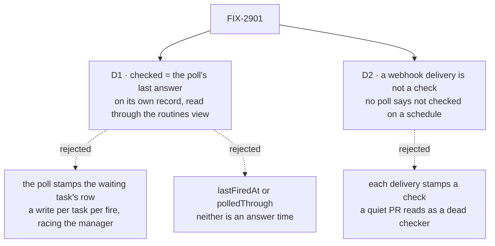

# FIX-2901 · Decisions

[Spec](SPEC.md) · **Decisions**

What was considered, what was chosen, why, and what each choice locks in. Two decisions are the
sign-off surface. Everything else here is context for them.

## The tree

Solid edges are what you're signing. Dashed edges lost, and the label says why.

## D1 · *Checked* is when the poll last got an answer from GitHub, stamped on the poll's own record and read through the routines view

| | |
|---|---|
| **Instead of** | The poll fire stamping *last checked* onto each waiting task's row, so every task view already has it |
| **Because** | The task row is orchestration's and its hold is harness-manager's. A poll that writes it adds a write per waiting task every few minutes, racing the manager's own hold and steer writes, and ties a workforce routine to a harness-manager hold shape. The poll record is already written on every answer, unchanged ones included, so the stamp costs no new write. Watchers keeping their own liveness time is the usual shape (Flux's `lastAttemptedRevision`, Argo CD's `reconciledAt`), and harness-manager stays neutral and never polls ([FIX-2578 D3](../FIX-2578/DECISIONS.md)) |
| **Locks in** | *Checked* means GitHub answered the poll, changed or not, per user and pull request; a fire that failed doesn't count. A host shows it only through workforce: harness-manager without workforce gets no line. The routines list, which the user's worker also reads, shows the same time for every followed pull request |

![D1: where last checked lives. The poll's own record read through the routines view, chosen, beside stamping the waiting task's row. Decides it: who writes the task row. The chosen option adds no write and leaves the row to its owners; stamping the task adds a write per task per fire that races the manager. Price: the host filters the routines list by task, against none. Tie: both update without a reload. Locks in: checked means GitHub answered the poll, shown only through workforce. Flips if: hosts without workforce need the line](figures/d1-where-it-lives.svg)

It comes down to who writes the task row: stamping it from the poll adds a racing write per task.

## D2 · A webhook delivery is not a check; a follow with no poll says *not checked on a schedule*

| | |
|---|---|
| **Instead of** | Counting each webhook delivery as a check, as the issue's note proposes |
| **Because** | A delivery arrives only when something changes. A quiet pull request's last delivery can be days old, which reads exactly like a dead checker, the confusion this issue exists to remove (Apache Beam's BEAM-5924 is the same bug: *last sync* tracked last activity). Nor can the view tell whether a webhook reaches this host at all: a laptop has no public URL. A poll answers on every fire, so its time is a real liveness signal |
| **Locks in** | A follow with no poll shows no age, so a webhook that stopped arriving stays invisible until push-only follows also poll slowly ([FIX-2536](../FIX-2536/DECISIONS.md) Q-A, open). Both hosts poll today, so no user sees this state yet |

It comes down to a quiet pull request: counting deliveries makes it read as a dead checker.

## Decided, not asked

- **The stamp's convergence point is the poll's fetch step**, on both its writes: an
  unchanged answer and an answer with events. A fetch that throws writes nothing, so the age
  grows. Nothing else writes it: not delivery, not `subscribe`, not the wake. The field goes on
  the poll schema so the settle step's parse keeps it.
- **A task's line reads only its own enabled follow.** One poll serves every follow of the user
  on that pull request, so another follow can keep the poll alive while the task's own is
  paused: paused reads *paused*, never *checked*. A follow with no `taskId` (written outside a
  task run) belongs to no task.
- **Late is past two intervals** (`now − checkedAt > 2 × everyMinutes`). The age is computed in
  the browser from the stored epoch time and re-rendered on a timer.
- **The interval shown is the poll's own** `everyMinutes` (the fastest of the user's follows on
  that pull request).
- **One line per pull request the task waits on.** When a pull request merges, its follow ends
  before the wake clears the hold, so the line may read *not checked* for a moment; acceptable.
- **The view reads the viewing user's follows.** On today's hosts that is the user who ran the
  task; a board shared across users would read another user's task as *not checked*. No host
  has one.
- **One line, worded once:** a browser-safe line from workforce that both hosts draw.
- **The poll record stays server-only.** The view reads it on the server; no client config.
- **Every new field is optional** (BP-030): a poll saved before reads *not checked yet* until
  its next answer.

## Considered and dropped

| Alternative | Why not |
|---|---|
| The engine's `lastFiredAt` (what the issue meant by "the schedule records its last fire") | Claimed before the fetch runs, so it moves when a bad token fails every fetch. It would show a dead poller as healthy |
| `polledThrough` | Moves only when an answer has events, and an owed delivery holds it at the oldest owed event |
| A new workforce view by task | The routines view already lists follows, with `paused`, and declares the poll collection. A second view would join the same rows |
| Make the poll record client-readable and join in the browser | Exposes the poll's ETags and owed list; every host re-implements the join |
| Stamp the time when a user's message wakes the task and it reads GitHub | A hand check, not a routine one, and it writes from harness-manager into workforce. A follow-up if users ask |
| Show only the cadence | Reads the same when the poller is dead (the goal's *smaller, rejected*) |

## Analysis

2026-11-24 · watermark 2026-11-23 (issue filed) · **Reshape lightly**, folded before
publishing.

1. **Reuse** — `reuse-review`: the stamp extends the poll schema; the proposed new view was
   **extend `routines`**. Folded. See [Builds on / Adds](SPEC.md#whats-already-here-and-the-debt).
2. **Prior art** — watchers keep their own liveness time, apart from what they saw (Flux,
   Argo CD); an answer time beats a fire time. Confirms D1.
3. **Other shapes** — stamp the task; `lastFiredAt`; a client join. In *Considered and dropped*.
4. **New factors** — #5669 (Teammates review reads PR state; same files, other meaning) and
   #5661 / FIX-2920 (why polling stops). Neither changes the shape.
5. **Necessity** — earns its place: a dead poller is invisible today.
6. **Ergonomics** — a host adds one `useView` it may already hold, and one line.
7. **Concerns** — three folded: the engine's `lastFiredAt` was missed; a paused follow could read
   *checked* through another follow's poll; the push-only wording claimed a liveness nothing
   confirms. The issue's `review-hold.tsx` surface is the review stop, not the PR wait; recorded.

## How it got here

- **Draft** — framed as poll liveness on a waiting task; the poll stamps its own record on every
  answer, read through the routines view; a webhook delivery is not a check.

**Open: none.**
