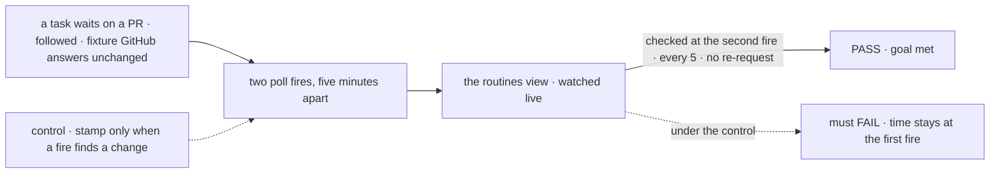
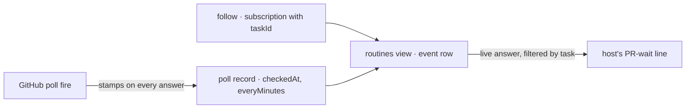

# FIX-2901 · Show when a task's pull request was last checked while the task waits on it

**Spec** · [Decisions](DECISIONS.md)

## Five users, before and after

| Someone who… | Today | After |
|---|---|---|
| **opens a coding task that waits on its pull request, in an app that polls GitHub** (the Teammates lab with reviewers set; the shift-manager devteam host) | Sees *PR open · #7* and "Merged? Say so here and I'll check." Nothing says whether anything is watching | Sees *Checked 3 min ago · every 5 min* beside *PR open*. The age ticks on screen and resets after each poll, with no reload |
| **waits on a pull request nothing follows for this task** (no follower wired, the wait opened before following started, or the task's follow is paused) | The same *PR open*, which reads as watched | Sees *Not checked automatically: send a message to check now* (or *paused*). A message wakes the task and it reads GitHub, as today; the line stays, since a hand check is not a routine one |
| **has a poller that stopped** (bad token, lost schedule index) | Nothing changes on screen. A stuck task looks like a slow review | The age keeps growing. Past two intervals the line says the check is late, so a dead poller shows instead of hiding |
| **follows by webhook, with no poll** (no host does today) | The same *PR open* | Sees *Not checked on a schedule*, with no time. The issue's note counted webhook deliveries as checks; a quiet pull request would then read as dead ([D2](DECISIONS.md#d2)) |
| **runs harness-manager with no workforce** | *PR open* | *PR open*, unchanged. The line is a workforce read |

The ask, in the product owner's words: "we need to show in the task when the PR was last
checked, if we are routinely checking to see if it is merged yet or not". A task that waits
days on a review is normal. A task that waits days because nothing is checking is a bug the
user can't see today.

## The goal, and how we'll know it's met

**A user looking at a coding task that waits on its pull request can tell, without reloading,
whether something checks GitHub for it, how often, and when it last did.**

| Is it the right goal? | |
|---|---|
| **The real need** | Tell a slow pull request from a stuck task ([FIX-2901](https://linear.app/fixpoint-labs/issue/FIX-2901): "If the user can't see when GitHub was last checked, they can't tell a slow PR from a stuck task") |
| **Smaller, and rejected** | Show the poll's cadence only ("checked every 5 min"). It reads the same when the poller is dead, which is the case the need is about |
| **Bigger, and not this issue's** | Say *why* a poll stopped (bad token, rate limit) and heal it. FIX-2920 (#5661) owns that; this line shows the effect |
| **Not done if** | The time moves only when a poll finds a change, so a quiet pull request reads as unchecked · the time is the poll's fetch mark (held back by an owed delivery) or the fire's start (moves even when the fetch fails) · a poll that throws still moves the time · a task nothing follows, or whose follow is paused, reads as watched · the line needs a reload to move · the age is drawn once and never ticks · nothing says *late* past two intervals |



The check reads what a watching screen receives after real poll fires, not the poll's own
record.

| How we verify | |
|---|---|
| **Goal check** | `goals/pull-request-wait/shows-last-check/`, new · model `n/a` · run by the implementer at completion · verdict on the implementation PR |
| **Signal** | **(a)** A followed waiting task: after fire 2, the task's routine in the watched answer gives that fire's time and 5 minutes, delivered to a `watchView` on `client.live` with no new request from the test. **(b)** A waiting task with no follow has no routine, and still none after a user's message wakes it; a paused follow reads paused. **(c)** A follow with no poll gives no time. **(d)** A poll whose fetch throws leaves the time at the last good answer. **(e)** The shared line, rendered from (a)'s answer with an injected clock: the age advances with no new answer, and at 2 × 5 min + 1 s it reads *late* |
| **Input** | The workforce service flow with a fixture GitHub provider whose `poll` answers `unchanged`, then one event; `routines.poll` at its default 5 minutes. Fires go through the scheduled endpoint with an injected clock five minutes apart, not by calling the handler. An answer with events must stamp too |
| **Anti-game** | Don't assert on the poll record or a helper's return. Read through the client's live view, so a stamp the view never hears fails. (e) asserts on rendered text |
| **Control that must fail** | `GOAL_CONTROL=stamp-on-change`: the stamp is written only when an answer has events. Must FAIL (a) on the time. `GOAL_CONTROL=static-age`: the line computes its age once, at render. Must FAIL (e) on *late*. Today's `main` fails (a) and (c) |

## What changes

![Two task lines, before and after. Before: PR open, number 7, and the hint "Merged? Say so here and I'll check", the same for every task. After, three lines: a polled task reads "Checked 3 min ago · every 5 min", one followed with no poll reads "Not checked on a schedule", and one nothing follows reads "Not checked automatically: send a message to check now". Under them, the path: the poll fire stamps its own record on every answer from GitHub; the routines view's event rows carry the task and the poll's time and interval; the host's line watches that view](figures/what-changes.svg)

The poll writes the time it last got an answer from GitHub on its own record, and the routines
view, which already lists every follow, carries that time and the follow's task. The
harness-neutral wait is not touched.

```diff
  // A host's PR-wait line (Teammates popup, shift-manager task panel)
  {waitsOnPullRequest(task) && <span>PR open · #{n}</span>}
+ const { value } = useView(routinesView);
+ const follows = value?.routines.filter((r) => "event" in r.trigger && r.taskId === task.id);
+ <PullRequestCheckLine follows={follows} />   // "Checked 3 min ago · every 5 min"
```

**Docs:** at release, update `reference/harness-runs.md` (the pull-request wait row and
*Pull requests*: what the line shows), `catalog/workforce/routines.md` (an event routine shows
its last poll; *Polling when there is no public URL*), `reference/workforce.md` (the routines
view's event row), and `catalog/starters/teammates.md` (the task popup). No new page; no README.



## What stays as it is

- The wait itself: harness-manager's hold, its releasers, the wake's own `gh` read
  ([FIX-2578 D3](../FIX-2578/DECISIONS.md)). harness-manager still never polls.
- Poll cadence, the fetch mark, ETags and what is owed ([FIX-2536 D2](../FIX-2536/DECISIONS.md)).
- The review card (`review-hold.tsx`). It draws the review stop, not the PR wait, so no
  registry copy changes.

## What's already here, and the debt

| Already here | What this does with it |
|---|---|
| **The job: say when something watched was last looked at.** Mechanisms `harness-readiness` (`checkedAt` per harness), `routines` (a clock routine's `nextRunAt`), `schedule` (the engine's `lastFiredAt` per fire, `scheduled-fires/**`). Searched `lastChecked`, `checkedAt`, `lastPolled`, `lastFire`, `lastSynced` across `packages/` | **None for a poll's answer.** `lastFiredAt` is claimed before the fetch runs, so it moves when a bad token fails every fetch; it can't show a dead poller ([considered and dropped](DECISIONS.md#considered-and-dropped)) |
| `routines`: the routines view lists every follow as an event routine, with `paused`, and declares the poll collection | **Extends** its event row with the follow's task and the poll's time and interval |
| `subscriptions`: a follow names its `taskId`; `followPullRequest` writes it | **Builds on** |
| The poll record (`pollScheduleInputSchema`): `everyMinutes`, `polledThrough` | **Extends** with one optional time. `polledThrough` is not it: an unchanged answer doesn't move it, and an owed delivery holds it back |
| `pullRequestWait` and the hosts' *PR open* lines | **Leaves alone** the wait; the hosts draw the new line beside it |
| [FIX-2578 D3](../FIX-2578/DECISIONS.md): every wake reads the PR; no poll in harness-manager | **Kept** |
| [FIX-2536 D1–D2](../FIX-2536/DECISIONS.md): one poll per user and pull request; its mark lives on the poll record | **Amended in part:** the record also carries when it last got an answer |
| [FIX-2535 D2–D3](../FIX-2535/DECISIONS.md): a coding task follows its PR once recorded, and hears its close | **Kept.** Its follow is the row the host reads |

| Adds | Existing piece considered | Why it doesn't fit / how composed |
|---|---|---|
| A *checked at* time on the poll record, written on every answer | `schedule`'s `lastFiredAt`; `polledThrough` | Neither is an answer time (above). Composed: the fetch already writes the record on every answer; one field joins that write |
| `taskId` and the poll's time and interval on the routines view's event row | `routines` view; a new view by task | **Extended**, not new: the view already lists follows and declares the poll collection. Hosts filter by task |

| The debt | |
|---|---|
| **Removes** | Nothing |
| **Adds** | One optional field on the poll record and three on an event routine, permanent by design. No second way to check a pull request, and no new view |
| **Leaves** | A push-only follow has no catch-up poll, so a missed webhook stays invisible ([FIX-2536](../FIX-2536/DECISIONS.md) Q-A, open). Why a poll fails is FIX-2920's |

**Net: flat.** Fields on two existing records; nothing removed, no new mechanism.

## Sign off

**[The goal](#the-goal-and-how-well-know-its-met), at that size:** whether, how often and when,
read live off real poll fires. If wrong: a cadence label that looks the same when the poller is
dead, or a line that needs a reload.

**[The debt](#whats-already-here-and-the-debt), net flat:** one field on the poll record, three
on the routines view's event row. If wrong: a second record of poll state someone keeps in step.

1. **[D1](DECISIONS.md#d1) · *Checked* is when the poll last got an answer from GitHub, stamped
   on the poll's own record and read through the routines view.** If wrong: hosts that don't
   use workforce never get the line.
2. **[D2](DECISIONS.md#d2) · A webhook delivery is not a check; a follow with no poll says
   *not checked on a schedule*.** If wrong: a webhook host can't show a dead webhook until a
   catch-up poll lands.

**Open: none.** D2 is the one to weigh: it narrows the issue's note that webhook deliveries
count as checks.

Feature · `workforce` + Teammates lab + `shift-manager` · small · no epic
