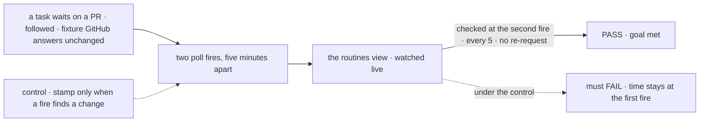

# FIX-2901 · Show when a task's pull request was last checked while the task waits on it

**Spec** · [Decisions](DECISIONS.md)

## Five users, before and after

| Someone who… | Today | After |
|---|---|---|
| **opens a coding task that waits on its pull request, in an app that polls GitHub** (Teammates with reviewers set; the shift-manager devteam host) | Sees *PR open · #7* and "Merged? Say so here and I'll check." Nothing says whether anything is watching | Sees *Checked 3 min ago · every 5 min*. The age ticks on screen and resets after each poll, with no reload |
| **waits on a pull request nothing follows for this task** (no follower wired, the wait opened before following started, or the follow is paused) | The same *PR open*, which reads as watched | Sees *Not checked automatically: send a message to check now* (or *paused*). A message still wakes the task to read GitHub; the line stays, since a hand check is not a routine one |
| **has a poller that stopped** (bad token, lost poll record) | Nothing changes on screen. A stuck task looks like a slow review | The age keeps growing and, past two intervals, the line says the check is late. A follow whose app polls but whose poll record is gone reads as not being checked, not as calm |
| **follows by webhook, with no poll** (no host does today) | The same *PR open* | Sees *Not checked on a schedule*, with no time. A webhook delivery is not a check ([D2](DECISIONS.md#d2)) |
| **runs harness-manager with no workforce** | *PR open* | *PR open*, unchanged |

The product owner's ask: "we need to show in the task when the PR was last checked, if we are
routinely checking to see if it is merged yet or not". Waiting days on a review is normal;
waiting days because nothing checks is a bug the user can't see today.

## The goal, and how we'll know it's met

**A user looking at a coding task that waits on its pull request can tell, without reloading,
whether something checks GitHub for it, how often, and when it last did.**

| Is it the right goal? | |
|---|---|
| **The real need** | Tell a slow pull request from a stuck task ([FIX-2901](https://linear.app/fixpoint-labs/issue/FIX-2901)) |
| **Smaller, and rejected** | The cadence only ("checked every 5 min"). It reads the same when the poller is dead, which is the case the need is about |
| **Bigger, and not this issue's** | Why a poll stopped, and healing it: FIX-2920 (#5661) |
| **Not done if** | The time moves only when a poll finds a change · it is the fetch mark or the fire's start, not the answer · a failed fetch moves it · an unfollowed, paused, or poll-less-but-should-poll follow reads as watched · it needs a reload · the age never ticks · nothing says *late* |



The check reads what a watching screen receives after real poll fires, not the poll record.

| How we verify | |
|---|---|
| **Goal check** | `goals/pull-request-wait/shows-last-check/`, new · model `n/a` · the implementer runs it at completion · verdict on the implementation PR |
| **Signal** | **(a)** After fire 2, the task's follow in the watched answer carries that fire's time and 5 minutes, delivered to a `watchView` on `client.live` with no new request. **(b)** No follow: none for the task, still none after a message wakes it; a paused follow reads paused. **(c)** A follow whose app polls but whose poll record was deleted reads *not being checked*; an app that never polls reads *not on a schedule*. **(d)** A fetch that throws leaves the time at the last good answer. **(e)** The shared line, rendered from (a) with an injected clock, advances with no new answer and reads *late* past two intervals |
| **Input** | The workforce service flow with a fixture GitHub provider whose `poll` answers `unchanged`, then one event; default 5-minute cadence. Fires go through the scheduled endpoint, five minutes apart on an injected clock |
| **Anti-game** | Read through the client's live view, never the poll record or a helper's return. (e) asserts on rendered text |
| **Control that must fail** | `GOAL_CONTROL=stamp-on-change` must FAIL (a) on the time. `GOAL_CONTROL=static-age` (age computed once) must FAIL (e) on *late*. Today's `main` fails (a) and (c) |

## What changes

![Two task lines, before and after. Before: PR open, number 7, and the hint "Merged? Say so here and I'll check", the same for every task. After, three lines: a polled task reads "Checked 3 min ago · every 5 min", one followed with no poll reads "Not checked on a schedule", and one nothing follows reads "Not checked automatically: send a message to check now". Under them, the path: the poll fire stamps its own record on every answer from GitHub; the routines view's event row carries the follow's task and the poll's time and interval; the host's line watches that view, filtered by task](figures/what-changes.svg)

The poll writes the time GitHub last answered it on its own record. The routines view, which
already lists every follow, joins that time and the follow's task onto its event rows; the
`listRoutines` verb a worker calls stays as it is. harness-manager's wait is not touched.

```diff
  // A host's PR-wait line (Teammates popup, shift-manager task panel)
  {waitsOnPullRequest(task) && <span>PR open · #{n}</span>}
+ const { value } = useView(routinesView);            // once per screen
+ <PullRequestCheckLine follows={followsOf(value, task.id)} />   // "Checked 3 min ago · every 5 min"
```

**Docs:** at release, update `reference/harness-runs.md` (the pull-request wait row and *Pull
requests*), `catalog/workforce/routines.md` (an event routine shows its last poll),
`reference/workforce.md` (the routines view's event row and the shared line), and
`catalog/starters/teammates.md` (the task popup). No new page; no README.

## What stays as it is

- The wait: harness-manager's hold, its releasers, the wake's own `gh` read
  ([FIX-2578 D3](../FIX-2578/DECISIONS.md)). harness-manager still never polls.
- Poll cadence, the fetch mark, ETags and what is owed ([FIX-2536 D2](../FIX-2536/DECISIONS.md)).
- The `listRoutines` verb's output, which a worker reads.
- `review-hold.tsx`, which draws the review stop, not the PR wait.

## What's already here, and the debt

| Already here | What this does with it |
|---|---|
| **The job: say when something watched was last looked at.** `harness-readiness` (`checkedAt`), `routines` (`nextRunAt`), `schedule` (the engine's `lastFiredAt`). Searched `lastChecked`, `checkedAt`, `lastPolled`, `lastFire`, `lastSynced` across `packages/` | **None for a poll's answer.** `lastFiredAt` moves even when the fetch fails ([dropped](DECISIONS.md#considered-and-dropped)) |
| `routines` view: lists every follow, with `paused`; declares the poll collection | **Extends** its event rows, in the view only |
| `subscriptions`: a follow names its `taskId` | **Builds on** |
| The poll record: `everyMinutes`, `polledThrough` | **Extends** with one optional time. `polledThrough` doesn't move on an unchanged answer |
| [FIX-2536 D1–D2](../FIX-2536/DECISIONS.md): one poll per user and pull request; its mark on the poll record | **Amended in part:** the record also carries its last answer |
| [FIX-2578 D3](../FIX-2578/DECISIONS.md), [FIX-2535 D2–D3](../FIX-2535/DECISIONS.md): no poll in harness-manager; a coding task follows its PR | **Kept** |

| Adds | Existing piece considered | Why it doesn't fit / how composed |
|---|---|---|
| A *checked at* time on the poll record | `schedule`'s `lastFiredAt`; `polledThrough` | Neither is an answer time. Composed: the fetch already writes the record on every answer |
| The follow's task and its poll's time and interval on the routines view's event rows | `routines` view; a new view by task | **Extended**: the view already lists follows and declares the polls. One poll read per view run, not per row |
| One browser-safe line (age, interval, *late*) that both hosts import | Each host's own *PR open* line | Composed into those lines; worded once so the hosts can't drift |

| The debt | |
|---|---|
| **Removes** | Nothing |
| **Adds** | One optional field, three view-only fields, one shared line. Permanent by design; no second way to check a pull request |
| **Leaves** | A webhook-only follow has no catch-up poll ([FIX-2536](../FIX-2536/DECISIONS.md) Q-A, open). Why a poll fails is FIX-2920's |

**Net: flat.** Fields on existing records and one shared line; nothing removed, no new mechanism.

## Sign off

**[The goal](#the-goal-and-how-well-know-its-met), at that size:** whether, how often and when,
live off real poll fires. If wrong: a cadence label that looks the same when the poller is dead.

**[The debt](#whats-already-here-and-the-debt), net flat:** one poll field, three view fields, one
shared line. If wrong: a second record of poll state someone keeps in step.

1. **[D1](DECISIONS.md#d1) · *Checked* is when GitHub last answered the poll, stamped on the
   poll's own record and read through the routines view.** If wrong: hosts without workforce
   never get the line.
2. **[D2](DECISIONS.md#d2) · A webhook delivery is not a check.** If wrong: a webhook host can't
   show a dead webhook until a catch-up poll lands.

**Open: none.** D2 is the one to weigh: it narrows the issue's note that webhook deliveries
count as checks.

Feature · `workforce` + Teammates lab + `shift-manager` · small · no epic
