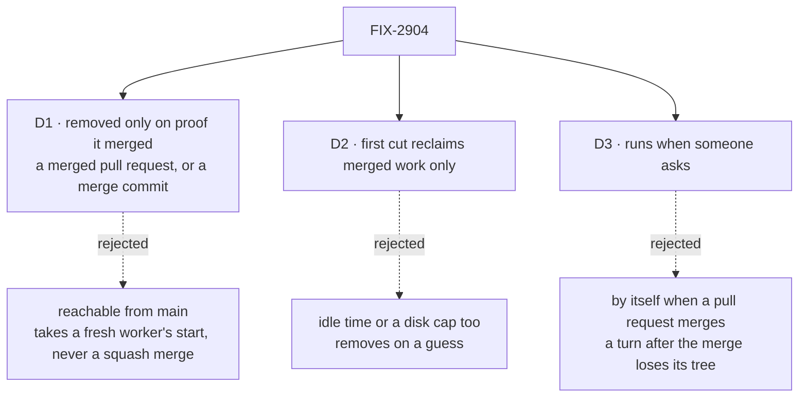

# FIX-2904 · Decisions

[Spec](SPEC.md) · **Decisions**

What was considered, what was chosen, why, and what each choice locks in. Three decisions are the sign-off surface. Everything else here is context for them.

## The tree

Solid edges are what you're signing. Dashed edges lost, and the label says why.

## D1 · A worktree is removed only on proof its work merged: a merged pull request, or a merge commit

| | |
|---|---|
| **Instead of** | "Reachable from main", git ancestry alone |
| **Because** | A worker that has just started has an empty branch at the base, and the base is reachable from main. Ancestry calls it merged and takes its worktree from under it. The same rule never matches a squash or rebase merge, because those commits never reach main. Proof has two sources. GitHub says a pull request on the branch merged and the branch has nothing past its head. Or the tip came into the default branch as a merge's second parent, which a branch at the base never does. Either way the branch needs a commit of its own past its cut point, so a worker cut at another branch's tip is not taken when that branch merges |
| **Locks in** | Unproven means kept. A fast-forward merge leaves no trace of the branch, so those worktrees are removed by hand, for good, and that includes the framework's own local merge (`land` does not pass `--no-ff`). While GitHub is unreachable, squash and rebase merges wait. Any later trigger has to bring its own proof |

It comes down to a worker that has just started: ancestry takes its empty branch, proof keeps it.

**What would change my mind:** if every worktree carried a marker saying its worker finished. Then that marker, not git, would be the proof.

## D2 · The first cut reclaims merged work only; idle time and disk caps stay out

| | |
|---|---|
| **Instead of** | FIX-2252's wider set: idle time, oldest first at a disk cap, or a mix |
| **Because** | Merged is the one trigger with no argument behind it. Idle isn't abandoned: a worker may come back, and it then pays a full install. A cap removes the wrong thing on a bad week. The worktrees these would add are the unmerged ones, which are the ones holding work |
| **Locks in** | The command's name and behaviour say *merged*. Idle and cap rules, if wanted, arrive as criteria of their own, never by widening this one. Abandoned unmerged worktrees stay until removed by hand, and the output lists them so the person sees the pile |

It comes down to a worktree untouched for a week: kept here, removed on a guess in the other.

**What would change my mind:** if most of the disk turns out to be abandoned work that never merged. Then idle time is the next criterion, and FIX-2252, which keeps that question, is where it goes.

## D3 · It runs when someone asks, not by itself when a pull request merges

| | |
|---|---|
| **Instead of** | Removing automatically when a pull request merges, or on a schedule (FIX-1768's shape) |
| **Because** | After a merge, a session's owner can still come back for another turn, and an attached session's turn fails once the owner's tree is gone. Taking trees on a trigger the person never sees makes those turns cut and install again, or fail. A person asking picks the moment, and the command is safe to repeat. (A board task whose pull requests all merged completes without needing its tree, so it is not the case here.) |
| **Locks in** | One function with many callers. An app's button, a schedule or a retire-on-merge each call it; none grows a remover of its own. Disk grows until someone runs it |

It comes down to a turn after the merge: its tree is still there, against gone and re-installed.

**What would change my mind:** if nobody runs it in practice. Then the app that owns the rows schedules it, calling the same function.

## Decided, not asked

- **Names.** Not *prune*: git's `worktree prune`, which the workspace host already runs, drops the records of directories that are gone, a different job. Not *landed*: in this codebase `land` and `Landed` mean *delivered* (a pull request opened, or a local merge), and a task's output carries `landed` when its pull request is merely open. The word is *merged*. Neither word has a glossary entry, so there is nothing to retire. A public name the build settles that reads as a term gets its entry in the implementation PR.
- **The convergence point is one function.** Every caller that asks "did this work merge?" goes through the one proof: the CLI, an app's sweep, and the preview's live set in the next spec. Every removal goes through `host.remove`.
- **The proof, exactly.** Three gates, all of them:
  1. **The branch has a commit of its own.** Count commits past the branch's cut point: the row's `baseCommit` when a row exists, else the first reflog entry. No cut point to read means unproven. Without this a fresh branch cut at another branch's tip reads as merged once that branch merges (a stacked worker; reproduced, and now a case in the POC).
  2. **Git or GitHub shows the merge.** Git: the tip is reachable from the default branch and is not on that ref's first-parent line, judged against the same ref both times. Or GitHub, by branch in the repository the pinned remote names: a pull request on the branch merged into the default branch, and the tip equals its head or is older.
  3. **Nothing is open.** No open pull request on the branch.
  A head commit the local object store lacks counts as unproven. A closed, unmerged pull request counts as unproven. A pull request from a fork is never found, so it is kept. A detached HEAD has no branch to prove and is kept. The primary checkout and the command's own directory are never candidates. `gh` runs outside the worktree with `--repo` taken from the pinned remote, as `land` does, so a checkout's own remotes cannot pick the repository.
- **A refusal never stops the sweep.** Each worktree is judged alone; the output lists every kept one with its own reason.
- **Rows are out of this cut.** No caller holds rows today: the CLI has none and no app is named. The sweep reads `host.list` and `host.remove` only. Leaving them out also leaves the question of skipping a worktree some live task is attached to (FIX-2659, FIX-2361) with the spec that adds rows.
- **The branch is kept, always.** GitHub deletes the remote branch on merge for this repository (`delete_branch_on_merge: true`), so a local branch left behind is small, and it is how a later turn cuts the worktree again (the provision reuses a branch that already exists). The sweep takes no `--delete-branch`: `remove` refuses to delete a branch whose commits live on no other ref, which is every squash or rebase merge, and that would keep the worktree.
- **Ignored files go with the directory.** `.env` files and scratch notes are deleted as they are by `--remove`; the dry run lists the worktrees, not the ignored files. Named under *Leaves*.
- **Disk is measured, not assumed.** The "3 GB" figure is the owner's and unmeasured; a package store that links files makes the apparent size larger than what removal frees. The goal check measures the bytes freed.
- **A dry run changes nothing.** It makes the same reads and writes no row and removes nothing.
- **Disposable-repository tests are part of the build.** They include a worktree a worker is using, held through a real in-use lock, and a fresh branch at the base. A destructive rule without them is unreviewed.
- **No Cursor, process or row cleanup.** Those are FIX-2252 and FIX-2251, named under *Leaves*.

## Considered and dropped

| Alternative | Why not |
|---|---|
| Reachable from main alone | Takes a fresh worker's start; never matches squash or rebase merges. Shown in `poc/merged-rule/` |
| Trust the pull-request state on the row | The row is refreshed at a turn's end only. A run that ended before the merge reads `open` forever |
| An outside watcher or script | It would repeat list, remove and the pull-request read, a second remover. It can't mark rows |
| One sweep per app (Teammates, Kitchen Sink) | Each would copy the proof, and the copies would drift |
| Delete the branch too by default | Takes the way back for a later turn, for almost no disk |
| `--force` to remove unproven work | Force already means *delete the branch anyway*. Removing unproven worktrees is a different, larger risk and has no flag |

## Settled

- **Ancestry alone is the wrong rule** — **CONFIRMED** by `poc/merged-rule/check.mjs --control ancestry-only`: it removes the fresh worker's branch and keeps the squash merge, and the check exits 1.
- **This repository merges by merge commit** — **CONFIRMED**: 500 of the last 500 first-parent commits on `main` are merge commits, and all three merge methods are allowed. Squash and rebase proof is for other repositories, and for this one should that setting change.
- **Only one place removes a worktree, and two callers reach it** — **CONFIRMED**, with a planted unclassified file shown to fail the check.
- **A row's pull-request state is refreshed at a turn's end only** — **CONFIRMED**: one file writes it.
- **`remove` refuses four ways** — **CONFIRMED**: `in-use`, `place-busy`, `uncommitted-work`, `unique-commits`. The premise held; nothing changed. (`unique-commits` applies with a branch delete or a detached HEAD, which is why the sweep never deletes a branch.)
- **A branch cut at another branch's tip reads as merged once that branch merges** — **CONFIRMED** by the analysis pass's repro and by `poc/merged-rule/check.mjs --control no-own-commit-check`: `stacked-fresh` is removed, and the check exits 1. The own-commit gate keeps it.
- **Squash-then-more needs more than "the pull request is merged"** — **CONFIRMED** by `--control pr-merged-only`: `squash-then-more` is removed, and the check exits 1.
- **Not run:** a board run's next turn cutting the worktree again from the kept branch. Read in `worktree.ts` (an existing branch is reused), not executed; the goal check carries a leg for it.

## Analysis

**2026-11-23 · base `d636237605` · verdict: right approach, with folds.** Run by a separate analyst with no memory of the draft, and a second pass checking the facts against the code.

| Objective | Finding |
|---|---|
| Reuse | Every Adds row extends something. One correction folded: the by-branch pull-request listing is pulled out of `recordBranchPullRequests` into one helper, so the proof does not add a third `gh` read. `await-pull-requests` is named and left alone (it sits above `workspace`) |
| Prior art | `gh-poi` removes on a merged pull request and requires the other pull requests on the branch to be closed: folded as the *nothing is open* gate. Cursor's cap-and-interval removal has users reporting live worktrees deleted, which supports D2 and D3 |
| Other shapes | The flag with no host member and no rows is the leaner one. Folded: a function over `host.list` and `host.remove`, no rows |
| New since FIX-2252 | `gh` runs in a checkout, so its remotes pick the repository: folded (read outside, `--repo` from the pinned remote). FIX-2659 and FIX-2361 would reuse merged worktrees: named under *Already here* |
| Necessity | The rows option had no caller: cut, and named as out of this cut |
| Ergonomics | `--delete-branch` would keep every squash or rebase worktree: the sweep never deletes a branch |
| Concerns | A stacked worker read as merged: the own-commit gate and a POC case. Ignored files go with the directory: under *Leaves*. The "3 GB" figure is unmeasured: the check measures bytes freed |

| Finding | Disposition |
|---|---|
| The git proof's "first parent" and "reachable" were judged against different refs; a session started from a merged pull request's head is taken, with nothing lost | Folded: same ref both times. The second case stays, because its commits are merged |
| `land`'s own merge fast-forwards, so it is never reclaimed | Recorded as a stated cost |
| The debt net was "flat" with a second pull-request read added | Folded: net up, small |
| "No existing code decides merged" | Folded: `await-pull-requests` and `readPullRequest` named |
| Should the sweep skip a worktree a live task is attached to | Recorded: with the spec that adds rows. Not asked |
| FIX-2252 is a child of epic FIX-2440 | Recorded in the footer. FIX-2904 sits under the same epic and keeps FIX-2252 as a separate, related issue |
| Open pull request #5583 changes how every `gh` and git call here is made | Recorded in the sign-off: adopt its lanes or land after |

## How it got here

- **Draft** — framed as the merged case of the staleness question FIX-2252 raised, split from it so FIX-2252 keeps the disputed cases; one selector over `host.remove`, proof of merge from GitHub or a merge commit, run on request. Built on the shared `workspace` host, surfaced through `fsdev worktrees`.
- **After analysis** — the proof gained an own-commit gate and a nothing-open gate, rows left the cut, and the branch is always kept. D1's rule is stricter, not different. No decision moved.

**Open: none.**
