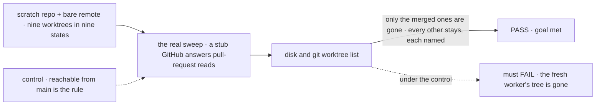
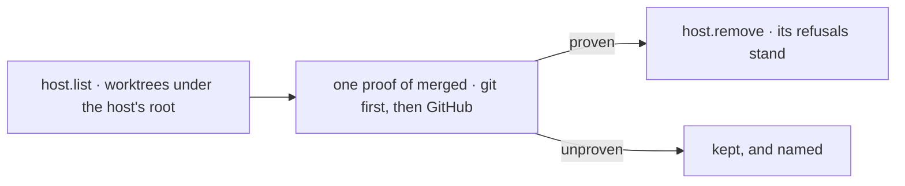

# FIX-2904 · Worktree cleanup: remove worktrees whose work has merged

**Spec** · [Decisions](DECISIONS.md)

## Six people, before and after

| Someone who… | Today | After |
|---|---|---|
| **has a disk full of worktrees whose pull requests merged** | Looks each pull request up, then removes the worktrees one at a time by path. Each is about 3 GB once dependencies are installed | Runs one command. Every worktree whose work merged is removed, and each line names the pull request or merge commit that proved it |
| **merges by squash or rebase** | Git can't tell these branches from open work, so they stay until removed by hand | GitHub is asked. A pull request merged into the default branch, with nothing past its head and none still open on the branch, is enough |
| **has a worker that has just started** | Nothing removes it | Kept. Its empty branch sits at the base, which a git-only check calls "merged". Only proof counts, and a branch needs a commit of its own past where it was cut |
| **kept working after the merge, or left uncommitted files** | Removal refuses a dirty tree | Kept, with the reason named: commits past the merged head, or the files at risk. Ignored files (`.env`, notes) go with a removed worktree, as they do for `--remove` |
| **has a run working in a worktree, or one being made** | Removal refuses | The same refusal, and the sweep carries on with the rest |
| **started a worker on another branch's tip, and that branch merged** | Nothing removes it | Kept. The worker's branch has no commit of its own past its cut point, and the tip it shares is the other branch's merge, not its own work |
| **can't reach GitHub** | n/a | Merge-commit merges are still found and removed. The rest are kept, and the output says how many it could not ask about |
| **merged by fast-forward, including the framework's own local merge** | Removed by hand | Kept, and named. A fast-forward leaves no merge to see. A stated cost, not a silent one |

Each coding run gets a worktree, and nothing takes it back. FIX-2252 filed that as "they will fill the disk" and left the open
question of *when* a worktree counts as finished. That issue keeps the disputed cases. This answers the one nobody disputes: its work merged.

## The goal, and how we'll know it's met

**After work merges, the person reclaims the disk its worktrees held with one command, and a worktree that holds work nobody else has, or that a worker is using, is never taken.**

| Is it the right goal? | |
|---|---|
| **The real need** | "Worktrees that have landed get reclaimed", each about 3 GB once installed (the owner's request; [FIX-2252](https://linear.app/fixpoint-labs/issue/FIX-2252): "they grow over time and will fill the disk") |
| **Smaller, and rejected** | "List which worktrees merged", leaving removal to hand; or "remove what git says is reachable from main". The second takes a fresh worker's start and never takes a squash merge. Running only on request is itself a cut to the need ("they pile up"): it reclaims on a person's say-so, not by itself ([D3](DECISIONS.md#d3)) |
| **Bigger, and not this issue's** | Removing by idle time or a disk cap, and Cursor's per-worktree agent state (FIX-2252's other options). Removing on merge, automatically ([FIX-1768](https://linear.app/fixpoint-labs/issue/FIX-1768)). Stopping processes started in a worktree ([FIX-2251](https://linear.app/fixpoint-labs/issue/FIX-2251)) |
| **Not done if** | The suite is green but the goal check never ran on a repository with a fresh branch at the base · it passes only on merge-commit merges · a squash-merged branch with commits added after the merge is taken · a fresh branch cut at another branch's merged tip is taken · a failed or unreachable GitHub read is treated as proof · the summary says removed and the directory is still there · a worktree a run holds, the primary checkout, the command's own directory or a detached HEAD is taken |



The check reads the disk and `git worktree list`, not the command's own summary. Under the control it must fail, or it proves nothing.

| How we verify | |
|---|---|
| **Goal check** | `goals/workspace/prune-merged/` · model-free · run by the implementer at completion · verdict in the implementation PR |
| **Signal** | Exactly the merge-commit, squash and rebase worktrees are gone from disk and from git's list. The fresh, stacked-fresh, merge-then-more, squash-then-more, fast-forward, uncommitted and in-use worktrees are present, each named with its own distinct reason. With GitHub unreachable the merge-commit one is still removed, the squash one is kept, and the output says how many it could not ask about. The primary checkout and the directory the command ran from are never taken. The bytes freed are measured, not assumed. A removed worktree's branch is kept, so a later turn can cut the worktree again |
| **Input** | A scratch repository and a bare remote. The host's own `gh` option points at a stub script that answers the pull-request reads; a second stub that fails stands for *unreachable*. Other branch names and another order must pass too |
| **Anti-game** | Don't assert on the command's summary alone, and don't stub the refusals: the in-use leg holds a real in-use lock. Don't make the squash rule "the pull request is merged" alone: the squash-then-more leg exists to fail that |
| **Control that must fail** | `GOAL_CONTROL=ancestry-only`, which must FAIL on *the fresh worker's worktree is kept*. A second, `GOAL_CONTROL=no-own-commit-check`, must FAIL on *stacked-fresh is kept*. Today's `main` has no command, so it fails *merged worktrees are gone*. A dry run exits 0 and removes nothing; a real run exits non-zero only when a removal it had proven fails |

## What changes


Read down the right-hand column. Ancestry alone (middle) takes the new worker and never takes the squash merge. Proof takes the two merged ones and nothing else. (The figure draws six of the nine check cases; the stacked, rebase and fast-forward ones are in the check, not drawn.)

**From a terminal:**

```diff
  fsdev worktrees .fsdev/teammates-runs                  # list
  fsdev worktrees .fsdev/teammates-runs --remove <dir>   # one, by path
+ fsdev worktrees .fsdev/teammates-runs --remove-merged --dry-run
+ #  would remove  feat-export-3fa9c2   PR #5601 merged, nothing past it
+ #  kept          fix-login-8be0d1     no merged pull request
+ #  kept          chore-docs-a41c07    uncommitted changes: README.md
+ fsdev worktrees .fsdev/teammates-runs --remove-merged
```

**From code:** a function over `host.list` and `host.remove`, called by the command. It takes no rows: nothing that holds them would call it today, so a removed worktree's row stays `ready` until a later read marks it `lost`, as it does for `--remove`.

The names are the implementer's, but the shape is not: a function over the host, not a new member of its interface, which would invite each host to write its own sweep. **Docs:** update the `fsdev worktrees` entries in `apps/docs/docs/cli/overview.md` and `apps/docs/docs/api/cli.md`, the *Listing and removing worktrees* section of `packages/workspace/README.md`, `apps/docs/docs/workforce/projects.md`, `packages/fsdev/README.md`, the method table of `packages/workspace/README.md`, and one line in `apps/kitchen-sink/README.md` saying the sweep reclaims merged work only (its manual steps stay: its branches rarely have pull requests). No new page. No architecture doc names worktree removal.



Candidates are only what the host lists. The proof lives in one place, so the next spec (a preview of every live worktree) asks the same question.

## What stays as it is

- `host.remove` and every refusal it makes: uncommitted work, a run in it, one being made, a branch holding the only copy of a commit.
- The branch. The sweep removes the directory and keeps the branch, so a later turn can cut the worktree again. It never deletes a branch: `host.remove` refuses to delete one whose commits live on no other ref, which is every squash or rebase merge once GitHub deletes the remote branch.
- No fetch. The sweep reads the refs the last fetch left, says which default-branch ref it judged against, and a stale ref only ever keeps more.
- Processes started in a worktree. A server still running in a removed directory keeps running ([FIX-2251](https://linear.app/fixpoint-labs/issue/FIX-2251) owns stopping it).
- A session's own *Remove worktree* action, which is owner-only and takes one worktree.
- Rows. They are never deleted, and this cut does not touch them.
- No app screen, button or background sweep. A session attached to another session's worktree would fail its next turn once the owner's tree is gone; the CLI cannot see attachments, and says so in its output.

## What's already here, and the debt

| Already here | What this does with it |
|---|---|
| `workspace` · `host.remove` (FIX-2419 ER-5, D3) | **Builds on.** The sweep calls it once per worktree. Every refusal is its own |
| `host.list` | **Builds on.** It is the candidate list |
| `worktreesCollection` rows (FIX-2439 D3) | **Leaves alone.** No caller holds rows today (the CLI has none), so `host.list` is the candidate list and the sweep takes none. An app that wants its rows marked passes them in its own change, through `markWorktreeRemoved` and `addWorktreePullRequests` |
| `branch-pull-requests` · the by-branch listing inside `recordBranchPullRequests`; `land`'s lookup of the repository the pinned remote names | **Extends.** The listing is pulled out into one helper the recorder and the proof both call, so there is no third `gh` read. The read runs outside the worktree with the repository named from the pinned remote, as `land` does, so a checkout's own remotes can't pick the repository. The row's copy is refreshed at a turn's end and a run's settle only, so a run that ended before the merge says `open` for good. The base must be the default branch: a stacked pull request merged into another feature is not proof |
| `harness-manager` · `await-pull-requests` (the merged verdict for a task, FIX-2578) | **Leaves alone.** It asks whether a *task's* pull requests merged, in a package that sits above `workspace`, so it cannot be reused here |
| `land` · `kind: "merge"` | **Leaves alone, and names the cost.** It merges without `--no-ff`, so when the base hasn't moved it fast-forwards and the sweep never reclaims it. Adding `--no-ff` is a one-line change for another issue |
| `fsdev worktrees --remove` | **Extends.** A flag beside it |
| The session's `removeWorktree` action | **Leaves alone** |
| Another way to reclaim merged worktrees | **None in code.** Searched `worktree remove`, `worktree prune`, `--remove`, `remove(` across `packages/`, `apps/` and `labs/`; no `mechanisms.yaml` row names the job. Two callers reach the one remover (the session action and the CLI), plus README steps by hand. This is a third caller, a selector over that remover. [FIX-2252](https://linear.app/fixpoint-labs/issue/FIX-2252) and [FIX-1768](https://linear.app/fixpoint-labs/issue/FIX-1768), both unbuilt, would be a fourth and fifth |
| FIX-2439 DECISIONS, "Every removal in the epic passes the collection" | **Kept.** Apps pass rows. The CLI doesn't, as `--remove` doesn't: its rows stay `ready` until a later read marks them `lost`, and a finished session never triggers one |
| [FIX-2252](https://linear.app/fixpoint-labs/issue/FIX-2252), a separate open issue | **Related, and keeps its question.** It keeps the decision of when an *unmerged* worktree counts as stale: idle time, a disk cap, explicit close, and Cursor's per-worktree agent state. This spec settles only the case nobody disputes, *branch merged*, and gives FIX-2252 a proof it can call |
| [FIX-1768](https://linear.app/fixpoint-labs/issue/FIX-1768), a separate open issue | **Related, and keeps its trigger.** It keeps removal on merge, automatically. It would call this proof and this function, not carry its own |
| [FIX-2251](https://linear.app/fixpoint-labs/issue/FIX-2251), a separate open issue | **Related, and keeps its job.** It keeps starting and stopping a worktree's processes. FIX-2659 and FIX-2361, which reuse earlier worktrees, would pick merged ones first: reuse of a merged worktree is theirs to decide |

| Adds | Existing piece considered | Why it doesn't fit / how composed |
|---|---|---|
| One function over the host that lists, proves and removes | `workspace` · `remove`, `list` | Composed. It calls both and decides nothing about removal itself. Not a second remover, and not a member of the host interface |
| One proof function for "merged" | `branch-pull-requests` listing; `readPullRequest`; `isAncestor` in `worktree.ts` | Composed from all three. No existing code decides *a worktree's work merged*, and two callers (this and the preview) need one answer |
| `--remove-merged` | `fsdev worktrees --remove` | Extends the command |

| The debt | |
|---|---|
| **Removes** | Nothing in code. The by-hand loop, and the README's manual `git worktree remove` steps |
| **Adds** | A fast-forward merge leaves no merge to see, so its worktree is kept and removed by hand, and that includes `land`'s own local merges. Permanent by design: unproven stays. A GitHub read at sweep time beside the row's turn-end copy: a second read of pull-request state, kept because the row is a display record. A third decider of "merged", beside the task verdict's: accepted, it asks about a worktree, not a task |
| **Leaves** | Idle and disk-cap triggers, and Cursor's per-worktree agent state: FIX-2252, stays open. Ignored files deleted with a worktree, not counted beforehand. Removal on merge, automatically: FIX-1768. Stopping a worktree's processes: FIX-2251 |

**Net: up, small.** One selector over the one remover and one flag are added, and a second pull-request read now sits beside the row's; nothing in code is removed. It closes the by-hand loop and leaves FIX-2252's other triggers open.

## Sign off

**[The goal](#the-goal-and-how-well-know-its-met), at that size:** merged work is reclaimed in one command and nothing else is taken. If wrong: we reclaim disk the person wanted back, or hold the issue open for idle-time rules it was never meant to settle.

**[The debt](#whats-already-here-and-the-debt), net up, small:** one selector, one flag and a second pull-request read are added; nothing is removed. If wrong: a second, quiet way to reclaim worktrees beside whatever FIX-2252 settles for unmerged ones.

1. **[D1](DECISIONS.md#d1) · A worktree is removed only on proof its work merged: a merged pull request, or a merge commit.** If wrong: squash merges stay while GitHub is unreachable, and fast-forward merges stay for good.
2. **[D2](DECISIONS.md#d2) · The first cut reclaims merged work only; idle time and disk caps stay out.** If wrong: abandoned, never-merged worktrees keep filling the disk.
3. **[D3](DECISIONS.md#d3) · It runs when someone asks, not by itself when a pull request merges.** If wrong: disk grows until someone remembers.

**Open: none.** Number 2 is the one to weigh. Open pull request [#5583](https://github.com/fixpoint-labs/flow-state-dev/pull/5583) changes how every `gh` and git call in these files is made (credential lanes); the build adopts its lanes or lands after it. Reasoning and what lost is in [DECISIONS.md](DECISIONS.md).

Feature · `workspace` + `fsdev` · small · epic FIX-2440 · related FIX-2252, FIX-1768, FIX-2251
