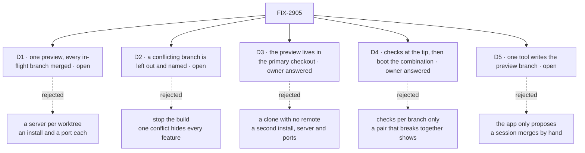

# FIX-2905 · Decisions

[Spec](SPEC.md) · **Decisions**

Five decisions are the sign-off surface. D3 and D4 are the owner's answers to the first draft's review, recorded as theirs; nothing here is approved by the author. D1, D2 and D5 are open.

## The tree

Solid edges are what you're signing. Dashed edges lost, and the label says why.

## D1 · One preview with every in-flight branch merged, instead of a server per worktree · open

| | |
|---|---|
| **Instead of** | A server per worktree: FIX-2251's shape |
| **Because** | The question is how the things in flight look together. A server each is an install of about 3 GB and a port for every feature, and never shows two features meeting. One preview is one install and one port, and does not replace looking at one feature alone |
| **Locks in** | The preview is a merge of in-flight work: a feature that only works alone shows up as a conflict or a break. The person's checkout sits on the preview branch |

It comes down to three features in flight: one install and one port, against three of each.

**What would change my mind:** previews are mostly of one feature at a time. Then FIX-2251's per-worktree server is the one to build.

## D2 · A branch that conflicts is left out and named, and the rest still show · open

| | |
|---|---|
| **Instead of** | Stopping the build until someone resolves the conflict |
| **Because** | Two features editing one file is routine in flight. Stopping shows nothing until a person acts, and saving that person is the point. The output names the left-out branch, its files and what merged before it: a branch can conflict with the merged result of several, so it blames none |
| **Locks in** | Merge order decides which of a pair is left out, and the output says so. A person resolves the pair by hand with plain git; rerere, which the tool turns on in the repository's config as the skill does, replays it on every rebuild. D4's failures use this same rule |

It comes down to two features editing one file: the rest still show, against nothing showing.

**What would change my mind:** conflicts are the usual case. Then an app conflict view or an order the person sets is worth building.

## D3 · The preview lives in the primary checkout, instead of a clone with no remote · owner answered

| | |
|---|---|
| **Instead of** | A separate clone with no remote (the first draft) |
| **Because** | The owner's reason: no second 3 GB install and no second server or ports, and the super app already rebuilds pages and offers a restart when source changes, so the preview reaches the app the person already runs |
| **Gives up** | A structural push guard: a clone has no remote to push to. Here the guard is the shipped content-judged hook (`18e1195bff`), which can be bypassed. And the primary is occupied: the person's checkout sits on `preview/<user>` |
| **Locks in** | What the hook does not stop, measured with the shipped script (`poc/preview-primary`, P8): `--no-verify`, and a commit made on a branch cut from the preview and pushed under another name, since the guard judges preview tips only. It does stop `HEAD` to another name and the preview by name, and lets a feature push. A run acts with the operator's trust and can move refs and shared config (`local-host.ts:232`), so against a run the hook is no guard at all. And see Facts 1 and 2: a Teammates run is cut from the checked-out branch, and a merge-landing lands on it |

It comes down to a second install and server: the primary needs neither, a clone needs both.

**What would change my mind:** a preview branch is ever pushed, or an occupied primary keeps getting in the way. Then the clone, whose first-draft experiment is in the history of this branch (`4442897a84`).

## D4 · Checks at each tip, then a boot of the merged tree, instead of checks per branch only · owner answered

| | |
|---|---|
| **Instead of** | A branch goes in when its checks pass and it merges cleanly |
| **Because** | The owner's Fork 1, option A. Two branches can each pass and each boot, and break the app together with no git conflict. The experiment builds one (P5): the checks and the boot pass on each alone, git merges them cleanly, and the merged tree does not boot |
| **Locks in** | Each app declares a start command and a loaded check, beside its start steps in `apps/super-app/apps.mjs`, and the package imports nothing from an app. The boot runs in the primary, the only tree with an install: a running server sees the merged files while it boots, and again on a rollback, so the super app may rebuild pages twice. An app whose boot would write what its running server reads declares none, and the output says it was not boot-checked. A wrong boot leaves a good branch out, named |

It comes down to two green branches that break together: caught and named, against a broken app nobody can explain.

**Who installs, when a branch changes the lockfile** (recommended; it extends the owner's answer, so it needs their nod). The tool never installs: replacing `node_modules` under a running server breaks it (`workspace.mjs:8`). A skipped branch is named with the exact command. That command alone does not bring the branch in, because an install in the primary reads the primary's lockfile, and the skipped branch's is not in it. So the branch comes in one of two ways: when its pull request merges and the next `pnpm dev` installs; or when the person opts it in by name, which says the app is stopped. The tool then merges it, skips gate 2 for that build as *not boot-checked until installed*, and prints the command; the person installs and restarts, and the next rebuild boots the combination. If wrong: a person runs one command by hand. The alternative, the tool installing, fails when an app is up.

**What would change my mind:** the boot is too slow or flaky to trust, so false rollbacks hide good branches.

## D5 · One tool writes the preview branch, and every caller asks it, instead of the app only proposing · open

| | |
|---|---|
| **Instead of** | The app only proposes a rebuild; a Claude session merges by hand |
| **Because** | A Claude coordinator and an app that both rebuild `preview/<user>` race: two merges and a reset in one checkout. One writer, under a lock in the repository's git directory (config is writable by runs), removes the race. A second caller gets *busy, held by X since T*, never a queue. The CLI, `pnpm wt:preview`, the skill, Teammates and the follow-up's button are all callers. A button then works, where "only proposes" leaves a person waiting on a session |
| **Locks in** | The tool is the only writer of the branch. The skill's by-hand steps stay documented as the fallback for a broken tool, and are used only then |

It comes down to a session and an app both rebuilding: one runs and one is told busy, against two merges racing on one branch.

**Recommendation:** this one. **What would change my mind:** the tool is so fragile that people merge by hand every day.

## Decided, not asked

- **Where it lives** (the owner's Fork 2, option A). One function in `@flow-state-dev/workspace` behind `fsdev worktrees --preview`; `pnpm wt:preview` and the skill call it. Lost: a dependency-free script, which the tool's gates could not use anyway.
- **In flight** is the `preview.branch` list plus the worktrees `host.list` returns for the given root, minus what FIX-2904's proof matches. The list covers a branch before its first commit.
- **The check list** is input, in the `;` form `checkCommandsFrom` parses. Which commands this repository uses (a cheap set or the full suite) is the implementer's proposal.
- **A recorded result** is accepted when the run's hold `head` equals the branch's tip now. Otherwise the tool runs the checks and keeps the result by tip.
- **Rebuild.** Base from `host.baseTip` after a fresh fetch, never the shared `origin/main` name. `reset --keep`, never `--hard`: when main changed a file the person edits it stops and names the file. The guard judges commits against the base, the new list and the branches the last build merged, so dropping a branch does not read as the preview's own work (found in P7).
- **No rebuild on its own** when a branch moves: a server that restarts under the person. A caller asks.
- **The boot gets no credential**, only the base lane's environment plus what the app names.
- **Several repositories** get one preview each, in each primary. Tests on disposable repositories are part of the build.

## Facts read from the code

Read on 2026-11-27 in this branch merged with `origin/main`. "Run" means run, "read" means read.

| # | Claim | Where | |
|---|---|---|---|
| 1 | Teammates names no `baseRef`, so a run is cut from the repository's checked-out branch (`baseRef ?? "HEAD"`), not a fixed ref. With the primary on the preview, **a run inherits every merged branch**: contrary to the brief's premise | `labs/teammates/host.mts:70`, `local-host.ts:1184`, `fsdev.config.mts:25` | read |
| 2 | With no `baseRef`, a merge-landing merges into the checked-out branch, so onto the preview. A pinned `origin/main` is refused (no tracking branch), and a local `main` is refused when not checked out | `land.ts:323`, `:373`, `:387` | read |
| 3 | A run in a listed repository can move the repository's refs, and shared config | `local-host.ts:232` | read |
| 4 | A Teammates run's check results are the `checks` on its run record, written whatever the verdict, in the app's store, so `fsdev worktrees` cannot read them. No tip is stored beside them; the hold's `head` is. Whether one attempt writes both together is not verified; the tip match covers it | `run-record.ts:350`, `:107`, `manager.ts:3380` | read |
| 5 | `host.list` returns worktrees under the host's root, so a Claude worktree under `.claude/worktrees` needs that root. `host.baseTip`, `land`'s merge step, `runCheckoutCommands` and `acquireLock` exist as used | `local-host.ts:2176`, `:629`, `land.ts:361`, `checkout-commands.ts`, `lock.ts:118` | read |
| 6 | `scripts/worktree.mjs` holds an ancestry-only proof for prune; FIX-2904's is the package's. A third is not added | `worktree.mjs:115` | read |
| 7 | #5583 merged 2026-11-24 | `gh pr view 5583` | run |
| 8 | Super app: rebuilds a page on a recorded input change, offers a restart on a changed server, installs only at start. Nothing pushes a reload to the labs' pages; only Next's HMR socket is piped for Kitchen Sink, and `location.reload` runs only after a Restart click | `rebuild.mjs:51`, `lifecycle.mjs:189`, `workspace.mjs:20`, `proxy.mjs:7`, `:359` | read |
| 9 | FIX-2251 (Backlog): part 2 has the host own a process per worktree, with a port and a preview pane. Overlaps gate 2's free port and the follow-up screen; blocks neither | Linear GraphQL, read-only | run |

## Considered and dropped

| Alternative | Why not |
|---|---|
| Boot in a throwaway worktree | It has no install: a second 3 GB, the cost D3 refused |
| A hand-kept list only | It goes stale |
| A second dependency-free copy of the logic | Two to keep true; the owner chose one |

## Settled

`poc/preview-primary/check.mjs`, run 2026-11-27 on git 2.48.1 and Node 24: **25 PASS, 2 GAP, exit 0**. `--control no-boot`: **exit 1**, failing exactly the three P5 assertions (the pair is in, the culprit unnamed, the tree does not boot).

- **P5** CONFIRMED: two branches green alone and booting alone merge cleanly and fail to boot together; with the gate the culprit is named after what merged before it, the other stays, and the tree boots.
- **P1, P7** CONFIRMED: uncommitted edits survive turning on and rebuilding; `reset --keep` stops when main changed a file they edit; a hand resolution replays; a hand commit blocks a rebuild. `reset --hard` would have taken the edit (found by the experiment).
- **P3, P4, P6** CONFIRMED: a recorded result is read, a moved tip is rechecked once, red and lockfile branches are left out, and when nothing boots HEAD stays put.
- **P8** CONFIRMED and measured: the shipped guard refuses `HEAD` elsewhere and the preview by name, and lets a feature push. **GAP:** `--no-verify`, and a commit on a branch cut from the preview, pass.
- **Not run:** another git, Windows, a real app's boot, a second repository, the reader of a real run record, the opt-in for a lockfile branch.

## How it got here

- **Draft** (`4442897a84`): a clone with no remote, one gate (merges cleanly), a script of its own. Analysed 2026-11-23; D1 and D2 held.
- **Owner's review:** D3 flipped to the primary checkout; checks at the tip plus a boot of the combination; one function in `workspace`; one writer. This amendment redrew D3, added D4 and D5, and replaced the experiment.

**Open:** D1, D2, D5, and the note on a merge-landing in the sign-off.
