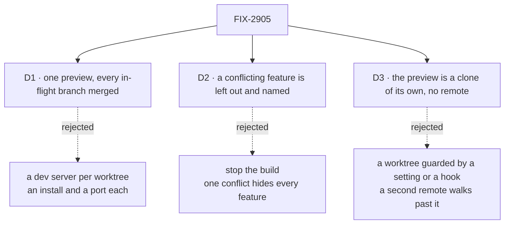

# FIX-2905 · Decisions

[Spec](SPEC.md) · **Decisions**

What was considered, what was chosen, why, and what each choice locks in. Three decisions are the sign-off surface. Everything else here is context for them.

## The tree

Solid edges are what you're signing. Dashed edges lost, and the label says why.

## D1 · One preview with every in-flight branch merged, instead of a dev server per worktree

| | |
|---|---|
| **Instead of** | A server per worktree, which is FIX-2251's shape |
| **Because** | The question is how the things in flight look together. A server per worktree is an install of about 3 GB and a port for each feature, and never shows two features meeting. One preview costs one install, one port, and shows the combination. It does not take the place of looking at one feature alone |
| **Locks in** | The preview is a merge of in-flight work. A feature that only works alone, or only after another lands, shows up as a conflict or a break here. A person who wants one feature alone still uses that worktree. The two fit together: a server FIX-2251 starts can run in the preview |

It comes down to three features in flight: one install and one port, against three of each.

**What would change my mind:** if previews are mostly of one feature at a time. Then FIX-2251's per-worktree server is the one to build, and this stays a recipe.

## D2 · A conflicting feature is left out and named, and the rest still show

| | |
|---|---|
| **Instead of** | Stopping the build until someone resolves the conflict |
| **Because** | Two features editing one file is routine in flight. Stopping shows nothing until a person fixes it, and a person is the thing the preview is meant to save. The output names the left-out branch, its files and the branches that merged before it, so the gap is never silent. A branch can conflict with the merged result of several, not with any one, so the output does not blame one |
| **Locks in** | Merge order decides which of a conflicting pair is left out, and the output says which. A person can resolve the pair by hand in the preview with plain git and commit; rerere, turned on in the preview's own config, replays that resolution on every later rebuild, so the same pair is not a conflict twice. A rebuild then needs the explicit discard that the guard asks for. A feature that merges cleanly but breaks the app hides the rest; a leave-out by name is the later fix, not part of this |

It comes down to two features editing one file: the rest still show, against nothing showing.

**What would change my mind:** if conflicts turn out to be the usual case, or one broken feature keeps hiding the rest. Then an app conflict view, a leave-out by name, or an order the person sets, is worth building next.

## D3 · The preview is a clone of its own with no remote, instead of a worktree guarded by a setting

| | |
|---|---|
| **Instead of** | A worktree of the person's repository, kept from pushing by a per-worktree setting, or by a pre-push hook |
| **Because** | Each way of guarding a worktree failed a case. A hook walks past on `--no-verify` (the experiment's control), and a name-based hook lets `HEAD:refs/heads/other` through (shown by an earlier version of the experiment, not kept). A dead push address set for `origin` leaves a second remote that any worker added to the shared config, which pushes (reported by the validation pass). The per-worktree setting also needs git's worktree-config extension in the person's repository, which stays behind, and which on a bare clone under the root makes every worktree report itself bare until a second key is moved (found by the validation pass; not re-run in the experiment). A clone has its own config, hooks and rerere cache, so none of the worker-written shared config reaches it. It has no remote, and a dead address for every push target (`url.<dead>.pushInsteadOf` with an empty prefix), so a typed-out URL and a remote added later are refused too. Nothing is written to the person's repository. Fetching the branches is a local path fetch: no network, no credentials |
| **Locks in** | A second working copy and one more install per repository. Its objects are hardlinked from the source, not copied. Someone who edits the clone's own config can turn the guard off, so it guards against accidents. A bare repository under the root works as a source (tested) |

It comes down to a push to a second remote or a typed address: refused here, let through by a guard written for `origin`.

**What would change my mind:** a host that cannot write a clone, or a repository too large to hold twice. Then a worktree guarded per worktree is the fallback, with the `core.bare` precondition checked and the dead address written for every remote on each build.

## Decided, not asked

- **Where it lives.** Under the host's root at `.previews/<repository>`, outside the clones and listed repositories `host.list` reads, so the list never shows it. That is what keeps it out of the in-flight set and out of `--remove-merged`: no marker is needed. Whether `host.list` skips a directory of this shape is read from its loop over repositories, not run.
- **In flight, exactly.** A listed worktree, on a branch, that FIX-2904's proof of merged work does not match. Not *live*: that word means a checkout already on this host (`PlaceOrigin "live"`) and a client read (`client.live`). A worktree with uncommitted changes counts, contributes its committed tip, and is counted as not fully shown. A worktree mid-rebase has no branch, and is counted the same way. A branch with no commits of its own is contained already and is not a conflict.
- **Build and rebuild.** A build fetches the base commit (`host.baseTip`) and each branch tip into the clone by local path, resets the preview to the base, and merges each branch with a merge commit in a stable order. The tip it made is recorded in the clone's own config, and the output prints each merged branch's short tip. A rebuild proceeds only when HEAD is that tip and the tree is clean; otherwise it refuses and lists what is there. An explicit discard resets anyway. `reset --hard` cannot lose work the guard has not seen: untracked and ignored files, `node_modules` among them, survive it.
- **Merges use `land`'s merge step**, pulled out so both share it: a real merge commit, conflicting files named from the index, abort and restore, and the programs a worker could plant switched off. A build holds a lock in the clone so two builds cannot run at once.
- **rerere lives in the clone.** It is turned on in the clone's own config, so a plain `git merge` and `git commit` in the preview record a resolution, and nothing reaches the person's repository or its rerere cache. A merge rerere finished is committed only when no file is left in conflict.
- **No rebase rule.** Because each rebuild starts from a reset, a worker that rebases its branch is merged fresh at its new tip.
- **Dependencies.** The setup command runs when the clone is first made, when the host has one. A later rebuild whose merges change a lockfile says an install is owed. It does not run one.
- **Which calls use which lane.** The merges and the branch fetches are local. The base fetch, and FIX-2904's GitHub read, use the remote lane. Open pull request #5583 defines the lanes.
- **Several repositories.** One preview per repository, each named in the output. Branches of different repositories are never merged together.
- **Disposable-repository tests are part of the build.** They include a worker that has just started, a rebuild over a commit made in the preview, a bare repository as the source, and every push form in the goal check.

## Considered and dropped

| Alternative | Why not |
|---|---|
| A server per worktree | FIX-2251's job. An install and port each, and features never meet |
| A fixed "preview slot" symlinked to whichever worktree | Already rejected in FIX-2251: watchers handle swapped symlinks badly, and the build cache belongs to one tree |
| A hand-kept list of branches in git config | It goes stale. The set is already known from the worktrees |
| Merging into the person's own checkout (`land`) | Touches the checkout, which is what the preview is for avoiding |
| A pre-push hook, a read-only remote, or a protected branch name | The hook is bypassed by `--no-verify` (shown) and, if name-based, by `HEAD:refs/heads/other` (shown in an earlier version of the experiment). A branch name cannot stop a push of another ref |
| A worktree with a per-worktree dead push address | Covers `origin` only; needs a repository-wide extension; breaks a bare clone's worktrees until a second key moves (see D3) |
| A clone made with `--shared` | Borrows the source's objects, which its garbage collection can remove. A local clone links them instead |
| A rebuild on its own when a branch moves | A server that restarts under the person. An app can call the build when it wants one |

## Settled

- **A clone with no remote and an empty-prefix `pushInsteadOf` refuses every push** — **CONFIRMED** in `poc/preview-worktree/check.mjs` (P2): HEAD to another name, the preview branch, another local branch, a typed URL, a remote added later, and `--no-verify`. The remote holds none of them, and a sibling worktree and the primary still push.
- **A hook guard is walked past** — **CONFIRMED** (`--control hook-guard` exits 1: `--no-verify` goes through, and the remote holds the pushed branch).
- **The person's repository is unchanged** — **CONFIRMED** (P7): HEAD, status, branch list, worktree list and config are identical, and no rerere cache appears. The baseline is taken before the clone is made.
- **A conflicting branch can be aborted out of the build, naming its files and the branches merged before it** — **CONFIRMED** (P4). A branch with no commits of its own is contained. Merged branches' own files are in the tree, and a worker's new commit is picked up on rebuild.
- **A hand resolution made with plain git is replayed on rebuild** — **CONFIRMED** (P5): rerere is in the clone's config, not typed per command.
- **A rebuild guard from a recorded tip and a clean tree** — **CONFIRMED** (P6), including the allowed rebuild with no hand commit.
- **A bare repository with worktrees works as the source** — **CONFIRMED** (P8) for the clone design.
- **A worktree guarded per worktree breaks on a bare clone, and a second remote pushes** — **REPORTED** by the validation pass from its own probes; this draft's experiment no longer runs that design.
- **Not run:** another git than 2.48, Windows, `provision` (never used), a second repository under one root, libgit2-based tools.

## Analysis

**2026-11-23 · base `d636237605` · verdict: right approach, with changes; D3 moved.** Run by a separate analyst with no memory of the draft, a second pass checking the facts against the code, and a blind check of the goal.

| Objective | Finding |
|---|---|
| Reuse | `land`'s merge step is the merge: extended, not rewritten. `host.baseTip` is "latest main". The marker and the build record were two records for one fact; the clone design drops the marker |
| Prior art | git.git's throw-away integration branch with rerere, and a merge queue's drop-the-failing-one-and-rebuild, back D1 and D2 |
| Other shapes | A clone of its own was the strongest alternative, and holds up better than the draft said: it became D3 |
| New since the watermark | FIX-1768, FIX-2659 and FIX-1767 touch the same worktrees; none changes the shape. FIX-2905 sits under epic FIX-2440, with FIX-2252, FIX-1768 and FIX-2251 as related issues that keep their own jobs |
| Necessity | Small and justified. The smaller option, a script, leaves the push path open |
| Ergonomics | One flag. A listing command that builds is a slight surprise, as `--remove-merged` is. The force-rebuild flag is the implementer's to name |
| Concerns | rerere recorded only for typed `-c` commands: fixed. The guard covered `origin` only: fixed by D3 |

| Finding | Disposition |
|---|---|
| The worktree-config route breaks a bare clone and leaves a setting behind | Folded: D3 is a clone |
| Second remote and typed URL bypass a push guard for `origin` | Folded into D3 and the check |
| rerere only worked with `-c` typed by the check | Folded: set in the clone's config |
| The control was mis-specified: a competent hook blocks `HEAD:other` | Folded: the control now fails on `--no-verify` |
| Baseline for "branch list unchanged" was taken after the branches were cut | Folded: taken first |
| "Live" already means two other things | Folded: *in flight* |
| Branches of several repositories can't merge together | Folded: one preview per repository |
| Blaming one branch for a conflict with the merged result | Folded: files plus what merged before |
| Stale tip, mid-rebase worktrees dropped silently | Folded: tips printed, counted as not fully shown |
| Goal said "every" and "running", the check proves neither | Folded: *that merges cleanly*; the check proves the tree, and says so |
| A branch that merges but breaks the app hides the rest | Recorded under *Leaves*: a leave-out by name, the owner's call on scope |
| Offline, a squash-merged branch counts as in flight | Folded: the output says so |
| FIX-2251 is "a third way" | Folded: they fit together |

## How it got here

- **Draft** — framed as a second spec on FIX-2904's proof of *merged*; one preview worktree made by the existing provision, in flight work read from the host's list, push guard by per-worktree config after a hook was shown to be bypassed.
- **After analysis** — D3 moved from a worktree guarded by config to a clone with no remote: a second remote and a bare-clone source defeated the config guard. The experiment was rewritten around the clone and kept its control. D1 and D2 did not move.

**Open: none.**
