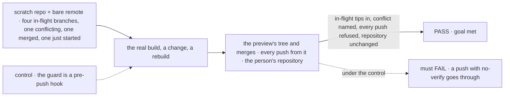
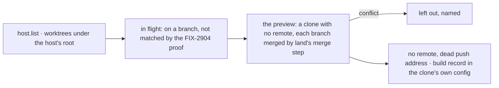

# FIX-2905 · Worktree preview: one app showing every in-flight branch merged

**Spec** · [Decisions](DECISIONS.md)

## Six people, before and after

| Someone who… | Today | After |
|---|---|---|
| **has several coding runs in flight and wants to see them all in the running app** | Starts one dev server per worktree, each with its own install and port, or merges the branches into their own checkout by hand | Runs one command. A preview of its own holds every in-flight branch merged, each named with the tip it was read at. They start the app there on a port they choose |
| **has two in-flight features that edit the same file** | Finds out when merging by hand | The later one is left out and named, with the files and the branches that merged before it. Everything else still shows |
| **has a pull request merge, or removes a worktree** | The by-hand list goes stale | The next rebuild drops it. The set is read from the worktrees each time, and merged work is in the base already. A finished run whose pull request is still open stays in |
| **rebuilds the preview** | n/a | It resets to the latest main and merges again, and replays a conflict fix the person made by hand. It refuses, and says what is there, if the preview holds a commit the last build did not make. An explicit discard resets anyway |
| **runs `git push` in the preview**, in any form | n/a | It fails: any branch name, a second remote, a typed-out URL, `--no-verify`. The preview has no remote and no address that works. Their repository and worktrees push as before |
| **checks their own repository afterwards** | n/a | Untouched: same branch, files, status, branch list and config. The only thing added is the preview's directory |

Two cases the table doesn't draw. A worktree with uncommitted changes, or one mid-rebase, shows its committed tip and is counted as *not fully shown*. A root with several repositories gets one preview per repository, each named.

The person has one question: *what do the things in flight look like together?* A server per worktree answers *what does each look
like alone*, at one install and one port each.

## The goal, and how we'll know it's met

**A person sees every in-flight feature that merges cleanly together in one app, the ones that don't are named, and nothing of theirs is touched or can be sent to GitHub from the combination.**

| Is it the right goal? | |
|---|---|
| **The real need** | "Preview all live worktrees at once in one running app" (the owner's request). Each worktree is about 3 GB once installed, so one server each does not scale |
| **Smaller, and rejected** | "A script that merges the branches." It leaves the push path open and loses a person's conflict fix on the next rebuild. Or "preview the most recent worktree", which is one feature, not the combination |
| **Bigger, and not this issue's** | Starting, stopping and choosing ports for the dev server ([FIX-2251](https://linear.app/fixpoint-labs/issue/FIX-2251)). Leaving a feature out by name when it merges cleanly but breaks the app. A conflict screen or a rebuild button in an app. Rebuilding on its own when a branch moves |
| **Not done if** | The merge is right but the push guard was tested only by branch name, or only against `origin` · the preview shows a stale tip · a rebuild throws away a hand resolution · a rebuild refuses forever after one hand commit, with no discard · the person's repository gained a branch, a setting or a cache · a branch's own files are not in the preview's tree · the goal check never ran on a conflicting pair, or on a bare repository with worktrees |



The check reads the preview's tree and refs and tries real pushes. It never asks the build whether it thinks it is safe. It proves the tree an app would start from, not that an app starts: running it is the person's.

| How we verify | |
|---|---|
| **Goal check** | `goals/workspace/preview-in-flight/` · model-free · run by the implementer at completion · verdict in the implementation PR |
| **Signal** | Each in-flight tip but the conflicting one is an ancestor of the preview's HEAD, and its own file is on disk in the tree. The conflicting branch is named with its files and what merged before it. A branch with no commits of its own is contained and not called a conflict. Moving a worker's branch and rebuilding picks up the new tip. Pushes from the preview all fail: HEAD to another name, the preview's branch, another local branch, a typed-out URL, a remote added later, and `--no-verify`; the remote holds none of them. A sibling worktree and the primary still push. The person's repository HEAD, status, branch list, worktree list and config are unchanged, with no rerere cache in it. A rebuild after a hand commit is refused; after a discard it replays the hand resolution; a rebuild with no hand commit succeeds. All of it again with a bare repository and worktrees as the source |
| **Input** | A scratch repository and a bare remote; the merged pull request is a stub `gh` answer, and a failing stub stands for *unreachable*. A different branch count, order and conflicting pair must pass too |
| **Anti-game** | Don't test the guard by branch name or against `origin` alone, don't read commit messages for what merged (read ancestry and files), and don't read the build's own report of success |
| **Control that must fail** | `GOAL_CONTROL=hook-guard` must FAIL on *a push with `--no-verify` is refused*. Today's `main` has no preview and fails the build and push legs |

## What changes


Read the right column top to bottom: a base, two merges, one branch left out, and a fence at the bottom. The left column is unchanged by any of it.

```diff
  fsdev worktrees .fsdev/teammates-runs
+ fsdev worktrees .fsdev/teammates-runs --preview
+ #  preview   .fsdev/teammates-runs/.previews/repo   base main 1a2b3c4
+ #  merged    feat-export 3fa9c2e, fix-login 8be0d1a
+ #  left out  chore-docs a41c07d: conflicts after feat-export in shared.txt
+ #  not shown 1 worktree has uncommitted changes, 1 is mid-rebase
+ #  install   a lockfile changed: an install is owed
+ cd .fsdev/teammates-runs/.previews/repo && pnpm dev --port 4300
```

Names are the implementer's. **Docs:** add a *Previewing in-flight worktrees* section to the `fsdev worktrees` entries in `apps/docs/docs/api/cli.md` and `apps/docs/docs/cli/overview.md`, to `packages/fsdev/README.md`, and to `packages/workspace/README.md` beside *Listing and removing worktrees* (with a row in its method table), and a line to `apps/docs/docs/workforce/projects.md` where a run's worktree is reviewed. No new page.



In flight is the complement of [FIX-2904](https://linear.app/fixpoint-labs/issue/FIX-2904)'s proof of *merged*: one function, two callers. The word is not *live*, which already means two other things in this package and its client.

## What stays as it is

- The person's repository, every worker's branch and worktree, and every row.
- Running the app: the person starts it, and chooses a port. Nothing here allocates one.
- Uncommitted work. A preview shows committed tips, and says how many worktrees it left out for having changes or a rebase under way.
- Removal. The preview is a clone, not a worktree: it is never listed, so `--remove-merged` cannot take it and the in-flight set cannot contain it.

## What's already here, and the debt

| Already here | What this does with it |
|---|---|
| `workspace` · `host.list` | **Builds on.** The set of worktrees to read |
| `workspace` · `host.baseTip` | **Builds on.** "Latest main" is the commit it returns after a fresh fetch from the pinned remote, never a local branch a run could move |
| `workspace` · `land`'s private merge step (`merge()`, `programsOff`, `requireGit`) | **Extends.** It already makes a real merge commit, names the files from the index, aborts and restores the checkout, and switches off any program a worker planted in shared git config. It is pulled out so `land` and the preview share one step. The preview does not go through `host.land`, which merges into the person's own checkout. Sets the git floor at 2.31 |
| `workspace` · `setUpCheckout` (the setup command) | **Builds on.** Run once when the clone is made. The CLI's host has no setup command today, so its output says an install is owed |
| [FIX-2904](https://linear.app/fixpoint-labs/issue/FIX-2904)'s proof of *merged* | **Builds on, and depends on it.** In flight is what that proof does not match. This spec cannot land before FIX-2904 merges. With GitHub unreachable a squash-merged branch counts as in flight, and the output says so |
| `workspace` · the provision that cuts a worktree | **Leaves alone.** It cuts worktrees of a repository, and needs a run source and a remote allowlist that `fsdev worktrees` refuses today. The preview is a clone of the local repository, which needs neither |
| `host.land`, kind `merge` | **Leaves alone.** It merges one accepted run into the person's own checkout. The preview exists to avoid that |
| Another way to see in-flight work running | **Two by hand, two planned, and they fit together.** A dev server started by hand in a worker's worktree, and `land` into the checkout. FIX-2251's per-worktree process and its live-checkout opt-out are unbuilt: a server it starts can run in the preview. Searched `preview`, `dev server`, `port`, `--port` across `packages/`, `labs/` and `apps/`: the only hits are `fsdev dev`'s fixed default port 4200, `serve`'s 3000, attachment previews and an error reporter's unrelated `preview` option. Nothing allocates a port per worktree |
| [FIX-2251](https://linear.app/fixpoint-labs/issue/FIX-2251), a separate open issue, with "Rejected: a fixed preview slot symlinked to whichever worktree" | **Related, and keeps its job.** It keeps starting, stopping and choosing ports for a server. This is not a slot swapped between worktrees; it is a clone of its own |
| [FIX-2252](https://linear.app/fixpoint-labs/issue/FIX-2252) and [FIX-1768](https://linear.app/fixpoint-labs/issue/FIX-1768), separate open issues | **Related, and keep their jobs.** FIX-2252 keeps deciding when an unmerged worktree is stale. FIX-1768 keeps removal on merge. The preview reads worktrees and removes none |

| Adds | Existing piece considered | Why it doesn't fit / how composed |
|---|---|---|
| A preview clone per repository, under the host's root and outside what it lists | `workspace` · the host's bare clones; provision | The host's clones are bare, for workers to hang worktrees on. A preview is a working copy with no remote, and nothing in code makes one |
| One build function: in-flight set, merges, conflict report, rebuild guard | `host.list`, `host.baseTip`, FIX-2904's proof, `land`'s merge step | Composed from all four. No new merge code |
| `--preview` | `fsdev worktrees` | Extends the command |

| The debt | |
|---|---|
| **Removes** | Nothing in code. The by-hand merge of branches into a checkout |
| **Adds** | One directory per repository the host lists, outside what it lists: accepted, because a clone is the only form that writes nothing to the person's repository ([D3](DECISIONS.md#d3)). Its objects are linked, not copied; its install is one more. A person who edits the clone's own config can turn the guard off: it guards against accidents. A third thing that reads in-flight work, beside FIX-2251's two: named so it reads this |
| **Leaves** | Dependencies: a feature that changes a lockfile needs an install in the preview, which the output says. The server's life and ports: FIX-2251. Leaving a feature out by name when it merges cleanly but breaks the app. An app conflict view and rebuild button |

**Net: up, slightly.** One new kind of directory is added, and nothing is removed. It composes from the existing host and writes nothing to the person's repository.

## Sign off

**[The goal](#the-goal-and-how-well-know-its-met), at that size:** every in-flight feature that merges cleanly together in one app, nothing of the person's touched, nothing pushable. If wrong: we ship a preview that hides a feature that merges but breaks the app, or hold the issue open for a server lifecycle it was never meant to deliver.

**[The debt](#whats-already-here-and-the-debt), net up, slightly:** one clone per repository is added; nothing is removed. If wrong: a directory of a few GB nobody remembers.

1. **[D1](DECISIONS.md#d1) · One preview with every in-flight branch merged, instead of a server per worktree.** If wrong: the person wanted each feature alone and gets a view where features meet.
2. **[D3](DECISIONS.md#d3) · The preview is a clone of its own with no remote, instead of a worktree guarded by a setting.** If wrong: a second copy of the checkout and one more install.
3. **[D2](DECISIONS.md#d2) · A conflicting feature is left out, named, and the rest still show.** If wrong: the preview quietly lacks a feature.

**Open: none.** Number 1 is the one to weigh. This spec builds on FIX-2904's proof of merged work and cannot land before it. Open pull request [#5583](https://github.com/fixpoint-labs/flow-state-dev/pull/5583) changes how every git and `gh` call here is made (local lane for the merges, remote lane for the base fetch); the build adopts its lanes or lands after it. Reasoning and what lost is in [DECISIONS.md](DECISIONS.md).

Feature · `workspace` + `fsdev` · small · epic FIX-2440 · blocked by FIX-2904 · related FIX-2252, FIX-1768, FIX-2251
