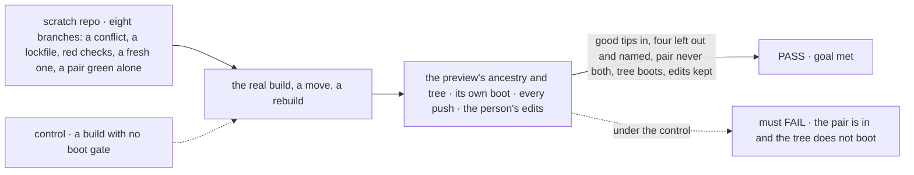
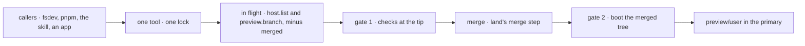

# FIX-2905 · Worktree preview: one app showing every in-flight branch merged

**Spec** · [Decisions](DECISIONS.md)

## Six people, before and after

| Someone who… | Today | After |
|---|---|---|
| **has several coding runs in flight and wants to see them together in the app they run** | Starts a server per worktree (about 3 GB and a port each), or has Claude merge the branches into their checkout, one git command at a time | One command. Their checkout sits on a local-only `preview/<user>` branch with every in-flight branch merged, each named with the tip it was read at. The app they already run shows it |
| **has two features that edit the same file** | Finds out when merging | The later one is left out and named, with its files and what merged before it. The rest still show |
| **has two features that each pass and boot, and break the app only together** | Finds out in the browser, with no one to blame | The merged tree must boot and load. If not, the preview goes back, the culprit is left out and named, the rest still show |
| **has a branch with red checks, or one that changes the lockfile** | Merged blind | Left out and named. A lockfile change is "install owed": replacing `node_modules` under a running server breaks it |
| **rebuilds, or has a pull request merge** | The by-hand list goes stale | One rebuild resets to the latest main, drops what merged, merges again and replays a conflict fix made by hand. It refuses if the preview holds a commit the build did not make |
| **has uncommitted edits, or runs `git push` in their checkout** | The preview is theirs to guard | Edits stay: a rebuild stops, never overwrites. A push of the preview by name or tip is refused by a hook. `--no-verify` is not stopped |

The person has one question: *what do the things in flight look like together, in the app that runs?* A server per worktree answers *what does each look like alone*.

## The goal, and how we'll know it's met

**A person sees, in the app they already run, every in-flight feature that merges cleanly and keeps the app working; the ones that don't are named; and nothing of theirs is lost.**

| Is it the right goal? | |
|---|---|
| **The real need** | "Preview all live worktrees at once in one running app" (the owner's request). A server each does not scale. The owner's longer goal is any FSD app editing itself live; this preview, with its roll-back-on-failed-boot gate, is a step toward it |
| **Smaller, and rejected** | "A script that merges the branches": it lets a pair that breaks only together through, and leaves Claude doing the merging |
| **Bigger, and not this issue's** | The super-app screen (a preview row, "stale, Rebuild", a `/preview` route): a separate follow-up, the next piece. A server per worktree ([FIX-2251](https://linear.app/fixpoint-labs/issue/FIX-2251), Backlog), whose port allocation gate 2's free port will share |
| **Not done if** | The boot gate is tested only with a pair git already refuses to merge · the control passes · a result recorded for an older tip is accepted · a lockfile branch is merged · a rebuild takes the person's edit · a hand resolution is lost |



The check reads the preview's ancestry and files and boots the tree with its own code. It never asks the build whether it succeeded.

| How we verify | |
|---|---|
| **Goal check** | `goals/workspace/preview-in-flight/` · model-free · run by the implementer at completion · verdict in the implementation PR |
| **Signal** | Each good tip is an ancestor of HEAD and its file is on disk. The conflicting, red, lockfile and boot-breaking branches are not, each named with its reason. A branch with no commits is contained. The pair: each alone is green and boots, together they merge with no git conflict and fail to boot, and the preview holds one. A recorded result is read for its tip; a moved branch is rechecked. Edits survive; a hand fix replays; a hand commit blocks a rebuild. If nothing boots, HEAD is the previous tip |
| **Input** | A scratch repository, a bare remote, eight worktrees. Another count, order and pair must pass too |
| **Anti-game** | Don't read the build's report or a commit message. Don't take one branch's boot as the pair's |
| **Control that must fail** | `GOAL_CONTROL=no-boot` must FAIL: the pair is in and the tree does not boot. Today's `main` has no preview and fails the build legs |

## What changes


Read the right column top to bottom: a base, two merges, three branches left out for three reasons, and a boot gate before the preview is kept.

```diff
  fsdev worktrees .fsdev/teammates-runs
+ fsdev worktrees .fsdev/teammates-runs --preview
+ #  preview   preview/jake on 1a2b3c4, base main
+ #  merged    feat-export 3fa9c2e, fix-login 8be0d1a
+ #  left out  chore-docs: conflicts after feat-export in shared.txt
+ #  left out  feat-billing: changes the lockfile, install owed
+ #  left out  feat-report: boots alone, breaks the app once it joins fix-login
+ #  not shown 1 worktree has uncommitted changes
```

- **One implementation, in `@flow-state-dev/workspace`**, as `fsdev worktrees --preview` (build, status, rebuild). `pnpm wt:preview` and the preview-mode skill call it, so Claude is called only on a conflict or failure. The skill's by-hand steps stay as the fallback for a broken tool. No second copy.
- **Gate 1, per branch: checks green at its tip.** A Teammates run already must pass the operator's checks, and the result is on its run record. The tool reads it when it was made at this tip, else runs the checks in the worktree and keeps the result by tip.
- **Gate 2, on the merged tree:** each app declares a start command and a loaded check. It boots on a free port, passes, and is stopped. A failure puts the preview back and names the culprit.
- **A lockfile change is skipped:** "install owed".
- **One writer** of `preview/<user>`, under a lock ([D5](DECISIONS.md#d5)).
- **Teammates pins its base.** It names none, so a run is cut from the checked-out branch, which is now the preview ([Facts](DECISIONS.md#facts-read-from-the-code)). One line in `labs/teammates/host.mts`.



**Docs:** `docs/contributing/orchestration.md` and the preview-mode skill change in the same PR. User docs come at release: a *Previewing in-flight worktrees* section for `fsdev worktrees`, and a line in `workforce/projects.md`.

## What stays as it is

- Every run's worktree, branch and row. A worktree with uncommitted changes or a rebase under way is counted *not fully shown*.
- Running the app. The super app already rebuilds a page when a file it was built from changes (`rebuild.mjs`), offers a restart when a server's source changed (`lifecycle.mjs`) and installs only at start (`workspace.mjs`). It knows nothing of previews and keeps that.
- `wt:prune`, the push guard (`check-preview-push.mjs`, `.husky/pre-push`) and the `preview.branch` list, as shipped.

## What's already here, and the debt

| Already here | What this does with it |
|---|---|
| `preview-mode` skill, `scripts/worktree.mjs`, the guard, the list | **Extends.** The skill is the by-hand version of this tool, and becomes its fallback. The model, list and guard are reused as shipped |
| `workspace` · `host.list`, `host.baseTip`, `land`'s merge step, `runCheckoutCommands`, `acquireLock` | **Builds on.** No new merge, check or lock code |
| [FIX-2904](https://linear.app/fixpoint-labs/issue/FIX-2904)'s proof of *merged* (spec merged to main) | **Builds on, and depends on it.** `scripts/worktree.mjs` holds its own ancestry-only proof for prune: the tool calls the package's and adds no third. Reconciling the script is not here |
| Pull request #5583 | **Merged 2026-11-24**: build on its lanes, not after it. Merges use the host git lane, checks and boot the base lane, and the base fetch and FIX-2904's GitHub read the remote lane |
| [FIX-2251](https://linear.app/fixpoint-labs/issue/FIX-2251), [FIX-2252](https://linear.app/fixpoint-labs/issue/FIX-2252), [FIX-1768](https://linear.app/fixpoint-labs/issue/FIX-1768) | **Related, keep their jobs:** server life and ports, staleness, removal on merge |

| Adds | Existing piece considered | Why it doesn't fit / how composed |
|---|---|---|
| `--preview` and one build function | The skill; `scripts/worktree.mjs` | The skill is this procedure done by Claude. Composed from the pieces above |
| A start command and loaded check per app | `apps/super-app/apps.mjs` declares each app's start steps on fixed ports | No loaded check, no free port. Added there and handed to the tool: the package imports nothing from an app |

| The debt | |
|---|---|
| **Removes** | Claude merging by hand as the normal path |
| **Adds** | The primary is occupied by the preview, and a merge-landing is unavailable while it is ([D3](DECISIONS.md#d3)). A guard that is a hook, not a wall. A boot on every build, and a false rollback hides a good branch ([D4](DECISIONS.md#d4)). One boot declaration per app |
| **Leaves** | The super-app screen and FIX-2251's process life. Two proofs of *merged* side by side |

**Net: up, small.** One tool and one declaration per app are added; the by-hand steps shrink to a fallback.

## Sign off

**[The goal](#the-goal-and-how-well-know-its-met), at that size.** If wrong: the preview hides a feature that breaks only in combination, or the issue is held open for a screen it never meant to deliver.

**[The debt](#whats-already-here-and-the-debt), net up, small.** If wrong: a boot declaration per app that nobody keeps true.

Open, for you:

1. **[D5](DECISIONS.md#d5) · One tool writes the preview branch and every caller asks it; recommended over the app only proposing.** If wrong: a person waits on a session for a rebuild a button could have run.
2. **[D1](DECISIONS.md#d1) · One preview with every in-flight branch merged, instead of a server per worktree.** If wrong: the person wanted each feature alone.
3. **[D2](DECISIONS.md#d2) · A branch that conflicts is left out and named, and the rest show.** If wrong: the preview quietly lacks a feature.

Answered by the owner, recorded as theirs: **[D3](DECISIONS.md#d3)**, the primary checkout and not a clone; **[D4](DECISIONS.md#d4)**, checks at the tip plus a boot of the combination; and one function in `workspace`.

**Seen while verifying:** with the primary on the preview, a Teammates run is cut from it, and a merge-landing lands on it. Pinning the base fixes the first. The second means landing by pull request only while the primary is on the preview.

Feature · `workspace` + `fsdev` + `labs/teammates` · small · epic FIX-2440 · blocked by FIX-2904 · related FIX-2251, FIX-2252, FIX-1768
