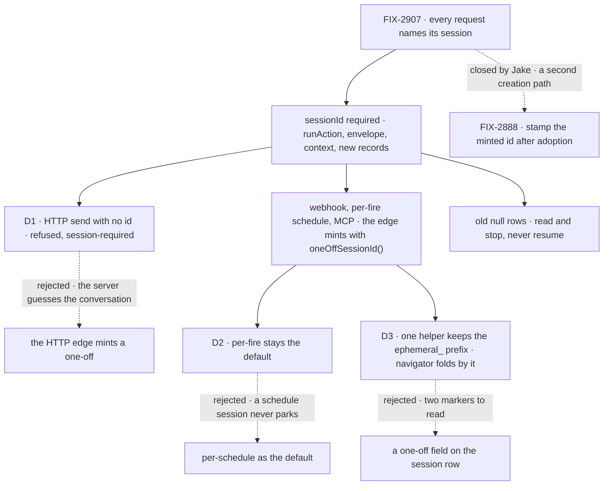

# FIX-2907 · Decisions

[Spec](SPEC.md) · **Decisions**

Three decisions are the sign-off. The direction is already Jake's: there are no sessionless
requests, so the session id is required and the entry points settle it before the request record
exists (agent-mailbox #47, comment 7110651424). What is left is what a caller with no id sees, the
schedule default, and how a one-off session is still marked.

## The tree

Solid edges are what you're signing. Dashed edges lost, and the label says why.

## D1 · An HTTP send with no session id is refused by name, and `send` requires one

| | |
|---|---|
| **Instead of** | The HTTP action route making a one-off session id, as the webhook route will, so `send(action, input)` keeps working with no id |
| **Because** | Jake's rule is that a request always has a session, and the issue asks that "direct runAction or API calls with no id are refused by name. No silent mint." An HTTP caller is the one entry point that knows which conversation it means: a minted id is a guess that leaves an orphan session per call, the same pile FIX-2887 has to prune. A webhook, a schedule and an MCP call have no caller who could name one, so they mint at their edge; a client does, so it names it. Making the id required on `send` and `execute` turns the refusal into a compile error for TypeScript callers, before any request is sent (tenet 5: the invariant lives at its convergence point, and the types carry it outward) |
| **Locks in** | `400 { error: "session-required" }` from `POST /api/flows/:flow/actions/:action` when neither the path nor the body names a session, before principal resolution writes anything. `SendOptions.sessionId` required in `@flow-state-dev/client`; `useAction`'s `execute(input, sessionId)` takes a required id. `SessionRequiredError` from `runAction` and the inbound host. Both names go through `docs/contributing/glossary.mjs` in the implementation PR |

![D1, what an HTTP send with no session id does. Chosen: refused by name, session-required, and the client's send needs a session id. Instead of: the HTTP edge making a one-off session, as webhooks do. It comes down to who knows the conversation: only the caller does, so a minted id is a guess and an orphan. Price: every caller that sent without a session names one, one line each. Tie: the run itself behaves the same. Locks in the session-required refusal and a required sessionId on send. Flips if an adopter needs one-shot HTTP calls with no session to keep](figures/d1-refuse-not-mint.svg)

It comes down to who knows the conversation: only an HTTP caller can name it, so the server should
not guess.

A one-shot caller is not left out: it passes `oneOffSessionId()` (browser-safe, from the
zero-dependency contracts layer), and gets the same one-off run, folded by the navigator, as today.
Kitchen Sink's artifact dialog is such a caller and changes that way. LangGraph takes the other
side: a stateless run gets a temporary thread the server makes and deletes when the run finishes.
That works because it also deletes the thread; until one-off sessions are pruned (FIX-2887) a
server mint only adds orphans. Temporal takes this side: the client always names the workflow id.

**What would change my mind:** adopters with many one-shot HTTP calls finding the extra argument a
real cost. Then a `send` option that calls `oneOffSessionId()` for them is a small client addition,
still with no server-side mint.

**What being wrong costs:** callers that relied on the sessionless send add one argument each. In
this repository: Kitchen Sink's artifact dialog, about 29 test files on the sessionless route, and
no `useAction` caller outside tests.

## D2 · `per-fire` stays the schedule default; the scheduled endpoint makes its one-off id up front

| | |
|---|---|
| **Instead of** | Making `per-schedule` the default, as the issue asked us to consider, so a schedule's fires share one session unless it opts out |
| **Because** | A fire in a schedule session never parks (FIX-2886, `SUSPEND_IN_SCHEDULE_SESSION`): a parked fire would leave the active registry and its continuation could run beside the next fire. Flipping the default would make every schedule whose fire suspends or waits fail where it works today, and would carry one fire's session state into the next for every schedule that never asked for that. `per-fire` keeps today's behaviour exactly; the only change is that the endpoint makes the id before it dispatches, so the record names it |
| **Locks in** | `session` still defaults to `"per-fire"`. The scheduled endpoint calls `oneOffSessionId()` for a per-fire fire, after the overlap check and the once-per-time claim, so a skipped or duplicate fire makes no id |

![D2, which session a schedule's fire runs in by default. Chosen: per-fire stays the default, and the scheduled endpoint makes the fire's one-off session id before it dispatches. Instead of: per-schedule as the default. It comes down to parking: a fire in a schedule session can never park, so flipping the default breaks every schedule whose fire suspends or waits. Price: per-fire sessions keep piling up until FIX-2887 prunes them. Tie: either way the request record names its session. Locks in per-fire as the default. Flips if no schedule needs to park](figures/d2-per-fire-stays.svg)

It comes down to parking: a schedule session can't park, so a per-schedule default breaks every
schedule that waits.

**What would change my mind:** a schedule session that can park safely (a continuation that holds
the schedule's overlap slot). Then `per-schedule` is the better default and this flips.

**What being wrong costs:** schedules keep one session row per fire until FIX-2887 prunes one-off
sessions.

## D3 · One-off sessions keep the `ephemeral_` prefix, made by one helper; the navigator folds by it

| | |
|---|---|
| **Instead of** | (a) A one-off field on the session row (for example `metadata.oneOff`), set by each edge, with the navigator folding by it. (b) No marker at all: drop the prefix and the navigator's "One-off runs" fold |
| **Because** | The rows already stored carry the prefix, so the navigator must keep reading it whatever we pick. A field would make two markers to read, and a write of that field at every edge beside the birth, which is the "marker plus a second creation path" the issue rules out. (b) puts one row per webhook delivery and per-fire fire back in the navigator's list (581 in the Teammates lab). Keeping the prefix, made in one place, changes no stored id and no reader. The prefix stays display-only, as `one-off-session.ts` already says: a caller can name an id with it, and nothing trusts it |
| **Locks in** | `oneOffSessionId(): string` in `@flow-state-dev/contracts/helpers` (re-exported from `@flow-state-dev/core/helpers`), beside `ONE_OFF_SESSION_PREFIX` and `isOneOffSessionId`, and the only code that makes such an id. The webhook route, the scheduled endpoint and the MCP adapter call it; custom transports may |

![D3, how a one-off session is marked for the navigator. Chosen: keep the ephemeral_ prefix, made by one helper that every edge calls, and the navigator folds by it as today. Instead of: a one-off field on the session row, or no marker and no folding. It comes down to the rows already stored: they carry the prefix, so the navigator must read it anyway, and a second marker would make two to read. Price: the prefix stays display-only, a caller can still name one. Tie: either way the session is born by the one birth path. Locks in a oneOffSessionId helper in contracts. Flips if a reader must prove how a session was made](figures/d3-one-prefix.svg)

It comes down to the rows already stored: they carry the prefix, so it stays the one marker.

**What would change my mind:** a reader that must prove a session was made by the engine (to prune
it, say, in FIX-2887). Then the server writes a field once, at birth, and that issue owns it.

**What being wrong costs:** a later change adds that field and keeps reading the prefix for old
rows.

## Decided, not asked

- **The convergence point is `runAction`'s admission**, ahead of the active-request registration and
  the request claim: a missing `sessionId` throws `SessionRequiredError` there, before anything is
  registered or written. Every writer passes through it or is checked earlier: the HTTP action route
  (the 400, before principal resolution), the inbound host's `dispatch` and its external-queue stub
  (refuses an envelope with no id before writing the queued stub), `dispatchInternalAs`,
  request continuation, request recovery, request wakes, the BullMQ job processor, `testFlow`,
  `fsdev run` and chat, and the workforce inventory writers. `createExecutionContext` requires
  `sessionId` unless `noSession` (a view), as a discriminated type, and asserts it at runtime for
  JavaScript callers. `settleFreshRequestSetupFailure` and `createInitialRequestRecord` take a
  required id.
- **Old null-session rows are history (BP-030).** They stay readable: the read types keep
  `sessionId` optional, and `pendingGatesOf` keeps skipping its session filter when the record has
  none, so stopping one finds its gate. They are never given a session: a resume (`POST
  …/requests/:id/resume`), a continuation, a crash-recovery retry or a request wake of a record with
  no session is refused or settled with a named reason (`legacy-sessionless-request`), never run in
  a new one-off session, because the suspension and the park keys were written with no session and
  a new id would hide its gates. The client already refuses continue and retry with no session.
  Refusing a plain retry of an old *failed* one-off run is stricter than the gate reason needs,
  and deliberate: one rule for every old null row. Over HTTP the refusal is a named 4xx, not the
  retry route's generic 500. Few rows can be in flight: only a one-off run that parked before the
  upgrade.
- **Work queued before the upgrade with no session** (a BullMQ job, an external-queue stub) never
  started, so it has no gates. The worker settles it by name (`legacy-sessionless-request`) and
  fails the job as not retryable, so the queue does not retry it. It is not given a one-off session
  at the worker, which would be a second creation path. Only jobs in flight across the deploy are
  affected.
- **The webhook route ensures every delivery's session.** Today it calls `ensureSessionForWebhook`
  only when the binding names an id. After, it mints with `oneOffSessionId()` when the binding
  names none, then ensures either id the same way, so a one-off webhook session is born with the
  same `metadata.source: "webhook"` as a named one, and a create the flow refuses is answered at
  the edge, as it is today for a named id, rather than mid-run.
- **The MCP adapter mints when its directive yields nothing**: no `mcp.session` directive, or a
  `{ fromInput }` field that is missing or blank (today both fall through to the engine's mint).
- **The branches that meant "the caller named a session" now always run**: the session admission
  and create check in `runAction` (the create check now sees the real id, not `""`), the
  deleted-session drop, the active-request entry's `sessionId`, retention, and the concurrency
  arbiter (which treats a missing session as "no arbitration"). Retention on a one-off session
  costs one read per completed run and removes nothing a one-off run keeps. The arbiter now takes a
  session lease for every one-off run: one lease write per webhook, MCP or per-fire run on a
  cross-process backend, accepted; a custom concurrency key function always sees a session id.
- **The sessionless route form stays registered** (`POST /:flowKind/actions/:actionName`) so a body
  `sessionId` still works there and a missing one gets the named 400, not a 404.
- **Coordination with FIX-2889.** It reserves the engine's derived ids at the same entry points.
  The two don't overlap in code paths that decide anything: this adds a missing-id check, that adds
  a reserved-prefix check. Whichever merges second rebases.

- **Views keep no session.** The mint being deleted also gave a `noSession` view an id it never
  used; the view branch carries none downstream. `InternalDispatch.sessionId`, documented as
  "absent starts a new one" though every caller passes one, becomes required.

## Considered and dropped

- **Mint at the inbound host** when an envelope has no id, so transports change nothing. One mint
  site, but the envelope stays optional and "no session" stays a meaning every transport can send
  by omission, which is the sessionless request under another name. Making each edge mint
  explicitly puts the choice where the caller is known, and the required type catches custom
  transports at compile time.
- **Stamp after adoption** (FIX-2888). Closed by Jake.
- **Give old null rows a session in a migration.** It would invent a session for history, and the
  gates of a parked old row would move under it. The rows are inert as they are.

## Open

None.

## Settled

No POC. The spec rests on no counted facts beyond the caller list in *Decided, not asked*, which
the required types re-derive at compile time: any caller that passes no id fails `pnpm typecheck`.

## Analysis

2026-11-23 · watermark: the issue's filing · **Right approach, with changes** (two folds, four
records).

1. **Reuse.** `oneOffSessionId()` extends `one-off-session.ts` (contracts has no dependencies, so
   it can't use the engine's id helper); the refusal names are new. No reuse verdict on an Adds item.
2. **Prior art.** LangGraph mints and deletes a temporary thread for a stateless run; Temporal
   has the client name the id. Cited under D1.
3. **Other shapes.** Minting at the inbound host, dropped. A client-side one-off option is D1's flip.
4. **New factors.** FIX-2886 merged and is accounted for.
5. **Necessity.** Right size; the leaner version is FIX-2888, closed.
6. **Ergonomics.** Three ways to get a fresh id, and only `oneOffSessionId()` folds as a one-off.
   **Folded:** it is the advice for one-shot sends, not `crypto.randomUUID()`.
7. **Concerns.** Work queued before the upgrade. **Folded** into *Decided, not asked*.

Records, in *Decided, not asked*: the view branch carries no id; the concurrency arbiter's lease
cost; a named 4xx for a legacy retry, and that refusing it is deliberate; `InternalDispatch.sessionId`
required. In `SPEC.md`: the principal-resolution envelope stays optional; Kitchen Sink's artifact
dialog, a sessionless sender the draft missed, is counted under D1.

## Notes from review

Recorded verbatim for the implementer. None changes the approach.

- cursor[bot], `DECISIONS.md` (Considered and dropped): "Inbound-host mint rejection is right; optional one-liner contrasting optional envelope vs edge mint + required types would help future readers."
- cursor[bot], `DECISIONS.md` (Decided, not asked): "Add debt visibility: always-defined `sessionId` enables admission I/O and retention `listAll()` on retention-bearing flows, not only arbiter leases."
- cursor[bot], `SPEC.md` (What changes): "Scope question for implementer: is the five-layer required `sessionId` the minimum cost of this goal, or could runtime gates at `runAction`/host ship first? I lean full types for custom transports, but this block drives issue size **M**."
- cursor[bot], `DECISIONS.md` (old null-session rows): "Consider surfacing in the people table that failed one-off retry is refused under the one-rule-for-null-rows policy — deliberate, but easy to miss."
- cursor[bot], `SPEC.md` (the diff): "For one-shot HTTP, lead with `oneOffSessionId()` below rather than `createSession()` so D1 migration cost reads correctly."
- cursor[bot], review summary: "Note extra admission session I/O and retention `listAll()` on flows with retention; optional arbiter skip for `isOneOffSessionId` on queue hosts if profiling warrants it."

- cursor[bot] security review, folded into `SPEC.md` → *How we verify* (e): "Add one clause to (a): a second user, a second org, and a second tenant each send the first run's session id (an `ephemeral_` id included), receive the same response as an id that was never used, and leave no request record."

## How it got here

- **Draft** — Jake ruled there are no sessionless requests and closed FIX-2888's stamp; this
  makes the id required from the HTTP route to the context, has the three one-off transports mint
  at their edge with the existing prefix, refuses a caller with no id by name, and keeps old null
  rows as stoppable history, using the findings from #5581.
