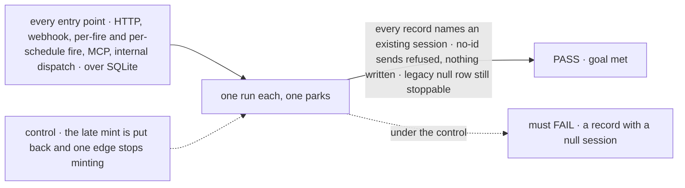
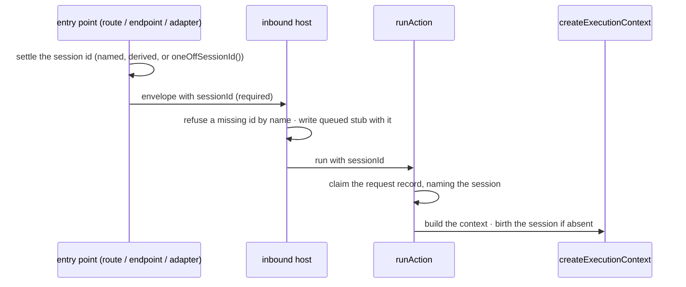

# FIX-2907 · Every request names its session

**Spec** · [Decisions](DECISIONS.md)

## Six people, before and after

| Someone who… | Today | After |
|---|---|---|
| **reads a webhook or schedule run in the DevTool** | Finds runs whose request record names no session (581 poll requests in the Teammates lab have `session_id = NULL`), so the run is missing from its session's Trace tab | Every run's request record names its session from its first write, and the session's request listing shows it |
| **sends an action over HTTP with no session id** (`client.flow(f).send(a, input)`, or `POST /api/flows/f/actions/a` with no `sessionId`) | The action runs in a session the engine makes up after the request record is written | Gets `400 session-required`, and nothing is written. They pass a session id: one they made with `client.flow(f).createSession()`, or, for a one-shot send, `oneOffSessionId()`, which the send creates as today and the navigator folds as a one-off ([D1](DECISIONS.md#d1)) |
| **calls `runAction` (or a custom transport's `host.dispatch`) with no `sessionId`** | The run gets a one-off session the request record never learns | TypeScript refuses the call; a JavaScript caller gets `SessionRequiredError` before anything is registered or written |
| **receives a webhook whose binding names no session, or fires a schedule with the default `per-fire`, or takes an MCP `tools/call` with no session directive** | The engine makes the one-off session after the record is written | The webhook route, the scheduled endpoint or the MCP adapter makes the one-off session id before it dispatches. The run is the same one-off run as today; per-fire stays the default ([D2](DECISIONS.md#d2)) |
| **opens the flow navigator** | One-off sessions fold under "One-off runs", by their `ephemeral_` prefix | The same. Every one-off id comes from one helper, which keeps that prefix ([D3](DECISIONS.md#d3)) |
| **has a request recorded with no session before this ships** | It can be read, stopped and (if suspended) resumed | It can still be read and stopped, and its gates are still found. Resuming, retrying or recovering it is refused by name: it stays as history ([Decided, not asked](DECISIONS.md#decided-not-asked)) |

## The goal, and how we'll know it's met

**No live run can start without a session: every entry point settles its session id before the
request record is written, so every request record a run writes names its session from the first
write, and the engine's late `ephemeral_` mint is gone.** Records written before this ships keep
no session and stay readable and stoppable.

| Is it the right goal? | |
|---|---|
| **The real need** | Jake, relayed on the mailbox (agent-mailbox #47, comment 7110651424): "there are no sessionless requests." From the issue: "createExecutionContext and the request record require sessionId. The late ephemeral_ mint is deleted." "Each entry point settles its session before it writes the request record." "Direct runAction or API calls with no id are refused by name. No silent mint." |
| **Smaller, and rejected** | Stamp the minted id onto the record after the context adopts it ([FIX-2888](https://linear.app/fixpoint-labs/issue/FIX-2888), #5581, closed). It hides the symptom and keeps a second creation path; Jake closed it for this |
| **Bigger, and not this issue's** | Pruning one-off sessions, old and new ([FIX-2887](https://linear.app/fixpoint-labs/issue/FIX-2887)). Reserving the engine's derived `owner-run:` / `service-route:` ids ([FIX-2889](https://linear.app/fixpoint-labs/issue/FIX-2889)). Backfilling a session onto old null rows |
| **Not done if** | Any path reaches `createExecutionContext` for a run without a session id (a view with `noSession` is not a run and writes no record) · a live run writes a request record, a queued stub, a suspension or an active-request entry with no session · an HTTP send or a `runAction` with no id runs, or is refused only after something is written · a webhook, per-fire schedule fire or MCP call with no session behaves differently from today apart from its record naming the session · the navigator stops folding one-off sessions · a request recorded with no session before this ships can no longer be read or stopped, or its gates are no longer found |



The check reads request records, suspensions and sessions from the store after real runs through
each entry point.

| How we verify | |
|---|---|
| **Goal check** | `goals/sessions/every-request-names-its-session/`, new · model `n/a` · run by the implementer at completion · verdict on the implementation PR |
| **Signal** | **(a)** For each entry point (HTTP send with an id, webhook with and without a binding `sessionId`, schedule fire `per-fire` and `per-schedule`, MCP `tools/call` with and without a directive, an internal `dispatchInternalAs`), one run: its request record has a non-null `sessionId` read straight after the claim (before the run settles), that session's row exists and belongs to the run's user and flow, and the session's request listing returns the run. The `per-fire` fire and the directive-less MCP call each land in a session `isOneOffSessionId` accepts. **(b)** An HTTP send with no id, and a `runAction` with no `sessionId`, are refused with `session-required` / `SessionRequiredError`, and the store holds no request record, active-request entry or session for them. **(c)** A webhook run that parks: its suspension and its request record name the same session, and stopping it by request id settles it. **(d)** A request record and suspension seeded with no session (the shape old rows have): the session's listing is unaffected, stopping it finds its gate and settles it, and resuming it is refused by name |
| **Input** | A fixture flow with a webhook binding, a static schedule, a per-schedule dynamic schedule, an MCP action and one action that parks, over the SQLite store |
| **Anti-game** | Read records from the store, not from a counter in the code under test. Floor each list with `tell.over`, so a run that read nothing reads CAN'T TELL. Read (a)'s record during the run, so a stamp after adoption can't pass |
| **Control that must fail** | `GOAL_CONTROL=late-mint`: `createExecutionContext` mints when `sessionId` is absent and the scheduled endpoint stops minting for `per-fire`. Must FAIL (a), on the per-fire record. `GOAL_CONTROL=http-mint`: the action route mints instead of refusing. Must FAIL (b). Today's `main` fails (a) and (b) |

## What changes

![Before and after, one row per entry point. Before, an HTTP send with no session id, a webhook with no binding sessionId, a per-fire schedule fire, an MCP call with no session directive and a direct runAction with no sessionId all reach the engine with no session; the request record is written with a null session, and createExecutionContext mints an ephemeral session afterwards. After, the HTTP send and the direct runAction are refused by name, and the webhook route, the scheduled endpoint and the MCP adapter each make a one-off session id with the one helper before dispatch, so every request record names its session from its first write. The late mint is deleted](figures/what-changes.svg)

The session id becomes required from the HTTP route down to the execution context; the three
transports that ran one-off runs make the id themselves, with one helper.

```diff
  // A client send
- await client.flow("support").send("ask", { text });
+ const support = client.flow("support");
+ const session = await support.createSession();
+ await support.send("ask", { text }, { sessionId: session.id });
  // a one-shot send: a one-off session, which the navigator folds as today
+ import { oneOffSessionId } from "@flow-state-dev/core/helpers";
+ await client.flow("support").send("ask", { text }, { sessionId: oneOffSessionId() });

  // useAction
- await execute(input);
+ await execute(input, sessionId);

  // A direct run, in a test or a custom transport
  await runAction({
    flow, actionName: "ask", input, userId, stores,
+   sessionId: "s-1",
  });

  // A custom transport that wants a one-off run
+ import { oneOffSessionId } from "@flow-state-dev/core/helpers";
  host.dispatch({
    source: "my-transport", flowKind, action, input, principal,
+   sessionId: oneOffSessionId(),
  });
```

`SendOptions.sessionId`, `useAction`'s `execute` session argument, `runAction`'s `sessionId`,
`InboundRequestEnvelope.sessionId`, `InternalDispatch.sessionId` and `createExecutionContext`'s `sessionId` (unless `noSession`,
which only a view sets) become required. The principal-resolution context's envelope (`core/src/types/auth.ts`) keeps it optional: the scheduled endpoint resolves its principal before any run exists. `RequestRecord.sessionId`, `RequestSummary.sessionId` and
the suspension record's `sessionId` stay optional on read, for old rows.

**Docs:** at release, `docs/client/overview.md` says `send` takes a session id and how to get one,
and drops the "no session" sentences; `docs/fundamentals/state-and-scopes.md` (the "sent without a
session id" line under the create check) says such a send is refused; `docs/server/connection-resilience.md`
says the snapshot's `sessionId` is absent only on a request recorded before sessions were
required; `docs/server/mcp.md` and `docs/server/scheduled.md` say a one-off run gets a fresh
session made for it (no behaviour change); the `@flow-state-dev/client` and `@flow-state-dev/react`
READMEs show `sessionId` on `send` and `execute`. Contributor docs in the implementation PR:
`docs/architecture/` pages that describe a sessionless run (the implementer finds them by
`ephemeral`/`one-off`/`no session`). No new page.



## What stays as it is

- Every one-off run's behaviour: a webhook delivery with no binding `sessionId`, a `per-fire`
  schedule fire and a directive-less MCP call each run alone in a new session, as today.
- `per-fire` as the schedule default; `per-schedule` and its reserved prefix (FIX-2886).
- Sessions are still born by `ensureSessionRecord`, with the flow's create check, the first time a
  run names an id that has no row.
- Views: a user or org view runs with `noSession`, writes no request record, and is untouched.
- Old rows with no session: never rewritten, never given a session.

## What's already here, and the debt

| Already here | What this does with it |
|---|---|
| **The job: pick the session a run lands in.** Mechanisms `inbound-transport`, `webhook`, `schedule`, `dispatch`. Five ways today: the HTTP body or path `sessionId`; a webhook binding's `sessionId(event)`; a schedule's `session` preset (FIX-2886); the dispatcher's child session and the engine's derived ids (`owner-runs.ts`); and, for every run with none, the late mint in `createExecutionContext.ts` | **Removes** the fifth. A run with no session now gets its one-off id from the entry point, through one helper, or is refused |
| **The one-off id.** `ONE_OFF_SESSION_PREFIX` / `isOneOffSessionId` (`contracts/src/helpers/one-off-session.ts`), minted only in `createExecutionContext.ts`, read by the navigator (`react/.../flow-navigator/dispatch-runs.ts`) and by `fsdev` chat | **Extended** with `oneOffSessionId()`, the only place the id is made ([D3](DECISIONS.md#d3)). The prefix stays display-only |
| **Session birth.** `ensureSessionRecord` (`engine/src/context/session-birth.ts`), called by `createExecutionContext` and by the webhook route's `ensureSessionForWebhook` | **Kept** as the one birth function. The webhook route now ensures every delivery's session, named or one-off, so a one-off webhook session carries `metadata.source: "webhook"` like a named one |
| **One-shot HTTP sends in this repository.** Kitchen Sink's artifact dialog sends each text transform to `rich-text-component` with no session (`apps/kitchen-sink/components/artifact-dialog.tsx`) | **Changed** to pass `oneOffSessionId()`: the same one-off run, now named by the caller |
| **Callers that already make their id.** `fsdev run` (`sess_…`), `testFlow` (`"test-session"`), `useSession`, workforce inventory writers, owner runs, request wakes, request continuation | **Unchanged**, except that a continuation or wake of an old null-session record is refused (below) |
| **Reading old null rows.** `pendingGatesOf` skips the session filter when the record has none; `request-recovery.ts` already skips session wakes for `record.sessionId == null`; the client already refuses continue/retry with no session | **Kept**, and the read types keep `sessionId` optional (BP-030) |
| [FIX-2888](https://linear.app/fixpoint-labs/issue/FIX-2888) / #5581 (closed): stamp the minted id onto the record after adoption, and move the suspension key | **Superseded in whole.** Its findings shape the legacy rules in *Decided, not asked* |
| [FIX-2886](https://linear.app/fixpoint-labs/issue/FIX-2886) ([spec](../FIX-2886/SPEC.md)): `per-fire` / `per-schedule`, the per-fire default | **Amended in part**: `per-fire` now makes its one-off id at the endpoint. The default is kept ([D2](DECISIONS.md#d2)) |
| [FIX-2889](https://linear.app/fixpoint-labs/issue/FIX-2889) (Backlog): reserve `owner-run:` / `service-route:` | **Independent, same entry points.** A one-off id is random, so it needs no reserving. Whichever lands second rebases its checks onto the other's |

| Adds | Existing piece considered | Why it doesn't fit / how composed |
|---|---|---|
| `oneOffSessionId()` in `@flow-state-dev/contracts/helpers`, re-exported from core | The inline mint in `createExecutionContext` | **Moved**, not added: the same id spelling, now called by the three edges that make one-off runs instead of by the context |
| `session-required` (HTTP 400) and `SessionRequiredError` | The route's existing `reserved-session-id` 400 and `UnknownSessionError` | A missing id is a different refusal from a reserved or unknown one; it gets its own name, as the issue asks ("refused by name") |

| The debt | |
|---|---|
| **Removes** | The late mint and the "no session" branches that read `options.sessionId !== undefined` in `runAction` (admission, create check with `""`, the deleted-session drop, retention), which now always run. The sessionless route form stops running actions |
| **Adds** | One helper and one refusal name, both permanent by design. A refusal on resume/retry/recovery of an old null-session record, permanent by design (those rows are history) |
| **Leaves** | One-off sessions are still never pruned ([FIX-2887](https://linear.app/fixpoint-labs/issue/FIX-2887)). Read types keep an optional `sessionId` for old rows. The engine's derived ids stay unreserved ([FIX-2889](https://linear.app/fixpoint-labs/issue/FIX-2889)) |

**Net: down.** A creation path and its branches go; one helper moves to contracts and one refusal
name is added.

## Sign off

**[The goal](#the-goal-and-how-well-know-its-met), at that size:** no run starts without a session,
every record a run writes names it from the first write, old null rows stay readable and stoppable.
If wrong: some entry point still writes a null-session record, and the DevTool keeps losing runs.

**[The debt](#whats-already-here-and-the-debt), net down:** the late mint and its branches go; a
helper and a refusal name are added. If wrong: the edges drift into five spellings of a one-off id.

1. **[D1](DECISIONS.md#d1) · An HTTP send with no session id is refused (`session-required`), and
   `send` requires a session id.** The one to weigh: it breaks every caller that sent without one.
   If wrong: adopters with one-shot HTTP calls add a line, or we add a client-side mint later.
2. **[D2](DECISIONS.md#d2) · `per-fire` stays the schedule default; the endpoint makes its one-off
   id up front.** If wrong: schedules keep one session row per fire until FIX-2887.
3. **[D3](DECISIONS.md#d3) · One-off sessions keep the `ephemeral_` prefix, made by one helper;
   the navigator folds by it as today.** If wrong: a later reader that must prove a session's origin
   adds a server-set field.

Feature · `contracts`, `core`, `engine`, `client`, `react`, `mcp`, `testing`, many tests, one goal ·
M (required types through five layers, three edge mints, one refusal, a test sweep) · supersedes
FIX-2888 · [Linear](https://linear.app/fixpoint-labs/issue/FIX-2907)
