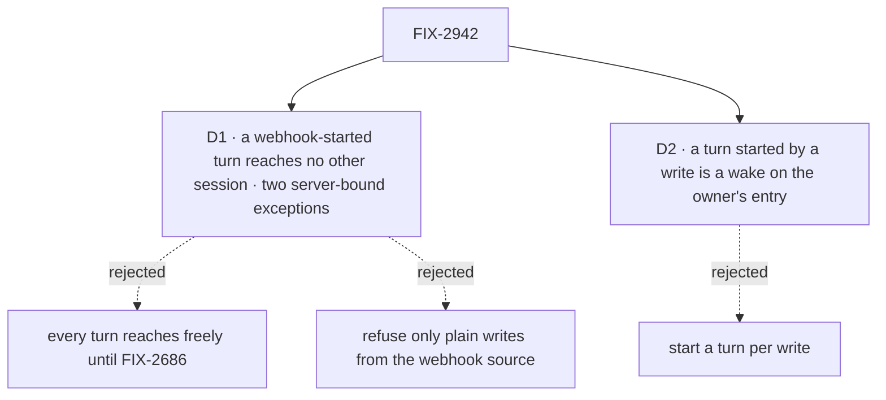

# FIX-2942 · Decisions

[Spec](SPEC.md) · **Decisions**

The epic already decided the reach, its admission and its notice (ER-1 to ER-3), and the owner
decided that a write across sessions is a plain write (epic [Q1](../../epics/FIX-2941/DECISIONS.md#q1)).
Two calls are this issue's own.

## The tree

Solid edges are what you sign. Dashed edges lost.

## D1 · A turn a webhook delivery started, directly or through the runs it fires, reaches no other session; a board's settle on the claimed task's session and a subscription delivery are the two exceptions

| | |
|---|---|
| **Instead of** | Let every turn reach other sessions until [FIX-2686](https://linear.app/fixpoint-labs/issue/FIX-2686) marks untrusted turns · or refuse only plain writes from the `webhook` source and let any named action run |
| **Because** | A webhook turn reads text a stranger wrote (a PR comment). The narrower rule has two holes. A service delivery's routing and the owner runs it fires are dispatched as `internal` (`dispatchInternalAs` in `owner-runs.ts`), so the `webhook` source never reaches the worker a PR comment wakes. And a named action is history, not a check: an action that takes a session id lets the text pick the session, and a read brings another conversation's data into a turn that can reply with it. So the delivery's origin rides the dispatch envelope beside the source, set by the server (`routeServiceEvent` passes it to every run it fires), never read from metadata (BP-031). The two exceptions take their session from a server-held record, the claimed row (`ctx.task.session`) and the thread index row, never from the model or the payload, and each keeps its own check: the claim, the delivery's verdict |
| **Locks in** | Until FIX-2686, a webhook-started turn can't read, list, write or call `acrossSessions()` on another session; each is refused alike, naming the rule and never the target. An app whose webhook worker needs more waits for FIX-2686. The mark follows dispatches, not data: a task the turn files in its own session, or the filer's wake after a settle, is not marked, and carrying it through data is FIX-2686's. FIX-2686 widens the same refusal to every untrusted turn |

It comes down to a stranger's text: if the turn can name a session, the text can choose it.

**What would change my mind:** FIX-2686 landing first. Then the refusal keys on its marking, and
the delivery origin is not added. Or a webhook worker in real use that must read another session:
that read becomes a third exception, bound to a server-held session the same way.

## D2 · A turn started by another session's write is a wake on the owning session's entry; wakes already coalesce per session

| | |
|---|---|
| **Instead of** | Start a turn per write that asks for one |
| **Because** | The wake store keeps one wake per tenant, session and entry, and a second wake folds into the first (`coalesceWake`). Fifty sub-tasks ending at once then start one turn of the filer, which reads every ending. A board's notices already reach their filer this way |
| **Locks in** | A turn woken by writes from other sessions reads what changed, not one event: it can't assume one write per turn. A definition that wants a turn per write has no way to ask for one |

It comes down to a burst: a turn per write is fifty turns for fifty endings.

## Decided, not asked

- **Admission is ER-1's, on the run's resolved principal.** The host rule is `principalOwnsRequest`'s
  owner compare. A target whose flow has its own caller resolver answers as missing to a block of
  another flow, and admits a block of its own flow on the run's caller. Never HTTP credentials:
  a runner's envelope carries none.
- **The system principal and the gateway fallback are no owner.** A schedule on either sees only
  its own sessions; two such schedules can't name each other's.
- **One convergence point.** Every named reach goes through one function that runs the admission
  chain, so a resource read, write, list and a claim can't disagree. Tested by the seven refusal
  cases on every verb.
- **Writes are versioned, not locked.** Two sessions writing one copy conflict the way two local
  writers do, and the definition's checks arbitrate. This answers FIX-1283 for named reach.
- **A whole-copy operation acts on one copy** (ER-3): list, count, claim the next task, and hear its
  changes act on the copy named, or the block's own.
- **The accessor's docs say when to use `ctx.sessions`**: for what isn't a resource.

## Considered and dropped

| Alternative | Why not |
|---|---|
| A new owner compare on user, org and tenant | Narrower than the routes: it admits a no-org session and a session an own-resolver flow refuses (epic analysis) |
| Reach through `ctx.sessions.get(id).resources` | A second door to sessions beside the resource accessor. The concept doc weighed it and rejected it |
| A lock that only the owning session writes | The workarounds this epic deletes exist because writes were forbidden ([concept doc](../../../docs/internal/design/scopes-and-sessions.md#why-writes-arent-locked)) |

## Analysis

2026-11-26 · watermark 2026-11-25 (the epic's analysis) · **Right approach.** Run over the whole
spec set, in the epic agent's own context: this dispatch had no sub-agent to give it.

1. **Reuse:** both Adds extend existing pieces (the resource accessor, the routes' admission). The
   wake store and the change bus carry the notice. See [Builds on / Adds](SPEC.md#whats-already-here-and-the-debt).
2. **Prior art:** Temporal routes a write into another workflow through a signal its history
   records; the owner chose plain writes (Q1), and where a stranger's text is near, D1
   keeps only two named actions, each bound to a server-held session.
3. **Other shapes:** a sessions-handle door, recorded under *considered and dropped*.
4. **New factors:** FIX-2686 is open and Todo; D1 is its stop-gap. No other issue since the
   watermark touches resource resolution.
5. **Necessity:** every later child builds on it.
6. **Ergonomics:** one method; the docs line separates it from `ctx.sessions`.
7. **Concerns:** D1's refusal must not block a board's settle or a subscription delivery. Both
   stay open as server-bound exceptions; no other named action is exempt.

## Notes from review

- "**FIX-2942 D1: the webhook refusal is easy to route around.** Keying on dispatch type `webhook` reads a trusted source (BP-031), good. But the escape hatch is "a named action", and any flow can expose a named action that does an arbitrary write. The stop-gap therefore protects only apps that don't do that. Fine as a stop-gap, but the spec should say so plainly, and say how a wake started by a write that a webhook turn made is typed (the derived turn is not `webhook`; the untrusted text can ride the data it wrote). If that is FIX-2686's job, link it as the owner of that case." — jhoffner, set review round 1
- "`ctx.resources.at({session})`, `ctx.cap.<name>.at`, `ctx.sessions` and the parent-row read on the request host are four doors to another session. The set removes the last and documents the first two. Good; make sure the FIX-2942 docs section ships with the first PR, not at release, so the two-doors rule is never in the code without its rationale." — jhoffner, set review round 1
- "Admission is one function per spec text ("one convergence point"). Make that a single exported function in `engine` that both the routes and the block path call, so the routes aren't left on the old multi-function chain. The set says "extends", but a shared entry point is the only thing that keeps them from drifting." — jhoffner, set review round 1
- "Acceptable stop-gap, not the long-term rule: transport=`webhook` is simpler than refusing all cross-session writes until FIX-2686, but it is a second phase. When FIX-2686 lands, plan to subsume this branch so resource code doesn't keep a delivery-specific admission table." — Cursor bot, round 1

These are inputs, not instructions.

## How it got here

- **Draft (Nov 26)** in the epic's spec set, after the owner decided Q1 (plain writes) and Q2.
- **Set review:** D1 narrowed to plain writes after the set review found that a task session
  woken by a service delivery settles on its filer's board.
- **Set review round 2 (Nov 26):** D1 widened from plain writes to every reach, with two
  server-bound exceptions, and its origin carried through the routing and owner runs a delivery
  fires. The Cursor security review showed a named action lets the text pick the session; Codex
  showed owner runs are dispatched as `internal`, so the `webhook` source alone fenced nothing on
  the service-delivery path (checked in `owner-runs.ts`).

**Open: none.**
