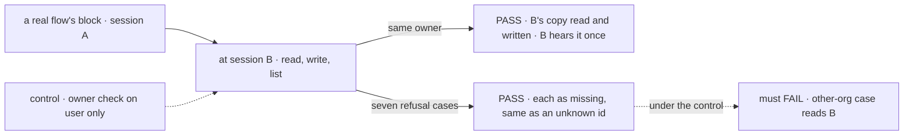
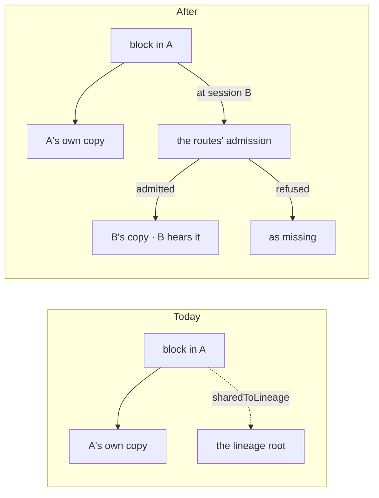

# FIX-2942 · A block reads and writes another of its owner's sessions by naming it

**Spec** · [Decisions](DECISIONS.md)

| Someone who… | Today | After |
|---|---|---|
| **writes a worker that settles its task on the conversation that filed it** | Can't reach that conversation's data. The board was moved to user scope and split per conversation so the worker could find it | Names the conversation: `ctx.resources.at({ session }).<name>` reads and writes its copy |
| **hands another of their sessions an id that isn't theirs** | n/a: no block can name a session | Gets the same answer as for an id nobody holds, on every verb. Another user, the same user in another org or tenant, a no-org session and a session an own-resolver flow refuses all read as missing |
| **owns the session that was written to** | n/a | Hears the write as it hears its own: the change bus, and for a task's ending the task notice. Fifty writes in a burst start at most one turn |
| **runs a worker woken by a webhook** (a PR comment, a CI event) | n/a | Reaches no other session, directly or through the owner runs the delivery fires. Two operations bound to a server-held session still run under their own checks: a board's settle on the claimed task's session, and a subscription delivery |
| **lists or claims from a copy** | Acts on the session's own copy, or its lineage root | Acts on one copy: its own, or the one it named. Nothing sweeps every session |

Each feature that needed another session's data built its own way around this. The epic
([FIX-2941](../../epics/FIX-2941/SPEC.md)) replaces those ways with one reach, and this issue is
that reach.

## The goal, and how we'll know it's met

**Within one owner, a block reads and writes another session's copy of a resource by naming the
session, and a session outside that owner is answered as missing, the way the HTTP routes answer
it.**

| Is it the right goal? | |
|---|---|
| **The real need** | Rules 5, 7 and 8 of [the concept doc](../../../docs/internal/design/scopes-and-sessions.md#the-rules), under the epic's ER-1 to ER-3: one reach, admitted by the routes' own functions, with the owning session told |
| **Smaller, and rejected** | "Reach for the owner's sessions, checked on user, org and tenant." It reaches sessions a browser can't: one an own-resolver flow refuses, or one with no org |
| **Bigger, and not this issue's** | Seeing across sessions in one read (FIX-2945). Moving the board onto this reach (FIX-2946) |
| **Not done if** | A refusal test is missing · a refused session answers differently from an unknown one on any verb · a write lands with no notice to the owning session · a turn is started per write · a webhook-started turn, or a run it fires, reaches another session other than through D1's two exceptions |



The check reads what the block got back and what session B heard, not the admission function's
return value.

| How we verify | |
|---|---|
| **Goal check** | `goals/sessions-reach/name-a-session/` · no model · run by the implementer at completion, in-process and behind a runner · verdict in the implementation PR |
| **Signal** | Same owner: a read, a write and a list on B's copy return B's data; B's change bus carries one notice per write; twenty writes in one burst start one turn of B's entry. Each refusal case (another user, another org, another tenant, a no-org session, an own-resolver refusal, two schedules on the gateway principal, a custom-resolver target whose resolver did not produce the run's principal) answers exactly as an unknown id does, on read, write and list. An owner run fired by a service webhook, whose input names another session: read, list, `acrossSessions()`, a plain write and a named action other than settle are each refused alike; the settle on its claimed task's session passes |
| **Input** | Two sessions of one owner on two flows that both declare a `notes` collection. Any other per-session definition must pass too |
| **Anti-game** | Assert on what the block reads back and on B's bus, never on the admission function. Compare each refusal byte for byte with an unknown id's answer |
| **Control that must fail** | `GOAL_CONTROL=owner-user-only` must FAIL *other-org reads as missing*. `GOAL_CONTROL=turn-per-write` must FAIL *one turn per burst*. `GOAL_CONTROL=webhook-source-only` must FAIL *the owner run is refused*. Today's `main` fails the same-owner row |

The principal's new mechanisms each get a row of their own, in the same goal check, on the same
anti-game rule:

| Signal | Control that must fail it |
|---|---|
| **Own-resolver admit:** a run whose principal the target's own resolver produced (`resolvedBy` matches) reads and writes its copy | `GOAL_CONTROL=own-resolver-closed` (every own-resolver target refused) |
| **Absent `resolvedBy`:** a principal with none, or a target resolver with none, reads as missing, as does a principal from the same resolver under other host settings | `GOAL_CONTROL=resolved-by-loose` (absent on both sides compares equal) |
| **A schedule naming a person** reaches that person's host-rule targets, and reads an own-resolver target as missing | `GOAL_CONTROL=schedule-as-machine` fails the first half; `GOAL_CONTROL=schedule-person-unscoped` (its person matches own-resolver targets too) fails the second |
| **Sticky kind:** a stale whole-record write carrying `person` onto a machine's session leaves it a machine's, and it still reaches nothing | `GOAL_CONTROL=kind-not-sticky` |
| **Backfill:** a pre-`kind` session reads as its first request's kind; one with no readable request, or whose parent is missing, recreated or past the depth bound, reads as a machine's | `GOAL_CONTROL=backfill-as-person` (no readable request reads as person) and `GOAL_CONTROL=parent-by-bare-id` (inherits from a recreated parent) |
| **Pre-org request retry:** an owner retrying a request id whose record predates orgs reuses it and is not refused | `GOAL_CONTROL=claim-exact-raw` (compares the stored record without normalising it) |

## What changes



Today a block reaches its own copy or its lineage root. After, it can name any session, and the
routes' admission decides what it finds. The lineage branch goes in FIX-2947.

```diff
  ctx.resources.notes                                // this session's copy
+ ctx.resources.at({ session: launchChatId }).notes  // the launch chat's copy, read and write
```

**Docs:** this issue carries the epic's shared story. Its changeset says "a scope is how many
copies exist; the owner decides who may look; name a session to reach its copy", and its PR
updates `docs/architecture/state-and-scopes.md` with a *Another session's copy* section that also
says when to use `ctx.sessions` instead. The resource guides follow at release.

## How a named reach is admitted

```mermaid
flowchart LR
  D["the door · host.resolvePrincipal"] -->|"set once"| P["principal · userId, orgId, tenantId, kind, resolvedBy"]
  P -->|"carried unchanged"| B["block in session A"]
  B --> K["kind is person · and A's recorded kind is person"]
  K --> T["tenant matches · isOrgAttributed"]
  T --> L["admitListedSession"]
  L --> V["own resolver: resolvedBy matches · else the one owner comparison"]
  V --> W["ownsRecord · ownerPin"]
  W --> C["B's copy · the definition's checks run"]
```



The same functions the HTTP routes use, fed the run's principal instead of HTTP credentials. A
miss at any step is a missing session.

**One principal.** `{ userId, orgId, tenantId, kind: "person" | "machine", resolvedBy }`, built
on core's `ResolvedPrincipal`. `resolvedBy` names the resolver that produced it, with the host
settings applied to its answer (`requireUser`, `defaultUserId`): the same key the HTTP list
resolves once per. It is a value, not a function reference, so it rides a runner's envelope.
The settings are part of the value, so one resolver under two configurations gives two values
that never match. A host-rule principal carries the host resolver's value the same way. An
absent `resolvedBy`, on the principal or on the target's resolver, never matches anything.
`host.resolvePrincipal` sets the whole principal once, at the door, and dispatch, sub-flows, owner
runs, wakes, schedules and webhooks carry it unchanged. A run started from a stored record (a
wake, an owner run, a task) reads the principal the record stored. `RequestPrincipal`,
`InstanceCaller`, `InternalPrincipal` and the schedule's principal shape all become this type.

**Who is a machine.** The scheduled route sets `kind: "machine"` when the fire runs as the gateway
fallback or the system principal. The webhook route sets it for a delivery's service principal.
A static or dynamic schedule that names a real person runs as that person (`kind: "person"`),
and reaches what that person reaches. A session records its creating principal's kind once, at
birth. The store's write path keeps it sticky, so a stale whole-record write can't turn a
machine's session into a person's. A run whose principal or session is a machine's reaches no
other session. `kind` is the only machine marker: no metadata stamp, no `"system"` id check and
no separate session flag.

**One owner comparison.** User, org and tenant, exact, in one function every door calls: the
session and request routes, the view host rule, the own-resolver verdict and a block's named
reach. A session with no org is refused before it, by `isOrgAttributed`, as the routes already
do.

The request-id claim (`resolveCallerRequestId`, `claimRequestRecord`) uses the same exact
comparison and keeps its BP-030 tolerance by normalising at read: a request record written before
orgs were stamped takes its session's org, then is compared. An owner retrying such an id reuses
it; nobody else gains it, since user and tenant still compare exactly.

**Own-resolver targets.** A target whose flow has its own resolver admits the run when that
resolver's identity equals the principal's `resolvedBy`, then the owner comparison runs on the
principal. A run whose principal another resolver produced reads it as missing. A schedule's
named person was resolved by no resolver of the target's, so it reaches host-rule targets only.

**Existing sessions are backfilled, not refused.** A session written before `kind` existed is
classified from its first request record's `source`, read in place (BP-030), with no new config:

| First request | Kind |
|---|---|
| `http`, `mcp`, `cli`, or a record from before `source` (stores read it as `http`) | person |
| `scheduled`, `webhook`, `notification`, or any request whose `userId` is `"system"` | machine |
| `internal` or `task` | the parent's kind, by the parent walk below |
| any other `source` | machine (fail closed) |

The known set is `RequestRecord.source` in `engine/src/stores/types.ts`, with the dispatch
sources in `engine/src/execution/transport-sources.ts`. `source` is an open string, so a custom
transport lands on the last row.

**The parent walk.** An `internal` or `task` session inherits a person's kind only from a parent
it can prove is the one that dispatched it:

- `parentSessionId` counts only on a record the dispatch seam wrote. The public session-create
  route never writes it, and a record whose parent the seam would not adopt does not count.
- The child is bound to its parent's incarnation, recorded on the child at dispatch, not to the
  bare parent id, which can be deleted and taken again. A child from before that field proves its
  parent by the lineage it inherited at spawn: a recreated parent mints a new lineage, so it
  doesn't match.
- The walk follows the chain the same way, to the depth bound the request host's lineage walk
  already uses (`MAX_LINEAGE_DEPTH`, 32).
- A missing, deleted, recreated, cyclic or over-deep chain reads as machine. So does a top-level
  `internal`, owner-run or service-route session with no parent, and any parent whose identity
  can't be proven.

A session with no readable request record also reads as a machine's. That session has never run, or its records are gone, so nothing says who made it, and a guess of
"person" would hand a webhook's or a schedule's session a person's reach. A wake or owner-run
record stored before this carries no `resolvedBy`, so a run started from it admits no
own-resolver target.

## What stays as it is

- **The sessions handle** (`ctx.sessions`): another session's flow, readable state fields,
  history and lists. It reaches no resources, and another session's state stays
  readable-fields-only.
- **A block's own copy**, reached with no name, as today.
- **Per-row owners inside a shared copy** (`ownerPrivate`, `ownerWrites`).

## What's already here, and the debt

| Already here | What this does with it |
|---|---|
| The routes' admission: `admitListedSession`, `ownResolverVerdict` (`engine/src/routes/instance-caller.ts`), `isOrgAttributed` (`engine/src/context/org-attribution.ts`), `ownsRecord` with `ownerPin` (`engine/src/context/record-owner.ts`) | **Extends** to a block's caller ([ER-1](../../epics/FIX-2941/DECISIONS.md#who-owns-what)). No new owner check |
| `principalOwnsRequest` (`engine/src/context/request-principal.ts`), and the user and org compares in `ownResolverVerdict` and the view host rule (`engine/src/routes/view-routes.ts`) | **Folds** into the one owner comparison |
| Five principal shapes: `RequestPrincipal`, `InstanceCaller` (`engine/src/routes/instance-caller.ts`), `InternalPrincipal` (`engine/src/durability/dispatch-internal.ts`), the schedule's principal, and core's `ResolvedPrincipal` (`core/src/types/auth.ts`) | **Folds** into one principal built on `ResolvedPrincipal`, with `kind` and `resolvedBy` |
| The HTTP list's resolve-once-per-resolver key (`createInstanceCallerResolver`) | **Builds on.** That key is `resolvedBy` |
| `RequestRecord.source`, `SessionRecord.parentSessionId` and `lineageId` (`engine/src/stores/types.ts`), and the bounded parent walk (`MAX_LINEAGE_DEPTH` in `engine/src/context/create-request-host.ts`) | **Builds on** to backfill an existing session's kind, proving each parent by its lineage |
| The request host's session reads (`engine/src/context/request-sessions.ts`): another session's flow and readable state, `undefined` on a miss | **Leaves alone**, and copies its miss shape |
| The resource resolver in `engine/src/context/createExecutionContext.ts`: own key, or the lineage root | **Extends** with a named session. The lineage branch stays until FIX-2947 deletes it |
| The change bus's one publish per write (`engine/src/bus/scope-changes.ts`) and the task notice | **Builds on.** A write into B publishes on B's topics, as a local write does ([ER-2](../../epics/FIX-2941/DECISIONS.md#who-owns-what)) |
| The wake store, which coalesces per tenant, session and entry (`coalesceWake`) | **Builds on** for turns started by another session's write ([D2](DECISIONS.md#d2)) |
| Dispatch type `webhook` (`core/src/types/dispatch.ts`) | **Builds on** to know a turn a webhook delivery started ([D1](DECISIONS.md#d1)) |
| `routeServiceEvent`, `fireOwnerRunThrough` and `dispatchInternalAs` (`engine/src/durability/owner-runs.ts`, `dispatch-internal.ts`), which dispatch a delivery's routing and owner runs as `internal` | **Extends:** each carries the delivery's origin on the envelope, so the runs it fires are fenced too ([D1](DECISIONS.md#d1)) |
| FIX-1283: two writers to one lineage-shared copy | **Answered.** A copy two sessions write is versioned at the store and guarded by the definition's checks, as two local writers are. No cross-session lock |
| Anything else that reaches another session's resources | **None.** Searched `sessionId`, `readFor`, `at(` and `session:` in `engine/src/context` and `core/src/types`. The parent-row read and settle on the request host (`core/src/types/request-host.ts`) is the one narrow case; FIX-2946 replaces it |

| Adds | Existing piece considered | How composed |
|---|---|---|
| `ctx.resources.at({ session })` | The sessions handle; the parent-row read | Extends the resource accessor. The handle reaches no resources, and a second handle beside it would be a second door to sessions |
| Block-side admission | The routes' admission functions | The same functions, fed the run's resolved principal |
| `kind` and `resolvedBy` on the principal; a session's recorded kind | Three machine markers (a schedule metadata stamp, a `"system"` id check, a session flag), and matching an own-resolver target by flow | Two fields on the one principal, set at the door. The session keeps its creator's kind, sticky at the store |
| A delivery origin on internal dispatches | The dispatch source; request metadata | Rides the envelope beside the source, server-set. Metadata is caller-shaped, so it can't carry it (BP-031) |

| The debt | |
|---|---|
| **Removes** | Four principal shapes onto one, and four owner compares onto one. Beyond that, it is what lets FIX-2946, FIX-2947 and FIX-2948 remove their workarounds |
| **Adds** | One accessor method. Two fields on the principal, and two on the session record (its kind, and on a dispatched child its parent's incarnation), with a backfill read for sessions from before them. Two ways to name another session, `ctx.sessions` and `ctx.resources.at`, for two jobs (not a resource, a resource), which the docs line says. The webhook refusal, and the delivery origin it reads, are a stop-gap that FIX-2686 widens to every untrusted turn |
| **Leaves** | Tenants inside per-user data, and FIX-2065 |

**Net: down here, and down across the set.** One method and two principal fields are added; four
principal shapes and four owner compares go. The set removes the workarounds it replaces.

## Sign off

**[The goal](#the-goal-and-how-well-know-its-met), at that size:** reach admitted by the routes'
own functions, with every refusal reading as missing. If wrong: a block reaches a session a
browser can't, or a caller learns which ids exist.

**[The debt](#whats-already-here-and-the-debt), flat:** one method, and the workarounds go
elsewhere in the set. If wrong: `ctx.sessions` and `ctx.resources.at` read as two answers to one
question.

1. **[D1](DECISIONS.md#d1) · A turn a webhook delivery started, or a run it fires, reaches no
   other session; a board's settle on the claimed task's session and a subscription delivery are
   the two exceptions.** If wrong: a PR comment steers a worker into reading or changing another
   conversation, or a webhook worker that needs other reach waits for FIX-2686.
2. **[D2](DECISIONS.md#d2) · A turn started by another session's write is a wake on the owning
   session, which already coalesces.** If wrong: a burst of endings starts a burst of turns.

**Open: none.** D1 is the one to weigh. [DECISIONS.md](DECISIONS.md) has the reasoning.

Feature · `core` + `engine` · medium · epic FIX-2941
