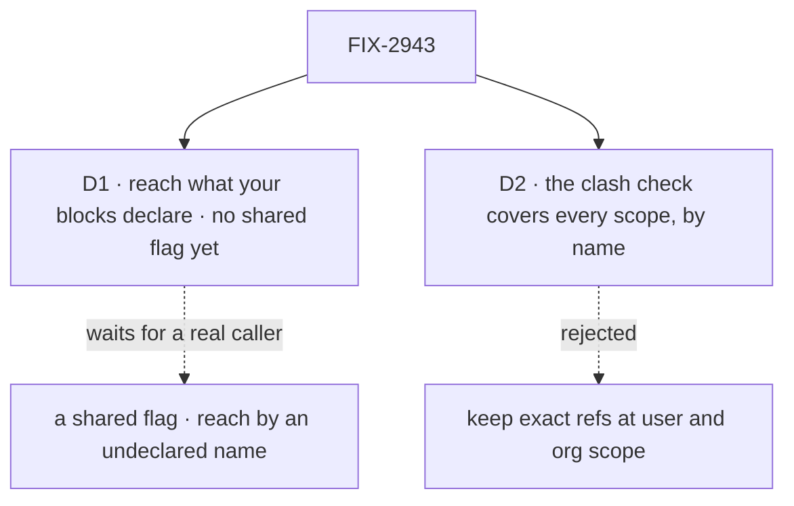

# FIX-2943 · Decisions

[Spec](SPEC.md) · **Decisions**

Two calls. The first amends an epic rule, under the condition the epic itself set for it.

## The tree

Solid edges are what you sign. Dashed edges lost.

## D1 · No `shared` flag yet: a flow reaches a definition its blocks declare, in any of the owner's sessions

| | |
|---|---|
| **Instead of** | A `shared` flag that lets any flow reach a definition by name, with boards always shared (epic ER-4 as written) |
| **Because** | Every reach the set needs is from a flow that already declares the definition, because the block that uses it carries the declaration: the coder flow includes the board's task entry, which declares the board's ledger (`taskLedgers`' `uses`). The epic's Adds row said that if the spec found no consumer but boards, the flag would wait. It found none, boards included. The one caller that would need it, a screen picking a board by runtime name, is the same one the owner held `boards()` back for ([Q2](../../epics/FIX-2941/DECISIONS.md#q2)) |
| **Locks in** | To reach a definition, a flow includes a block that declares it. No public "shared definition" term ships. Adding the flag later is additive: it widens who may reach, and narrows nothing |

It comes down to the caller: no flow in the set reaches a definition it can't declare.

**What would change my mind:** a caller that has to reach a definition it can't declare, such as a
generic admin screen. Then the flag ships with `boards()`, as one change.

This amends epic ER-4. See the spec-set PR's *Epic amendments*.

## D2 · The start-up clash check covers every scope, keyed by the definition's name; isolated copies are never compared

| | |
|---|---|
| **Instead of** | Today's check: user and org scope only, keyed on exact refs |
| **Because** | Reach makes session copies cross flows, so two shapes under one session-scoped name now read each other's rows. Keying on the name (the storage key or the collection's pattern) is what two flows actually share; an exact ref is a code identity two flows rarely share (FIX-1207). Isolated copies are separate data, so comparing them refuses apps that are fine (FIX-2563) |
| **Locks in** | An app that starts today with two session-scoped shapes under one name is refused after the upgrade, with an error naming both flows. Its fix is to rename one |

It comes down to reach: two shapes under one name now meet in one session's copy.

## Decided, not asked

- **One comparison.** The clash rule is `sameClientConfig` plus the schema compare the check runs
  today, so the start-up check and the address path can't disagree on what "the same definition"
  means. Its convergence point is `validateScope`; the address path calls the same comparison.
- **Typed names come from the block's declarations** (FIX-1580's surface). With D1, nothing is
  reached that a block didn't declare, so no registry-wide type is generated.
- **FIX-2563 and FIX-1207 close** with D2 as the reason.
- **The manifest registry is unchanged**: it is the model's discovery door, not definitions.

## Considered and dropped

| Alternative | Why not |
|---|---|
| A generated type of every name in the installation | Only needed when a block reaches names it doesn't declare, which D1 doesn't allow |
| A separate definition registry object | A second place to register. The flow registry's union already is the registry (ER-5) |

## Analysis

2026-11-26 · watermark 2026-11-25 · **Right approach, with a change.** Run over the whole set in
the epic agent's own context.

1. **Reuse:** extends `validateScope` and reuses `sameClientConfig`; the Adds table has one row.
2. **Prior art:** not searched for this issue. The question is how this framework's own
   declarations meet, which the epic's analysis already compared outward.
3. **Other shapes:** the `shared` flag; it waits (D1).
4. **New factors:** none since the watermark.
5. **Necessity:** FIX-2946 depends on one shape per name at session scope.
6. **Ergonomics:** nothing new to learn: declaring a block is declaring its data.
7. **Concerns:** D1 changes an epic rule. Folded as an epic amendment, not silently.

## How it got here

- **Draft (Nov 26)** in the epic's spec set. The `shared` flag was dropped once the set showed
  every reach comes from a declaring flow; the epic's own condition for waiting was met.

**Open: none.**
