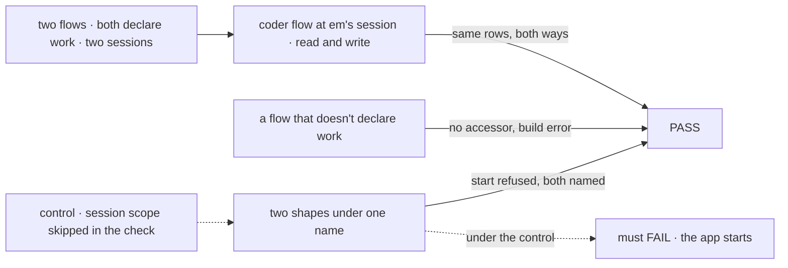
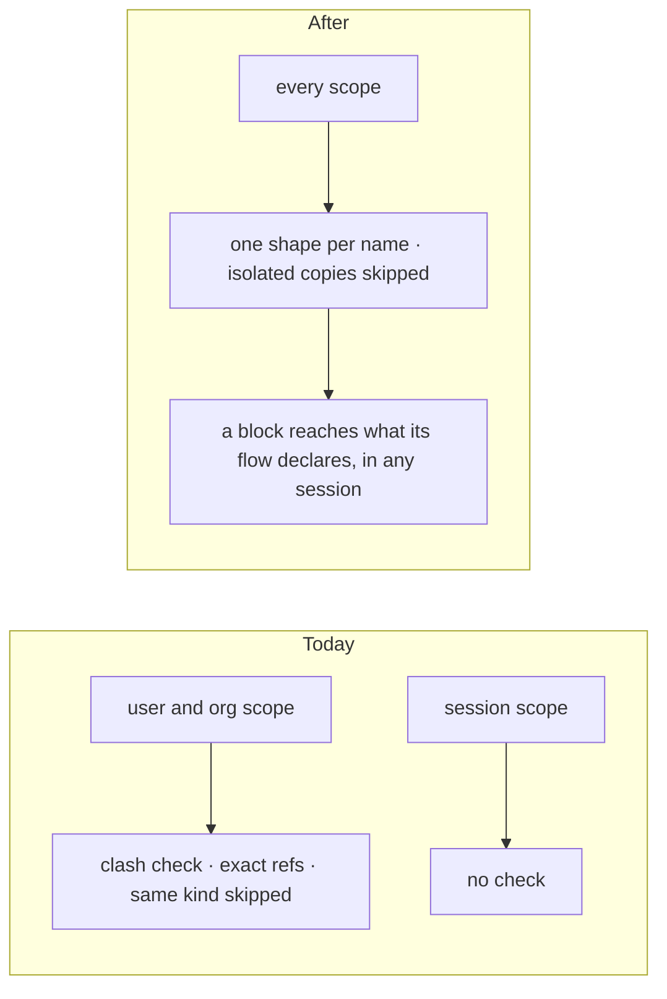

# FIX-2943 · One definition per name, in every scope: a flow reaches what its blocks declare

**Spec** · [Decisions](DECISIONS.md)

| Someone who… | Today | After |
|---|---|---|
| **reaches another session's copy from a flow of another kind** (coder settling on em's board) | Can't. A per-session copy is read only by its own session's flow, so the board was moved to user scope | Reaches it, because the coder flow includes the board's task entry, and that block declares the board. One shape per name guarantees both flows read the same rows |
| **declares two different shapes under one session-scoped name in two flows** | Starts. The two never met, since nothing crossed sessions | Is refused at start, naming both flows and the name. Today's user- and org-scope refusal now covers session scope too |
| **runs two copies of one flow with flow isolation** | The start-up check can refuse them as a clash (FIX-2563) | Starts. Isolated copies are separate data, so they are never compared |
| **types a definition's name wrong** | A run-time `undefined` | A build error: a block reaches only names it declares, typed from its own declarations |
| **wants a flow's private state kept away from other flows' models** | Flow isolation | The same: a flow that doesn't declare a definition can't reach it, by name or otherwise |

Reach (FIX-2942) only works across flows if every flow that names `work` means the same `work`.
This issue makes that true for every scope, and settles how a flow gets to reach a definition at
all.

## The goal, and how we'll know it's met

**A block in one flow reads and writes another flow's session copy of a definition both flows
declare, a clashing shape refuses start, and a flow that doesn't declare a definition can't reach
it.**

| Is it the right goal? | |
|---|---|
| **The real need** | Rule 6 of [the concept doc](../../../docs/internal/design/scopes-and-sessions.md#the-rules) and the epic's ER-4 and ER-5: one shape per name, and reach that never hands a flow's private data to another |
| **Smaller, and rejected** | "The clash check covers session scope." Safe, but says nothing about which flows may reach what |
| **Bigger, and not this issue's** | Reach by a name the flow doesn't declare (a `shared` flag), and a board picked by a runtime name. Both wait for a real caller ([D1](DECISIONS.md#d1)) |
| **Not done if** | Two flows start with two shapes under one session-scoped name · two isolated copies of one flow are refused · a block reaches a definition its flow doesn't declare · a typo compiles |

The check starts real flows and reads the rows and the start-up error. It never inspects the
registry's internals.

| How we verify | |
|---|---|
| **Goal check** | `goals/sessions-reach/one-definition-per-name/` · no model · run by the implementer at completion · verdict in the implementation PR |
| **Signal** | A write by the coder flow into em's session copy is read back by em's flow, and the reverse. Two flows with different `work` shapes at session scope: start refused, the error naming both flows and `work`. Two isolated copies of one flow: start succeeds. A type test: `ctx.resources.at({ session }).worke` fails to compile |
| **Input** | The concept doc's em and coder flows on `work`. Any pair of flows sharing a declaring block must pass |
| **Anti-game** | Assert on rows read back and on the start error, never on a registry method's return |
| **Control that must fail** | `GOAL_CONTROL=skip-session-scope` must FAIL *two shapes refuse start*. Today's `main` fails *coder writes em's copy* |

## What changes

The check moves from exact refs at two scopes to names at every scope. Reach rides on it: a flow
declares a definition by including a block that uses it, as resources are declared today.

**Docs:** `docs/architecture/state-and-scopes.md` gains one paragraph on one shape per name and
reach by declaring, under FIX-2942's section. The changeset names the new start-up refusal. No
glossary term is coined: "shared definition" is not added ([D1](DECISIONS.md#d1)).

## What stays as it is

- **Flow isolation** (`flowIsolation`, `isolateUserState`, `isolateOrgState`): unchanged.
- **Block-level declarations** rising into flows through `defineFlow`'s merge.
- **The manifest registry** (`createManifestRegistry`), a model's discovery door. It is a different
  job, and no public "registry" noun is added beside it.
- **The resource-address path** (`engine/src/resources/scope-address.ts`) for user and org reads
  from no session.

## What's already here, and the debt

| Already here | What this does with it |
|---|---|
| The start-up clash check, `validateScope` in `engine/src/registry/flow-registry.ts`: user and org only, exact refs, same kind skipped | **Extends** to session scope, keyed by name, isolated declarations skipped ([D2](DECISIONS.md#d2)) |
| `declarationsOf` and `resolveAddress` (`engine/src/resources/scope-address.ts`), which find every flow's declaration of one address and refuse when they disagree | **Builds on.** The same comparison, `sameClientConfig`, is the clash rule |
| `defineFlow`'s merge of block resources | **Builds on.** Including a block is declaring its definitions |
| Typed `ctx.resources` from a block's declarations ([FIX-1580](https://linear.app/fixpoint-labs/issue/FIX-1580)) | **Builds on.** `.at({ session })` returns the same typed accessors |
| [FIX-2563](https://linear.app/fixpoint-labs/issue/FIX-2563) (the check over-refuses isolated flows) and [FIX-1207](https://linear.app/fixpoint-labs/issue/FIX-1207) (it keys on exact refs) | **Closed** by D2, each with that reason |
| A cross-flow lookup by a name a flow doesn't declare | **None.** Searched `registry.list()` callers and `declarationsOf`: only the address path, which reads, never reaches into sessions |

| Adds | Existing piece considered | How composed |
|---|---|---|
| Session scope in the clash check | `validateScope`, `sameClientConfig` | Extends the one check; no second place registers anything (ER-5) |

| The debt | |
|---|---|
| **Removes** | The exact-ref key and the session-scope gap in the clash check, and the over-refusal of isolated copies |
| **Adds** | A start-up refusal for apps that today start with two shapes under one session-scoped name. Permanent by design: those apps would read each other's rows wrong |
| **Leaves** | The same-kind skip, whose stale-schema gap `unregister`'s note describes. A restart fixes it, and changing what identity the check keys on is its own change |

**Net: down.** One check covers every scope, two issues close, and no flag is added.

## Sign off

**[The goal](#the-goal-and-how-well-know-its-met), at that size:** reach between flows that both
declare a definition, and a refused clash. If wrong: two flows meaning two things by `work`
corrupt each other's rows.

**[The debt](#whats-already-here-and-the-debt), net down:** the check widens, no flag is added.
If wrong: an app that clashes today stops starting after an upgrade.

1. **[D1](DECISIONS.md#d1) · No `shared` flag yet: a flow reaches a definition its blocks
   declare.** Amends epic ER-4. If wrong: a real caller has to reach a definition it can't
   declare, and gets nothing until the flag ships.
2. **[D2](DECISIONS.md#d2) · The clash check covers every scope, keyed by name; isolated copies
   are never compared.** If wrong: an app that starts today is refused after an upgrade.

**Open: none.** D1 is the one to weigh: it changes an epic rule.

Feature · `engine` + `core` · small · epic FIX-2941
