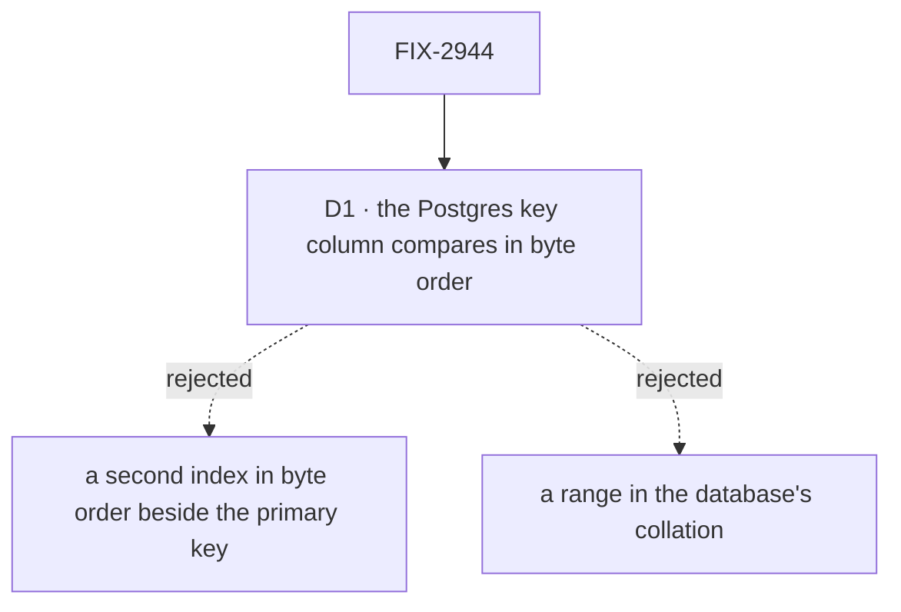

# FIX-2944 · Decisions

[Spec](SPEC.md) · **Decisions**

One call. The rest is mechanism.

## The tree

Solid edges are what you sign. Dashed edges lost.

## D1 · Postgres's `resource_key` column compares in byte order (`COLLATE "C"`), so the primary key serves the range

| | |
|---|---|
| **Instead of** | A second index, `(scope_type, scope_id, resource_key COLLATE "C")`, beside the primary key · or a range in the database's default collation |
| **Because** | A prefix's upper bound (its successor) is only right in byte order: in a language collation, keys under one prefix need not sort together. A second index makes every resource write update two indexes. SQLite already compares keys in byte order (`BINARY`), and the Postgres stores already compare ids that way (`COLLATE "C"`) |
| **Locks in** | A migration rebuilds each resource table's primary key once, locking it while it runs. Any `ORDER BY resource_key` in Postgres sorts in byte order after it, as SQLite does and as the filesystem store's tests expect |

It comes down to write cost: a second index is a second write on every resource change.

**What would change my mind:** a deployment that can't take the rebuild lock. Then the second
index is built concurrently, and the primary key keeps its collation.

## Decided, not asked

- **Every prefix read goes through one helper per store** that builds the range, so no query is
  left on a function. Its tests cover an empty prefix (no upper bound), a prefix ending in the
  highest code point, and `%` and `_` in keys.
- **A varying segment that isn't a prefix is a declared field index** (FIX-2532), never a second
  key encoding. With partitions gone (FIX-2946), the segments that vary are the scope id and the
  collection's path, both prefixes.
- **The store conformance suite gains a case** comparing each SQL store's prefix rows with the
  filesystem store's.

## Considered and dropped

| Alternative | Why not |
|---|---|
| `LIKE 'prefix%'` with escaping | Uses an index only under `text_pattern_ops` or byte collation, the same migration, plus escaping |
| A generated column holding the collection's prefix | A second copy of the key to keep in step |

## Analysis

2026-11-26 · watermark 2026-11-25 · **Right approach.** Run over the whole set in the epic agent's
own context.

1. **Reuse:** the primary key and the existing byte-order compares. One store-private helper.
2. **Prior art:** a byte-order range for a prefix is the standard btree prefix scan; Postgres
   documents that `LIKE` uses an index only under the C collation or a pattern operator class.
3. **Other shapes:** a second index; rejected in D1.
4. **New factors:** none since the watermark.
5. **Necessity:** FIX-2945's join depends on it.
6. **Ergonomics:** invisible to apps.
7. **Concerns:** the rebuild lock on a large table. Recorded in D1's *flips*.

## How it got here

- **Draft (Nov 26)** in the epic's spec set.

**Open: none.**
