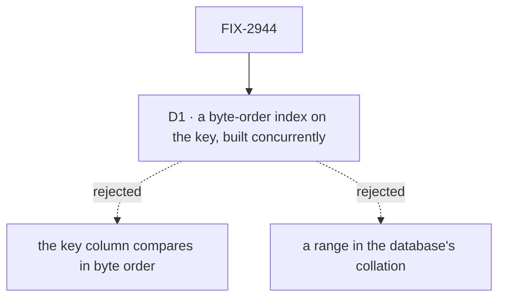

# FIX-2944 · Decisions

[Spec](SPEC.md) · **Decisions**

One call. The rest is mechanism.

## The tree

Solid edges are what you sign. Dashed edges lost.

## D1 · Postgres answers the range from a byte-order index, `(scope_type, scope_id, resource_key COLLATE "C")`, built concurrently in place of the scope index

| | |
|---|---|
| **Instead of** | Change the `resource_key` column to byte order, so the primary key serves the range · or a range in the database's default collation |
| **Because** | A prefix's upper bound (its successor) is only right in byte order: in a language collation, keys under one prefix need not sort together. Changing the key column's collation rebuilds each primary key under a lock that blocks writes. An index built `CONCURRENTLY` doesn't, which is how `store-postgres/src/schema.ts` already adds indexes to populated tables. The new index replaces `idx_resource_state_scope` and `idx_resource_content_scope`, which only repeat the primary key's leading columns, so a resource write still updates two indexes |
| **Locks in** | The range read names byte order (`resource_key COLLATE "C"`) to use its index. The column, the primary key and every `ORDER BY resource_key` keep today's collation, so no read's order changes. No column changes collation, so `resource_index.resource_key` joins as today. SQLite needs nothing: it already compares keys in byte order (`BINARY`) |

It comes down to the migration: a concurrent build takes no lock on writes, and a column change does.

**What would change my mind:** the planner not using the byte-order index for the range on a
seeded store. Then the key column moves to byte order, and the rebuild lock is the price.

## Decided, not asked

- **Every prefix read goes through one helper per store** that builds the range, so no query is
  left on a function. Its tests cover an empty prefix (no upper bound), a prefix ending in the
  highest code point, and `%` and `_` in keys.
- **A varying segment that isn't a prefix is a declared field index** (FIX-2532), never a second
  key encoding. With partitions gone (FIX-2946), the segments that vary are the scope id and the
  collection's path, both prefixes.
- **The store conformance suite gains a case** comparing each SQL store's prefix rows with the
  filesystem store's.

## Considered and dropped

| Alternative | Why not |
|---|---|
| `LIKE 'prefix%'` with escaping | Uses an index only under `text_pattern_ops` or byte collation, the same migration, plus escaping |
| A generated column holding the collection's prefix | A second copy of the key to keep in step |

## Analysis

2026-11-26 · watermark 2026-11-25 · **Right approach.** Run over the whole set in the epic agent's
own context.

1. **Reuse:** the existing byte-order compares and the concurrent-index path in `schema.ts`. One
   store-private helper.
2. **Prior art:** a byte-order range for a prefix is the standard btree prefix scan; Postgres
   documents that `LIKE` uses an index only under the C collation or a pattern operator class.
3. **Other shapes:** the key column in byte order; rejected in D1.
4. **New factors:** none since the watermark.
5. **Necessity:** FIX-2945's join depends on it.
6. **Ergonomics:** invisible to apps.
7. **Concerns:** whether the planner uses the byte-order index for the range. The goal check's
   query plan answers it; D1's *flips* names the fallback.

## How it got here

- **Draft (Nov 26)** in the epic's spec set.
- **Review round 1 (Nov 26)** flipped D1 from changing the key column's collation to a byte-order
  index built concurrently: the review showed the new index replaces the scope index, so the
  write-cost reason for the column change didn't hold, and the column change locks writes.

**Open: none.**
