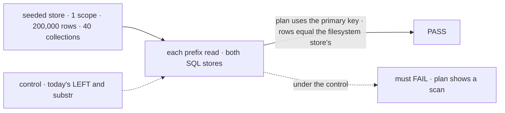
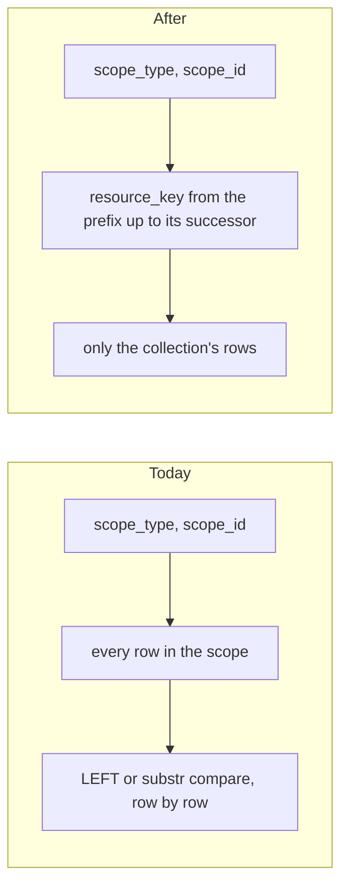

# FIX-2944 · SQL stores filter every varying key segment without a scan

**Spec** · [Decisions](DECISIONS.md)

| Someone who… | Today | After |
|---|---|---|
| **runs on Postgres with a busy user** | Every read of a collection, such as a board's rows, scans every row in that user's scope and compares a prefix with `LEFT(...)` | The read walks the primary key's index to the collection's first row and stops after its last |
| **runs on SQLite** | The same scan, with `substr(...)` | The same index walk |
| **reads a collection whose keys hold `%` or `_`** | Correct: the function compare sidesteps `LIKE`'s wildcards | Still correct: a range compare has no wildcards |
| **runs the filesystem store in development** | Returns the rows under a prefix | Returns the same rows; the conformance suite now asserts both SQL stores match it |
| **builds a read across sessions** (FIX-2945) | Would scan every session's scope | Gets a per-session read that is an index range, so the join stays cheap |

## The goal, and how we'll know it's met

**Every prefix read in both SQL stores is answered from the primary key's index, on the same rows
it returns today.**

| Is it the right goal? | |
|---|---|
| **The real need** | Rule 12 of [the concept doc](../../../docs/internal/design/scopes-and-sessions.md#the-rules), the epic's ER-6, and the closure's leg c: no prefix read by `LEFT` or `substr` |
| **Smaller, and rejected** | "Add an index on the scope columns." It exists (`idx_resource_state_scope`) and doesn't help: the function on `resource_key` still forces a scan inside the scope |
| **Bigger, and not this issue's** | Filtering on a field inside a row: declared field indexes ([FIX-2532](https://linear.app/fixpoint-labs/issue/FIX-2532)). The read across sessions (FIX-2945) |
| **Not done if** | A query plan on a seeded store still shows a scan of the scope · any prefix query still calls a function on `resource_key` · a key with `%`, `_` or a non-ASCII character returns different rows · the stores' row sets differ from the filesystem store's |



The check reads the database's own query plan and the returned rows, not the SQL string.

| How we verify | |
|---|---|
| **Goal check** | `goals/sessions-reach/indexed-key-segments/` · no model · Postgres and SQLite · run by the implementer at completion · verdict in the implementation PR |
| **Signal** | For every prefix read (resource state and content, in both stores), `EXPLAIN` shows an index range on the primary key and no scan of the scope's rows. The row sets equal today's and the filesystem store's, for prefixes that are empty, end in a multi-byte character, or hold `%` and `_` |
| **Input** | One scope with 200,000 rows across 40 collection prefixes. A seed with other prefix lengths must pass too |
| **Anti-game** | Don't assert on the SQL text. A query that names no function can still scan |
| **Control that must fail** | Today's `main` must FAIL *plan uses the primary key* on both stores |

## What changes



The predicate moves from a function over the key to a range on it, which the primary key's
index answers.

```diff
- AND LEFT(resource_key, char_length($3)) = $3
+ AND resource_key >= $3 AND resource_key < $4      -- $4: the prefix's successor, in byte order
```

**Docs:** no user documentation impact; a store's query shape isn't documented. The store
package changelogs say the Postgres key column moves to byte order ([D1](DECISIONS.md#d1)).

## What stays as it is

- **The key layout.** No key moves. Rows written before this change are read by the new query.
- **The store interface** (`getByPrefix` and its siblings in `engine/src/stores/types.ts`).
- **Live-only reads.** A tombstone reads as absent, as today.

## What's already here, and the debt

| Already here | What this does with it |
|---|---|
| Prefix reads by `LEFT` in `store-postgres/src/resource-state-store.ts` and `content-store.ts`, by `substr` in the SQLite pair | **Replaces** with a range on the key |
| The primary key `(scope_type, scope_id, resource_key)` in both schemas | **Builds on.** It is the index the range uses |
| Byte-order compares of ids in Postgres (`COLLATE "C"` in `store-postgres/src/suspension-store.ts`) | **Builds on** for the key column ([D1](DECISIONS.md#d1)) |
| `idx_resource_state_scope`, `idx_resource_content_scope` | **Leaves alone.** The primary key covers them; dropping them is not this issue's |
| Declared field indexes ([FIX-2532](https://linear.app/fixpoint-labs/issue/FIX-2532)) | **Leaves alone.** They filter on a row's fields; this filters on its key |
| Encoded prefixes features build (partitions, the skills catalog's partition) | **Leaves** to FIX-2946 and FIX-2948. This issue makes a prefix fast; it doesn't decide who may build one |

| Adds | Existing piece considered | How composed |
|---|---|---|
| A successor helper for a prefix's upper bound | `getPatternPrefix` in core | A store-private helper beside each query; nothing public |

| The debt | |
|---|---|
| **Removes** | Four function-over-key predicates and their scans |
| **Adds** | A Postgres migration that changes the key column's collation and rebuilds its primary key ([D1](DECISIONS.md#d1)) |
| **Leaves** | The two scope indexes the primary key now covers |

**Net: down.** Four scans go; one migration runs once.

## Sign off

**[The goal](#the-goal-and-how-well-know-its-met), at that size:** every prefix read from the
index, the same rows. If wrong: the read across sessions sits on a scan per session.

**[The debt](#whats-already-here-and-the-debt), net down:** four scans go, one migration runs.
If wrong: a large deployment pays a long lock once.

1. **[D1](DECISIONS.md#d1) · Postgres's key column compares in byte order (`COLLATE "C"`), so the
   primary key serves the range.** If wrong: a migration that locks a large table, or a second
   index on every write.

**Open: none.**

Improvement · `store-postgres` + `store-sqlite` · small · epic FIX-2941
