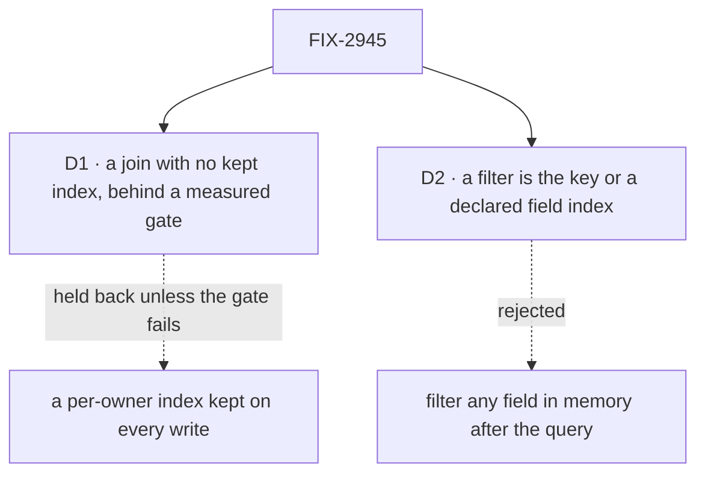

# FIX-2945 · Decisions

[Spec](SPEC.md) · **Decisions**

The read's shape, its paging and its change topic follow the epic (ER-7, ER-8) and
`userSuspensions`. Two calls are this issue's own.

## The tree

Solid edges are what you sign. Dashed edges lost.

## D1 · The read is a join with no kept index, accepted only if a seeded store meets a stated gate

| | |
|---|---|
| **Instead of** | A per-owner index of every row, updated on every write |
| **Because** | A kept index is a second copy of every row's location, written on every write to any session's copy, and wrong whenever a write and its index entry part. The join reads what is already stored. Its cost grows with the owner's sessions and rows, which the gate measures |
| **Locks in** | The read's speed depends on the sessions index and FIX-2944's ranges. **The gate:** an owner with 5,000 sessions and 100,000 rows of one definition, 2,000 matching a declared-index filter, answers a first page of 50 in under 50 ms at p95, on Postgres and on SQLite, on the CI runner. A miss stops the build and goes back to the epic, since a kept index is the epic's call |

It comes down to write cost: a kept index makes every write to any copy write twice.

**What would change my mind:** the gate failing. Then the epic decides a kept index, and this
issue waits for that.

## D2 · A filter on the read is the row's key or a declared field index; a filter on any other field is refused, never applied in memory

| | |
|---|---|
| **Instead of** | Accept any filter and apply it to the rows after the query |
| **Because** | A filter applied after the query reads every row of every session to return a few (BP-033), and a page of 50 can then read the owner's whole store. The key is answered by the primary key (FIX-2944), and a declared index ([FIX-2532](https://linear.app/fixpoint-labs/issue/FIX-2532)) by its index table, both inside the same query. A task found by its id is a key filter, so it needs no index of its own |
| **Locks in** | An app that filters across sessions declares the field's index on its definition. A filter naming an undeclared field throws when the read is called, naming the field |

It comes down to rows read: an in-memory filter reads the owner's whole store for one page.

## Decided, not asked

- **Paging is `userSuspensions`' contract.** The cursor marks the last store row read, not the last
  row shown, and is sealed (below). A page can be short, even empty, while `next` is set, because per-row admission
  drops rows after the query. A listing ends only when `next` is absent.
- **The owner rule is ER-1's, split at the query.** SQL applies tenant, org (with
  `isOrgAttributed`) and user; `ownResolverVerdict` and the owner pin run per row after. One
  conformance test asserts that this read and FIX-2942's named reach refuse the same cases.
- **The public name is `ctx.resources.acrossSessions().<name>`**, read-only, each row with its
  session. It is callable from any block but a webhook-started turn's ([FIX-2942 D1](../FIX-2942/DECISIONS.md#d1)),
  and records its topic when the block is a view's.
- **The change topic is one per definition per owner** (user, org, tenant). FIX-2750's partition
  key becomes a session key on it, hashed as the partition key is today. A write to any session's
  copy publishes there through the change bus's one write path, so no second publish is added (the
  epic's write-notice seam).
- **Nothing names a row the per-row check dropped.** Admission runs after the query, so a session
  an own-resolver flow refuses to this caller is in the rows read. The cursor is sealed by the
  engine, opaque to the caller, so `next` never carries a dropped row's session or task id. A
  notice carries no raw session id, so a view re-reads rather than learning which session
  changed. An empty page with `next` set then answers as an unknown id does.
- **The filesystem store walks the owner's session folders**, sorted as the SQL stores sort, and
  the store conformance suite holds the three to one answer.

## Considered and dropped

| Alternative | Why not |
|---|---|
| A helper that reads each session in turn | N reads, and no topic for sessions made later |
| One topic per session copy | A view would need to know every session in advance, including future ones |

## Analysis

2026-11-26 · watermark 2026-11-25 · **Right approach.** Run over the whole set in the epic agent's
own context.

1. **Reuse:** `userSuspensions`' join and paging, FIX-2750's topic, FIX-2532's indexes,
   FIX-2944's ranges. See [Builds on / Adds](SPEC.md#whats-already-here-and-the-debt).
2. **Prior art:** a fan-in read by owner over a sessions table is how chat products list
   conversations; the epic's analysis covered LangGraph and Mastra.
3. **Other shapes:** a kept index; held back by D1's gate.
4. **New factors:** FIX-2532 is in review; D2 depends on it landing.
5. **Necessity:** FIX-2946's screens and lookup depend on it.
6. **Ergonomics:** mirrors `.at({ session })`, so one model covers both.
7. **Concerns:** the gate's numbers are a guess at a busy owner. Recorded in D1; the gate is
   measured, not assumed.

## Notes from review

- "**FIX-2945 admission:** post-query `ownResolverVerdict` may N× `sessions.get` per page—document the same bound as `userSuspensions` or add a conformance cap." — Cursor bot, round 1
- "**FIX-2945 D1 (join, no kept index, measured gate):** good shape, but also record the gate's failure path: what ships if 5,000 sessions misses 50 ms (a kept index, or a narrower page)? Today the answer is "a kept index comes back", which the epic otherwise rejects. Naming the fallback now avoids a re-gate." — jhoffner, set review round 1

These are inputs, not instructions.

## How it got here

- **Draft (Nov 26)** in the epic's spec set. Paging took `userSuspensions`' contract as is,
  which settles the epic's open paging default.
- **Set review round 2 (Nov 26):** the cursor is sealed and the topic's session key hashed, after
  the Cursor security review found that `userSuspensions`' cursor and a raw session key would name
  a session the per-row check had dropped. Amends ER-8.

**Open: none.**
