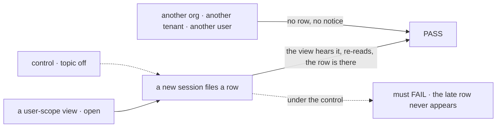
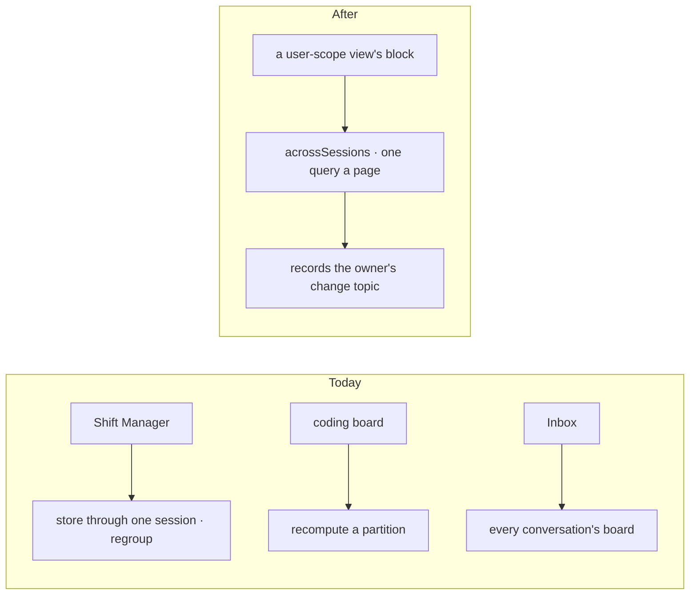
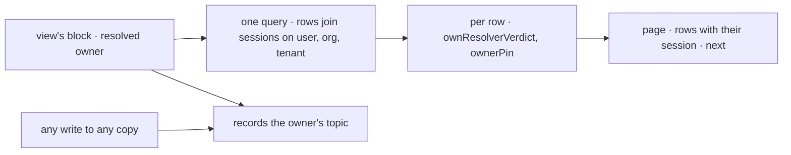

# FIX-2945 · One read across an owner's sessions: one query, one change topic

**Spec** · [Decisions](DECISIONS.md)

| Someone who… | Today | After |
|---|---|---|
| **builds a screen of every task in a user's sessions** | Reads the whole store through whichever session declares it and regroups rows (Shift Manager), recomputes a partition (the coding board), or reads every conversation's board (the Inbox) | Calls one read from a user-scope view's block. Each row comes back with the session it belongs to |
| **has a board open when a new session files a task** | Hears it only if its partition was read, through FIX-2750's keyed partitions | Hears it: every write to any session's copy publishes on one topic per definition and owner, and the view read that topic |
| **is the same user in another org** | Today's user topic spans orgs, so its notices can reach the other org's screens | Never hears the other org's changes. No raw session id or task id rides the topic, and a cursor names no row the caller can't see |
| **runs on Postgres or SQLite** | n/a | Gets one SQL query per page, joined to the sessions table on the full owner |
| **runs the filesystem store** | n/a | Gets the same rows in the same order, held by the store conformance suite |
| **finds a task's session from its id alone** (workforce's message target) | Reads a partition index (`findTaskPartitions`) | Calls the same read, filtered by the row's key at the store (FIX-2946 moves the callers) |

## The goal, and how we'll know it's met

**A user-scope view lists one definition's rows from every session its owner has, including
sessions made after it opened, in one query per page, and never shows another owner's rows.**

| Is it the right goal? | |
|---|---|
| **The real need** | Rule 13 of [the concept doc](../../../docs/internal/design/scopes-and-sessions.md#the-rules) and the epic's ER-7 and ER-8: one way to see across sessions, with notices that stay right |
| **Smaller, and rejected** | "A helper that loops over the owner's sessions." The same N reads the workarounds make, and a view that can't hear a session made after it ran |
| **Bigger, and not this issue's** | Moving the three screens and the task-id lookup onto it (FIX-2946). A kept per-owner index (rejected by the epic unless [D1](DECISIONS.md#d1)'s gate fails) |
| **Not done if** | A page takes more than one SQL query · a short page ends the listing · another org's or tenant's row appears, or its notice is heard · a cursor or a notice names a session the caller's admission refuses · the filesystem store's order differs · the gate in D1 was not measured |



The check reads the view's answers over HTTP and the notices its socket receives.

| How we verify | |
|---|---|
| **Goal check** | `goals/sessions-reach/across-sessions/` · no model · SQLite, Postgres and the filesystem store · run by the implementer at completion · verdict in the implementation PR |
| **Signal** | A view over `notes` lists rows from three sessions; a fourth session made after the view opened files a row, the view is notified within 2 s, and its next answer includes it. Each page is one SQL query (counted at the driver). Three other owners' rows and notices never reach it. A caller of flow Q reading a definition a custom-resolver flow P also writes gets no P session id, task id or readable cursor field, on a page or its socket. D1's gate numbers are recorded |
| **Input** | One owner with three sessions on two flows. More sessions, or another definition, must pass too |
| **Anti-game** | Assert on the view's HTTP answer and the socket, never on the store method's return |
| **Control that must fail** | `GOAL_CONTROL=topic-off` must FAIL *the late row appears*. `GOAL_CONTROL=owner-user-only` must FAIL *the other org's row never appears* |

## What changes



One read replaces three paths. FIX-2946 moves each screen onto it.

```diff
+ const page = await ctx.resources.acrossSessions().notes.list({ after })
+ // page.rows: [{ session, key, value }] · page.next: the cursor, while more remain
```

A board offers the same read through its capability, `ctx.cap.work.acrossSessions()` (FIX-2946).

**Docs:** `docs/architecture/state-and-scopes.md` gains *Looking across sessions*, and
`docs/internal/design/reading-writing-installing.md` → Views names the read. The changeset
carries the call and the change topic.

## How a page is answered



SQL applies the parts of ER-1 it can; the rest runs per row after the query, as the routes'
session list does.

## What stays as it is

- **`ctx.sessions.list()`**, for sessions themselves, not a definition's rows.
- **Views and their per-run dependency record** ([FIX-2623](../FIX-2623/DECISIONS.md)).
- **The change bus's write path.** One publish per write; this adds a topic it publishes on.

## What's already here, and the debt

| Already here | What this does with it |
|---|---|
| `userSuspensions` (`engine/src/context/request-sessions.ts`): one query joined across a principal's sessions, paged by the last store row, a short page while `more` is set | **Builds on.** Same join shape, same paging contract |
| FIX-2750's user topic and keyed partitions (`engine/src/push/partition-key.ts`, `ViewHearing.partitions`) | **Extends.** The partition key becomes a session key, hashed as the partition key is, and the topic narrows to one owner ([ER-8](../../epics/FIX-2941/DECISIONS.md#who-owns-what)). FIX-2946 retires the partition key |
| The routes' per-row admission (`admitListedSession`, `ownResolverVerdict`) | **Builds on** for what SQL can't decide |
| Declared field indexes and `findBy` ([FIX-2532](https://linear.app/fixpoint-labs/issue/FIX-2532)) | **Builds on.** A field filter is answered by one; a key filter by the primary key ([D2](DECISIONS.md#d2)) |
| Range reads on the key (FIX-2944) | **Builds on.** Each session's part of the join is an index range |
| The sessions table's owner columns | **Extends** with an index over user, org and tenant |
| Anything else that reads across sessions | **None general.** The three screens' paths and `findTaskPartitions` are the workarounds; FIX-2946 removes them |

| Adds | Existing piece considered | How composed |
|---|---|---|
| `ctx.resources.acrossSessions()` | `userSuspensions`; views | The same join and paging, for any per-session definition |
| A store read joined to sessions | The store's prefix read | One new method per store, sharing FIX-2944's range |
| The owner's change topic | FIX-2750's user topic; the change bus | Extends that topic; published on the bus's one write path |

| The debt | |
|---|---|
| **Removes** | Nothing by itself: FIX-2946 removes the three paths it replaces |
| **Adds** | One read, one store method per store, one index on the sessions table. Filtering on an undeclared field is refused, not filtered in memory ([D2](DECISIONS.md#d2)) |
| **Leaves** | A kept per-owner index, unless D1's gate fails |

**Net: flat here, down across the set.**

## Sign off

**[The goal](#the-goal-and-how-well-know-its-met), at that size:** one read, one query a page,
one topic, nothing across owners. If wrong: each screen keeps its own path.

**[The debt](#whats-already-here-and-the-debt), flat:** one read added; three paths go in
FIX-2946. If wrong: the join is slow and a kept index comes back.

1. **[D1](DECISIONS.md#d1) · A join with no kept index, accepted only if a seeded store meets a
   stated gate.** If wrong: every screen across sessions is slow for a busy owner.
2. **[D2](DECISIONS.md#d2) · A filter is the row's key or a declared field index; anything else is refused.**
   If wrong: an app filtering on an undeclared field has to declare an index first.

**Open: none.** D1 is the one to weigh.

Feature · `core` + `engine` + `store-postgres` + `store-sqlite` · medium · epic FIX-2941
