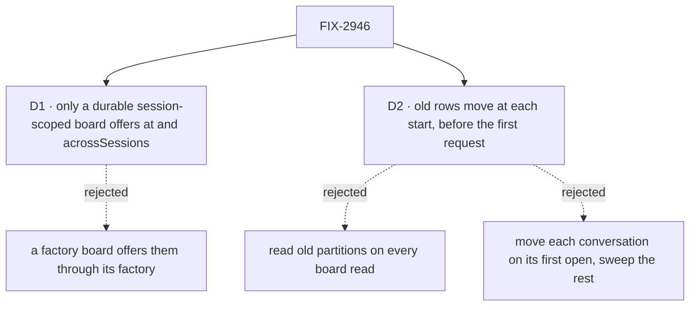

# FIX-2946 · Decisions

[Spec](SPEC.md) · **Decisions**

The board's door is the owner's ([Q2](../../epics/FIX-2941/DECISIONS.md#q2)): `ctx.cap.<name>.at({ session })`
and `.acrossSessions()`, no `boards()` helper. The owner asked this spec to say which boards offer
them. That is D1. D2 is how the rows already stored get to their new home.

## The tree

Solid edges are what you sign. Dashed edges lost.

## D1 · Only a board on a durable, session-scoped collection offers `.at` and `.acrossSessions`; a factory-, request- or sequencer-backed board doesn't, by its type

| | |
|---|---|
| **Instead of** | A factory-backed board offering them by calling its factory with the named session |
| **Because** | A factory is caller-opaque (`TaskBoardBacking`'s `"factory"`): the board doesn't know where it keeps rows, so it can't promise that another session's copy is where the factory would look, or that the owner check guarded it. Request and sequencer boards live in one run and have no other copy. A board on a declared session-scoped collection has its copies where FIX-2942 and FIX-2945 read them |
| **Locks in** | Reach is a property of the board's backing, checked when the app is built. An app with a factory board that wants reach moves its storage into a declared collection |

It comes down to the owner check: through a factory, nothing proves the rows reached are the owner's.

**What would change my mind:** a factory board in real use that needs reach. Then the factory
grows a session argument, and the owner check runs before it is called.

## D2 · Rows stored by today's partitioned ledgers move into their conversation's copy at start, before the first request is served, on every start of the release that carries the mover; the mover is workforce's and goes after that release

| | |
|---|---|
| **Instead of** | Read the old partitions on every board read until nothing is left in them · or move each conversation's rows the first time it is opened, with a background sweep for the rest |
| **Because** | Reading old partitions keeps `partition.ts`, its index and the forced `flowIsolation: false` alive, which is what the epic deletes ([epic D2](../../epics/FIX-2941/DECISIONS.md#d2)). Moving on first open puts that same partition check in every board read until the sweep ends, so the code still can't go; and the sweep needs a scheduler not every host has, or runs at start, which is this choice. A pass at start moves everything, and a key parser lives only in the mover. It follows `upgrade-kept-turns.ts`, the existing run-at-start upgrade step |
| **Locks in** | Each start walks the old rows, so a large store's first start is slow; once moved, a start finds none. **Resumable:** a row is written into its copy before the old one is removed, and a row already in its copy is skipped, so a pass stopped midway is re-run safely. **Rolling deploy:** a new instance never writes a partitioned row. One an old instance writes during the deploy is moved by the next start and unseen by new instances until then; the upgrade note asks hosts to drain old workers first. **Nothing stays unseen silently:** FIX-2950 removes the mover but leaves a start check that refuses to serve while any partitioned row remains, naming the release whose start moves it. That also catches a host that skips the mover's release. A row found in both places keeps its later update and reports the other. **Placement:** a row moves only into a session that exists, whose user, org and tenant are the cell the row was read from, and whose current lineage is the one in the partition's filing id. Session ids are reusable after a delete, by another user of the tenant or by a recreate with a new lineage, so the id alone would hand the old tasks to the new session. Any other row stays where it is and is reported, never dropped (BP-030). The same rule holds for every row the pass places, FIX-2947's and FIX-2948's included |

It comes down to deleting partitions: reading them, now or until a sweep ends, keeps their code.

**What would change my mind:** a deployment whose store is too large to walk at start. Then the
mover runs as a command the operator starts, and serving waits for it.

## Decided, not asked

- **`ctx.task` is set by the task entry from the claimed row**, server-side, with the task's id
  and the session whose board it sits on. Never from the envelope's input (BP-031). It is the one
  convergence point for "which board is my task on": every settle, progress write and message
  target reads it.
- **The task tools take no `board` argument.** Searched the workers and kits for a turn that files
  on two boards: none. Filing writes the session's own copy; working and settling reach the task's
  board. A second board in one turn gets its argument when a real case appears (the epic's default).
- **The task-id lookup filters at the store by the row's key**, through FIX-2945's read. Without
  partitions a row's key is its task id, so the primary key and the owner join answer it, and the
  `byTaskId` index has no reader left. It never loads every copy and discards.
- **The plan ledger moves with the conversation board** and keeps its shape (epic D2).
- **Shift Manager's board read moves after FIX-2777** deletes `reads.ts`; nothing in it is rebuilt.
- **The filer's turn** starts once per ending through FIX-2942's wake, which coalesces.

## Considered and dropped

| Alternative | Why not |
|---|---|
| A `boards(ctx, name, { session })` helper | The owner held it back (Q2): a second door to a board that has one |
| Keep the `byTaskId` index to find a task's session | A second record of where a row is; the read across sessions answers it |

## Analysis

2026-11-26 · watermark 2026-11-25 · **Right approach.** Run over the whole set in the epic agent's
own context.

1. **Reuse:** the capability, FIX-2942's reach and FIX-2945's read; the Adds table has three rows,
   each extending a piece. See [Builds on / Adds](SPEC.md#whats-already-here-and-the-debt).
2. **Prior art:** the concept doc's walkthrough composes this end state on paper.
3. **Other shapes:** a tracer that moves the conversation board first and the plan ledger later;
   rejected by epic D2, since `partition.ts` stays until both move.
4. **New factors:** FIX-2777 is in review, and this issue waits for it.
5. **Necessity:** the epic's long pole.
6. **Ergonomics:** one door per board, typed; `ctx.task.session` replaces two state keys.
7. **Concerns:** moving stored rows. D2's mover is resumable, loses nothing, reports what it can't
   place, and catches a rolling deploy's late rows at the next start.

## Notes from review

- "Perf contract: "filters at the store by the row's key" should explicitly mean a **point lookup** (key filter + limit 1), not a paged `acrossSessions` walk—otherwise task resolution can inherit FIX-2945's worst-case join cost." — Cursor bot, round 1
- "Strong seam: one workforce mover with 2947/2948 only adding rows avoids the classic "three migrations drift" smell. Implementer should resist a second mover script even if 2948 lands in a later PR." — Cursor bot, round 1

These are inputs, not instructions.

## How it got here

- **Draft (Nov 26)** in the epic's spec set, after the owner decided Q2 and asked which boards
  offer the reach (D1).
- **Review round 1 (Nov 26)** said what D2 does on a crash mid-pass and on a rolling deploy, and
  answered the lazy move with a sweep. The direction held: move before serving, no dual read.
- **Set review round 2 (Nov 26):** D2 gained a placement rule and a start check. The Cursor
  security review showed a session id is reusable after a delete, by another user of the tenant
  (`tenant:sessionId` storage keys) or by a recreate with a new lineage, so a row now moves only
  into the session, owner and lineage that filed it. Codex showed a late row from an old instance
  could stay unseen if no later start came, and a host skipping the mover's release would lose
  every row; FIX-2950 now leaves a start check behind.

**Open: none.**
