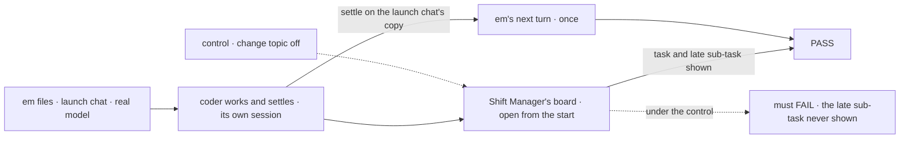
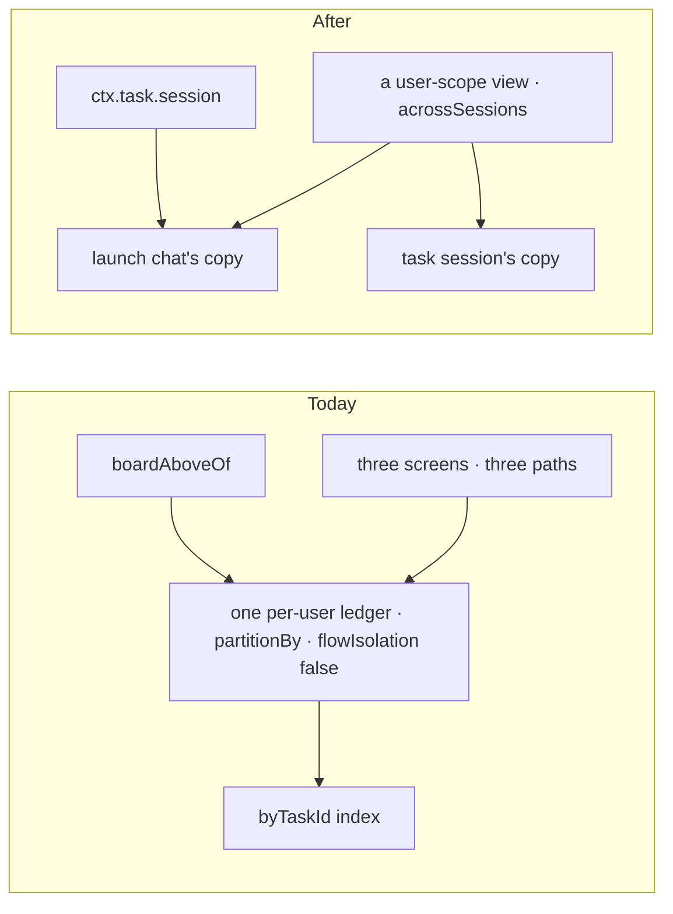

# FIX-2946 · Task boards are per-session copies: the conversation board and plan ledger leave user scope

**Spec** · [Decisions](DECISIONS.md)

| Someone who… | Today | After |
|---|---|---|
| **files a task in the launch chat** (em) | Writes one per-user ledger, under the launch chat's partition, with flow isolation forced off so coder's flow can reach it | Writes the launch chat's own copy of the board |
| **settles a task from its own session** (coder) | Finds the board through `boardAboveOf` (the filing session, or the conversation that routed it) and a partition | Reaches it through the task: `ctx.cap.work.at({ session: ctx.task.session })`. The claim still guards the settle, and the filer's turn starts once |
| **opens Shift Manager's board, the coding board or the Inbox** | Each reads across conversations its own way | Each is a user-scope view reading `ctx.cap.<name>.acrossSessions()`, and hears a sub-task filed in a session made after it opened |
| **sends a worker message to a task by id** | Workforce asks a partition index which conversation holds the task | Workforce reads across sessions, filtered at the store by the row's key, which is the task id |
| **had boards and plans before the upgrade** | Rows under user scope, keyed by partition | Every row is in its conversation's copy, moved at start before the first request is served. A row an old instance writes during a rolling deploy is moved by the next start |
| **defines a board backed by a factory, or by one run** | n/a | Gets no `.at` or `.acrossSessions`: such a board has no other session's copy the board can find |

## The goal, and how we'll know it's met

**em files a task in one conversation, coder settles it from its own session, em's turn starts
once, and Shift Manager's board shows it with a sub-task filed in a session made after the board
opened, with no partition left in the code.**

| Is it the right goal? | |
|---|---|
| **The real need** | The epic's leg a, and its *learns task boards* team: a board has a copy per session, reached by naming the session ([FIX-2941](../../epics/FIX-2941/SPEC.md)) |
| **Smaller, and rejected** | "The conversation board moves to session scope." Leaves the plan ledger partitioned, so `partition.ts` stays ([epic D2](../../epics/FIX-2941/DECISIONS.md#d2)), and the three screens on their own paths |
| **Bigger, and not this issue's** | Merging the plan and delegation boards, task lifecycles, verdict templates, one person-wait tool: the follow-on task-API epic ([D1](../../epics/FIX-2941/DECISIONS.md#d1)) |
| **Not done if** | `partitionBy`, `findTaskPartitions`, `boardAboveOf` or the `byTaskId` index remain · a screen reads a board through a session · an old row is unreadable after the move · em's turn starts twice · the goal passed only on SQLite |



The check reads what Shift Manager shows and em's turn count, never the board's return values.

| How we verify | |
|---|---|
| **Goal check** | `goals/sessions-reach/boards-per-session/` · real model for em · SQLite and Postgres · run by the implementer at completion, after FIX-2777 merges · verdict in the implementation PR |
| **Signal** | The task and coder's sub-task, filed in a session made after the board opened, appear on Shift Manager's board within 2 s of filing. em's turn after the settle starts exactly once. The coding board and the Inbox show the same task. A fixture of rows written by today's `main` reads the same after the move, and after a pass stopped midway and run again. `partitionBy` is absent from `packages/*/src` |
| **Input** | The concept doc's CSV export story. Another task wording must pass, 2 of 3 runs on the real model |
| **Anti-game** | Assert on Shift Manager's view answer and em's request count, never on `createTask`'s or the settle's return |
| **Control that must fail** | `GOAL_CONTROL=topic-off` must FAIL *late sub-task shown*. Today's `main` fails *no partition left* |

## What changes



The one per-user ledger becomes one copy per session. A task names its board; screens read
across sessions; the partition, its index and the board-above helper go.

```diff
- const board = await conversationLedgerAt(ctx, boardAboveOf(ctx))
+ const board = ctx.cap.work.at({ session: ctx.task.session })
  await board.settle(taskId, result)
```

**Docs:** the task-board guide's *where a board lives* changes to "a copy per session, reached by
naming the session", in this PR's changeset. Its PR retires *partition*, *board above* and
`partitionBy` in `docs/contributing/glossary.mjs`.

## What stays as it is

- **What a task is**: its rows, statuses, claim, settle and cascade. This issue moves where boards
  live, not their lifecycle (epic D1).
- **Two stores**: the delegation ledger and the plan ledger keep their shapes (epic D2).
- **`defineTaskCollection`**, the one board definer, and `ctx.cap.<name>` for a block's own copy.
- **The board's settle as a named action** (epic Q1).

## What's already here, and the debt

| Already here | What this does with it |
|---|---|
| The conversation ledger (`workforce/src/conversation-board/ledger.ts`) and the plan ledger (`plan.ts`), user scope, `partitionBy` | **Moves** both to session scope, shapes kept |
| `partition.ts`, `find-task-partitions.ts` and `define-task-collection.ts`'s forced `flowIsolation: false` and `byTaskId` index (`orchestration/src/tasks/collection/`) | **Removes** |
| `boardAboveOf` (`board-above.ts`) | **Replaced** by `ctx.task.session` |
| The board's typed capability (`TaskBoardHandle.capability`, `ctx.cap.<name>`) | **Extends** with `.at({ session })` and `.acrossSessions()` over FIX-2942's and FIX-2945's reads ([Q2](../../epics/FIX-2941/DECISIONS.md#q2), [D1](DECISIONS.md#d1)) |
| The parent-row read and settle on the request host (`core/src/types/request-host.ts`) | **Replaced** by reach through the task |
| `taskSessionOf` and `findTaskPartitions` in `workforce/src/messages/` (`message-target.ts`, `queue.ts`, `consult.ts`) | **Replaced** by the read across sessions, filtered at the store by the row's key (ER-7) |
| Shift Manager's board read through kit views (FIX-2683; FIX-2777 deletes `reads.ts`), the coding board (`harness-manager/src/kit/coding-board.ts`), the Inbox view (`workforce/src/workers/inbox-view.ts`) | **Moved** onto one view's read across sessions |
| FIX-2750's partition key (`engine/src/push/partition-key.ts`) | **Removed** with partitions; FIX-2945's session key replaces it |
| FIX-2080's filed cascade and FIX-2078's ending delivery | **Kept**, now addressed by session |

| Adds | Existing piece considered | How composed |
|---|---|---|
| `ctx.cap.<name>.at({ session })`, `.acrossSessions()` | The capability; a `boards()` helper | Two methods on the capability, thin over the resource reads. No `boards()` (Q2) |
| `ctx.task` (the task's id and its board's session) | `boardAboveOf`; the task entry's server-written state | Set by the task entry from the claimed row, server-side. Replaces the helper |
| A one-time mover for old rows ([D2](DECISIONS.md#d2)) | Dual-reading partitions on every read | Workforce-owned, deleted by a follow-up |

| The debt | |
|---|---|
| **Removes** | `partition.ts` (206 lines), `find-task-partitions.ts` (60), `board-above.ts` (26), 52 `partitionBy` lines, three cross-session screen paths, the parent-row read and settle, the forced `flowIsolation: false`, the `byTaskId` index, FIX-2750's partition key |
| **Adds** | The mover, kept for one release: [FIX-2950](https://linear.app/fixpoint-labs/issue/FIX-2950) · remove the board-row mover |
| **Leaves** | Two board stores (epic D2), for the task-API epic |

**Net: down.** Several hundred lines go; one mover is added for a release.

## Sign off

**[The goal](#the-goal-and-how-well-know-its-met), at that size:** the board end to end, the plan
ledger with it, and every screen on one read. If wrong: partitions survive beside reach.

**[The debt](#whats-already-here-and-the-debt), net down.** If wrong: the mover outlives its
release.

1. **[D1](DECISIONS.md#d1) · Only a board on a durable session-scoped collection offers `.at` and
   `.acrossSessions`; a factory-backed board doesn't.** If wrong: an app with a factory board has
   no reach until it declares its collection.
2. **[D2](DECISIONS.md#d2) · Old rows move at start, before the first request, on every start of
   one release, by a resumable mover workforce owns.** If wrong: a large store's first start is
   slow, or a row an old instance writes mid-deploy is unseen until the next start.

**Open: none.** D2 is the one to weigh: it is the riskiest step in the epic.

Improvement · `orchestration` + `workforce` + `harness-manager` + `shift-manager` + `core` · large · epic FIX-2941
