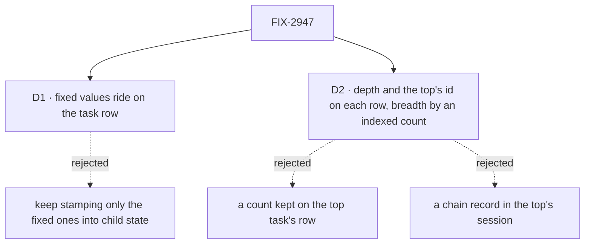

# FIX-2947 · Decisions

[Spec](SPEC.md) · **Decisions**

The epic decided that lineage and copies at birth go (ER-10). Two calls are this issue's: where
the values fixed at filing live, and where a chain's limits are counted once the chain record
goes.

## The tree

Solid edges are what you sign. Dashed edges lost.

## D1 · Values fixed at filing ride on the task row and arrive with the work; nothing is stamped into child state

| | |
|---|---|
| **Instead of** | Keep stamping the values that are fixed on purpose (the project) into child state, and drop only the stamps that stood in for a read |
| **Because** | A stamped value has two homes, the row and the child's state, and a hop down copies it again. The project is already on the row (`filedProjectOf`); today's `handedProjectOf` reads the row first and the stamp second. One home is the row, which every session working the task reaches through `ctx.task` (FIX-2946) |
| **Locks in** | A task session reads its fixed values from its task row, once per request. A value that should follow the parent is read from the parent live, by name. An app can't add a stamp; it adds a field to its task input (FIX-2894) |

It comes down to homes: a stamp is a second copy of the row's value, copied again each hop.

**What would change my mind:** the row read showing in a turn's cost. Then the value is cached
per request, not stamped.

## D2 · A chain's depth and its top's id ride on each task row; breadth is a bounded count of the rows under that top, read through a declared index

| | |
|---|---|
| **Instead of** | Keep a count on the top task's row, written on each filing · or keep a chain record, moved into the top's session |
| **Because** | Depth and the top's id are fixed at filing, so they are D1's kind of value: the parent's depth plus one, and the parent's top. Breadth is then the number of rows whose top is this one, which a declared `top` index ([FIX-2532](https://linear.app/fixpoint-labs/issue/FIX-2532)) answers through FIX-2945's read across sessions, stopping at the limit plus one. A kept count is a second record of that number: every filing writes the top's row, pieces filing at once contend on it and retry, and a filing that fails after counting leaves it wrong. Today's chain record carries reservations and a lease (`chain.ts`, 229 lines) for exactly that |
| **Locks in** | A filing reads at most the limit plus one index entries, in one query, and writes nothing but its own row. Pieces filing at the same moment can each see room, so the limit can be passed by the number filing together; it is a guard against runaway splitting, not an exact quota. Nothing to clean up: the count is the rows. Rows written before the upgrade get their top's id from FIX-2946's mover |

It comes down to a second record: a kept count is the rows' number stored again, and it drifts.

**What would change my mind:** an app that needs the limit exact while pieces file at once. Then
the count is kept on the top's row with a versioned write, and filings contend on it.

## Decided, not asked

- **The routing lock moves into the lead session's own per-session record**, read and written by
  name (FIX-2942). Session state can't be written by another session, so the lock is a resource,
  not state.
- **The Kitchen Sink's background-work demo** names its parent and reaches the parent's board copy.
- **Message hops keep their own count** (`messages/hop.ts`'s hop and chain id): those are about an
  exchange, not a session's parentage. Only the carried filing values go.
- **Old sessions keep working.** Their stamped state is ignored; their tasks' rows carry the
  project, and the mover gives rows written before the upgrade their depth and top (BP-030).
- **FIX-1090, FIX-1108 close** as obsolete; FIX-1132 keeps its `testFlow` half on its own route.

## Considered and dropped

| Alternative | Why not |
|---|---|
| Keep lineage for same-flow children only | A second rule for children on the same flow; the concept doc removes it |
| Read the project from the parent live | Moves the task when the conversation switches projects, which is the bug the stamp fixed |

## Analysis

2026-11-26 · watermark 2026-11-25 · **Right approach.** Run over the whole set in the epic agent's
own context.

1. **Reuse:** FIX-2894's input and the existing project stamp on the row; FIX-2532's declared
   index and FIX-2945's read count breadth, so no count is kept. See [Builds on / Adds](SPEC.md#whats-already-here-and-the-debt).
2. **Prior art:** a job system that passes a child its job payload and a parent id (Temporal's
   child workflows, BullMQ's flows) and nothing else matches rule 10.
3. **Other shapes:** a count on the top's row; kept as D2's fallback.
4. **New factors:** #5711 is open and lands first.
5. **Necessity:** the largest removal in the set.
6. **Ergonomics:** two state keys and a helper become `ctx.task`.
7. **Concerns:** a stamped value with an unfound reader. The sweep for the retired names in the
   closure (FIX-2949 leg c) catches a reader left behind.

## How it got here

- **Draft (Nov 26)** in the epic's spec set. The set review moved depth onto the row, so it is a
  fixed value like the project, and placed `ctx.task` in FIX-2946, which owns ER-9.
- **Review round 1 (Nov 26)** moved breadth from a count kept on the top task's row to a bounded
  count through a declared `top` index: a kept count is a second record that contends and drifts,
  and the index answers the same question. The price, a limit passable by pieces filing together,
  is stated in D2.

**Open: none.**
