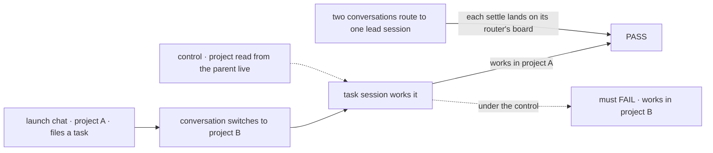
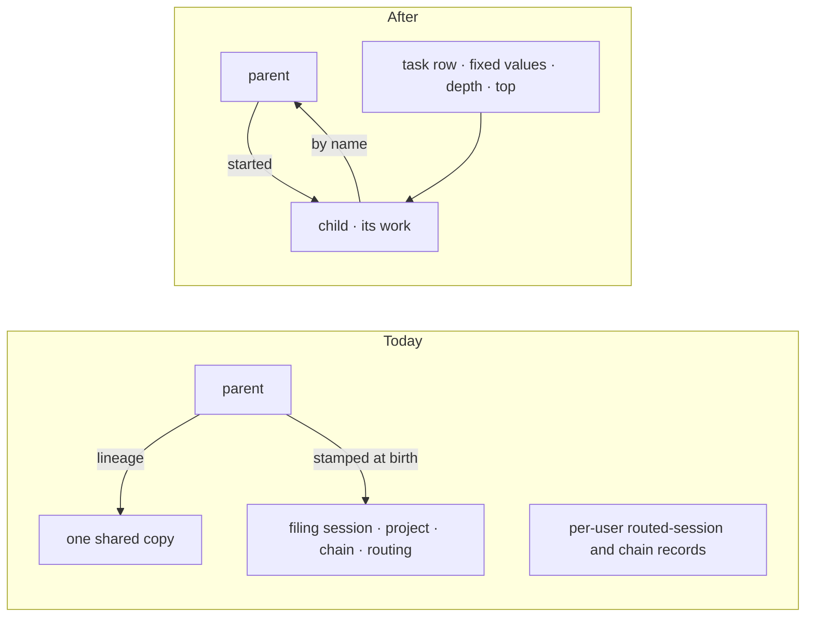

# FIX-2947 · A child session gets its work, not copies: lineage, child-state stamps and the routed-session and chain records go

**Spec** · [Decisions](DECISIONS.md)

| Someone who… | Today | After |
|---|---|---|
| **starts a child session on the same flow** | Shares its parent's lineage: resources marked `sharedToLineage` are one copy for both | Gets its own copies. It reads or writes the parent's by naming it (`ctx.resources.at({ session: parent })`) |
| **files a task in a conversation, then switches the conversation's project** | The task keeps its project because the project was stamped into the task session's state at birth, "however many hops down" | The task keeps its project because the project rides on the task row, fixed at filing, and arrives with the work |
| **works a routed task in a workstream's lead session** | A per-user routed-session record says which conversation's board the session is serving | The task names its board (`ctx.task.session`); the routing lock is the lead session's own record, written by name |
| **splits a task into pieces, and pieces into pieces** | Depth comes from stamped child state; breadth is counted in a per-user chain record keyed by a hash of the partition | Depth and the top task's id ride on each task row, fixed at filing; breadth is a bounded count of the rows under that top, through a declared index |
| **reads the Kitchen Sink's background-work demo** | Its board is lineage-shared | Its board is the parent's copy, reached by naming the parent |

Lineage and copies at birth stood in for one missing ability: a child reading its parent. FIX-2942
adds that ability, so both stand-ins go.

## The goal, and how we'll know it's met

**A child session knows the session that started it and the work it was started for, and nothing
else implicitly: a lead session settles a routed task on the board of the conversation that routed
it, and a task keeps its project when its conversation switches.**

| Is it the right goal? | |
|---|---|
| **The real need** | Rule 10 of [the concept doc](../../../docs/internal/design/scopes-and-sessions.md#the-rules) and the epic's ER-10 |
| **Smaller, and rejected** | "Lineage goes." Leaves the stamps, the routed-session record and the chain record, which exist for the same reason |
| **Bigger, and not this issue's** | A task's lifecycle and the plan and delegation boards' merge (the task-API epic) |
| **Not done if** | `lineageId`, `sharedToLineage`, `filingSessionId`, `routedFrom`, the routed-session or task-chain record, or `handedProjectOf` remain in `packages/*/src` · a value is still copied into child state · a chain's limits stop holding · an old session or task can't be worked after the upgrade |

The check reads where the task's work happened and which board each settle landed on.

| How we verify | |
|---|---|
| **Goal check** | `goals/sessions-reach/work-not-copies/` · no model (scripted workers) · run by the implementer at completion · verdict in the implementation PR |
| **Signal** | A task filed under project A is worked in A after its conversation switches to B. Two conversations route tasks to one workstream lead session; each settle lands on its own router's board, and each router's turn starts once. A sixth level of splitting is refused, and the 101st task under one top task, filed after the other hundred, is refused. The retired names are absent from `packages/*/src`. A session and a task written by today's `main` are worked after the upgrade |
| **Input** | Scripted em and coder workers on two flows. Other depths and limits configured through `taskChainLimit` must pass too |
| **Anti-game** | Assert on the row's settled state on each board and on the workspace the work ran in, never on the child's own state |
| **Control that must fail** | `GOAL_CONTROL=project-live` must FAIL *works in project A*. `GOAL_CONTROL=board-from-parent` must FAIL *each settle lands on its router's board* |

## What changes

The child keeps its parent's id and is handed the work. The task row carries what was fixed at
filing. The rest is read from the parent by name.

**Docs:** the glossary retires *lineage*, *shared to lineage*, *filing session*, *task chain record*
and *routed session* in this PR. The changeset says what replaced each. The task-board guide's
*splitting work* section follows at release.

## What stays as it is

- **The parent link** on a session record. A child knows who started it.
- **The chain's limits**: depth 5 (`MAX_TASK_DEPTH`) and 100 tasks under one top (`DEFAULT_TASK_CHAIN_LIMIT`, `taskChainLimit`).
  Breadth stays a guard against runaway splitting; pieces filing at the same moment can pass it by
  their number ([D2](DECISIONS.md#d2)).
- **FIX-2894's typed task input** and its claim check.
- **Session state**: never shared, and readable fields only from another session.

## What's already here, and the debt

| Already here | What this does with it |
|---|---|
| Lineage: `engine/src/resources/lineage-scope.ts`, `lineageId`, `resolveLineageId`, the lineage storage kind, the lineage branch in `createExecutionContext.ts` | **Removes** |
| `sharedToLineage` on resources and task collections | **Removes** |
| Copies at birth: `workforce/src/workers/session-fields.ts`'s hand-over half, the carried state in `messages/hop.ts`, `handedProjectOf` and the hand-over stamps in `conversation-board/board.ts` | **Removes.** The fixed values move to the row ([D1](DECISIONS.md#d1)) |
| `filing-session.ts`, `routed-session.ts`, `chain.ts` in `workforce/src/conversation-board/` | **Removes.** Depth and breadth move to rows ([D2](DECISIONS.md#d2)); the routing lock moves into the lead session's own record |
| FIX-2894's typed task input | **Extends.** Values fixed at filing are fields on the task row, not a second record |
| `filedProjectOf(row)`: the project already stamped on rows | **Builds on.** It becomes the only source |
| [#5711](https://github.com/fixpoint-labs/flow-state-dev/pull/5711), typed session fields (open) | **Waits for it**, then deletes what it typed rather than retyping it |
| [FIX-1090](https://linear.app/fixpoint-labs/issue/FIX-1090), [FIX-1108](https://linear.app/fixpoint-labs/issue/FIX-1108), [FIX-1132](https://linear.app/fixpoint-labs/issue/FIX-1132)'s lineage half | **Closed** as obsolete, each with that reason |

| Adds | Existing piece considered | How composed |
|---|---|---|
| Depth, the top task's id and the fixed project as fields on a task row | FIX-2894's typed input; `filedProjectOf` | Fields written at filing, server-side, beside the existing project stamp |
| A declared `top` index on task rows, counted at filing | The chain record; a count kept on the top's row | A [FIX-2532](https://linear.app/fixpoint-labs/issue/FIX-2532) index read through FIX-2945's read across sessions, stopping at the limit plus one ([D2](DECISIONS.md#d2)) |
| The lead session's routing lock as its own per-session record | The per-user routed-session record | The same lock, in the session it locks, written by name through FIX-2942 |

| The debt | |
|---|---|
| **Removes** | `lineage-scope.ts` (306 lines) and about 244 lineage lines in the engine, `session-fields.ts`'s hand-over half, `filing-session.ts` (115), `routed-session.ts` (143), `chain.ts` (229), the carried-hop parts of `hop.ts`, five retired terms, and the tests that only prove them |
| **Adds** | Rows written before the upgrade carry no depth or top (BP-030): FIX-2946's mover writes both onto each, from the chain record that counted it. It goes with that mover, under the same follow-up ([FIX-2950](https://linear.app/fixpoint-labs/issue/FIX-2950)). Old sessions' stamped state is ignored, not read |
| **Leaves** | The two board stores (epic D2) |

**Net: down**, by roughly a thousand lines.

## Sign off

**[The goal](#the-goal-and-how-well-know-its-met), at that size:** the work, the parent's id, and
nothing else. If wrong: a child misses a value it read from its stamps.

**[The debt](#whats-already-here-and-the-debt), net down.** If wrong: a stamped value had a
reader nobody found, and it reads `undefined`.

1. **[D1](DECISIONS.md#d1) · Values fixed at filing ride on the task row; nothing is stamped into
   child state.** If wrong: a hot per-turn read of the row.
2. **[D2](DECISIONS.md#d2) · Depth and the top's id ride on each row; breadth is a bounded count
   through a declared index.** If wrong: pieces filing at the same moment pass the limit by their
   number.

**Open: none.** D2 is the one to weigh.

Improvement · `engine` + `core` + `orchestration` + `workforce` + `apps/kitchen-sink` · large · epic FIX-2941
